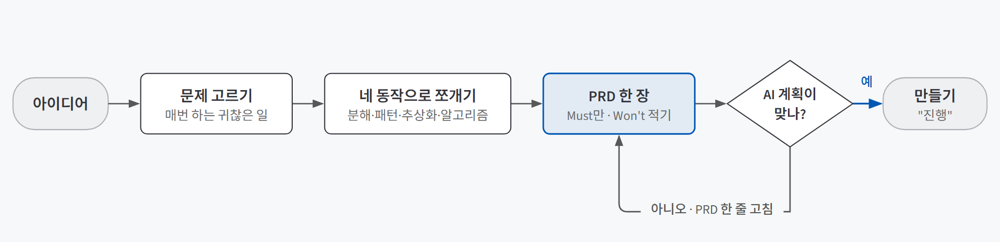
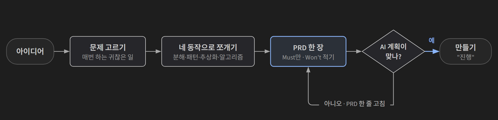
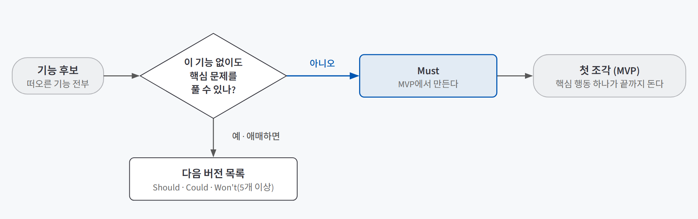
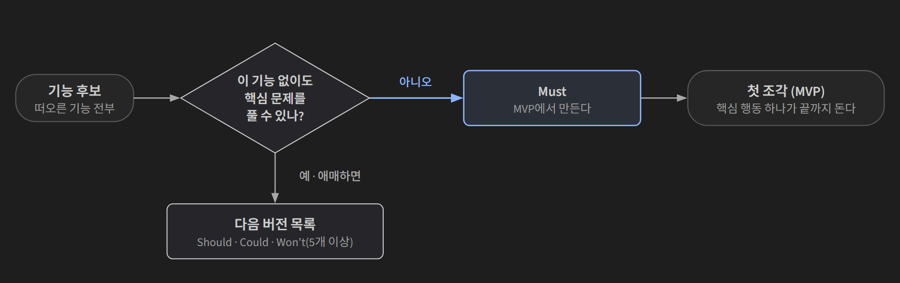

## 한 줄 요약

**AI에게 "만들어 줘"라고 하기 전에, 무엇을 풀지 고르고 잘게 쪼개서 한 장짜리 설계도로 맞춰 두는 일이다.** 이 설계도를 PRD(Product Requirements Document, 제품 요구사항 문서)라고 한다. 무엇을, 누구를 위해, 어떤 규칙으로, 어디까지 만들지 적은 기획서다.

인테리어 공사를 떠올리면 쉽다. 시공팀에 "예쁘게 해 주세요"라고만 하면 시공팀 취향대로 나온다. 어느 벽을 헐고, 무엇을 남기고, 이번 예산으로는 무엇을 안 하는지 적은 도면 한 장을 주면 결과를 도면과 비교할 수 있다. 방향이 틀렸으면 도면 한 줄을 고치면 되지, 다 지은 벽을 다시 부수지 않아도 된다.

AI도 마찬가지다. 코드는 AI가 빠르게 짠다. 그래서 사람이 할 일은 **"무엇을, 어떤 순서로, 어떤 조건에서, 어디까지"를 또렷하게 정해 주는 것**으로 옮겨 간다.

## 필요한 이유

AI에게 일을 통째로 던지면 세 가지 일이 자주 생긴다.

| 생기는 일 | 왜 생기나 | 예 |
|---|---|---|
| **일반론이 돌아온다** | 내 분야의 맥락을 모르니 가장 흔한 답을 준다 | "우리 회사 업무를 AI로 자동화해 줘" → 어느 회사에나 맞는 조언 |
| **방향이 흘러간다** | AI는 대화 전체가 아니라 내 **마지막 한 마디**에 맞춰 움직인다 | 고칠 때마다 다른 데가 바뀌어, 처음 원한 것과 멀어진다 |
| **기능이 너무 많아진다** | 떠오르는 대로 다 시키면 AI는 다 만든다 | 화면은 복잡해졌는데 핵심 흐름 하나도 끝까지 안 돈다 |

같은 AI라도 결과는 달라진다. 차이는 AI 성능이 아니라 **일을 얼마나 잘게 나눠서 줬느냐**다.

- "우리 회사 업무를 AI로 자동화해 줘" → 일반론
- "고객 문의 메일을 세 종류(환불·배송·기타)로 나누고, 환불 건은 처리 기한을 함께 적어서 표로 만들어 줘" → 바로 쓸 수 있는 결과

그리고 더 근본적인 이유가 하나 있다. **규칙을 내가 정하지 않으면, 결과가 맞는지 판정할 기준도 없다.** "테트리스 만들어 줘"는 한 줄로 충분하다. 1984년부터 공유된 규칙이 AI 안에 이미 있어서 이름 자체가 명세서이기 때문이다. 그런데 내 업무 도구나 내가 규칙을 정한 게임에는 그런 공용 이름이 없다. 규칙을 AI에게 맡기면, AI가 규칙을 그럴듯하게 바꿔치기해도 알아챌 방법이 없다.

## 개념과 동작

AI에게 일을 넘기기 전에 네 가지를 순서대로 한다. **고르고, 쪼개고, 자르고, 맞춘다.**

{: .light }
{: .dark }

1. **고른다:** "멋진 기능"이 아니라 내 분야에서 **매번 하는 귀찮은 일**을 고른다.
2. **쪼갠다:** 그 일을 AI가 하나씩 정확히 할 수 있는 조각으로 나눈다.
3. **자른다:** 첫 버전에 꼭 필요한 것만 남기고, 나머지는 "지금은 안 함" 목록으로 보낸다.
4. **맞춘다:** 이걸 PRD 한 장으로 적고, AI에게 바로 만들게 하지 않고 **계획부터** 받는다. 계획이 내 생각과 맞을 때만 "진행"이라고 한다.

핵심은 **사람이 정할 것과 AI에게 맡길 것을 나누는 것**이다.

| 사람이 정한다 | AI에게 맡긴다 |
|---|---|
| 무엇을 풀지, 누구를 위한 것인지 | 어떤 기술(프레임워크, DB)로 만들지의 후보와 근거 |
| 규칙과 끝나는 조건, 예외 상황 | 실제 코드 |
| 첫 버전에서 무엇을 안 할지 | 만들 순서의 초안 |
| 결과가 합격인지 판정할 기준 | 가짜 데이터, 반복 작업 |

기술 선택도 AI가 고르는 게 아니라, AI가 후보를 견줘 근거와 함께 내놓으면 사람이 그 근거가 내 조건에 맞는지 판단한다.

## 적합한 경우와 피할 경우

| 쓰는 게 좋은 경우 | 쓰지 않아도 되는 경우 |
|---|---|
| 새 서비스나 기능의 **첫 버전**을 만들 때 | 이름이 곧 명세인 것 ("테트리스 만들어 줘" 한 줄이면 된다) |
| **공용 이름이 없는 것**을 만들 때 (내 업무 도구, 내가 규칙을 정한 게임) | 한 번 묻고 끝나는 질문이나 초안 |
| 여러 번 고쳐 가며 **오래 쓸** 결과물 | 결과가 틀려도 바로 다시 시키면 되는 가벼운 작업 |
| 결과를 누군가 **합격·불합격으로 판정**해야 할 때 | |

그리고 PRD를 잘 쓴다고 해결되지 않는, **애초에 쪼개서 AI에게 넘기면 안 되는 일**도 있다.

| 쪼개기 어려운 영역 | 예 |
|---|---|
| 본질적으로 창의적인 작업 | 시·소설, 새 콘셉트 발상 |
| 사람 사이의 미묘한 판단 | 환자의 "괜찮아요"를 표정과 맥락에서 읽기 |
| 정답 없는 가치 판단 | 승진 대상자 결정, 치료 우선순위, 변론 전략 |

"신입을 평가해서 누구를 승진시킬지 정해 줘"는 위험한 요청이다. 이런 일은 판단을 돕는 자료 정리(객관 지표 표)까지만 AI에게 맡기고, 최종 판단과 책임은 사람이 진다.

## 장점과 한계

| 장점 | 한계 |
|---|---|
| 방향이 틀리면 문서 한 줄만 고치면 된다. 수백 줄 코드를 되돌릴 필요가 없다 | 첫 시도는 거칠다. 두세 번 고쳐 써야 또렷해진다 |
| 규칙을 내가 정했으니 AI가 규칙을 바꿔치기했는지 **판정할 기준**이 내 손에 있다 | 너무 잘게 쪼개면 조각을 다시 잇는 일이 늘어난다 |
| 작아도 끝까지 굴러가는 첫 버전이 빨리 나온다. 써 보면서 배우고 고칠 수 있다 | 너무 많이 자르면 사용자가 원한 결과를 하나도 끝낼 수 없다 |
| PRD가 나중에 기능을 붙일 때의 길잡이가 된다 | PRD가 있어도 AI가 그대로 만들었는지는 **직접 써 보고** 확인해야 한다 |

## 적용 방법

### 1단계. 내 분야의 아픈 문제를 고른다

출발점은 "어떤 AI 기능이 멋질까?"가 아니라 **"내 분야에서 가장 아픈 문제가 뭐였지?"**다. 기준은 **자주 반복되고, 시간을 많이 잡아먹는 일**이다.

같은 기능이라도 출발점이 다르면 다른 물건이 나온다. 범용 회의록 요약기는 내용을 고르게 줄이지만, 그 일을 해 본 사람은 **누가 무엇을 언제까지** 하기로 했는지만 뽑는 도구를 만든다. 현장에서 살아남는 건 두 번째다. 106개 실험을 종합한 연구(Vaccaro 등, 2024)에서도 사람과 AI를 합친 이득은 **사람이 AI보다 잘하는 영역일수록** 컸다. 내 분야를 아는 눈이 있어야 AI와 함께 일하는 의미가 생긴다.

AI에게 후보를 먼저 받아도 되지만, 그 답이 내 분야의 우선순위와 맞는지는 **내가 채점한다.**

### 2단계. 네 동작으로 쪼갠다

고른 문제를 AI가 풀 수 있는 조각으로 나눈다. 이 방법을 **컴퓨팅 사고법**(Computational Thinking)이라고 한다.

| 동작 | 하는 일 | 기준 |
|---|---|---|
| **분해** | 큰 일을 작은 조각으로 나눈다 | 한 사람이 한 시간 안에 시작할 수 있는 크기까지 |
| **패턴 인식** | 조각 사이에서 반복되는 것을 찾는다 | 같은 형식이면 하나의 해결책으로 묶는다 |
| **추상화** | 본질만 남기고 세부는 버린다 | "급한", "적당히" 같은 말을 **셀 수 있는 기준**으로 바꾼다 |
| **알고리즘** | 푸는 순서를 정한다 | 입력부터 출력까지 화살표로 적는다 |

실습에서는 내 업무(대외협력)의 언론보도 수집으로 해 봤다.

| 동작 | 내가 쪼갠 내용 (요약) |
|---|---|
| 분해 | 검색어 관리 / 기사 정보 수집 / 중복 제거 / 요약·키워드 / 카테고리·우선순위(상·중·하) 태깅 |
| 패턴 인식 | 소송·리콜·제재 같은 부정어가 자사 언급과 붙으면 "상" 후보 / 같은 이슈를 여러 언론사가 보도하면 한 건으로 묶는다 |
| 추상화 | **"급한 기사다"라는 느낌을 "카테고리 + 부정어·정책어 사전 + 언급 대상" 조합의 규칙으로** 바꿨다 |
| 알고리즘 | 검색어 순회 → 수집 → 중복 제거 → 요약 → 태깅 → 엑셀 저장 |

핵심은 추상화다. 판단을 규칙으로 적으려면 내가 무엇을 보고 그렇게 판단하는지부터 말로 꺼내야 한다. **감을 규칙으로 못 옮기면 AI도 못 옮긴다.** AI에게 넘길 때는 **누가 어떤 기준으로 합격을 판단하는지**(검증 기준)까지 적는다. 이 칸은 그 분야를 아는 사람만 채울 수 있고, 가장 자주 빠지는 칸이기도 하다.

### 3단계. 한 문장으로 정의하고, 범위를 자른다

서비스를 **"[누가] [어떤 상황에서] [무엇을 못 해서] [어떤 불편]을 겪는다"** 한 문장으로 쓴다. 사용자는 한 사람으로 좁히고, "앱으로", "AI로" 같은 수단은 뺀다. 한 문장으로 안 써지면 범위가 아직 넓다는 신호다.

그다음 기능마다 **"이 기능 없이도 사용자가 핵심 문제를 풀 수 있나?"**를 묻고, 풀 수 있으면 다음 버전으로 보낸다.

{: .light }
{: .dark }

남은 첫 버전이 **MVP**(핵심 한 가지를 처음부터 끝까지 할 수 있는 가장 작은 작동 버전)다. 나눌 때는 **MoSCoW** 네 칸을 쓴다.

| 칸 | 뜻 | MVP에서는 |
|---|---|---|
| **M**ust | 꼭 있어야 한다 | **이것만 만든다** |
| **S**hould · **C**ould | 있으면 좋다 · 나중에 | 다음 버전 |
| **W**on't | 지금은 안 한다 | **일부러 적어 둔다** |

AI와 일하면 "이것도 넣을까?"가 쉬워져서 기능이 슬금슬금 는다(**스코프 크립**). Won't 목록이 있어야 "이번엔 안 하기로 했다"고 말할 근거가 생긴다. 반대로 너무 잘라서 핵심 흐름이 끝까지 안 굴러간다면 지나치게 자른 것이다.

### 4단계. PRD 한 장을 AI와 함께 쓴다

초안은 AI와 잡는다. 아이디어가 흐릿하면 **인터뷰**(AI가 하나씩 되묻게 하기) → **추천**(기술 후보 3개 이상을 장단점과 함께) → **정리**(PRD로 문서화) 순으로 대화한다. 추천을 받을 때는 근거와 "내 조건에도 맞는지"를 한 번 더 묻는다.

| 항목 | 질문 |
|---|---|
| 무엇을 · 누가 | 한 문장 문제 정의, 첫 버전의 사용자 |
| 규칙 · 끝나는 조건 | 무엇을 하면 무엇이 바뀌나, 언제 완료인가 |
| **예외 상황** | 빈 입력, 네트워크 실패, 같은 버튼을 두 번 누르면? |
| **안 만들 것** | Won't 목록 |

예외 상황을 꼭 적는다. AI는 "모든 게 정상인 경우"만 만들기 쉽다. 그리고 PRD에는 **어떤 기술로 만들지를 적지 않는다.** 무엇을 만들지는 사람이 정하고, 어떻게 만들지는 AI가 후보를 견줘 근거와 함께 고르게 한다.

### 5단계. 계획부터 받고, "진행"이라고 하면 만들게 한다

PRD를 주고 바로 코드를 받지 않는다. **"바로 만들지 말고 순서와 내가 정할 것부터 알려 줘. 맞으면 '진행'이라고 할게"**처럼 계획을 먼저 받는다. 계획이 틀렸으면 PRD 한 줄만 고치면 된다. 코드가 수백 줄 생긴 뒤에 방향을 바꾸는 것보다 훨씬 싸다. 이렇게 문서로 먼저 합의하고 만드는 방식을 **스펙 주도 개발**이라고 한다.

결과를 고칠 때는 해법이 아니라 **관찰한 문제**를 말한다("어디서 · 무슨 문제가 · 어떻게 되면 좋겠다"). 해법을 추측해 지정하면 틀린 추측도 AI가 그대로 따른다. 범위는 문제 있는 곳으로 좁히고, 고쳤다는 말 대신 **직접 써 보고** 확인한다.

## 다른 방법과 비교

| 방법 | 시작 속도 | 방향 유지 | 한 줄 평가 |
|---|---|---|---|
| 한 줄로 "○○ 만들어 줘" | 가장 빠름 | 낮음 | 이름이 곧 명세인 것(테트리스)에만 통한다 |
| 대화하며 그때그때 고치기 | 빠름 | 낮음 | AI가 마지막 한 마디에 맞춰 움직여 방향이 흘러간다 |
| 스펙 도구로 문서 여러 장 (OpenSpec 등) | 느림 | 높음 | 제안서·설계·요구사항·작업 목록이 변경 단위로 남는다. 서비스가 커지면 이쪽으로 간다 |
| **PRD 한 장 + 계획 먼저** | 보통 | 높음 | 첫 버전에 맞는 무게다. 틀리면 문서 한 줄을 고친다 |

## 주의할 점

**스코프 크립은 진보처럼 느껴진다.** "고객이 원해서", "경쟁사에 있어서", "하루면 된다길래" 같은 이유로 기능이 하나씩 붙는다. 하나하나는 합리적으로 보이지만, 쌓이면 핵심 흐름 하나도 끝까지 안 도는 서비스가 된다. 새로 떠오른 기능은 바로 만들지 말고 다음 버전 목록에 적는다. AI에게 기능 12개를 한꺼번에 요청하는 것도 같은 함정이다.

그 밖에 기억할 것:
- **문제 문장에 해결책을 넣는다.** "AI로 자동화해서 ~"로 시작하면 다른 방법을 비교할 여지가 사라진다.
- **검증 기준을 적지 않는다.** 결과가 나와도 맞는지 판정할 수 없다.
- **AI의 답이 매끄러우면 맞는 줄 안다.** 그럴듯함과 정확함은 다르다. 특히 숫자·기한·조건을 흔한 값으로 채워 넣는 경우를 의심한다. 환불 안내문을 부탁했더니 "구매일로부터 30일 이내 언제든 전액 환불, 별도 사유 없이 즉시 처리"라고 썼다면, 실제 규정(예: 7일, 개봉 시 불가)과 다를 수 있고, 예외(단순 변심과 하자의 구분)가 통째로 빠졌고, "즉시 처리"라는 단정은 분쟁 때 회사를 묶는다.
- **AI의 추천을 그대로 받는다.** 후보가 하나뿐이거나 근거가 없거나 내 조건을 안 담았으면 다시 묻는다.
- **너무 많이 자른다.** 첫 버전이 작아도, 사용자가 핵심 행동 하나는 처음부터 끝까지 할 수 있어야 한다.

## 용어 정리

| 용어 | 뜻 |
|---|---|
| PRD (Product Requirements Document) | 무엇을, 누구를 위해, 어떤 규칙으로, 어디까지 만들지 적은 한 장짜리 기획서 |
| 컴퓨팅 사고법 | 큰 문제를 분해·패턴 인식·추상화·알고리즘 네 동작으로 쪼개는 사고법 |
| MVP (Minimum Viable Product) | 사용자가 핵심 한 가지를 처음부터 끝까지 할 수 있는 가장 작은 작동 버전 |
| MoSCoW | 기능을 Must(꼭) / Should(있으면 좋음) / Could(나중에) / Won't(지금은 안 함)로 나누는 방법 |
| 스코프 크립 | 기능이 하나씩 슬금슬금 늘어 끝이 안 보이게 되는 것 |
| 스펙 주도 개발 | 만들 내용을 문서로 먼저 합의하고, 그 문서대로 만드는 방식 |

---

→ 이 개념을 검증한 프로젝트: [PRD 먼저 쓰고 AI와 만들기 검증 — 유튜브 채널 카테고리 서비스로 확인한 세 가지](/posts/youtube-channel-category/)
