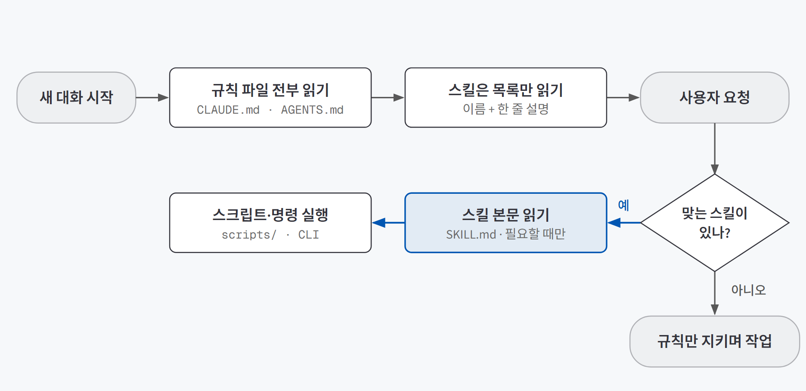
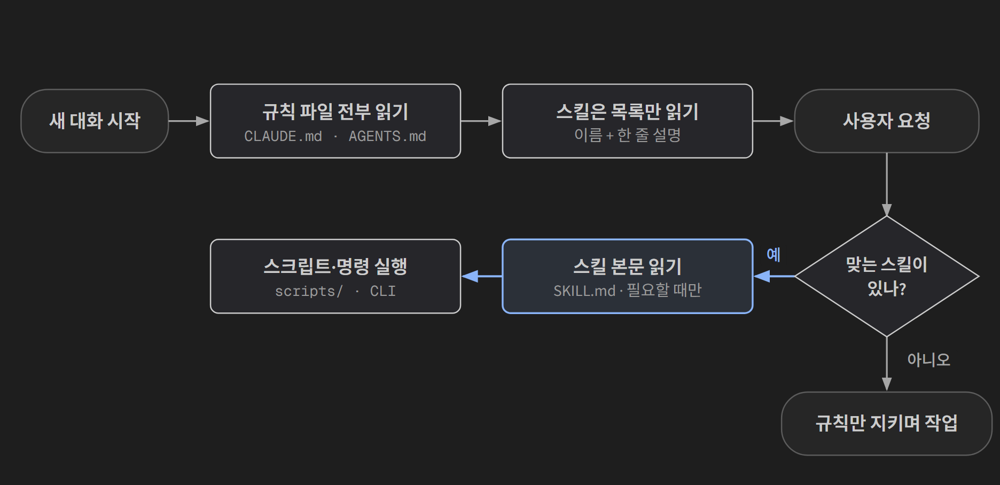
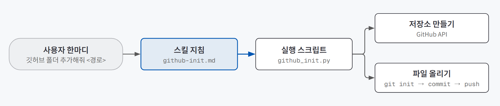
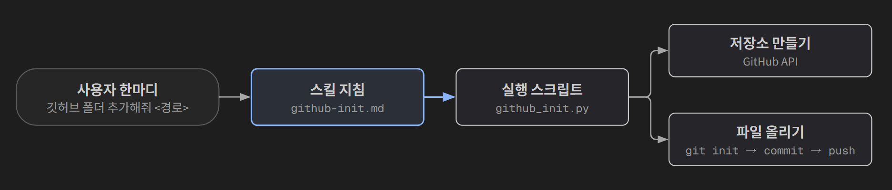

## 한 줄 요약

**코딩 에이전트에게 매번 하던 설명을 파일로 적어 두는 방법이다.** 프로젝트에서 늘 지켜야 할 안내는 **규칙 파일**(CLAUDE.md·AGENTS.md)에, 가끔 하지만 순서가 정해진 작업은 **스킬**(SKILL.md)에 적는다.

여기서 **코딩 에이전트**는 말로 지시하면 직접 파일을 만들고 고치고 명령을 실행하는 AI 도구를 말한다. Claude Code, Codex CLI, Cursor 같은 도구가 여기에 속한다. 일반 챗봇은 코드를 보여 주기만 하지만, 코딩 에이전트는 내 컴퓨터의 파일을 실제로 바꾼다.

새로 온 직원을 떠올리면 쉽다. 사무실 벽에는 "출입증은 항상 패용, 서버실 문은 닫아 둘 것" 같은 **안내문**이 붙어 있다. 누구나 매일 본다. 반면 "분기 결산 하는 법"은 **서랍 속 매뉴얼**에 있다. 평소엔 제목만 알고 있다가 결산할 때 꺼내 읽는다. 규칙 파일이 벽의 안내문이고, 스킬이 서랍 속 매뉴얼이다.

## 필요한 이유

코딩 에이전트는 대화가 끝나면 앞에서 들은 걸 잊는다. 새 대화를 열 때마다 이런 말을 다시 해야 한다.

- "이 프로젝트는 `npm run dev`로 실행해."
- "데이터 파일(todo.db)은 직접 지우지 마."
- "화면 문구는 존댓말로 써."

같은 말을 반복하는 것 자체도 번거롭지만, 더 큰 문제는 **매번 조금씩 다르게 말하게 된다**는 점이다. 어느 날은 "존댓말로"를 빠뜨리고, 어느 날은 "todo.db는 건드리지 마"를 빠뜨린다. 그날 빠뜨린 규칙은 그날 결과물에서 깨진다. 결과가 들쭉날쭉한 원인이 AI가 아니라 **내 설명이 들쭉날쭉했기 때문**인 경우가 많다.

반대로 한 대화에 모든 설명을 계속 쌓아 두는 것도 답이 아니다. 대화가 길어지면 AI는 앞에서 정한 것을 놓치고 없는 파일 이름을 지어내기 시작한다. 이를 **컨텍스트 부패**(context rot)라고 부른다. 그래서 설명은 대화가 아니라 **파일**에 남겨야 한다. 대화를 새로 시작해도 파일은 그대로 남기 때문이다.

## 개념과 동작

코딩 에이전트는 **모델**(답을 내는 AI 자체)과 **하네스**(그 모델이 파일을 읽고 명령을 실행하게 해 주는 실행 환경)로 나눠 볼 수 있다. 규칙 파일과 스킬은 하네스 쪽에 덧붙이는 장치다. 모델을 바꾸지 않고도 "이 프로젝트를 아는 조수"로 만들 수 있다.

둘의 가장 큰 차이는 **언제 읽히는가**다.

{: .light }
{: .dark }

- **규칙 파일**은 대화를 시작할 때마다 **처음부터 끝까지 전부** 읽힌다. 프로젝트 루트에 두는 마크다운 파일 하나이고, "에이전트를 위한 README"라고 생각하면 된다.
- **스킬**은 평소에 **이름과 한 줄 설명만** 읽힌다. 스킬 하나당 약 30~50토큰(AI가 글을 읽는 단위) 정도다. 사용자 요청이 그 설명과 맞을 때만 본문 전체를 읽고, 필요하면 스킬에 딸린 스크립트를 실행한다. 이렇게 필요할 때만 펼쳐 보이는 방식을 **점진 공개**(progressive disclosure)라고 한다.

그래서 스킬은 수십 개를 켜 둬도 부담이 거의 없지만, 규칙 파일은 한 줄 한 줄이 매 대화의 비용이 된다.

비슷한 자리에 하나가 더 있다. AI를 내 데이터나 외부 서비스(DB, 노션, 캘린더 등)에 연결하는 **MCP**(Model Context Protocol, AI와 도구를 잇는 연결 표준)다. 셋은 경쟁 관계가 아니라 역할이 다르다.

| 내가 원하는 것 | 무엇을 쓰나 | 비유 |
|---|---|---|
| AI가 **항상** 이런 식으로 행동하게 하고 싶다 | 규칙 파일 (CLAUDE.md / AGENTS.md) | 벽에 붙은 안내문 |
| **반복하는 다단계 작업**을 한마디로 시키고 싶다 | 스킬 (SKILL.md) | 서랍 속 매뉴얼 |
| AI에게 **새 연결**(내 DB, 외부 서비스)을 주고 싶다 | MCP | 장비를 꽂는 어댑터 |

## 적합한 경우와 피할 경우

| 쓰는 게 좋은 경우 | 쓰면 안 되는 경우 |
|---|---|
| 새 대화마다 **같은 설명을 반복**하고 있을 때 | 한 번 하고 끝날 일 (그냥 대화에서 말하면 된다) |
| 실행 명령, 폴더 구조, 금지 사항처럼 **프로젝트 내내 바뀌지 않는 정보** | 오늘만 해당하는 지시 ("이번엔 버튼 색만 바꿔") |
| 순서가 정해진 작업을 **여러 번** 할 때 (배포, 저장소 연결, 보고서 형식 맞추기) | 매번 판단이 달라지는 작업 (순서를 미리 적을 수 없다) |
| 여러 사람이나 여러 도구가 **같은 기준**으로 작업해야 할 때 | 규칙을 아직 정하지 못했을 때 (틀린 규칙이 매 대화에 퍼진다) |

규칙 파일과 스킬 중 무엇을 쓸지 헷갈리면 이렇게 가른다.

| 질문 | 예 → | 아니오 → |
|---|---|---|
| 이 프로젝트에서 **모든 작업**에 해당하는가? | 규칙 파일 | 다음 질문 |
| **특정 작업**을 할 때만 필요한가? | 스킬 | 대화에서 그때그때 말한다 |
| 순서가 정해져 있고 **명령이나 스크립트**로 끝낼 수 있는가? | 스킬 + 스크립트 | 스킬 본문에 지침만 적는다 |

## 장점과 한계

| 장점 | 한계 |
|---|---|
| 대화를 새로 시작해도 설명이 유지된다 | 규칙 파일은 매 대화에 전부 읽히므로, 길어질수록 비용이 쌓이고 중요한 규칙이 묻힌다 |
| 같은 지시가 늘 같은 문장으로 들어가니 결과가 덜 흔들린다 | AI가 스킬을 꺼낼지 말지를 **설명 한 줄**만 보고 정한다. 설명이 흐리면 안 불린다 |
| 스킬은 수십 개를 켜 둬도 부담이 적다 | 도구마다 읽는 파일 이름이 다르다 (Claude Code는 CLAUDE.md만 자동으로 읽는다) |
| 파일이라 git으로 버전 관리하고 팀과 나눌 수 있다 | 스킬은 "지시문 + 실행 코드"라, 출처를 모르는 스킬을 켜면 내 컴퓨터에서 남의 코드가 돈다 |

## 적용 방법

### 1단계. 반복하는 설명을 나눈다

지난 대화에서 **두 번 이상 한 말**을 모아 두 갈래로 나눈다. 모든 작업에 해당하는 것(프로젝트 개요, 실행·테스트 명령, 지킬 규칙, 하지 말 것)은 **규칙 파일**로, "저장소를 새로 만들 때는 이 순서로" 같은 **특정 작업의 순서**는 **스킬**로 보낸다.

### 2단계. 규칙 파일은 짧게, 명령어 먼저 쓴다

프로젝트 루트에 `CLAUDE.md`(또는 `AGENTS.md`)를 둔다.

| 칸 | 담는 것 |
|---|---|
| 개요 | 무엇을 하는 프로젝트인지 한두 줄 |
| 명령 | 실행·테스트 명령. 설명보다 앞에 둔다 |
| 규칙 | 폴더 구조, 데이터 위치, 말투·코드 스타일 |
| 하지 말 것 | 실데이터 삭제처럼 되돌릴 수 없는 일 |

`AGENTS.md`는 여러 코딩 도구가 함께 읽는 공통 이름이지만 **Claude Code는 `CLAUDE.md`만 자동으로 읽는다.** 내용은 `AGENTS.md`에 쓰고 `CLAUDE.md`에는 불러오기 한 줄(`@AGENTS.md`)만 두면 둘 다 맞출 수 있다. Next.js로 만든 프로젝트에는 이 구조가 처음부터 들어 있었다.

만든 뒤에는 **새 대화**에서 "이 프로젝트 어떻게 실행해?"라고 물어, 적어 둔 명령이 돌아오는지 확인한다.

### 3단계. 반복 작업을 스킬로 만들고, 실제 일은 스크립트에 맡긴다

스킬은 `.claude/skills/<이름>/SKILL.md` 폴더 하나다. 맨 위 머리말에 이름과 **`description`**, 그 아래 지시를 쓴다. 가장 공들일 곳은 `description` 한 줄이다. AI는 평소 이 한 줄만 보다가 요청과 맞을 때 본문을 연다. 그래서 무엇을 하는지보다 **언제 쓰는지**, 사용자가 실제로 할 말("깃허브 초기설정해줘 <폴더>")을 적는다.

스킬이 일을 직접 다 하기보다 **검증된 스크립트를 불러 주게** 만드는 편이 안정적이다. AI가 매번 코드를 새로 짜지 않기 때문이다. 직접 만든 저장소 연결 스킬이 이 구조다.

{: .light }
{: .dark }

본문은 "`scripts/github_init.py`를 실행한다"와 오류 안내 정도이고, 폴더·git·토큰 확인부터 저장소 생성과 push까지는 스크립트가 순서대로 하다가 실패하면 멈춘다. 정해진 스크립트를 부르기만 하므로 머리말의 `model`에 가벼운 모델을 지정했다.

### 4단계. 불려야 할 때만 불리는지 확인한다

스킬을 처음 만들면 도구를 재시작해야 인식된다. 설명에 적은 문장으로 한 번, **비슷하지만 다른 요청**으로 한 번 요청해 본다. 너무 안 불리면 설명에 예시 문장을 보태고, 너무 자주 불리면 "이럴 때만"을 좁힌다.

### 5단계. 위험한 명령은 사람이 승인한다

규칙 파일과 스킬이 생기면 AI가 직접 실행하는 명령이 늘어난다. 권한 설정은 도구마다 이름이 달라도 대체로 네 단계다.

| 단계 | 동작 | 언제 |
|---|---|---|
| 매번 확인 | 파일 수정, 명령 실행 전마다 묻는다 | 처음 쓸 때, 중요한 폴더 |
| 편집만 자동 | 파일 수정은 바로, 명령 실행은 묻는다 | 익숙해진 프로젝트 |
| 위험한 것만 확인 | 삭제·배포 같은 것만 묻는다 | 되돌릴 지점(커밋)이 있을 때 |
| 아무것도 안 물어봄 | 전부 자동 | 버려도 되는 실험 환경에서만 |

규칙 파일에 "지우지 말 것"을 적어 둬도 **마지막 문지기는 사람**이다. 실습에서도 실데이터 삭제를 시켜 보고 승인 창에서 거부해 확인했다.

## 다른 방법과 비교

| 방법 | 설명이 유지되나 | 비용 | 한 줄 평가 |
|---|---|---|---|
| 대화마다 직접 설명 | ❌ | 매번 손이 든다 | 한 번 하고 끝날 일에는 이게 제일 낫다 |
| 긴 대화 하나에 계속 쌓기 | 대화 안에서만 | 갈수록 커진다 | 길어지면 앞의 규칙을 놓친다 (컨텍스트 부패) |
| **규칙 파일** | ✅ | 매 대화에 전부 읽힌다 | 늘 지킬 것만, 짧게 |
| **스킬** | ✅ | 평소엔 설명 한 줄 | 특정 작업의 순서를 외워 둔다 |
| MCP | ✅ (연결이 유지됨) | 연결한 도구 설명을 미리 읽는다 | 규칙이 아니라 **새 연결**을 줄 때 |
| 플러그인 | ✅ | 켠 만큼 | 스킬·명령·MCP 설정을 한 꾸러미로 묶어 팀에 나눌 때 |

규칙 파일과 스킬은 하네스를 강하게 만드는 여러 방법 중 가장 가벼운 것이다. 하네스 전체를 설계하는 일, MCP로 외부 도구를 잇는 일, 에이전트에게 줄 도구를 설계하는 일은 뒤 과정에서 따로 정리한다.

## 주의할 점

**스킬은 생각보다 큰 권한을 가진다.** 저장소 연결 스킬을 다시 읽어 보다가 구멍을 하나 찾았다. 스크립트가 저장소를 **공개**로 만들고 `git add .`로 폴더 안의 모든 파일을 올린다. 대상 폴더에 `.gitignore`(올리지 않을 파일 목록)가 없으면 API 키가 든 `.env` 파일까지 공개 저장소에 올라갈 수 있다. 스킬 한마디로 5분 걸리던 일이 20초로 줄었지만, 그만큼 **실수도 20초 만에** 퍼진다. 되돌릴 수 없는 동작(공개 게시, 비밀 파일 업로드)이 있는 스킬에는 실행 전 확인 단계를 넣어야 한다. 이 경우라면 `.gitignore`가 있는지 먼저 검사하거나, 공개 여부를 한 번 묻는 단계다.

그 밖에 기억할 것:
- **Claude Code는 `AGENTS.md`를 자동으로 읽지 않는다.** `CLAUDE.md`에 `@AGENTS.md`를 적어 불러온다.
- **스킬 폴더를 처음 만들면 도구를 재시작**해야 인식된다. "스킬이 안 불린다"의 첫 번째 원인이다.
- **규칙 파일이 길어지면 중요한 줄이 묻힌다.** 매 대화에 전부 읽히니, 특정 작업에만 필요한 내용은 스킬로 옮긴다.
- **틀린 규칙은 매 대화에 퍼진다.** 대화에서 한 번 틀린 말은 그 대화에서 끝나지만, 규칙 파일에 적힌 틀린 말은 고칠 때까지 모든 작업에 들어간다.
- **남이 만든 스킬은 열어 보고 쓴다.** 스킬은 지시문과 실행 코드를 함께 담고 있어서, 켜는 순간 내 계정과 파일에 접근할 수 있다.
- **승인 창에 습관적으로 "예"를 누르지 않는다.** 중요한 폴더에서는 자동 승인을 켜지 않고, 위험한 작업 전에는 커밋으로 되돌릴 지점을 만든다.

## 용어 정리

| 용어 | 뜻 |
|---|---|
| 하네스 | 모델을 감싸서 파일 읽기·명령 실행·반복을 할 수 있게 해 주는 실행 환경 |
| 규칙 파일 (CLAUDE.md / AGENTS.md) | 대화를 시작할 때마다 자동으로 전부 읽히는 프로젝트 안내 파일 |
| 스킬 (SKILL.md) | 특정 작업의 방법을 적어 둔 폴더. 평소엔 이름과 설명만 읽히고, 필요할 때 본문이 열린다 |
| 점진 공개 | 목록만 먼저 보여 주고, 필요할 때만 본문을 펼치는 방식 |
| description | 스킬 머리말의 한 줄 설명. AI가 스킬을 꺼낼지 말지를 이 줄로 판단한다 |
| MCP | AI를 내 데이터·외부 서비스에 연결하는 표준 |
| 컨텍스트 부패 | 대화가 너무 길어져 AI가 앞에서 정한 것을 놓치는 현상 |

---

→ 이 개념을 검증한 프로젝트: [PRD 먼저 쓰고 AI와 만들기 검증 — 유튜브 채널 카테고리 서비스로 확인한 세 가지](/posts/youtube-channel-category/)
