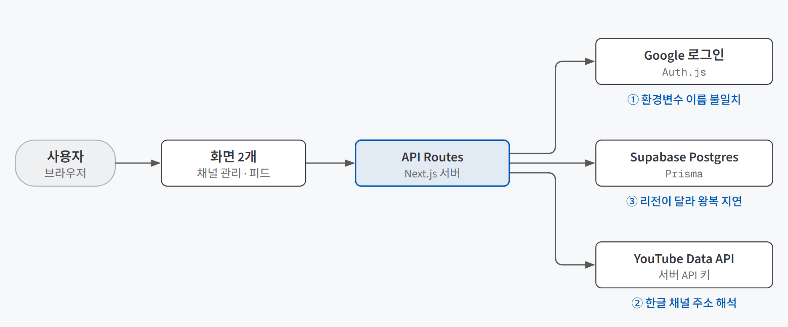
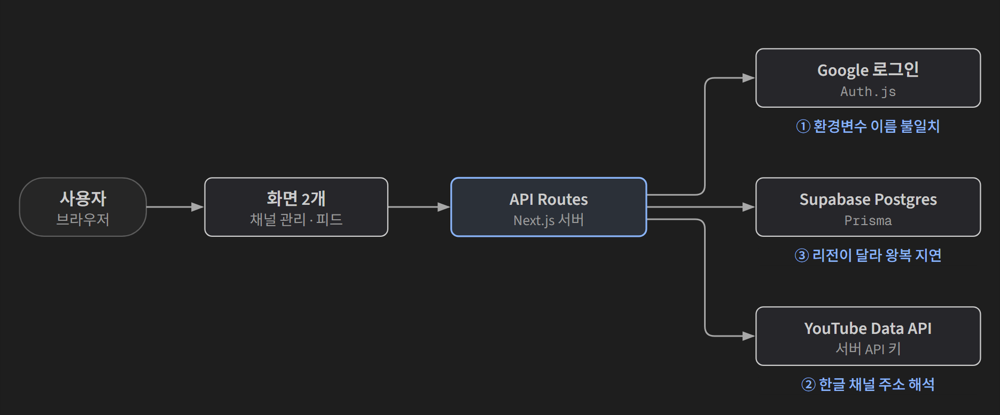

## 한 줄 소개

**PRD(무엇을·왜 만들지 적은 기획서)를 먼저 쓰고 코딩 에이전트와 함께 만들면 실제로 범위가 지켜지는지 확인하려고, 유튜브 채널 카테고리 서비스를 하루 만에 만들어 검증했다.** 관심 있는 유튜브 채널을 내가 정한 카테고리(AI, 영화 등)로 묶고, 카테고리를 고르면 그 채널들의 새 영상만 모아 보여 주는 서비스다.

저장소: [beginner-driver/Main_Quest_1](https://github.com/beginner-driver/Main_Quest_1)

> **검증한 것:** "이번엔 안 만들 것" 목록으로 범위 지키기 ✅ · 규칙을 화면이 아니라 서버·DB에 두기 △ · 규칙 파일(CLAUDE.md)의 효과 △
>
> **발견한 것:** 버그는 전부 바깥 서비스와 만나는 경계에서 나왔다 · 배포 환경에서만 생기는 비용이 있다
{: .prompt-tip }

## 만든 이유

[AI에게 맡기기 전에 — 풀 문제를 고르고 PRD 한 장으로 정하기](/posts/problem-selection-prd/)와 [코딩 에이전트의 규칙 파일과 스킬](/posts/coding-agent-skills-rules/)를 배우고 나서 세 가지가 궁금했다.

1. PRD에 **"이번엔 안 만들 것"**을 적어 두면, 무엇이든 금방 만들어 주는 AI와 일할 때도 범위가 지켜질까?
2. "중복 금지", "본인 데이터만 보기" 같은 규칙을 **화면이 아니라 서버·DB에서** 지키게 만들 수 있을까?
3. 코딩 에이전트에게 주는 **규칙 파일(CLAUDE.md)**은 실제로 어디까지 실수를 막아 줄까?

실험 대상으로는 유튜브를 쓰며 겪던 불편을 골랐다. 유튜브에서 챙겨 보는 채널이 많아지면 관심사가 홈 화면에 뒤섞여 새 영상을 놓친다. 유튜브에는 **채널을 내 기준으로 묶어 새 영상만 모아 보는 기능이 없다.** 이론에서 배운 "좋은 첫 문제"의 조건에도 맞았다.

| 좋은 첫 문제의 조건 | 이 서비스에서는 |
|---|---|
| 내가 직접 겪는 불편 | 유튜브 홈 화면에서 직접 겪는 일이다 |
| 한 문장으로 쓸 수 있다 | "챙겨 보는 채널이 많아지면 관심사가 섞여서 새 영상을 놓친다" |
| 핵심 행동이 하나다 | 카테고리를 고르면 그 채널들의 새 영상이 모인다 |

## 실험 설계

### 서비스 구조

{: .light }
{: .dark }

1. Google 계정으로 로그인한다. 로그인은 **누구의 데이터인지 구분하는 용도**로만 쓰고, 유튜브 구독 목록 같은 민감한 권한은 요청하지 않는다.
2. **채널 관리 화면**에서 채널 주소를 붙여 넣어 등록하고, 채널마다 카테고리를 하나 붙인다.
3. **카테고리 피드 화면**에서 카테고리를 고르면 그 채널들의 최신 영상이 모인다.
4. 영상마다 하트(즐겨찾기)를 누를 수 있고, 영상을 클릭하면 "확인함" 표시가 자동으로 붙는다.

그림의 파란 글씨 ①②③은 만드는 도중에 실제로 깨진 지점이다. 아래 결과에서 다룬다.

### 사용 기술

| 기술 | 어디에 썼나 |
|---|---|
| **Claude Code** | 코딩 에이전트. PRD를 주고 화면·서버·DB 코드를 함께 만들었다 |
| **Next.js** | 화면과 서버 기능(API Routes)을 한 프로젝트에서 만드는 웹 프레임워크. 서버를 따로 둘 필요가 없었다 |
| **Auth.js** | Google 로그인을 붙이는 라이브러리. 직접 회원가입·비밀번호를 만들지 않으려고 썼다 |
| **Supabase(Postgres) + Prisma** | Supabase는 무료로 쓸 수 있는 클라우드 데이터베이스, Prisma는 DB 표를 코드로 정의하고 다루는 도구다 |
| **YouTube Data API v3** | 유튜브가 공개한 데이터 조회 창구. 채널 정보와 최신 영상을 가져온다. 공개 정보만 쓰므로 서버의 API 키 하나로 충분했다 |
| **Vercel** | GitHub 저장소와 연결해 두면 올릴 때마다 자동으로 배포해 주는 서비스 |

### 데이터 구조

PRD에 저장할 데이터를 먼저 정해 두었다. 핵심은 **영상 자체는 저장하지 않는다**는 결정이다. 피드를 열 때마다 유튜브에서 최신 영상을 받아 오므로, DB에는 "이 사용자가 이 영상을 확인했는지, 즐겨찾기 했는지"만 남기면 된다.

| 표 | 담는 것 |
|---|---|
| Category | 사용자별 카테고리 이름 |
| Channel | 사용자별 등록 채널과 소속 카테고리 (없으면 미분류) |
| VideoStatus | 사용자 × 영상별 확인함·즐겨찾기 여부 |

### 판단 기준

이번 검증은 숫자를 재는 실험이 아니라 **만든 기록을 근거로 확인하는 실험**이다. 근거는 세 가지를 썼다.

| 근거 | 무엇을 보나 |
|---|---|
| PRD.md | 만들 것(MVP 기능)과 "이번엔 안 만들 것(향후 확장)" 목록 |
| 커밋 기록 12개 | 무엇이 언제 추가됐고, 무엇이 깨져서 고쳐졌는지 |
| 최종 코드 | 규칙이 화면에 있는지, 서버·DB에 있는지 |

## 검증 결과

| 질문 | 결과 | 근거 |
|---|---|---|
| 1. "안 만들 것" 목록으로 범위 지키기 | ✅ 지켜짐 | 제외 목록 5개 중 만든 것 0개. 추가된 것은 기존 화면의 표시 개선뿐이었다 |
| 2. 규칙을 서버·DB에 두기 | △ 구현은 확인 | 모든 API에 본인 확인 조건과 DB 중복 금지 제약을 넣었다. 다른 계정으로 교차 확인한 기록은 없다 |
| 3. 규칙 파일의 효과 | △ 부분 확인 | 규칙 파일은 적힌 범위(Next.js)만 다뤘고, 적히지 않은 라이브러리(Auth.js)에서 버전 차이 버그가 났다 |

### 질문 1. "안 만들 것"을 적어 두면 범위가 지켜지는가

PRD 마지막에 **"향후 확장 (이번 스코프 제외)"**이라는 이름으로 다섯 가지를 적어 두었다. 이론에서 말한 "지금은 안 함(Won't)" 목록이다.

| 제외한 기능 | 뺀 이유 | 결과 |
|---|---|---|
| 실제 유튜브 구독 목록 자동 가져오기 | 민감한 권한이라 Google 검수가 필요하다 | 만들지 않음 |
| 앱 안에서 구독 취소 | 위와 같은 권한 문제 | 만들지 않음 |
| 영상 주소 직접 저장 (클립보드 감지 포함) | 핵심 흐름(카테고리 → 새 영상)과 무관하다 | 만들지 않음 |
| 어디까지 봤는지 재생 위치 추적 | 임베드 플레이어가 필요해 범위가 커진다 | 만들지 않음 |
| AI·MCP 기반 확장 | 첫 조각에 필요 없다 | 만들지 않음 |

**다섯 개 모두 끝까지 만들지 않았다.** 첫 구현 커밋 이후 1시간 반 동안 커밋이 10개 더 쌓였지만, PRD 밖에서 새로 생긴 것은 세 가지였다.

- 피드에 영상 썸네일과 유튜브 바로가기 링크
- 피드에 영상 길이 표시
- 로그인 전 화면의 서비스 설명과 1~3단계 안내

모두 **이미 있는 두 화면을 보기 좋게 만드는 일**이었고, 새 화면이나 새 데이터 표는 하나도 늘지 않았다. AI는 시키면 무엇이든 금방 만들어 주기 때문에 "이것도 넣을까?"가 쉬워지는데, 목록에 적어 둔 기능은 결국 하나도 들어오지 않았다. 목록에는 기능 이름만이 아니라 **뺀 이유(Google 검수 필요, 핵심 흐름과 무관 등)**까지 같이 적어 두었다. 구독 목록 가져오기처럼 편의성을 크게 올릴 기능일수록, 이유가 적혀 있어야 나중에 다시 꺼내 들지 않는다.

### 질문 2. 규칙을 화면이 아니라 서버·DB에 둘 수 있는가

이론에서는 "규칙은 화면이 아니라 DB에서 지킨다"고 배웠다. 화면에서 버튼만 막는 건 누구나 우회할 수 있기 때문이다. 이 서비스에는 지켜야 할 규칙이 세 가지 있었다.

| 규칙 | 어디서 지키나 | 어긴 요청이 오면 |
|---|---|---|
| 내 데이터만 보고 고친다 | 모든 API가 로그인 사용자의 id를 조건으로 붙여서 조회·수정·삭제 | 로그인 안 했으면 401, 남의 데이터면 "찾을 수 없음"(404) |
| 같은 이름의 카테고리는 하나만 | DB 표에 "사용자 + 이름" 중복 금지 제약 | DB가 거부하고, 서버가 "이미 같은 이름의 카테고리가 있습니다"(409)로 바꿔 알려 준다 |
| 같은 채널은 한 번만 등록 | DB 표에 "사용자 + 채널 id" 중복 금지 제약 | 새로 만들지 않고 기존 채널을 돌려준다 |

```ts
// 남의 카테고리 id를 보내도, 내 것(userId 일치)이 아니면 지울 대상이 0건이 된다.
const { count } = await prisma.category.deleteMany({
  where: { id, userId: session.user.id },
});
if (count === 0) return NextResponse.json({ error: "카테고리를 찾을 수 없습니다." }, { status: 404 });
```

카테고리 중복 금지는 첫 구현에는 없었고 그 뒤에 추가한 규칙이다. 화면에서 이름을 미리 검사하는 대신 **DB 제약으로 넣었다.** 이렇게 하면 버튼을 두 번 빠르게 눌러도 DB가 하나만 받아 준다.

다만 △로 둔 이유가 있다. 강의에서는 브라우저가 DB에 직접 붙는 구조라 **RLS(행 수준 보안, DB가 행마다 주인을 확인하는 기능)**로 막았다. 이 서비스는 브라우저가 DB에 직접 붙지 않고 서버를 거치는 구조라 RLS 대신 **API마다 조건을 넣는 방식**을 썼다. 이 방식은 API 하나라도 조건을 빠뜨리면 그대로 뚫린다. 코드상으로는 모든 API에 조건이 있지만, **다른 계정으로 로그인해서 앞 사람 데이터가 안 보이는지 직접 확인한 기록은 남기지 않았다.** "모든 API에 조건을 넣었다"는 말은 직접 교차 확인하기 전까지는 코드를 믿는 것에 그친다.

### 질문 3. 규칙 파일은 어디까지 막아 주는가

코딩 에이전트는 프로젝트의 규칙 파일(CLAUDE.md)을 매번 읽고 일한다. 이 프로젝트에서는 **규칙 파일을 직접 쓰지 않았다.** Next.js가 새 프로젝트를 만들 때 자동으로 넣어 주는 경고문 한 단락이 전부였고, 끝까지 바뀌지 않았다.

> 이 Next.js는 네가 아는 버전이 아니다. 코드를 쓰기 전에 설치된 문서를 먼저 읽어라.

결과는 반반이었다.

- **Next.js 쪽에서는 버전 차이 때문에 고친 커밋이 없었다.** 다만 규칙 파일 덕분인지, 원래 문제가 없었던 건지는 이 실험만으로는 가를 수 없다.
- **규칙에 없는 Auth.js에서 정확히 같은 종류의 버그가 났다.** 로그인 키는 환경변수(코드 밖에 따로 두는 설정값)에 `GOOGLE_CLIENT_ID`라는 흔한 이름으로 넣어 두었다. 그런데 이번에 쓴 Auth.js v5는 따로 지정하지 않으면 `AUTH_GOOGLE_ID`라는 이름을 찾는다. 첫 코드는 키를 직접 넘기지 않고 이 기본값에 기대고 있어서, 로그인 키가 빈 채로 Google에 전달됐고 로그인이 `invalid_client` 오류로 막혔다.

```ts
// 수정: 라이브러리가 기본으로 찾는 이름에 기대지 않고, 키를 직접 넘긴다.
Google({
  clientId: process.env.GOOGLE_CLIENT_ID,
  clientSecret: process.env.GOOGLE_CLIENT_SECRET,
}),
```

**규칙 파일은 적힌 범위만 지킨다.** "이 버전은 네가 아는 것과 다르다"는 경고는 Next.js에만 걸려 있었고, 버전마다 사용법이 달라지는 라이브러리는 Auth.js, Prisma처럼 더 있었다. 자동으로 생긴 규칙 파일을 그대로 두는 것과 내 프로젝트에 맞게 쓰는 것은 다른 일이다. 다음 프로젝트에서는 "버전이 크게 바뀐 라이브러리 목록"을 규칙 파일에 직접 적어 둘 생각이다.

## 직접 만들며 알게 된 것

### 버그는 전부 바깥 서비스와 만나는 경계에서 나왔다

커밋 기록에서 "고쳤다"고 남은 문제를 모아 보니 세 개였고, 셋 다 **내 코드와 바깥 서비스가 만나는 자리**였다. (카테고리 중복 금지 추가는 버그라기보다 빠진 규칙이라 질문 2에서 다뤘다.)

| 순서 | 경계 | 무엇이 깨졌나 |
|---|---|---|
| ① | 로그인 라이브러리 | 버전마다 다른 환경변수 이름 (질문 3) |
| ② | 사용자 입력 → 유튜브 API | 한글 채널 주소를 해석하지 못함 |
| ③ | 배포 서버 → DB | 서버와 DB의 위치가 달라 요청마다 느려짐 |

②는 영어 예시로만 테스트했다면 끝까지 몰랐을 버그다. 유튜브 채널 주소에 한글 이름(`@채널이름`)이 들어가면, 브라우저에서 복사할 때 `%EC%B1%84...` 같은 **퍼센트 인코딩**(주소에 쓸 수 없는 글자를 숫자로 바꾼 형태)으로 바뀐다. AI가 처음 만든 코드는 영문·숫자로 된 채널 이름만 알아보도록 짜여 있어서 한글 채널은 등록이 안 됐다. 주소를 원래 글자로 되돌린(디코딩) 뒤 해석하게 고쳤고, 입력창에도 되돌린 글자가 바로 보이게 했다.

이걸 고치면서 하나 더 바꿨다. 처음에는 유튜브 API가 실패하면 "400 오류"처럼 **상태 번호만** 보여 줬는데, 이것만으로는 원인을 알 수 없었다. 유튜브가 돌려준 오류 설명까지 메시지에 붙이게 바꿨다. AI가 "모든 게 정상인 경우"만 짠다는 이론의 경고를 실제로 확인한 셈이다.

### 배포 환경에서만 생기는 비용이 있다

로그인 확인 방식도 중간에 바꿨다. 처음 설정은 **요청이 올 때마다 DB에 "이 사람 로그인 상태 맞나?"를 물어보는 방식**이었는데, 배포 서버(Vercel)와 DB(Supabase)가 서로 다른 지역(리전)에 있어서 그 한 번의 왕복이 매번 비쌌다.

로그인 정보를 암호화된 쪽지(JWT) 형태로 브라우저에 들려 보내는 방식으로 바꿔서, 요청마다 DB에 묻는 왕복을 없앴다. 이론에서 "어떤 DB를 쓸지"는 배웠지만 **"DB가 서버와 얼마나 멀리 있는지"가 속도를 좌우한다**는 건 내 컴퓨터에서 돌릴 때는 보이지 않는 문제였다. 다만 얼마나 빨라졌는지는 숫자로 재 두지 않았다.

## 검증 범위와 한계

| 구분 | 내용 |
|---|---|
| **사용자 수** | 나 혼자 써 봤다. 여러 사람이 동시에 쓸 때의 동작은 확인하지 못했다 |
| **본인 데이터 분리** | 두 번째 계정으로 교차 확인한 기록이 없다. |
| **자동 테스트** | 테스트 코드가 없다. 모든 확인은 화면에서 직접 눌러 본 것이다 |
| **커밋 단위** | 이론은 "단계마다 커밋"을 권했지만, 첫 구현 커밋 하나에 PRD·화면·DB·API가 한꺼번에 들어갔다(파일 38개). 그 안에서 무엇이 한 번에 됐고 무엇을 다시 시켰는지는 기록으로 남지 않았다 |
| **유튜브 API 사용량** | 피드를 열 때마다 등록 채널 수만큼 API를 부른다. 유튜브 API에는 하루 사용량 한도가 있는데, 채널이 많아지면 몇 번까지 버티는지는 재 보지 않았다 |
| **속도 개선 폭** | 로그인 확인 방식 변경 전후의 응답 시간을 숫자로 남기지 않았다 |

## 결론

세 질문 중 확실하게 확인한 건 1번이다. **"이번엔 안 만들 것"을 이유와 함께 적어 두면, AI가 무엇이든 금방 만들어 주는 환경에서도 범위가 지켜진다.** 늘어난 것은 기존 화면의 표시 개선뿐이었고, 하루 안에 로그인부터 배포까지 끝까지 굴러가는 첫 조각을 만들 수 있었다.

2번과 3번은 "구현은 됐지만 확인은 덜 됐다"에 가깝다. 대신 그 과정에서 이론에 없던 것을 얻었다. AI가 짠 코드는 **바깥 서비스와 만나는 경계**(라이브러리 버전, 사람이 넣는 입력, 배포 환경)에서 깨졌다. 다음 프로젝트에서는 경계마다 확인할 목록을 먼저 적어 둘 생각이다.
