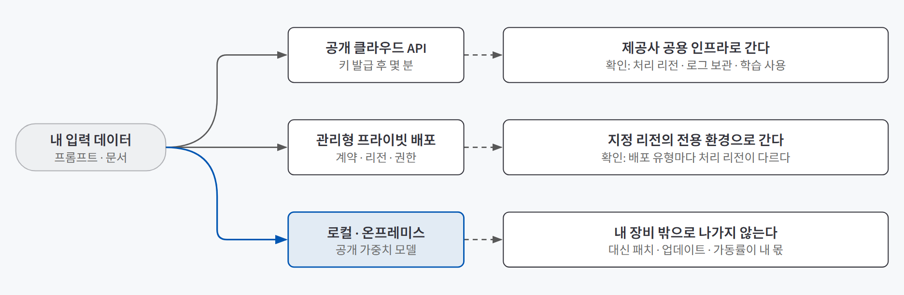
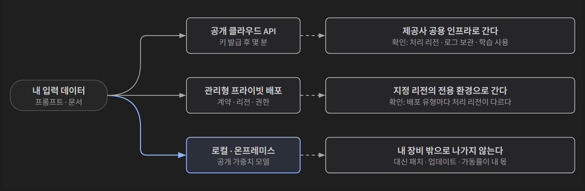
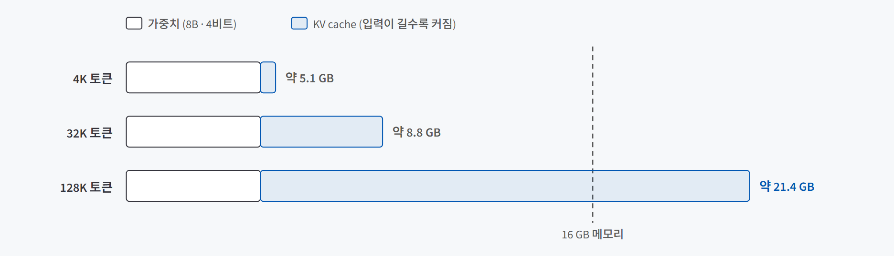
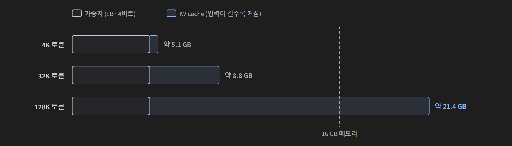

## 한 줄 요약

**LLM을 어디서 돌릴지는 "어느 모델이 똑똑한가"가 아니라 "내 데이터가 어디까지 가고, 돈이 어디서 나가고, 누가 바꾸고 멈출 수 있는가"로 정한다.** 선택지는 공개 클라우드 API, 관리형 프라이빗 배포, 로컬 세 갈래이고, 실무에서 가장 흔한 답은 이 셋을 단계별로 섞는 하이브리드다.

식당에 비유하면 이렇다. 공개 API는 **외식**이다. 메뉴는 가장 좋고 바로 먹을 수 있지만, 재료(데이터)가 남의 주방으로 들어간다. 관리형 프라이빗 배포는 **호텔 연회장 대관**이다. 남의 주방이지만 우리만 쓰는 공간과 계약이 있다. 로컬은 **집밥**이다. 재료가 집 밖으로 나가지 않지만, 장보기와 설거지와 냉장고 고장까지 전부 내 일이다.

## 필요한 이유

LLM 기능을 만들 때 "일단 API 키를 받아 붙이는" 경우가 많다. 시작은 가장 빠르다. 그런데 서비스가 커지면 세 가지 질문이 한꺼번에 돌아온다.

- **데이터:** 고객 상담 원문이나 내부 문서를 외부 서버로 보내도 되는가?
- **비용:** 요청이 늘면 API 요금이 계속 오르는데, 장비를 사서 직접 돌리면 더 싼가?
- **통제권:** 제공사가 모델을 바꾸거나 종료하면, 어제까지 잘 되던 출력 형식이 깨지지 않는가?

반대로 "민감하니까 무조건 로컬"도 답이 아니다. 노트북에서 도는 모델은 최상위 모델보다 품질이 한참 아래이고, 장비·보안 패치·장애 대응이 전부 내 몫이 된다. **어느 한쪽이 항상 옳지 않기 때문에, 업무마다 근거를 남기고 고르는 방법**이 필요하다.

## 개념과 동작

### 실행 위치는 셋이다

"API냐 로컬이냐"의 이분법에서 빠지기 쉬운 세 번째 갈래가 **관리형 프라이빗 배포**다. 클라우드 사업자(예: Azure, AWS의 모델 서비스)가 지정한 리전의 전용 환경에서 모델을 돌려 주는 방식이다.

{: .light }
{: .dark }

| | 공개 클라우드 API | 관리형 프라이빗 배포 | 로컬 · 온프레미스 |
|---|---|---|---|
| 쓸 수 있는 모델 | 그 시점 최고 성능을 가장 먼저 | 사업자 카탈로그 안에서 | 내 하드웨어에 들어가는 공개 가중치 모델 |
| 시작 시간 | 키 발급 후 몇 분 | 며칠~몇 주 (계약, 리전, 권한) | 설치는 몇 분, 하드웨어 조달은 별개 |
| 비용 모양 | 토큰당 종량제 | 종량제 + 관리 비용 | 초기 투자가 크고, 이후 한계비용은 전기값 |
| 데이터가 가는 곳 | 제공사 공용 인프라 | 지정 리전의 전용 환경 | 내 장비 밖으로 안 나감 |
| 어울리는 상황 | 최고 품질이 필요하고 민감도가 낮음 | 규제 산업, 민감 데이터인데 높은 품질도 필요 | 반출 금지, 오프라인, 대량 반복 작업 |
| 주의점 | 리전, 로그 보존, 상태 저장 기능 | "관리형"이 자동으로 안전하다는 뜻은 아님 | 업데이트·보안 패치·가동률이 전부 내 몫 |

이름보다 **데이터 흐름**으로 구분해야 한다. Ollama에서 `qwen3.5:9b`와 `gpt-oss:120b-cloud`는 같은 명령, 같은 화면으로 실행되지만, 앞의 것은 내 컴퓨터에서 돌고 뒤의 것은 Ollama 데이터센터에서 돈다. 로그인을 요구하면 데이터가 밖으로 나가는 길이다.

### 로컬에서 도는 이유: 만드는 것과 쓰는 것은 비용이 다르다

모델을 **만드는**(학습) 데는 수백만 달러가 들지만, **쓰는**(추론) 데는 이미 정해진 숫자 뭉치(파라미터)를 메모리에 올려 읽기만 하면 된다. 파라미터 하나를 감당하는 바이트로 비교하면 차이가 선명하다.

| | 파라미터 하나당 | 7B 모델이면 |
|---|---|---|
| 학습 (혼합 정밀도) | 가중치 2B + 마스터 사본 4B + 옵티마이저 상태 8B + 그래디언트 4B = **18바이트 이상** | 126GB 이상 |
| 추론 | 가중치 2B + KV cache | **14GB 남짓** |

같은 모델인데 아홉 배 가까이 차이 난다. 남는 벽은 하나, **파라미터를 전부 메모리에 올려야 한다**는 점이다. 일부만 올리고 나머지를 디스크에서 읽으면 토큰마다 수 GB를 긁어와야 해서 쓸 수 있는 속도가 안 나온다. Llama 3.1 8B의 FP16 파일은 14.96GB라 흔한 노트북 GPU(8~16GB)에는 빠듯하다.

### 양자화: 정밀도를 깎아 크기를 줄인다

**양자화**는 가중치를 덜 촘촘한 눈금으로 반올림해 저장하는 것이다. 16비트(눈금 65,536개)를 4비트(눈금 16개)로 바꾸면 파라미터 하나가 2바이트에서 0.5바이트가 된다.

로컬 모델 파일 이름에 자주 보이는 `Q4_K_M`은 이렇게 읽는다.

| 표기 | 뜻 |
|---|---|
| Q4 | 기본 4비트 |
| K | K-quant. 가중치를 작은 블록으로 나눠 블록마다 스케일을 따로 둔다 |
| M | medium. 손해가 큰 자리(어텐션 Value 행렬 등)는 6비트로 남긴다. 실효 약 4.8비트 |
| `.gguf` | 가중치·토크나이저·메타데이터를 파일 하나에 담은 형식 |

크기는 크게 줄지만 품질은 생각보다 잘 버틴다. Llama 3.1 8B 기준 평가는 이렇다.

| 항목 | FP16 | Q4_K_M | 변화 |
|---|---|---|---|
| 파일 크기 | 14.96 GB | 4.57 GB | 69.4% 감소 |
| Perplexity (WikiText-2) | 7.32 | 7.56 | 3.3% 악화 |
| 다운스트림 벤치마크 평균 | 69.47 | 69.15 | 0.46% 하락 |
| MMLU | 63.50 | 62.43 | 1.07p 하락 |

잘 버티는 이유는 개별 반올림 오차가 합산 과정에서 상쇄되고, 다음 단어를 고르는 계산(softmax)이 절대값보다 **누가 더 큰가**에 좌우되기 때문이다. 다만 3비트·2비트부터는 손실이 가팔라지고, 3B 이하 작은 모델일수록 손상이 크다. 4비트가 실무 기본값이고, **이 작업에서 4비트가 실제로 틀리는 걸 확인했을 때** 8비트로 올린다. 차이는 길고 조건 많은 추론, 드문 고유명사·숫자에서 드러난다.

### 메모리는 가중치만이 아니다: KV cache

"파일이 4.6GB니까 8GB 카드면 되겠다"는 계산은 긴 입력을 넣는 순간 틀린다. 모델은 읽은 토큰마다 중간 계산 결과(**KV cache**)를 메모리에 쌓아 두기 때문이다.

> 필요 메모리 ≈ 가중치 + **KV cache** + 런타임 오버헤드(약 0.75GB)

{: .light }
{: .dark }

8B급 모델(BF16 캐시) 기준으로 4K 토큰이면 캐시가 0.52GB지만 128K 토큰이면 16.78GB로, **가중치보다 캐시가 세 배 넘게 커진다.** 메모리 크기별로 들어가는 범위는 대략 이렇다.

| 메모리 | 실행 가능한 범위 (4비트) |
|---|---|
| 8 GB | 8B급을 짧은 컨텍스트로 겨우 |
| 12 GB | 14B급까지 |
| 16 GB | 20B급, 또는 8B를 긴 컨텍스트로 |
| 24 GB | 30~35B급 |
| 48 GB 이상 | 70B급을 긴 컨텍스트와 함께 |

칸을 넘치면 일부 층이 CPU와 시스템 RAM으로 넘어가는 **CPU 오프로딩**이 일어나 초당 수십 토큰이던 속도가 한 자릿수로 떨어진다. 도구를 여러 번 부르는 에이전트에는 치명적이다. 같은 7B라도 구형 구조(MHA) 모델은 캐시가 네 배로 부푸니 모델 카드에서 **KV 헤드 수**를 확인한다.

### MoE: 다 올려야 하지만 다 계산하지는 않는다

**MoE**(Mixture of Experts)는 모델 안을 여러 "전문가"로 쪼개고, 토큰마다 일부만 골라 계산하는 구조다. gpt-oss-20b는 전체 21B인데 토큰당 3.6B만 활성화된다. 그래서 **메모리는 21B만큼 필요하고, 속도는 3.6B 모델처럼 나온다.** 메모리에 들어가느냐는 전체 파라미터가, 얼마나 빠르냐는 활성 파라미터가 정한다. 단, KV cache는 줄여 주지 않는다.

### 고르는 기준은 세 축이다

실행 위치는 **데이터 · 비용 · 통제권** 세 축으로 따진다.

| 축 | 핵심 질문 | 흔한 착각 |
|---|---|---|
| 데이터 | 입력이 어느 서버까지 가고, 얼마나 남고, 누가 볼 수 있나 | "학습에 안 쓴다" = "남지 않는다" |
| 비용 | 무엇을 대체하고, 사람 시간과 가동률까지 셌나 | "로컬은 공짜다" |
| 통제권 | 누가 모델을 바꾸고, 멈추면 누가 고치고, 감사 때 무엇을 내나 | "관리형이면 알아서 안전하다" |

**데이터 축**에서 "학습에 쓰지 않는다"와 "남지 않는다"는 다른 말이다. 2026년 7월에 문서로 확인한 기준으로, OpenAI는 API 데이터를 학습에 쓰지 않지만 남용 모니터링 로그를 최대 30일 보관한다. Anthropic은 API 입출력을 30일 이내 삭제하고 학습에 쓰지 않지만, 위반으로 표시된 대화는 최대 2년 남는다. **ZDR**(제로 데이터 보관) 계약도 0을 뜻하지 않는다. 승인이 필요하고, 파일·배치처럼 상태를 저장하는 기능은 대상이 아니며, 법적 요구 예외가 남는다. 그래서 학습 사용, 로그 보관, 처리 리전, 하위 처리자, 계약 형태, 삭제·감사 여섯 가지를 **따로** 확인한다.

**비용 축**에서 공개된 손익분기 분석은 하루 50만 토큰부터 월 5억 토큰까지 천 배 가까이 갈린다. 전제가 달라서다. 값싼 소형 API를 대체하는지, 운영하는 사람의 시간을 세는지, 장비를 얼마나 놀리는지(**가동률**)에 따라 결론이 뒤집힌다. 로컬 비용을 부풀리는 가장 큰 원인은 비싼 장비가 아니라 낮은 가동률이다.

**통제권 축**은 반년쯤 뒤에 아프다. 제공사는 모델을 종료한다(OpenAI는 일반 모델 기준 최소 6개월 전 예고). 더 흔한 건 같은 프롬프트에 출력 형식이 미묘하게 바뀌는 일이다. 로컬은 버전을 고정해 "검증한 것 = 운영하는 것"을 지킬 수 있지만, 그 대가로 보안 패치와 장애 대응이 내부 일정에 들어온다.

## 적합한 경우와 피할 경우

| 실행 위치 | 잘 맞는 경우 | 맞지 않는 경우 |
|---|---|---|
| 공개 API | 공개 자료, 최고 품질이 성과를 좌우, 트래픽이 들쭉날쭉 | 반출이 금지된 데이터, 계약 확인 없이 개인정보를 그대로 보낼 때 |
| 관리형 프라이빗 | 규제 산업에서 민감 데이터와 높은 품질이 동시에 필요 | 며칠~몇 주의 계약·설정을 감당할 수 없는 빠른 실험 |
| 로컬 | 반출 금지, 오프라인, 같은 작업을 대량 반복 | 다단계 추론·긴 에이전트 작업처럼 품질 격차가 큰 일, 운영할 사람이 없을 때 |
| 하이브리드 | 단계마다 데이터 민감도가 다를 때 (예: 식별자 제거는 로컬, 익명화된 요약은 API) | 단계 사이 데이터 경계를 설계할 여유가 없을 때 |

업무별로 놓으면 이런 식이다. 도메인이 결론을 정하지 않는다. **그 업무가 다루는 데이터·비용·통제 요구가 정한다.**

| 업무 | 1차 선택 | 이유 |
|---|---|---|
| 공개 판례 요약 | API | 공개 자료이고, 긴 문서 이해력은 상위 모델이 유리하다 |
| 환자 상담 기록 요약 | 로컬 또는 프라이빗 | 민감정보가 밀집해 있고 별도 승인이 필요하다 |
| 설비 장애 로그 분류 | 내부 실행 | 영업비밀이고 폐쇄망 요구가 있다 |
| 공개 리뷰 트렌드 요약 | API | 공개 데이터이고, 속도와 품질이 성과다 |

## 장점과 한계

| 장점 | 한계 |
|---|---|
| 업무마다 근거를 남기므로 "왜 이걸 썼나"에 답할 수 있다 | 정책·가격·모델 성능이 계속 바뀌어 결정문도 낡는다 |
| 하이브리드로 민감 단계만 내부에 두고 품질은 API로 챙길 수 있다 | 단계가 늘면 데이터 경계와 장애 지점도 늘어난다 |
| 로컬은 리전·보관 협상 자체를 없애고, 버전을 고정할 수 있다 | 로컬도 자동 안전이 아니다. 노트북 분실, 인증 없이 연 사내 포트, 클라우드 백업 폴더에 쌓인 로그가 사고 지점이다 |
| 직접 돌려 보면 "이 기기에서 형식을 지키는 가장 작은 모델" 같은 실측값이 생긴다 | 내 노트북 모델과 최상위 모델의 격차는 공개 모델 전체의 격차보다 훨씬 크다 |

마지막 줄은 두 겹이다. 최상위 공개 가중치 모델은 비공개 최상위 모델보다 약 4개월 뒤처진다는 분석(Epoch AI)이 있지만, 그 모델은 수백 GB라 노트북에서 돌지 않는다. 코딩처럼 정답을 확인할 수 있는 영역은 많이 따라붙었고, 다단계 추론과 긴 에이전트 작업은 차이가 남아 있다.

## 적용 방법

### 1단계. 데이터가 어디까지 가는지부터 적는다

모델 이름이 아니라 **입력이 어느 물리적 서버까지 가는지**로 시작한다. 여섯 항목(학습 사용, 로그 보관, 처리 리전, 하위 처리자, 계약 형태, 삭제·감사)을 **공식 문서와 확인 날짜**로 채운다. 마케팅 문구는 근거가 아니다. 해외 리전 호출은 국내 개인정보보호법의 국외 이전에 걸릴 수 있으니, 결정문에 "법무·정보보호 확인 필요"를 남긴다.

### 2단계. 로컬 후보는 메모리부터 계산한다

가중치(4비트면 파라미터 수 × 약 0.5GB)에 **실제로 넣을 입력 길이의 KV cache**를 더한다. 그 합이 GPU 메모리 안에 들어가야 한다. 계산이 빠듯하면 컨텍스트를 줄이거나 캐시를 양자화(약 절반)하거나, MoE 모델을 검토한다.

### 3단계. 직접 돌려서 내 기기 사양서를 만든다

계산식이 알려 주지 않는 것은 직접 잰다. Ollama라면 세 숫자를 본다.

| 확인할 것 | 보는 곳 | 기준 |
|---|---|---|
| 체감 속도 | `--verbose`의 eval rate (초당 생성 토큰) | 15 이상이면 답답하지 않고, 5 아래면 기다림이 느껴진다. 첫 응답(로딩 포함)은 버린다 |
| GPU 밖으로 밀려나는 지점 | `ollama ps`의 PROCESSOR 열 | `100% GPU`에서 처음 벗어나는 길이가 속도가 꺾이는 지점이다 |
| 형식 준수 | 출력을 **JSON 파서에 실제로 통과**시킨다 | 작은 모델은 내용은 맞혀도 설명 문구나 코드블록을 덧붙인다. 에이전트에서 가장 먼저 무너지는 곳이다 |

M4 Pro 맥에서 4B 모델로 측정한 사례를 보면, 입력을 7만 토큰으로 늘리자 메모리는 6.1GB로 버텼지만 답을 쓰기 전까지 141.7초를 기다렸다. **로컬에서는 메모리보다 시간이 먼저 아프다.**

### 4단계. 비용은 남의 숫자 대신 내 전제로 계산한다

공개 분석의 손익분기를 인용하지 않는다. 대체하는 API 단가, 월 요청 수, 장비 감가, 전기, **운영하는 사람의 시간**, 가동률을 넣고 양쪽에서 가장 큰 항목 하나를 찾는다. 그게 병목이다. 병목이 API 토큰이라면 로컬로 옮기기 전에 출력 길이 줄이기, 프롬프트 캐싱, 배치 처리, 소형 모델 라우팅을 먼저 해 본다.

### 5단계. 결정문에 재검토 조건을 붙인다

업무 하나마다 "여기서 돌린다"와 데이터·비용·통제권 근거, 감수하는 것과 보완책(식별자 제거, 사람 검토, 회귀 테스트 세트)을 적는다. 가장 중요한 건 **재검토 조건**이다. "상황이 크게 바뀌면"은 아무도 감지하지 못한다. "월 요청이 5만 건을 넘으면", "모델 종료 예고가 나오면"처럼 대시보드에서 알아챌 수 있게 적는다. API를 쓴다면 실제 업무 입력 20~50개로 **회귀 테스트 세트**를 만들어 모델 버전이 바뀔 때마다 돌린다.

## 다른 방법과 비교

| 결정 방식 | 속도 | 근거 | 한 줄 평가 |
|---|---|---|---|
| 일단 API | 가장 빠름 | 약함 | 시작에는 맞지만, 민감 데이터가 들어오는 순간 다시 결정해야 한다 |
| 민감하면 무조건 로컬 | 보통 | 약함 | 품질 격차와 운영 부담을 셈에 넣지 않는다 |
| 남의 손익분기 인용 | 빠름 | 약함 | 전제가 달라 천 배까지 갈리는 숫자다 |
| **세 축 + 결정문 + 재검토 조건** | 느림 | 강함 | 업무마다 근거가 남고, 언제 다시 볼지가 정해진다 |

## 주의할 점

**복사한 명령 한 줄로 데이터가 기기를 벗어난다.** Ollama의 `-cloud` 태그 모델은 로컬 모델과 같은 명령, 같은 화면으로 돈다. 블로그에서 복사한 실행 명령이 사실은 원격 실행일 수 있다. 로그인을 요구하면 밖으로 나가는 길이라고 보면 된다.

그 밖에 기억할 것:
- **파일 크기만 보고 메모리를 계산한다.** 긴 문서를 넣는 순간 메모리 부족이나 CPU 오프로딩이 난다.
- **Ollama는 컨텍스트 창만큼 캐시를 미리 잡는다.** `num_ctx`를 크게 열어 두면 짧은 질문에도 메모리를 차지한다(맥의 MLX 변종은 채운 만큼만 쓴다).
- **thinking을 켠 채로 속도를 잰다.** 생각 과정이 섞여 수치가 부풀려진다. `--think=false`는 등호를 꼭 붙인다. 띄어 쓰면 `false`가 프롬프트로 들어간다.
- **정책 수치를 요약 글에서 옮긴다.** 보관 기간 같은 숫자는 글마다 다르다. 공식 문서와 확인 날짜를 같이 적는다.
- **"관리형"이면 리전이 고정된 줄 안다.** 관리형 서비스라도 Global 배포 유형은 모델이 배포된 어느 지역에서든 처리될 수 있다.
- **담당자 한 명의 노트북에서 서비스를 돌린다.** 그건 통제권이 아니라 위험이다.

## 용어 정리

| 용어 | 뜻 |
|---|---|
| 추론 (inference) | 이미 학습된 모델에 입력을 넣어 답을 받는 것. 학습보다 메모리가 훨씬 적게 든다 |
| 양자화 | 가중치를 덜 촘촘한 눈금으로 반올림해 저장해 크기를 줄이는 것 |
| Q4_K_M / GGUF | 4비트 K-quant 중간 단계 양자화 표기 / 가중치·토크나이저를 한 파일에 담는 로컬 모델 형식 |
| KV cache | 모델이 읽은 토큰마다 쌓아 두는 중간 계산 결과. 입력이 길수록 커진다 |
| CPU 오프로딩 | GPU 메모리를 넘친 층을 CPU·시스템 RAM에서 처리하는 것. 속도가 크게 떨어진다 |
| MoE (Mixture of Experts) | 여러 전문가 중 일부만 골라 계산하는 구조. 메모리는 전체, 속도는 활성 파라미터 기준 |
| eval rate | 초당 생성 토큰 수. 로컬 모델의 체감 속도 지표 |
| 관리형 프라이빗 배포 | 클라우드 사업자가 지정 리전의 전용 환경에서 모델을 돌려 주는 방식 |
| ZDR (Zero Data Retention) | 입출력을 보관하지 않기로 한 별도 계약. 적용 제외 기능과 예외가 있다 |
| 회귀 테스트 세트 | 실제 업무 입력과 기대 출력 조건을 묶어, 모델이 바뀔 때마다 돌려 보는 묶음 |
