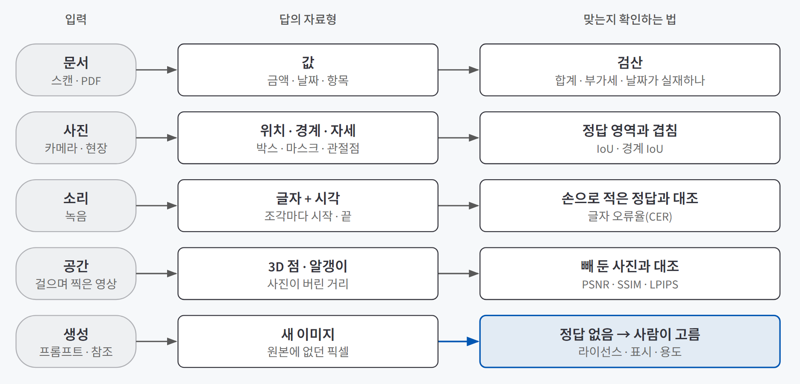
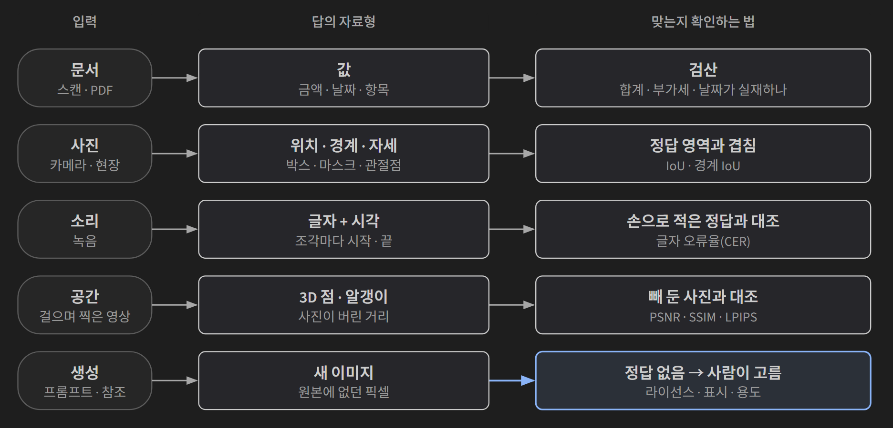
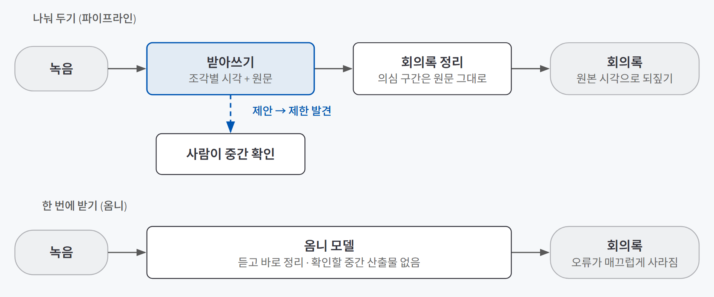
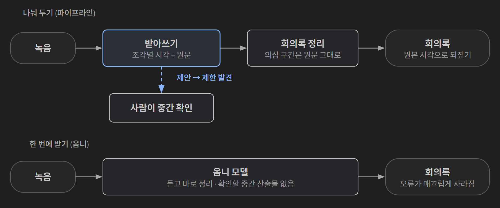

## 한 줄 요약

**"이 파일 좀 분석해 줘"라는 한 문장 안에는 서로 다른 주문이 섞여 있다. 문서에서는 값을, 사진에서는 위치·경계·자세를, 녹음에서는 글자와 시각을, 영상에서는 사라진 거리를 원한다.** 답의 자료형이 정해지면 고를 도구, 맞았는지 확인하는 방법, 틀렸을 때의 책임이 함께 정해진다. 그래서 멀티모달 AI는 모델 이름보다 **답의 모양**부터 정한다.

병원 검사를 떠올리면 쉽다. 의사는 "검사해 주세요"라고 하지 않는다. 수치가 필요하면 혈액검사, 위치가 필요하면 X선, 소리가 필요하면 청진, 입체가 필요하면 CT를 고른다. 검사마다 정상 범위를 판정하는 방법도 다르다. 무엇을 알고 싶은지가 먼저고, 장비는 그다음이다.

## 필요한 이유

두 장면이 이유를 보여 준다.

**계약서 23건에서 금액을 뽑는 실습이다.** 기계는 `3`, `2`, `,`, `0`을 전부 맞게 읽었다. 그런데 병합된 표 칸 때문에 "계약 금액" 자리에 "부가세 3,200,000"을 넣었다. 실패한 곳은 글자 인식이 아니라 **어느 숫자가 어느 항목에 속하는가**였다. 더 좋은 OCR로 바꿔도 이 문제는 그대로다.

**회의 녹음을 회의록으로 만드는 실습이다.** 받아쓰기 단계에서 `제안`이 `제한`으로 바뀌었다. 그 상태로 "회의록으로 정리해 줘"라고 하자 오류는 흔적 없이 사라졌고, 녹취에 없는 개최일까지 지어냈다. 결과물만 보면 아주 매끄러웠다. **요약이 받아쓰기 오류를 세탁한 것이다.**

두 경우 모두 "더 좋은 모델"로는 풀리지 않는다. 답이 어떤 모양이어야 하는지, 어느 자리에서 맞는지 확인할지를 먼저 정하지 않았기 때문이다. 입력이 글에서 그림·소리·공간으로 넓어질수록 결과는 더 그럴듯해 보이고, 틀린 곳은 더 찾기 어려워진다.

## 개념과 동작

### 답의 자료형부터 정한다

같은 공장 사진 한 장에도 질문이 넷 숨어 있다. "흠집이 정확히 어디?"는 사각형 좌표를, "안전모 미착용 몇 명?"은 개수를, "마모 면적이 얼마나 늘었나?"는 픽셀 단위 영역을, "비슷한 분위기로 한 장"은 원본에 없던 새 이미지를 원한다. 입력 종류별로 놓으면 이렇다.

{: .light }
{: .dark }

답이 **값**이면 다시 계산해서 검산할 수 있다(단가×수량=합계, 부가세=본체의 10분의 1, 날짜가 실재하는가). 답이 **위치나 경계**면 다시 계산할 것이 없으니, 사람이 정한 정답 영역과 얼마나 겹치는지 잰다. 답이 **새로 만든 것**이면 맞는지 물어볼 정답 자체가 없다. 이 차이가 아래 모든 설명의 뼈대다.

### 문서: 읽는 일과 알아보는 일은 다르다

PDF는 두 종류다. 워드나 한글에서 내보낸 PDF는 글자 정보(텍스트 레이어)가 들어 있어 **읽기만** 하면 된다. 복합기나 휴대폰으로 찍은 PDF는 픽셀뿐이라 **알아봐야(OCR)** 한다. 텍스트 선택·복사가 되는지만 봐도 대개 갈린다. 이 갈림길을 먼저 보면 필요 없는 OCR 비용과 오류를 피한다.

OCR은 네 정거장을 한 방향으로 지난다.

| 정거장 | 하는 일 | 흔한 실패 |
|---|---|---|
| 전처리 | 기울기 보정, 흑백 나누기, 잡음 제거 | 1도 기울면 A4 폭에서 줄이 3.7mm 어긋난다. 잡음을 세게 지우면 `1.5`가 `15`가 된다 |
| 검출 | 글자가 있는 영역의 좌표를 찾는다 | 표 테두리, 도장, 밑줄, 로고에 방해받는다 |
| 인식 | 잘라 낸 줄 이미지를 문자열로 바꾼다 | 획 하나 차이(`믿`/`민`), 한자·영문 혼용 |
| **레이아웃 분석** | 좌표 붙은 문자열을 표·문단·항목으로 묶는다 | **가장 자주 무너진다.** 셀 병합, 선 없는 표, 다단 조판 |

단계마다 98%라고 단순하게 가정해도 네 번 곱하면 약 92%, 100장 중 8장이 어긋난다(**오류 전파**). 게다가 오류는 성질을 바꿔 번진다. 기울기 1도가 줄 상자를 두 줄에 걸치게 하고, 섞인 문자열이 결국 금액 칸에 부가세를 넣는다. 최종 결과만 보는 사람은 원인을 알 수 없다. 감사 추적이 필요한 업무에서 전통 OCR이 여전히 쓰이는 이유는 틀리지 않아서가 아니라 **왜 틀렸는지 되짚을 수 있어서**다.

문서 도구는 이름이 비슷해도 내놓는 답의 모양이 다르다.

| 도구 | 답의 자료형 | 근거 되짚기 | 대표 실패 |
|---|---|---|---|
| Tesseract | 문자열 · 점수 · 좌표 | 원본 위 좌표와 중간 결과 | 누락, 오인식, 읽기 순서 |
| PaddleOCR | 문자열 · 점수 · 좌표 (한국어는 PP-OCRv5 다국어 모델) | 같음 | 같음 |
| PaddleOCR-VL (문서 전용 VLM) | Markdown · 표 · 수식 · 구조 | 원문 페이지와 원시 출력 대조 | 구조 누락, 재배열, 생성 |
| 범용 멀티모달 (Claude, ChatGPT) | 질문에 따른 문장 · 구조 | 원문 인용 위치와 대화 기록 | 환각, 비공개 전처리, 서비스 변경 |

말로 답하는 모델(VLM)은 잘 안 보이는 자리도 문맥상 그럴듯한 값으로 채운다. 내부 단계가 밖에서 보이지 않으니, 확인 장치를 **바깥에** 만든다. 원본과 원시 결과를 보존하고, 요약·추정·보정을 금지하고, 판독 불가는 `[UNCLEAR]`로 남기게 하고, 사람이 미리 적은 기준값과 대조한다. JSON으로 깔끔하게 와도 금액이 원문에 없는 재계산 값일 수 있다. **형식을 지켰다는 것과 내용이 맞다는 것은 별개다.**

### 사진: 박스, 마스크, 관절점은 서로 대신하지 못한다

YOLO 같은 패키지 하나로도 같은 사진에서 세 종류의 답이 나온다. 모델 앞부분은 같고, 끝의 **head**가 답의 자료형을 정한다.

| 작업 | 내놓는 것 | 어울리는 질문 | 필요한 라벨 |
|---|---|---|---|
| 객체 탐지 | 이름 + 사각형 좌표 + 점수 | 무엇이 어디에 몇 개인가 | 박스 |
| 분할 | 대상별 픽셀 마스크 | 각 대상이 어디까지인가, 넓이는 | 다각형 |
| 포즈 추정 | 사람 박스 + 관절점(keypoint) | 신체 부위가 어떤 자세인가 | 관절점 |

**탐지의 박스는 계측값이 아니라 "여기를 보세요"라는 후보다.** 대각선 균열에 박스를 씌우면 90% 이상이 멀쩡한 콘크리트다. `score 0.87`도 "87% 확률로 사람"이라는 뜻이 아니다. 현장 사진이 학습 데이터와 다르면 아무렇지 않게 부풀거나 줄어든다. 박스가 맞았는지는 **IoU**(겹친 면적 ÷ 합친 면적)로 재는데, IoU 0.53은 문턱 0.5에서 정답이고 0.75에서 오답이다. IoU는 판정이 아니라 측정값이고, 문턱은 업무가 정한다.

그래서 **임계값은 기술 설정이 아니라 정책**이다. `conf=0.25` 한 줄이 "어떤 실수에 더 큰 비용을 치를지"라는 업무 결정이다.

| 업무 | 놓쳤을 때 | 헛짚었을 때 | 시작 방향 |
|---|---|---|---|
| 화재 · 안전장비 감지 | 사고 위험이 크다 | 확인 업무가 는다 | 낮은 선에서 시작 |
| 자동 결제 · 문서 승인 | 매출 누락, 승인 지연 | 잘못된 청구·승인 | 높은 선에서 시작 |
| 통계용 개체 수 집계 | 과소 집계 | 과대 집계 | 양쪽 비용을 함께 계산 |

높은 선 위는 자동 처리, 낮은 선 아래는 제외, 그 사이는 사람에게 보내는 3단 구조로 설계할 수 있다. 다만 라벨 없이 임계값만 바꿔 보는 것은 검증이 아니라 민감도 관찰이다.

**분할은 더 좋은 기술이 아니라 더 비싼 기술이다.** 라벨링 비용, 계산량, 경계 불확실성이 모두 커진다. 창고 파렛트 개수라면 박스로 충분하고, 설비 코팅이 벗겨진 면적이라면 마스크가 필요하다. SAM(Meta)처럼 점이나 박스로 가리키면 마스크 후보를 내주는 모델은 라벨링 초안을 빠르게 만든다.

매끈한 마스크는 "정확하겠지"라는 착각을 준다. 경계 오차는 한 방향으로 쏠린다. 둘레 400픽셀인 손상 부위에서 경계를 평균 2픽셀 바깥으로 잡으면 면적이 약 800픽셀 늘어, 8,000픽셀 기준 **10% 과대 산정**이 된다. 월 3천 건이면 체계적 편향이다. 평균 IoU 0.9로는 이 편향이 보이지 않는다. 평균은 방향을 지우기 때문이다. 그래서 분할 프로젝트의 첫 문서는 모델 비교표가 아니라 **경계 정의서**다. "심한 부식" 대신 "손톱으로 긁어 요철이 느껴지는 범위", "큰 균열" 대신 "폭 1mm 이상"처럼 형용사를 쓰지 않는다.

### 소리: 받아쓰기 오류는 요약에서 사라진다

말을 글자로 바꾸는 것이 **STT**(음성 인식)다. Whisper(OpenAI)는 잡다한 음성·자막 68만 시간으로 학습해 처음 듣는 녹음에 강하고, 가중치를 받아 내 컴퓨터에서 돌릴 수 있다. 회사 회의 녹음처럼 외부 서버로 보낼 수 없는 소리는 로컬 받아쓰기를 쓴다.

한국어에서는 크기 선택이 결과를 가른다(글자 단위 오류율 기준).

| 크기 | 돌릴 때 메모리 | 한국어 글자 오류율 |
|---|---|---|
| tiny · base | 1GB 미만 | 36.6% · 40.6% — **한국어에서는 못 쓴다** |
| small | 1.4GB | 17.5% |
| medium | 2.4GB | 13.9% |
| large-v3 | 3.8GB | 8.0% |
| large-v3 turbo | — | 10.8% (small이 아니라 large의 빠른 판) |

영어 예제의 크기를 그대로 따라 하면 첫 실습부터 막힌다. 그런데 한국어로 다시 학습한 base는 8.7%로, 20배 넘게 큰 large-v3(8.0%)에 거의 붙었다. **크기보다 그 언어를 봤느냐가 먼저다.**

모델보다 더 큰 손잡이는 **마이크**다. 같은 모델, 같은 회의인데 각자 헤드셋은 오류율 16.9, 회의실 마이크 하나는 36.4였다. 낡은 모델이면 먼저 바꾸고, 그다음부터는 더 큰 모델과 씨름하기보다 녹음 환경을 바꾸는 편이 빠르다.

소리에는 글자 말고도 단서가 있다. "네, 알겠습니다"는 글자로는 동의지만, 긴 침묵 뒤 낮은 목소리였다면 불만이나 포기 신호일 수 있다. 다만 단서마다 믿을 수 있는 정도가 다르다. 발화 요약과 침묵 구간은 원문 시각으로 되짚을 수 있지만, 감정 분류는 보조 신호로만 쓰고, 성격 유형 추정은 대부분 빼는 편이 맞다.

### 공간: 사진이 버린 거리를 되찾는다

사진은 찍히는 순간 **거리**를 버린다. 공간 AI는 그 거리를 되찾아 3차원으로 다시 쌓는다. 먼저 정할 것은 무엇에 담느냐다. 이름을 정확히 불러야 에이전트도 그 분야의 도구를 가져온다.

| 담는 방식 | 이루어진 것 | 강한 쪽 | 어디에 쓰나 |
|---|---|---|---|
| 메시 | 정점과 삼각형 | 가볍고 고치기 쉽다 | 게임, 3D 인쇄, 제품 설계 |
| 포인트 클라우드 | 위치와 색만 가진 점 | 재는 장비가 그대로 내준다 | 측량, 라이다, 건설 기록 |
| 복셀 | 공간을 나눈 격자 칸 | 속까지 담는다 | 의료 영상, 물리 시뮬레이션 |
| **가우시안 스플랫** | 반투명 타원 알갱이 수백만 개 | 흐린 경계, 반투명, 각도별 반짝임 | 사진에서 되찾은 장면, 매물·상품 둘러보기 |

거리를 되찾는 원리는 **시차**다. 렌즈가 자리를 옮기면 가까운 것은 많이, 먼 것은 조금 밀린다. 그래서 방 안을 **걸어 다니며** 찍어야 하고, 제자리에서 몸만 돌리면 거리가 나오지 않는다. MapAnything(Meta) 같은 모델은 사진 여러 장을 함께 보고 깊이와 카메라 위치를 한 번에 내준다.

3D 가우시안 스플래팅(2023)은 그 전의 NeRF(2020)와 계산 방향이 반대다. NeRF는 장면을 신경망에 외우게 하고 화소마다 신경망에 물어 그리기가 느리다. 스플래팅은 공간의 알갱이를 화면에 눌러 찍어 겹쳐 바르는, 그래픽 장치가 30년 해 온 일로 바꿔 실시간으로 그린다. 알갱이 하나에 값이 62개(248바이트) 드는데, 그중 73%가 **보는 각도에 따른 색 변화**(구면 조화)다. 파일이 큰 이유는 형태가 아니라 반짝임이다.

주의할 점이 있다. 한 번에 복원하는 최신 모델은 **잰 값과 채워 넣은 값이 한 파일에 섞인다.** 무늬 없는 흰 벽의 깊이는 잰 값이 아니라 "이런 장면은 대개 이렇더라"로 채운 값이다. 카메라가 지나가지 않은 자리(소파 뒤, 걸어 들어온 쪽의 벽)는 값이 없어 검게 남는데, 이건 잘못 그린 게 아니라 정직하게 비어 있는 것이다.

실습에서는 공개된 장소인 주차장을 18초 동안 걸으며 찍었다. 24장을 뽑았고, 카메라가 퍼진 정도는 0.23이었다(0.1 아래면 사실상 제자리에서 돈 것). 점은 약 322만 개가 나왔다. 무압축 `.ply`는 218.95MB였고, 웹용 `.sog` 형식으로 바꾸자 알갱이를 하나도 버리지 않고 14.06MB(15.6배 작음)가 됐다. 화면 중앙의 검은 구멍은 카메라가 찍지 않은 바닥 방향이었고, 먼 배경이 날개처럼 늘어진 조각은 시차가 부족해 생긴 것이었다. 결과는 [beginner-driver/my-open-space](https://github.com/beginner-driver/my-open-space)에 있다.

### 만드는 일: 정답 대신 선택이 남는다

꺼내는 일에는 정답이 있다. 이미지 생성처럼 **원본에 없던 픽셀을 만드는 일**에는 정답이 없고, 대신 사람의 선택이 남는다.

생성 모델은 프롬프트에 안 적은 칸(피사체, 동작, 카메라, 조명, 환경, 스타일)을 학습 데이터에서 가장 흔했던 값으로 채운다. 시선을 안 적으면 카메라를 보고, 수를 안 정하면 대개 더 많아진다. 좋은 프롬프트는 긴 것이 아니라 **빈 칸이 없는 것**이다. 결과가 마음에 안 들면 모델을 바꾸기 전에 시드를 고정하고 한 번에 한 칸씩 바꾼다. 손가락과 화면 안 글자(특히 한글)는 프롬프트로 잘 안 된다. 구도를 바꾸거나 나중에 편집 도구로 넣는다.

지금 오픈 모델이 한 장을 1초 남짓에 그리는 것은 **증류**(50번 걸어갈 길을 한두 번에 찍도록 가르친 것) 덕분이다. 그래서 증류 모델은 스텝 4 안팎, 가이던스 0.0이 기본값이다. 모델 이름만 갈아 끼우고 이 숫자를 그대로 두면 그림이 망가진다.

프롬프트로 자세를 정확히 통제하기는 어렵다. 이때 **ControlNet**을 얹는다. 참조 사진에서 관절점(포즈), 윤곽선, 깊이 같은 구조를 뽑아 생성 조건으로 건다. 프롬프트는 내용을, ControlNet은 자세와 배치를 따른다. 앞에서 본 포즈 추정의 관절점이 여기서 생성의 입력으로 다시 쓰인다.

실습으로 참조 사진의 자세를 따라 새 인물을 만드는 도구를 Colab에 만들었다([beginner-driver/pose-image-tool](https://github.com/beginner-driver/pose-image-tool)). 2026년 7월 기준 FLUX.2-klein에는 공식 포즈 ControlNet이 없어 생태계가 안정적인 **FLUX.1-dev + Union ControlNet**을 골랐다. 무료 T4에서 처음 시도한 조합은 시스템 RAM이 먼저 터져서, 양자화를 한 단계 더 낮춘 GGUF(Q3_K_S)와 fp8 ControlNet으로 줄였다. 결과에서 확인한 것은 세 가지다.

| 관찰 | 이유 |
|---|---|
| 무게중심과 팔다리 방향은 따라왔지만, 세밀한 관절 각도는 느슨했다 | ControlNet 강도를 0.65로 둬 프롬프트에 여지를 줬다 |
| 손 모양이 뭉개졌다 | 손가락 관절점을 뽑지 않는 설정(`hand_and_face=False`)이었다 |
| 같은 자세인데 앞모습이 뒷모습으로 바뀌었다 | 관절 뼈대는 2D 투영이라 카메라 시점까지는 고정하지 못한다 |

생성에서 가장 먼저 확인할 것은 화질이 아니라 **조건**이다. 세 층이 따로 걸린다.

| 층 | 언제 걸리나 | 확인할 것 |
|---|---|---|
| 모델 라이선스 | 가중치를 직접 돌릴 때 | 상업 이용 가부. 같은 회사·같은 날 공개된 FLUX.2-klein도 4B는 아파치 2.0, 9B는 비상업이다. 실습에 쓴 FLUX.1-dev도 비상업이다 |
| 서비스 약관 | 남의 서버를 쓸 때 | 산출물 권리, 내 입력을 서비스가 쓰는 권리, 침해 면책(대개 유료 상업 요금제에만) |
| 저작권법 | 그 위 | 사람의 창작적 기여가 없는 출력물은 보호받기 어렵다는 방향. 약관이 "당신 소유"라고 해도 없는 권리는 줄 수 없다 |

### 한 모델이 다 받을까, 나눠 둘까

글·그림·소리를 함께 다루는 방식은 셋으로 갈린다. 이미지·음성 전용 인코더가 언어 모델에 정보를 넘기는 **연결형**, 여러 입력을 같은 의미 공간에 놓는 **공유 임베딩형**, 한 모델이 입출력을 통째로 다루는 **네이티브(옴니)형**이다. 공유 임베딩의 대표인 CLIP은 이미지-설명글 쌍 4억 개로 "어느 설명이 어느 그림에 붙는가"를 맞히게 학습해, 문장으로 사진을 검색할 수 있게 했다. 다만 가깝다고 같은 것은 아니다. 거리는 학습 데이터의 통계라 업무에서 중요한 차이를 놓칠 수 있다.

실무에서 갈리는 질문은 "전문 도구를 여러 개 이을까, 하나가 다 받게 할까"다. 기준은 성능이 아니라 **검증할 자리가 어디에 남느냐**다.

{: .light }
{: .dark }

받아쓰기와 정리를 나눠 두면 `제안`이 `제한`으로 옮겨진 것을 중간 산출물에서 잡을 수 있다. 앞의 회의록 실습에서도 "받아쓰기가 의심스러운 곳은 원문 그대로 표시"라는 항목을 넣자, 같은 모델이 두 오류를 모두 인용해 표시했다. 옴니 모델은 소리를 그대로 받아 억양·침묵 같은 단서를 살리지만, 듣고 바로 결론을 말하니 그 중간이 없다.

## 적합한 경우와 피할 경우

| 판단 | 쓰는 게 좋은 경우 | 쓰면 안 되는 경우 |
|---|---|---|
| 글 말고 다른 입력을 더하기 | 핵심 증거가 그림·소리에 있다 (녹슨 위치, 침묵, 계기판) | 텍스트로 충분한데 "더 많이 넣으면 낫겠지"일 때. 비용·개인정보·검증 부담만 는다 |
| 마스크(분할) | 면적, 치수, 절단선처럼 **경계가 곧 답**일 때 | 개수와 다시 볼 위치만 필요할 때. 박스로 충분하다 |
| 범용 멀티모달 모델로 문서 읽기 | 열린 질문, 한두 장 확인, 구조가 단순한 문서 | 감사 추적이 필요한 대량 추출. 좌표와 중간 결과가 남는 OCR이 낫다 |
| 옴니 모델 | 실시간 안내, 화면·소리를 함께 보는 대화 | 회의록·계약처럼 나중에 근거를 되짚어야 하는 일 |
| 이미지 생성 | 습작, 시안, 구도 실험 | 실제와 혼동될 자리에 표시 없이 쓸 때, 사람을 촬영·판정하는 기능을 근거 없이 만들 때 |

## 장점과 한계

| 장점 | 한계 |
|---|---|
| 답의 자료형을 정하면 도구, 검증 방법, 책임 소재가 같이 정해진다 | 입력이 많을수록 결론이 더 그럴듯해 보여 틀린 곳을 찾기 어렵다 |
| 글로 옮기면 사라지는 단서(위치, 억양, 거리)를 판단에 쓸 수 있다 | 자료형마다 채점 방법이 달라 "모델 성능" 한 숫자로 비교할 수 없다 |
| 로컬 OCR·받아쓰기·복원 모델로 민감한 자료를 밖에 보내지 않고 처리할 수 있다 | 라이선스가 모델마다, 크기마다 다르다. 가장 유명한 구현이 회사에서 못 쓰는 경우도 있다(원본 3D 가우시안 스플래팅 구현은 연구용 조건) |
| 단계를 나누면 "못 찾았나 / 잘못 읽었나 / 잘못 묶었나"를 구분할 수 있다 | 단계를 나눈 만큼 오류 전파 지점도 늘어난다 |

## 적용 방법

### 1단계. 답의 자료형과 쓸 곳을 먼저 적는다

"분석해 줘"를 값 · 위치 · 경계 · 자세 · 글자+시각 · 3D · 새 이미지 중 무엇이 필요한지로 바꾼다. 쓸 곳도 함께 적는다. 3D 인쇄용이면 메시, 측량이면 포인트 클라우드, 둘러보기면 스플랫이다. 자료형이 정해지면 후보 도구가 절반 이하로 줄어든다.

### 2단계. 입력부터 확인한다

모델을 바꾸기 전에 입력을 본다. PDF에 텍스트 레이어가 있는지, 사진이 학습 데이터와 비슷한 조건인지, 녹음이 각자 마이크인지, 영상이 걸어 다니며 찍은 것인지. 가장 싼 개선은 대개 여기서 나온다.

### 3단계. 산출 계약을 정하고 원시 결과를 남긴다

모델에게 결과의 모양을 계약처럼 정해 준다. 표는 행·열을 유지하고, 판독 불가는 `[UNCLEAR]`, 요약·추정·보정은 금지, 받아쓰기는 조각마다 시작·끝 시각을 남긴다. 그리고 정리된 결과와 별도로 **원시 결과**(좌표, 점수, 원문 조각)를 함께 저장하고, 모델 이름·버전·데이터 전송 위치를 기록한다. 다른 모델로 대체했다면 그 사실도 남긴다. 대체 자체는 실패가 아니고, 조용히 바꾸는 것이 문제다.

### 4단계. 사람이 만든 기준으로 채점한다

정답은 모델이 아니라 사람이 만든다. 문서는 미리 적은 기준값과, 받아쓰기는 앞 30초를 손으로 받아 적은 정답과, 3D 복원은 빼 둔 사진과 대조한다. 임계값은 놓쳤을 때와 헛짚었을 때의 비용을 따져 정하고, 그 사이 회색지대는 사람에게 보낸다. 같은 설정으로도 결과가 흔들리니(같은 녹음에서 오류율 0.7~4.1%) 한 번 잰 값으로 결론 내지 않는다.

### 5단계. 라이선스와 사용 책임을 확인한다

가중치 라이선스, 서비스 약관, 저작권을 나눠 본다. "오픈소스"라도 코드와 가중치 라이선스가 다를 수 있고, 상업 범위에 사내 업무까지 넣는 약관도 있다. 사람을 촬영·판정하는 기능이라면 탐지 목적, 촬영 대상의 고지·동의, 기록 보관 기간, 가장 위험한 오탐과 미탐, 이의 제기 통로를 먼저 적는다. 이 칸은 에이전트가 아니라 사람이 채운다.

## 다른 방법과 비교

| 방법 | 시작 속도 | 근거 되짚기 | 한 줄 평가 |
|---|---|---|---|
| 범용 멀티모달 챗봇에 파일 올리기 | 가장 빠름 | 약함 | 감 잡기에는 좋지만, 매끈한 답 속 틀린 값을 찾기 어렵고 입력이 외부로 나간다 |
| 전문 모델을 단계별로 잇기 (OCR · 탐지 · 받아쓰기) | 보통 | 강함 | 중간 산출물마다 확인할 수 있다. 단계가 늘수록 오류 전파 지점도 는다 |
| 옴니 모델 하나에 맡기기 | 빠름 | 약함 | 실시간 상황 파악에 맞다. 감사가 필요한 기록에는 중간이 없다 |
| **자료형 먼저 + 산출 계약 + 사람의 기준값** | 느림 | 강함 | 어느 도구를 쓰든 맞았는지 판정할 수 있고, 도구가 바뀌어도 같은 기준을 다시 쓴다 |

## 주의할 점

**매끈할수록 더 의심해야 한다.** 깔끔한 JSON 속 재계산된 금액, 선명한 마스크 속 한 방향으로 쏠린 경계, 매끄러운 회의록 속 사라진 받아쓰기 오류, 손가락까지 완벽한 생성 이미지. 손가락 여섯 개짜리 그림은 누구나 알아보지만, 완벽해 보이는 결과는 아무도 따져 보지 않는다. 결과가 완벽해질수록 근거를 더 요구한다.

그 밖에 기억할 것:
- **점수를 확률로 읽는다.** 탐지 점수 0.87은 "87% 확률"이 아니다. 현장이 바뀌면 흔들린다.
- **mAP 하나로 도입을 정한다.** 평균의 평균이라 가장 중요한 클래스 하나를 못 맞혀도 높게 나온다. "놓치면 안 되는 클래스의 재현율"과 "사람이 다시 볼 하루 알림 건수"를 본다.
- **오류율의 단위를 안 본다.** 같은 결과도 글자 단위와 단어 단위로 3%대와 14%대처럼 네 배 차이 난다. 한국어는 띄어쓰기가 유연해 글자 단위가 맞다.
- **참조 이미지나 녹음을 무심코 올린다.** 올리는 순간 남의 서버로 간다. 사내 자료라면 이것만으로 결론이 날 수 있다.
- **"모델이 할 수 있는 것"과 "내 실행 도구가 지원하는 것"을 같다고 본다.** 같은 모델도 로컬 실행 도구는 글·이미지만, 서버용 엔진은 소리·영상까지 받기도 한다.
- **모델 이름의 숫자를 제품 계보로 읽는다.** YOLO 버전 번호는 여러 팀이 이어 붙인 것이라, 번호가 크다고 같은 제품의 최신판이 아니다.

## 용어 정리

| 용어 | 뜻 |
|---|---|
| 모달리티 / 멀티모달 | 정보를 담는 형식(글, 이미지, 소리, 영상, 센서값) / 여러 형식을 함께 받아 한 판단으로 묶는 것 |
| VLM (Vision-Language Model) | 이미지를 보고 말로 답하는 모델. 문서 전용(PaddleOCR-VL)과 범용(Claude, ChatGPT)이 있다 |
| 레이아웃 분석 | 좌표가 붙은 글자들을 표·문단·항목으로 묶는 단계. OCR에서 가장 자주 무너진다 |
| 오류 전파 | 앞 단계의 작은 오류가 뒤 단계에서 성질을 바꿔 커지는 것 |
| 산출 계약 | 결과의 형식과 금지 사항(추정 금지, `[UNCLEAR]` 표시 등)을 미리 정해 주는 것 |
| IoU (Intersection over Union) | 예측 영역과 정답 영역이 겹친 정도. 판정이 아니라 측정값이다 |
| mAP | 클래스별 정밀도를 평균 낸 탐지 성능 지표. `@0.5`보다 `@0.5:0.95`가 까다롭다 |
| 분할 (segmentation) / 마스크 | 대상을 픽셀 단위로 가르는 작업 / 그 결과 |
| 경계 정의서 | 어디까지를 대상으로 볼지 형용사 없이 적은 라벨링 기준 문서 |
| 키포인트 (keypoint) | 포즈 추정이 내놓는 관절 위치 점 |
| CER (Character Error Rate) | 글자 단위 오류율. 한국어 받아쓰기 정확도에 맞는 단위 |
| 옴니 모델 | 글·소리·이미지·영상을 어떤 조합으로든 받는 모델 |
| 공유 임베딩 공간 | 그림과 문장을 같은 좌표계에 놓아 거리로 의미를 비교하는 방식 (CLIP) |
| 시차 | 카메라가 움직일 때 가까운 것은 많이, 먼 것은 조금 밀리는 현상. 거리를 되찾는 근거 |
| 가우시안 스플래팅 | 반투명 타원 알갱이 수백만 개로 장면을 담아 실시간으로 그리는 3D 표현 |
| 증류 모델 | 큰 모델이 여러 번 걸어갈 길을 한두 번에 찍도록 배운 모델. 스텝 4 안팎, 가이던스 0.0 |
| ControlNet | 참조 사진의 자세·윤곽·깊이를 생성 조건으로 거는 보조 회로 |

---

→ 이 개념을 검증한 프로젝트: [얼굴 인식 사진 찾기 검증 — 성공 기준부터 적고 만든 PoC로 확인한 세 가지](/posts/face-recognition-photo-organizer/)
