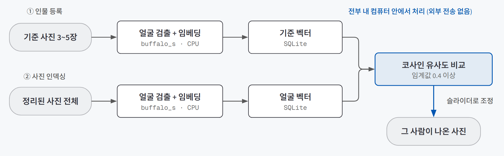
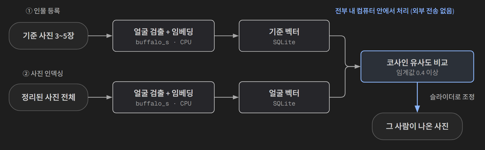
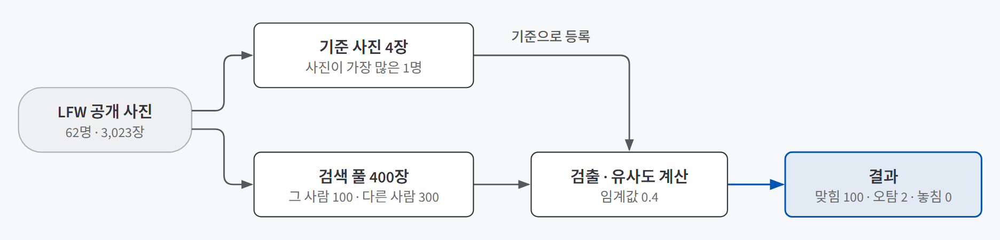
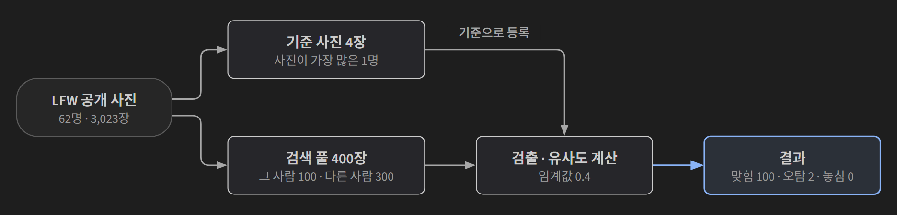

## 한 줄 소개

**"내 업무의 병목을 찾고, 만들기 전에 정량 성공 기준을 적고, 작게 만들어 판단한다"는 PoC 방식이 실제로 판단을 내려 주는지 확인하려고, 얼굴 인식으로 특정 인물이 나온 사진을 찾는 데스크톱 도구를 만들어 검증했다.** 기준 사진 몇 장으로 인물을 등록하면, 수천 장짜리 사진 라이브러리에서 그 사람이 나온 사진을 모아 보여 준다.

저장소: [beginner-driver/Main_Quest_2](https://github.com/beginner-driver/Main_Quest_2)

> **검증한 것:** 미리 적은 기준으로 판단하기 ✅(정확도·속도) / △(시간 단축) · 사진을 밖으로 보내지 않고 노트북 CPU로 처리 ✅ · 임계값 하나로 오탐과 놓침을 함께 막기 △
>
> **발견한 것:** 오탐 두 건이 모두 기준 인물의 배우자였다 · 한글 경로의 사진을 오류 없이 못 읽는 버그가 있었다 · 얼굴을 너무 꽉 자른 사진은 검출기가 못 찾는다
{: .prompt-tip }

## 만든 이유

[AI에게 파일을 줄 때 먼저 정할 것 — 문서·사진·소리·공간에서 꺼내는 답의 모양](/posts/multimodal-ai/)과 [클라우드 API로 쓸까, 내 컴퓨터에서 돌릴까 — LLM 실행 위치 정하기](/posts/cloud-api-vs-local-llm/)를 배우고 나서 세 가지가 궁금했다.

1. 만들기 전에 **정량 성공 기준**을 적어 두면, PoC가 끝났을 때 "그럴듯하다" 대신 **판단**이 나올까?
2. 개인 사진처럼 **밖으로 보내면 안 되는 자료**를 실행 위치로 먼저 거르면, 노트북 CPU만으로 쓸 만한 속도가 나올까?
3. 이론에서는 "임계값은 기술 설정이 아니라 정책"이라고 했다. **임계값 하나로** 오탐과 놓침을 함께 막을 수 있을까?

실험 대상은 개인 사진 정리다. 이론에서 정리한 업무 유형 중 **검색**(자료는 있는데 설명이 없어 못 찾는 일)에 그대로 들어맞는다. 사진은 수천~수만 장 쌓여 있지만 폴더가 촬영일 기준이라 "이 사람이 나온 사진"으로는 찾을 방법이 없고, 폴더를 하나씩 열어 눈으로 확인하다 지치면 사진을 놓친다.

## 실험 설계

### 동작 흐름

{: .light }
{: .dark }

1. 찾을 사람의 기준 사진 3~5장을 등록하면, 각 사진에서 얼굴을 찾아 **임베딩**(얼굴을 512개 숫자로 바꾼 것. 같은 사람일수록 숫자 묶음이 비슷해진다)으로 바꿔 저장한다.
2. 정리된 사진 전체를 한 번 훑어 모든 얼굴을 임베딩으로 바꿔 둔다(인덱싱).
3. 사람을 고르면 기준 임베딩과 모든 얼굴 임베딩을 **코사인 유사도**(두 숫자 묶음이 같은 방향을 가리키는 정도, 1에 가까울수록 닮음)로 비교해, 임계값 0.4 이상인 사진을 보여 준다.
4. 임계값은 화면의 슬라이더로 사람이 조정할 수 있다.

얼굴 인식 앞에는 사진 정리 단계가 있다. 원본은 절대 건드리지 않고, 촬영일(EXIF)로 `YYYY년/YYYY-MM-DD/` 폴더에 **사본만** 만든다.

### 사용 기술

| 기술 | 어디에 썼나 |
|---|---|
| **InsightFace (`buffalo_s`)** | 얼굴 검출(RetinaFace)과 임베딩(ArcFace)을 함수 한 번으로 처리하는 얼굴 인식 패키지. 그중 가벼운 모델 묶음을 썼다 |
| **ONNX Runtime** | 학습된 모델을 GPU 없이 CPU에서 돌리는 실행기 |
| **OpenCV · Pillow · exifread** | 사진 읽기, 썸네일 만들기, 촬영일 정보(EXIF) 읽기 |
| **SQLite** | 사진 목록, 등록한 인물, 얼굴 임베딩 저장. 벡터 DB 없이 파일 하나로 충분하다고 봤다 |
| **PyQt6** | 파이썬으로 데스크톱 화면을 만드는 도구 |
| **scikit-learn** | 공개 얼굴 데이터(LFW) 내려받기와 정밀도·재현율 계산 |

모델은 후보 여섯을 놓고 골랐다. 이론대로 **실행 위치를 점수보다 먼저** 걸렀다.

| 후보 | 결과 | 이유 |
|---|---|---|
| 클라우드 얼굴 인식 API | **먼저 제외** | 정확도는 최상급이지만 개인 사진을 외부로 보내야 한다 |
| dlib 기반 `face_recognition` | 제외 | Windows에서 빌드 도구 없이는 설치가 어렵다 |
| DeepFace | 제외 | 결국 같은 계열 모델을 감싼 것인데 의존성만 무겁다 |
| AdaFace | 보류 | 작은 얼굴에 강하지만 직접 변환·통합해야 한다. 작은 얼굴에서 자주 틀리면 다시 본다 |
| OpenCV YuNet + SFace | 대안으로 남김 | 새 의존성이 0개지만 얼굴 정렬 등 전처리를 직접 짜야 한다 |
| **InsightFace `buffalo_s`** | **채택** | 컴파일 없이 설치되고, 검출+임베딩이 한 번에 되고, 오프라인에서 돈다 |

### 성공 기준 (만들기 전에 적은 것)

| 항목 | 기준 |
|---|---|
| 정확도 | 공개 얼굴 데이터(LFW)에서 **정밀도·재현율 각각 90% 이상** |
| 처리량 | CPU에서 **사진 1장당 검출+임베딩 1초 이내** |
| 처리시간 | 특정 인물 사진을 찾는 시간이 **수동 탐색보다 대폭 단축** |

**정밀도**는 "찾았다고 한 사진 중 진짜 그 사람인 비율", **재현율**은 "그 사람 사진 중 빠짐없이 찾아낸 비율"이다. 앞쪽이 낮으면 엉뚱한 사람이 섞이고(오탐), 뒤쪽이 낮으면 사진을 놓친다(놓침).

### 샘플

{: .light }
{: .dark }

개인 사진을 저장소에 올릴 수 없어서 **LFW**(Labeled Faces in the Wild, 인물 이름이 붙은 공개 얼굴 사진 모음)를 썼다. 사진마다 누구인지 라벨이 이미 붙어 있어서 **정답을 모델을 돌리기 전에** 확보할 수 있다.

- 사진이 20장 이상인 62명, 3,023장을 받는다.
- 사진이 가장 많은 한 사람의 사진 4장을 기준으로 등록한다.
- 그 사람의 나머지 사진 100장 + 다른 61명의 사진 300장을 섞어 400장짜리 검색 풀을 만든다.

PoC 노트북은 앱이 쓰는 얼굴 인식 코드를 **그대로 불러와** 실행한다. 노트북에서 나온 숫자가 곧 앱의 숫자가 되게 했다.

## 검증 결과

| 질문 | 결과 | 근거 |
|---|---|---|
| 1. 미리 적은 기준으로 판단하기 | ✅ 정확도·속도 / △ 시간 단축 | 정밀도 0.980·재현율 1.000·장당 329ms로 두 기준은 넘었다. 시간 단축은 비교 대상(수동 탐색)을 재지 않아 판단하지 못했다 |
| 2. 노트북 CPU로 처리 | ✅ PoC 규모에서 | 400장 전부 얼굴 검출 성공, 장당 329ms. 외부 전송 없음 |
| 3. 임계값 하나로 오탐·놓침 막기 | △ | 0.4에서 놓침 0건, 오탐 2건. 오탐 두 건의 점수가 그 사람 사진 점수와 겹쳐, 임계값만 옮겨서는 둘 다 0으로 만들 수 없었다 |

### 질문 1. 미리 적은 기준으로 판단이 서는가

| 지표 | 결과 | 기준 | 판단 |
|---|---|---|---|
| 정밀도 | **0.980** (찾은 102장 중 100장이 맞음) | 90% 이상 | ✅ |
| 재현율 | **1.000** (100장 중 100장 찾음) | 90% 이상 | ✅ |
| 장당 처리 시간 | **329ms** | 1,000ms 이내 | ✅ |
| 얼굴 검출 실패 | 0장 / 400장 | — | — |

정확도와 처리량은 **결과를 보기 전에 적은 숫자**와 바로 비교할 수 있어서, "쓸 만해 보인다"가 아니라 "기준을 넘었다"로 끝낼 수 있었다.

세 번째 기준은 달랐다. AI 쪽은 400장 × 329ms = 약 132초로 **실제로 쟀다.** 그런데 비교 대상인 수동 탐색은 "한 장 보는 데 1.5초"라고 **가정한 추정치**(약 600초)였다. 이 둘로 계산하면 약 78% 단축이지만, 한쪽이 가정이라 이 숫자로는 판단할 수 없다.

정확도 기준은 공개 데이터가 정답을 쥐고 있어서 잴 수 있었지만, 시간 기준은 **기준선(지금 방식)을 재는 일을 건너뛴 채** 적었다. 같은 400장에서 사람이 직접 찾는 시간을 재야 판단할 수 있다. 기준을 적는 것만으로는 부족하고, **그 기준을 잴 수단까지 같이 정해 둬야** 판단이 선다.

### 질문 2. 사진을 밖으로 보내지 않고 노트북 CPU로 충분한가

후보를 점수로 줄 세우기 전에 **"사진이 컴퓨터 밖으로 나가는가"로 먼저 걸렀다.** 정확도만 보면 1위일 수 있는 클라우드 API가 처음부터 빠졌고, 남은 후보 중 GPU 없이 도는 가벼운 모델(`buffalo_s`)을 골랐다.

결과는 장당 329ms로 기준의 3분의 1 수준이다. 검색도 별도 서버 없이 SQLite에 임베딩을 넣고 numpy로 비교하는 구조로 충분했다. 얼굴 하나당 임베딩이 약 2KB라 수만 장까지는 배열 하나로 다룰 수 있다.

다만 ✅는 **PoC 규모**에 대한 것이다. LFW 사진은 250×250 크기인데, 실제 폰 사진은 훨씬 커서 사진을 읽고 줄이는 시간이 더 든다. 수천~수만 장 전체를 인덱싱하는 시간은 재지 않았다.

### 질문 3. 임계값 하나로 오탐과 놓침을 함께 막을 수 있는가

임계값 0.4는 실험 전에 코드 기본값으로 정해 둔 값이다. 그 결과는 이렇다.

| 구분 | 건수 | 뜻 |
|---|---|---|
| 맞힘 | 100 | 그 사람 사진을 그 사람이라고 찾음 |
| **오탐** | **2** | 다른 사람을 그 사람이라고 찾음 (유사도 0.501, 0.484) |
| 놓침 | 0 | 그 사람 사진을 못 찾음 |

오탐 두 건은 임계값 0.4를 **근소하게** 넘었다. 그러면 임계값을 0.51로 올리면 끝날까? 정밀도-재현율 곡선을 보면 그렇지 않다. 곡선은 재현율 1.0에 닿기 직전까지 정밀도 1.0을 유지하다가 마지막에 꺾인다. 그 사람의 사진 중 **가장 점수가 낮은 사진이 오탐보다 낮은 점수**를 받았다는 뜻이다. 오탐을 0으로 만들 만큼 임계값을 올리면 놓침이 생긴다.

이론에서 배운 대로 임계값은 **"어떤 실수를 더 비싸게 볼지"를 정하는 정책**이었다. 사진 찾기에서는 엉뚱한 사진이 몇 장 섞이는 것보다 내 사진을 놓치는 쪽이 더 아깝다. 그래서 놓침이 0인 낮은 쪽(0.4)을 기본값으로 두고, 슬라이더를 둬서 **마지막 판단은 사람에게 넘겼다.**

## 직접 만들며 알게 된 것

### 오탐 두 건이 모두 기준 인물의 배우자였다

오탐 사진을 하나씩 열어 보니, 두 건 모두 **기준 인물의 배우자**였다. 닮은 남남이 아니라, 같은 자리에서 자주 함께 찍히는 사람이었다.

원인은 확인하지 못했다. 같은 행사·같은 조명에서 찍힌 사진이 많아 촬영 조건이 비슷했던 것이 영향을 줬을 수 있다고 추정만 했다. 그래도 그냥 넘기기 어렵다. **개인 사진첩은 가족 사진이 대부분**이라, 공개 데이터에서 400장 중 2장이던 오탐이 실제 사진첩에서는 더 자주 나올 수 있다.

이론에서는 임계값과 오탐을 "점수가 애매한 경우"로만 다뤘다. **어떤 사람이 오탐으로 들어오는지**는 데이터를 직접 열어 봐야 알 수 있었다. 다음 개선 후보로는 가족이 여러 명 등록됐을 때 "A와 B 중 누구에 더 가까운가"를 상대 비교하는 방식을 남겨 뒀다.

### 한글 경로의 사진을 오류 없이 못 읽는 버그가 있었다

앱을 만들면서 얼굴 인덱싱이 **오류 없이 전부 실패할 뻔한** 문제를 찾았다. 사진을 읽는 OpenCV 함수(`cv2.imread`)는 Windows에서 한글이 들어간 경로를 읽지 못하면 오류를 내지 않고 **빈 값을 조용히 돌려준다.** 그런데 이 앱은 정리 폴더를 `2026년` 같은 한글 이름으로 만든다. 그대로 뒀다면 실제 사진첩의 모든 사진에서 "얼굴 없음"이 나왔을 것이다. 파일을 바이트로 직접 읽어 디코딩(`cv2.imdecode`)하도록 고쳤고, 새 의존성을 붙이면 한글 경로로 한 번씩 확인하기로 했다.

### 얼굴을 너무 꽉 자른 사진은 검출기가 못 찾는다

LFW는 얼굴 부분만 꽉 잘라 작게 줄인 버전을 기본으로 내려준다. 사전 테스트에서 이 버전은 검출기가 얼굴을 못 찾는 경우가 있어서, 원본 크기(250×250)를 그대로 받도록 바꿨다. 그 뒤로 400장 전부 검출에 성공했다.

얼굴 검출기는 얼굴 주변의 여백까지 보고 판단한다. **사람 눈에는 더 깔끔해 보이는 입력이 모델에게는 더 어려운 입력**일 수 있다는 걸, 숫자가 나오기 전 단계에서 알게 됐다.

## 검증 범위와 한계

| 구분 | 내용 |
|---|---|
| **데이터** | LFW는 대부분 얼굴이 정면 가까이 크게 찍힌 사진이고, 어려운 사례(단체사진 속 작은 얼굴, 어두운 사진, 옆모습, 마스크·선글라스)를 따로 넣지 않았다. 내 사진첩으로 정확도를 잰 기록은 없다 |
| **인물 수** | 기준 인물 한 명, 무작위 표본 한 번으로 잰 결과다. 다른 사람·다른 표본에서도 같은 숫자가 나오는지는 확인하지 못했다 |
| **임계값** | 0.4 한 값만 숫자로 남겼다. 오탐과 정답 점수가 얼마나 겹치는지는 곡선으로만 봤고, 점수 분포를 따로 기록하지 않았다 |
| **규모** | 400장, 250×250 사진에서 잰 속도다. 실제 해상도의 수천~수만 장 인덱싱 시간은 재지 않았다 |
| **검수 화면** | 앱의 검색 결과에 유사도 점수와 순서가 없다. 사람이 오탐 후보를 먼저 볼 수 있게 고쳐야 한다 |

## 결론

세 질문 중 가장 크게 남은 건 1번이다. **만들기 전에 적은 숫자가 있으면 PoC는 판단으로 끝난다.** 정확도와 속도는 "기준을 넘었다", 시간 단축은 "잴 수단을 정하지 않아 판단할 수 없다"로 결론이 났다. 둘 다 결과다. 기준을 적을 때 **그 기준을 무엇으로 잴지**까지 같이 적어야 한다.

2번과 3번은 구조로 남았다. 실행 위치로 먼저 거르니 노트북 CPU로도 PoC를 끝낼 수 있었고, 임계값으로 다 못 막는 오탐은 사람이 훑어보는 화면으로 넘겼다. 남은 일은 내 사진첩에서 **가족 사진과 단체사진이 섞인 어려운 표본**을 정답과 함께 만들어, 공개 데이터의 0.980이 실제로도 유지되는지 다시 재는 것이다.
