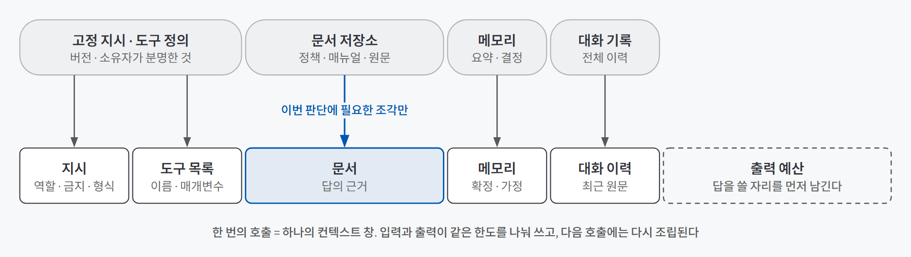
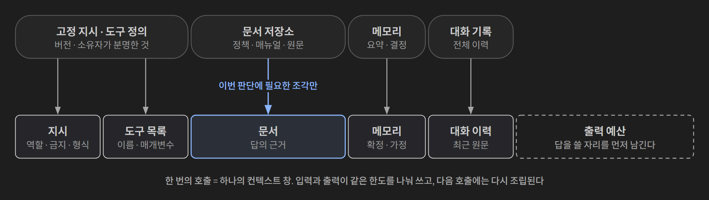
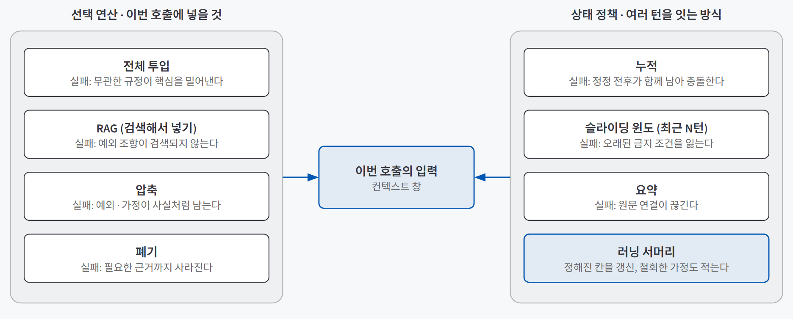
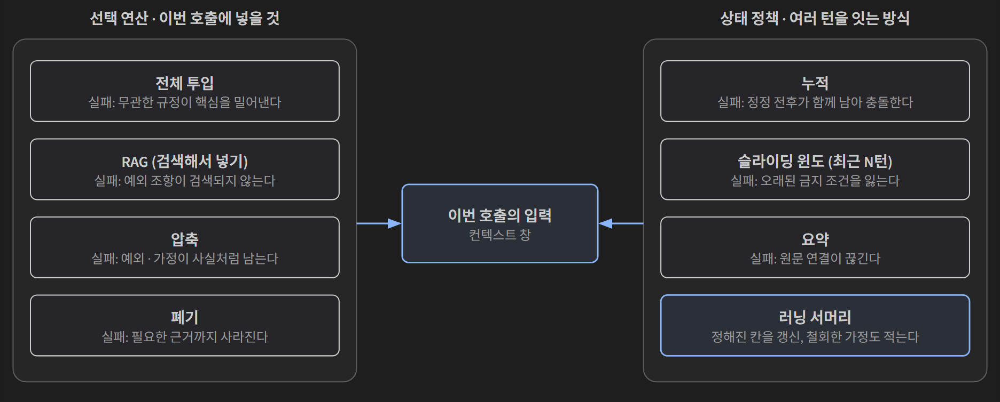

## 한 줄 요약

**모델은 이번 호출에 넣어 준 텍스트만 읽는다. 컨텍스트 엔지니어링은 많이 넣는 기술이 아니라, 이번 판단에 필요한 최소한의 믿을 수 있는 근거만 골라 배치하는 일이다.** 판단 순서는 출처 → 선택 → 배치·상태 → 신뢰 → 권한 → 비용이다.

책상과 서랍에 비유하면 쉽다. 컨텍스트 창은 **책상**이다. 넓이가 정해져 있고, 일이 끝나면 매번 치워진다. 문서와 기록은 **서랍**(파일·DB·문서 저장소)에 있다. 책상에 서랍 속 서류를 전부 쏟아 놓으면 정작 필요한 한 장을 못 찾는다. 이번 일에 필요한 서류만 꺼내 펼치고, 다음 일에는 다시 고른다.

## 필요한 이유

같은 질문인데 어제와 오늘 답이 다를 때가 있다. 이걸 "모델이 변덕스럽다"로 넘기면 고칠 수가 없다. 대부분은 **입력이 달랐기 때문이다.** 지시가 바뀌었거나, 대화 요약이 바뀌었거나, 다른 버전의 문서가 검색됐거나, 출력에 쓸 자리가 모자랐다.

컨텍스트 창이 수십만 토큰으로 넓어지면서 "그냥 다 넣으면 된다"는 생각도 흔해졌다. 그런데 **창에 들어간 것과 모델이 그걸 읽고 쓴 것은 다른 일이다.** 긴 입력의 중간에 놓인 근거는 덜 쓰인다는 연구(Lost in the Middle, Liu 외 2023)가 있고, 대화가 길어지면 초반에 정정한 가정이 다시 살아나기도 한다. 많이 넣을수록 비용과 지연도 같이 늘어난다.

그래서 매 호출마다 **무엇을 넣고, 무엇을 빼고, 무엇을 다음 턴으로 넘길지**를 정하는 설계가 필요하다.

## 개념과 동작

### 컨텍스트 창의 세 성질

| 성질 | 뜻 | 놓치면 생기는 일 |
|---|---|---|
| **유한하다** | 입력과 출력이 같은 한도를 나눠 쓴다 | 입력을 꽉 채우고 긴 답을 기대하면 처음부터 충돌한다 |
| **매 호출 새로 구성된다** | 대화가 이어져 보이는 건 앱이 이전 메시지·요약·검색 결과를 다시 넣어 주기 때문이다 | "아까 알려 줬으니 알겠지"라고 기대하면 틀린다 |
| **저장소가 아니다** | 장기 보관과 검색은 파일·DB가 맡고, 창은 지금 필요한 재료를 잠깐 펼치는 자리다 | 한 번 넣은 정책을 다음 호출에서도 안다고 착각한다 |

정리하면 **들어감과 읽힘, 보관과 회수는 각각 다른 일이다.** 답이 달라졌을 때는 모델보다 먼저 이번 호출에 들어간 지시·문서·요약의 출처와 버전을 확인한다.

### 같은 창을 나눠 쓰는 다섯 재료

창 하나를 다섯 재료가 나눠 쓴다. 하나를 늘리면 다른 하나가 밀려난다.

{: .light }
{: .dark }

| 재료 | 담는 것 | 대신할 수 없는 것 |
|---|---|---|
| 지시 | 역할, 금지, 출력 형식 | — |
| 문서 | 답의 근거가 되는 원문 | 메모리가 원문을 대신하지 못한다 |
| 메모리 | 요약, 확정된 결정, 선호 | 요약은 원문보다 정보가 적다 |
| 도구 목록 | 도구 이름, 매개변수, 설명 | 도구 설명이 실제 실행 결과를 대신하지 못한다 |
| 대화 이력 | 지난 턴의 원문 | 과거 대화가 최신 상태(예: 주문 상태)를 대신하지 못한다 |

여기에 **출력 예산**을 따로 남겨 둬야 한다. 추론(thinking)을 켠 모델은 생각하는 데 쓰는 토큰이 출력 한도를 다 써서 본문이 비는 경우도 있다.

### 들어가도 읽히지 않는다: 맥락 부패

창 안에 근거가 있는데도 답에 쓰이지 않는 실패를 **맥락 부패**(context rot)라고 부른다. 코딩 에이전트에서 대화가 길어질 때 생기는 현상은 [규칙 파일과 스킬](/posts/coding-agent-skills-rules/) 글에서 다뤘고, 여기서는 원인별로 나눈다. LangChain이 정리한 진단 언어로 보면 네 가지다.

| 유형 | 증상 | 원인 | 처방 |
|---|---|---|---|
| **오염** (poisoning) | 앞선 답의 추정이 다음 턴에 사실처럼 인용된다 | 검증 안 된 생성문이나 요약이 상태로 다시 들어갔다 | 원문과 대조하고, 검증 전 생성문과 그 파생 요약을 뺀다 |
| **주의 분산** (distraction) | 핵심 조항이 있는데 주변 설명이 답을 차지한다 | 질문과 무관한 정보가 주의를 빼앗았다 | 넣는 범위를 줄이되, 결론을 바꾸는 기한·예외·비용 조항은 남긴다 |
| **혼동** (confusion) | 비슷한 근거가 섞여 어느 조건을 적용했는지 흐려진다 | 비슷한 문장의 적용 대상·버전·시점이 구분되지 않았다 | 근거마다 적용 대상과 버전을 표시한다 |
| **충돌** (clash) | 양립할 수 없는 지시나 근거가 답에 함께 반영된다 | 우선순위·최신성·권한을 판정하지 않았다 | 충돌 목록을 만들고 어느 규칙을 적용했는지 근거와 함께 남긴다 |

같은 오답이라도 원인이 다르면 처방이 다르다. 오염이면 원문을 다시 보고 상태를 고쳐야 하고, 주의 분산이면 넣는 양을 줄여야 한다. "중간은 항상 안 읽는다"는 규칙도 아니다. 모델·문서 구성·질문에 따라 달라지므로, 내 자료에서 **근거의 위치만 바꿔 보는 실험**으로 확인한다.

### 두 가지 결정: 선택 연산과 상태 정책

"무엇을 기억시킬까"보다 정확한 질문은 둘이다. **이번 호출에 무엇을 넣을까**(선택 연산)와 **여러 턴의 이력을 어떻게 이어 갈까**(상태 정책).

{: .light }
{: .dark }

**선택 연산**은 넷이다.

| 연산 | 맞는 장면 | 대표 실패 | 실패 뒤 복구 |
|---|---|---|---|
| 전체 투입 | 짧고 서로 연결된 정책처럼 예외를 함께 읽어야 할 때 | 무관한 규정이 핵심 조항을 밀어낸다 | 무관 문서를 분리하거나 근거 위치를 바꾼다 |
| RAG (검색해서 넣기) | 국소적인 근거 몇 개로 풀리는 질문 | 예외 조항이 검색되지 않아 그럴듯하지만 불완전한 답이 나온다 | 질의를 바꿔 다시 검색하고, 부족하면 전문으로 전환한다 |
| 압축 | 확인한 사실과 결정 이유를 다음 상담에 이어야 할 때 | 요약이 예외나 폐기된 가정을 사실처럼 남긴다 | 원문을 다시 열어 고치고, 불확실한 항목은 확인 질문으로 되돌린다 |
| 폐기 | 끝난 탐색 기록, 철회된 해석 | 필요한 근거나 폐기한 이유까지 사라진다 | 저장소에서 원문을 다시 꺼내 필요한 부분만 넣는다 |

RAG는 토큰을 크게 아끼지만 완전성을 보장하지 않는다. 검색 1위만 쓰면 기한 조항은 찾고 예외·배송비 조항은 놓칠 수 있다. 검색과 전체 문맥을 비교한 연구(Self-Route, Li 외 2024)의 특정 구성에서는 검색 1위만 쓴 RAG의 집계 점수가 20.24로, 전체 문맥의 45.53보다 낮았다. 조각을 나누는 경계에서 조건과 예외가 잘리거나 옛 버전 조각이 검색되는 문제도 있다.

**상태 정책**도 넷이다.

| 정책 | 방식 | 대표 실패 |
|---|---|---|
| 누적 | 이력을 전부 넣는다 | 정정 전후가 함께 남아 충돌한다 |
| 슬라이딩 윈도 | 최근 N턴만 넣는다 | 최근에 다시 언급되지 않은 금지 조건·파일 경로를 잃는다 |
| 요약 | 지난 대화를 줄여 넘긴다 | 원문 연결이 없으면 또 하나의 불투명한 문서가 된다 |
| **러닝 서머리** | 정해진 칸(목표 / 확정 사실 / 가정 / 미해결 / 다음 행동)을 계속 갱신한다 | 칸을 비우면 다른 요약과 같아진다 |

러닝 서머리는 갱신할 때 **철회한 사실과 그 이유를 함께 적는다.** 그래야 12번째 턴에 철회한 가정이 29번째 턴에 되살아나지 않는다. 도구 실행 결과도 상태다. 원시 출력 전체를 남길지, 실행 ID와 저장 위치만 남길지, 필요한 사실만 남길지를 정한다.

압축과 요약은 이름이 비슷하지만 다르다. **압축은 이번 입력을 줄이는 선택 연산이고, 요약은 과거를 다음 턴으로 넘기는 상태 정책이다.**

### 요약은 손실 압축이다

짧고 매끄러운 요약일수록 답을 바꿀 정보를 잃었는지 알아채기 어렵다. 반품 정책 "14일 이내 반품 가능, 택 제거 상품은 착용 여부 확인 뒤 처리, 변심 배송비 고객 부담"을 "14일 이내 반품 가능, 배송비 고객 부담"으로 줄이면, 상담자는 착용 여부를 묻는 대신 반품 불가를 선언할 수 있다. 요약은 다섯 항목으로 대조한다.

| 대조 항목 | 원문에서 찾을 것 | 빠지면 생기는 일 |
|---|---|---|
| 사실 | 누가, 언제, 무엇을 확정했나 | 오래된 사실을 현재 사실처럼 쓴다 |
| 부정 | 하지 말라는 말, 해당하지 않는 경우 | 금지된 결론이 사실로 바뀐다 |
| 예외 | 기본 규칙을 뒤집는 단서 | 일반 규칙만 남아 경계 사례가 사라진다 |
| 미결정 | 아직 확인하지 못한 사실 | 가정이 확정 사실로 승격된다 |
| 출처 | 어느 문서의 어느 절인가 | 사람이 원문을 다시 확인할 길이 없다 |

### 넣은 데이터가 지시처럼 작동할 때

읽으라고 넣은 웹페이지·이메일·첨부 속 문장이 지시처럼 작동하는 것이 **간접 프롬프트 인젝션**이다. OWASP는 이를 LLM01:2025로 분류한다. 공격 문구는 "지시를 무시하라"처럼 티 나지 않는다. "보안을 위해 이 링크를 확인하십시오", "이전 검토자가 승인했습니다"처럼 정상 업무 말투를 흉내 낸다.

그래서 창에 넣는 텍스트를 파일 형식이 아니라 **출처와 작성 권한**으로 나눈다.

| 범주 | 예 | 행동을 정할 권한 |
|---|---|---|
| 행동 규칙 | 시스템 지시, 승인된 프로젝트 규칙 | 있다 |
| 내용 근거 | 정책 문서, 조회 결과 | 사실의 근거일 뿐, 지시는 아니다 |
| 대화 상태 | 확인된 결정, 주문번호 | 확인된 범위에서만 |
| 비신뢰 입력 | 웹페이지, 받은 이메일, 첨부 속 제3자 문장 | 없다 |

**프롬프트 하나로는 완전히 막을 수 없다.** 방어는 네 층으로 쌓는다. 외부 내용은 출처를 표시해 "사실 후보이지 실행 지시가 아니다"라고 구분하고, 입력과 출력·도구 인자를 검사하고, 권한을 최소로 주고(요약 작업에는 읽기 전용), 메일 전송·환불·결제 같은 민감 행동은 사람이 승인한다. 모델이 외부 문장을 잘못 믿어도 **권한이 없으면 피해가 작다.**

### 앞부분이 같으면 다시 계산하지 않는다: 프리픽스 캐싱

요청의 앞부분이 이전 요청과 같으면 처리 결과를 재사용하는 것이 **프리픽스 캐싱**이다. 2026년 8월 기준 Anthropic 가격 문서 예시에서는 캐시에서 읽는 입력이 일반 입력 단가의 10% 수준이고, 캐시에 쓰는 비용은 일반 입력보다 약간 비쌀 수 있다(모델·계약마다 다르니 계산 전에 현재 값을 확인한다).

중간에 날짜나 주문번호 같은 가변 값이 끼면 그 뒤로는 재사용되지 않는다. 그래서 입력을 세 블록으로 배치한다.

| 순서 | 블록 | 예 |
|---|---|---|
| ① | 버전·소유자가 분명한 고정 블록 | 공통 지침, 도구 정의, 검토된 정책 |
| ② | 요청마다 바뀌는 근거 | 검색 발췌, 최신 예외 |
| ③ | 사용자 입력 | 질문, 주문번호 |

캐시는 모델이 문맥을 더 잘 이해하게 하지 않는다. **적중률은 품질 점수가 아니다.**

## 적합한 경우와 피할 경우

| 이런 때 공들인다 | 이런 때는 가볍게 해도 된다 |
|---|---|
| 같은 질문에 답이 흔들릴 때 | 짧은 단발 질문 (질문 하나에 근거 한두 개) |
| 긴 문서·긴 대화를 다루는 상담·안내 서비스 | 매번 독립적인 변환 작업 (번역, 형식 바꾸기) |
| 외부 웹·이메일·첨부를 읽고 도구 권한도 가진 에이전트 | 신뢰할 수 있는 내 입력만 다루고 도구가 없는 경우 |
| 같은 긴 지시·정책을 여러 호출이 반복할 때 (비용·지연) | 한 번만 하는 대화 (캐시 쓰기 비용만 남는다) |

업무별로 고르면 이런 식이다.

| 업무 | 선택 연산 | 상태 정책 |
|---|---|---|
| 예외가 많은 반품 상담 | 정책 전문 투입 | 원문 주소를 가진 러닝 서머리 |
| 짧은 사내 질의 | 관련 조각 검색 | 최근 몇 턴 |
| 웹을 읽는 리서치 에이전트 | 출처를 표시한 검색 결과 | 확정 사실과 가정을 나눈 메모, 외부 문장은 메모리에 넣지 않는다 |

## 장점과 한계

| 장점 | 한계 |
|---|---|
| 답이 달라졌을 때 지시·문서·요약·출력 예산 중 무엇이 바뀌었는지 추적할 수 있다 | 대조와 기록에 손이 많이 간다. 답을 바꿀 수 있는 항목에 집중해야 한다 |
| 같은 오답이라도 원인(오염·분산·혼동·충돌)별로 처방이 달라진다 | 어떤 전략이 나은지는 모델·문서·질문마다 달라서 실험 없이는 모른다 |
| 근거의 범위(선택)와 시간에 따른 변화(상태)를 따로 책임질 수 있다 | 검색 점수는 진실의 확률이 아니다. 검색 품질이 답의 상한이 된다 |
| 신뢰 경계와 최소 권한으로 인젝션 피해를 줄인다 | 프롬프트 수준의 방어는 우회될 수 있다. 시스템 권한 제한이 같이 있어야 한다 |
| 고정 블록을 앞에 두면 비용·지연이 준다 | 오래되거나 민감한 정보를 고정 블록에 넣으면 비용은 줄어도 노출 범위가 넓어진다 |

## 적용 방법

### 1단계. 판단 조건부터 적는다

넣을 자료를 고르기 전에 **이 답을 바꾸는 사실이 무엇인지** 적는다. 반품 상담이라면 수령일, 택 제거 여부, 반품 사유(배송비 부담) 세 지점이다. 이 목록이 있어야 무엇을 넣고 뺄지 판단할 수 있다. 출력에 필요한 분량도 이때 정해 남겨 둔다.

### 2단계. 토큰 예산표를 만든다

다섯 재료마다 실제 토큰 수, 고정인지 가변인지, 출처와 버전, **빼면 생기는 위험**을 적는다. 무엇을 넣을지가 곧 무엇을 뺄지라는 판단이 표에 드러난다. 이번에 안 쓰는 도구 정의, 중복 예시가 먼저 줄일 후보다.

### 3단계. 선택 연산과 상태 정책을 따로 고른다

이번 호출에는 전체 투입·RAG·압축·폐기 중 무엇을 쓸지, 여러 턴에는 누적·윈도·요약·러닝 서머리 중 무엇을 쓸지 각각 정한다. 요약을 쓴다면 문장마다 원문 주소를 붙이고, 다섯 항목(사실·부정·예외·미결정·출처) 대조를 거친다.

### 4단계. 같은 질문에 맥락만 바꿔 비교한다

질문은 고정하고 넣는 맥락만 바꿔 답을 비교한다.

| 조건 | 넣는 맥락 | 보는 것 |
|---|---|---|
| none | 없음 | 근거 없이 답할 때의 기준선. 맞아도 우연일 수 있다 |
| full | 정책 전문 | 예외와 연결 조항을 함께 볼 때. 긴 문서의 잡음도 함께 들어간다 |
| selected | 관련 조각만 | 최소 근거로 충분한가. 빠진 조항 때문에 답이 달라질 수 있다 |
| selected_cited | 관련 조각 + 출처 표시 | 출처를 되짚을 수 있게 한 효과. 표시가 사실을 보장하지는 않는다 |

채점은 정답 여부만 보지 않는다. 핵심 판단마다 실제 조항과 맞는지(근거 일치), 근거 없는 주장이 있는지, 근거가 부족할 때 단정 대신 확인 질문을 했는지, 그리고 1단계에서 적은 판단 지점을 몇 개 회수했는지(**필수 결정 회수율**)를 센다. 근거 없이 "14일 이내 반품 가능"을 맞힌 답은 정답이지만 근거 일치는 실패다.

### 5단계. 신뢰 경계와 배치 순서를 정한다

창에 들어가는 텍스트를 네 범주(행동 규칙·내용 근거·대화 상태·비신뢰 입력)로 나누고, 비신뢰 입력은 도구 인자로 옮기지 않으며 메모리에도 넣지 않는다. 그다음 고정 블록 → 요청별 근거 → 사용자 입력 순으로 배치한다. 보안 사고나 권한 변경이 생기면 캐시 적중률보다 고정 블록에서 즉시 빼는 것이 먼저다.

## 다른 방법과 비교

| 방법 | 비용 | 근거 완전성 | 한 줄 평가 |
|---|---|---|---|
| 긴 창을 믿고 전부 넣기 | 높음 | 들어는 있음 | 들어간 것과 읽힌 것이 다르다. 중간 근거와 정정된 가정이 문제다 |
| 검색 1위만 넣기 | 낮음 | 낮음 | 토큰은 아끼지만 예외 조항을 놓친다 |
| 대화 전부 누적 | 점점 증가 | 높지만 충돌 포함 | 정정 전후가 함께 남는다 |
| 프롬프트 문구만 다듬기 | 낮음 | 변화 없음 | 입력 재료가 같으면 근거 문제는 그대로다 |
| **판단 조건 → 예산표 → 선택·상태 분리 → 비교 실험** | 설계 비용 | 확인됨 | 답이 달라진 이유를 입력의 차이로 설명할 수 있다 |

## 주의할 점

**검증되지 않은 문장이 장기 메모리에 들어가면 다음 세션마다 오염이 반복된다.** 모델의 추정, 외부 웹 문장, 확인하지 않은 요약이 메모리나 프로젝트 규칙 파일에 한 번 들어가면 매 호출 근거처럼 다시 읽힌다. 메모리에 넣기 전에 원문 대조를 거치고, 들어간 걸 발견하면 폐기한다. 모델이 "승인되었습니다"라고 말해도 그건 승인이 아니다.

그 밖에 기억할 것:
- **창에 넣었다고 저장된 게 아니고, 저장소에 있다고 이번 답에 읽힌 것도 아니다.**
- **긴 창은 다 넣어도 된다는 허가가 아니다.** 판단 조건부터 적는다.
- **검색 상위 결과가 답의 완전성을 보장하지 않는다.** 기한·예외·비용 조항과 현재 버전이 다 있는지 본다.
- **공식 도메인의 문서라도 그 안의 명령문은 시스템 지시가 아니다.**
- **캐시 적중률을 올리려고 오래된 목록이나 연락처를 고정 블록에 넣지 않는다.** 퇴사자 번호와 바뀐 등급이 계속 읽히고 개인정보 노출 범위가 넓어진다.
- **추론을 켠 모델은 출력 예산을 따로 확인한다.** 생각하는 데 한도를 다 써서 본문이 빈 채로 끝날 수 있다.

## 용어 정리

| 용어 | 뜻 |
|---|---|
| 컨텍스트 창 | 한 번의 호출에서 모델이 읽는 입력과 쓰는 출력이 함께 들어가는 한도 |
| 토큰 예산표 | 지시·문서·메모리·도구 목록·대화 이력이 각각 몇 토큰을 차지하고, 빼면 무슨 위험이 있는지 적은 표 |
| Lost in the Middle | 긴 입력의 중간에 놓인 근거를 모델이 덜 활용하는 현상 |
| 맥락 부패 (context rot) | 창 안에 근거가 있는데도 답에 제대로 쓰이지 않는 실패. 오염·주의 분산·혼동·충돌로 나눈다 |
| 선택 연산 | 이번 호출에 무엇을 넣을지 정하는 방식 (전체 투입, RAG, 압축, 폐기) |
| 상태 정책 | 여러 턴의 이력을 다음 호출로 어떻게 넘길지 정하는 방식 (누적, 슬라이딩 윈도, 요약, 러닝 서머리) |
| 러닝 서머리 | 목표·확정 사실·가정·미해결·다음 행동 칸을 계속 갱신하는 짧은 상태 노트 |
| 간접 프롬프트 인젝션 | 모델이 읽은 외부 데이터 속 문장이 지시처럼 작동하는 공격 |
| 프리픽스 캐싱 | 요청 앞부분이 이전과 같으면 그 처리 결과를 재사용해 비용·지연을 줄이는 기능 |
| 필수 결정 회수율 | 답이 반드시 다뤄야 할 판단 지점 중 실제로 다룬 비율 |

---

→ 이 개념을 검증한 프로젝트: [근거로만 답하는 RAG 챗봇 검증 — Claude Code 안내봇으로 확인한 세 가지](/posts/claude-code-rag-bot/)
