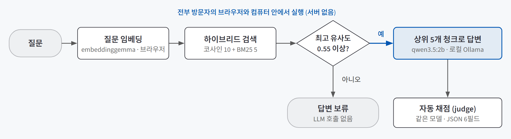
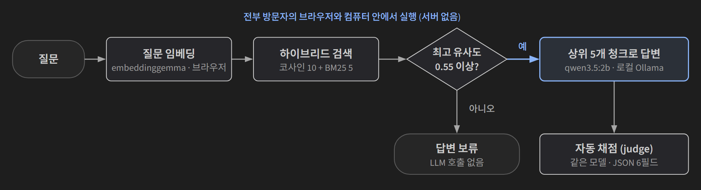
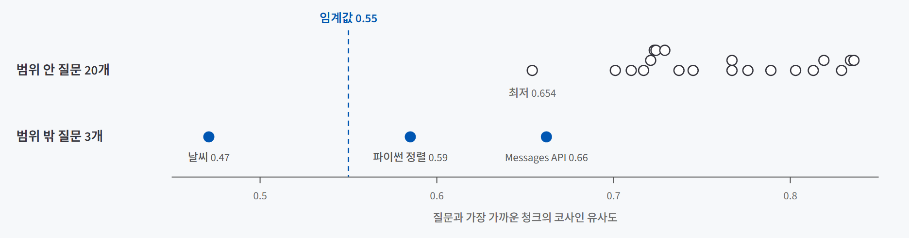
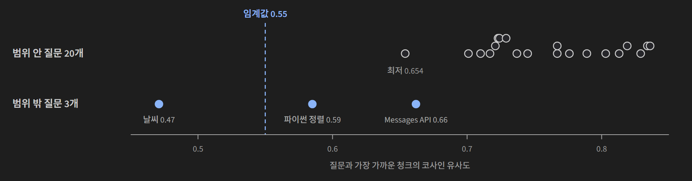

## 한 줄 소개

**"자료에만 근거해 답하고, 근거가 없으면 모른다고 말하게 한다"는 컨텍스트 설계가 작은 로컬 모델에서도 통하는지 확인하려고, Claude Code 공식 문서를 근거로 답하는 RAG 챗봇을 만들어 검증했다.** RAG(Retrieval-Augmented Generation)는 질문과 가까운 자료 조각을 먼저 찾아 AI에게 함께 건네고, 그 자료를 근거로 답하게 하는 방식이다. 질문을 넣으면 공식 문서에서 가까운 조각을 찾아 답하고, 답 아래에 원문 링크를 붙인다.

저장소: [beginner-driver/Main_Quest_3](https://github.com/beginner-driver/Main_Quest_3)

> **검증한 것:** 근거 원칙과 인용 지시로 출처 붙은 답 내기 △ · 유사도 임계값 + 프롬프트 지시로 범위 밖 질문 막기 ✅ · 같은 모델로 자동 채점하기 ❌(단독으로는 못 믿음)
>
> **발견한 것:** 범위 밖 질문의 유사도가 범위 안 질문보다 높을 수 있다 · 채점기가 자기 평가 문장과 반대되는 값을 매겼다 · 서버가 없어도 브라우저 보안 설정은 남는다
{: .prompt-tip }

## 만든 이유

[많이 넣는다고 잘 읽지 않는다 — 컨텍스트 엔지니어링으로 이번 호출에 넣을 것 고르기](/posts/context-engineering/), [지시는 부품으로, 답은 계약으로 — 시스템 프롬프트와 구조화 출력](/posts/system-prompt-structured-output/), [클라우드 API로 쓸까, 내 컴퓨터에서 돌릴까 — LLM 실행 위치 정하기](/posts/cloud-api-vs-local-llm/)를 배우고 나서 세 가지가 궁금했다.

1. "CONTEXT에만 근거하고 `[MC-001]`처럼 출처를 달아라"라는 **근거 원칙**과 출처 ID가 붙은 자료 조각만으로, 20억 파라미터급(2B) 작은 로컬 모델도 출처가 붙은 답을 낼까?
2. 자료와 무관한 질문을 **유사도 임계값**(가장 가까운 자료 조각과의 유사도가 이보다 낮으면 답을 보류하는 기준)과 **"없으면 추측하지 말라"는 지시**, 두 겹으로 막을 수 있을까?
3. 답을 **같은 모델에게 JSON으로 채점**(LLM-as-a-Judge)시키면, 사람이 하나하나 보지 않아도 품질을 잴 수 있을까?

실험 대상으로는 Claude Code 공식 문서를 골랐다. 입문 내용(설치, 기본 사용법)과 심화 내용(훅, 서브에이전트, MCP, Agent SDK)이 수십 페이지에 흩어져 있어 원하는 답을 찾기 어렵고, 문서가 공개돼 있어 **답이 맞는지 원문으로 바로 확인할 수 있다.** 범위도 PRD에 먼저 적었다. Claude API(Messages API) 문서는 별도 제품이라 일부러 뺐고, 이걸 범위 밖 질문으로 썼다.

## 실험 설계

### 동작 흐름

{: .light }
{: .dark }

1. 질문을 브라우저 안에서 **임베딩**(문장을 768개 숫자 묶음으로 바꾼 것. 뜻이 가까울수록 숫자 묶음도 비슷하다)으로 바꾼다.
2. **하이브리드 검색**으로 자료 조각(청크)을 찾는다. 뜻이 가까운 순(코사인 유사도) 10개와 낱말이 겹치는 순(BM25) 5개를 합친다.
3. 가장 가까운 청크의 유사도가 **0.55 미만이면 AI를 부르지 않고** "문서에서 확인되지 않는 내용"이라고 답을 보류한다.
4. 0.55 이상이면 상위 5개 청크를 근거로 넣어 **로컬 Ollama**가 답을 스트리밍한다.
5. 답이 끝나면 같은 모델이 그 답을 채점해 기록한다.

이 구조에는 **서버가 없다.** 화면과 자료는 GitHub Pages에 올린 정적 파일이고, 임베딩은 방문자의 브라우저에서, 답변은 방문자 컴퓨터의 Ollama에서 돈다. 질문이 어디로도 전송되지 않는 대신, 쓰려면 방문자가 Ollama를 직접 설치해야 한다. 배포한 사이트는 [beginner-driver.github.io/Main_Quest_3](https://beginner-driver.github.io/Main_Quest_3/)다.

### 사용 기술

| 기술 | 어디에 썼나 |
|---|---|
| **Vite + React + TypeScript** | 서버 없이 돌아가는 한 페이지짜리 화면. GitHub Actions로 GitHub Pages에 자동 배포했다 |
| **Transformers.js + EmbeddingGemma(300M)** | 브라우저 안에서 질문을 임베딩한다. 청크 임베딩도 같은 모델로 미리 만들어 정적 파일로 넣었다 |
| **Ollama + Qwen 3.5 2B** | 내 컴퓨터에서 LLM을 돌리는 실행기와 2B급 작은 모델. 답변 생성과 채점에 같은 모델을 썼다 |
| **BM25** | 낱말이 얼마나 겹치는지로 점수를 매기는 전통 검색 방식. `PreToolUse` 같은 정확한 이름을 보완하려고 붙였다 |

### 자료와 질문

공식 문서에서 **29개 청크**(입문 18개, 심화 11개)를 만들었다. 청크마다 `MC-001` 같은 고정 ID, 원문 URL, 섹션 이름을 붙였다. ID는 답 안에서 출처를 가리키는 손잡이이고, URL은 사람이 원문을 열어 확인하는 길이다.

평가 질문은 23개다. 입문 10개와 심화 10개는 각각 특정 청크를 겨냥해 만들었고, 범위 밖 3개는 성격을 달리했다.

| 범위 밖 질문 | 성격 |
|---|---|
| Claude API(Messages API)에서 시스템 프롬프트 지정법 | PRD에서 일부러 뺀, 가까워 보이는 주제 |
| 파이썬 리스트 정렬법 | 프로그래밍이지만 무관한 질문 |
| 오늘 서울 날씨 | 완전히 무관한 질문 |

질문 23개를 실제 앱과 같은 검색·프롬프트·채점 코드에 태우는 평가 스크립트를 만들어 한 번에 돌렸다. 채점 항목은 여섯 가지다.

| 항목 | 뜻 |
|---|---|
| grounded | 답이 건넨 자료에 근거하는가 |
| noHalluc | 자료에 없는 사실을 지어내지 않았는가 |
| cited | `[MC-XXX]` 형식 인용이 있는가 |
| refusal | 답을 보류했는가 |
| score / comment | 0~1 전체 점수와 한 문장 평가 |

## 검증 결과

| 질문 | 결과 | 근거 |
|---|---|---|
| 1. 근거 원칙과 인용으로 출처 붙은 답 내기 | △ 기준은 충족 | 범위 안 20개 모두 검색을 통과했고 인용 비율 기준도 넘었다. 다만 그 비율을 매긴 채점기를 믿기 어려웠다 |
| 2. 두 겹으로 범위 밖 질문 막기 | ✅ 3/3 보류 | 임계값이 1개, 프롬프트 지시가 나머지 2개를 막았다 |
| 3. 같은 모델로 자동 채점하기 | ❌ 단독으로는 못 믿음 | 채점 값이 자기 평가 문장과 어긋났고, 손으로 대조한 낮은 점수 6건은 실제로는 문제가 없었다 |

### 질문 1. 근거 원칙과 인용으로 출처가 붙은 답이 나오는가

질문은 한국어, 문서는 영어였지만 검색은 잘 됐다. 범위 안 질문 20개의 최고 유사도는 **0.654~0.836**으로 모두 임계값 0.55를 넘었다.

시스템 프롬프트는 한 문단이다. "CONTEXT만 근거로 한국어로 답하고, 사용한 부분은 반드시 `[MC-XXX]`로 인용하라. CONTEXT에 없으면 '문서에서 확인할 수 없습니다'라고 답하고 추측하지 말라." 채점 결과로는 인용 비율이 입문 90%, 심화 80%로 미리 정한 기준을 넘었다.

△로 둔 이유는 이 숫자를 매긴 쪽이 채점기라는 점이다. 질문 3에서 보듯 채점기는 자기 평가와 반대되는 값을 자주 매겼다. 점수가 낮게 나온 6건은 답 원문을 직접 대조해 문제가 없음을 확인했지만, **점수가 높게 나온 답은 따로 대조하지 않았다.** 그래서 "인용이 붙은 답이 나온다"까지는 말할 수 있어도, 그 인용이 모두 정확하다고는 말할 수 없다.

### 질문 2. 두 겹으로 범위 밖 질문을 막을 수 있는가

세 질문 모두 답이 보류됐다. 다만 막은 자리가 달랐다.

| 질문 | 최고 유사도 | 막은 곳 |
|---|---|---|
| 서울 날씨 | 0.47 | 임계값. AI를 부르지 않고 바로 보류 |
| 파이썬 정렬 | 0.59 | 임계값은 통과. 프롬프트 지시로 "문서에서 다루지 않는다"고 답함 |
| Messages API | 0.66 | 임계값은 통과. 프롬프트 지시로 "절차가 안내되어 있지 않다"고 답함 |

**임계값 혼자서는 1개만 막았다.** 나머지 둘은 "추측하지 말라"는 지시가 막았다. 두 겹을 둔 설계가 실제로 필요했던 셈이다. 같은 0.55를 강의에서는 "약한 근거 경고를 띄우는 선"으로 썼는데, 여기서는 "AI를 아예 부르지 않는 선"으로 더 세게 썼다. 덕분에 날씨 질문은 모델이 끼어들 틈 없이 같은 답이 나온다.

### 질문 3. 같은 모델로 자동 채점을 믿을 수 있는가

채점은 답을 만든 같은 2B 모델에게 시켰다. 여섯 항목을 JSON으로만 내라고 형식을 지정(`format: "json"`)했다. JSON을 읽지 못해 채점이 실패한 적은 없었지만 **내용이 자기 자신과 어긋났다.**

PreToolUse 훅 질문이 대표적이다. 답에는 `[MC-019]`가 분명히 있었고 내용도 맞았다. 채점기는 평가 문장에 "인용이 포함되어 있으나"라고 쓰고는 `cited: false`, `score: 0`을 매겼다. noHalluc·cited가 낮게 나온 답 6건을 원문과 직접 대조해 보니 모두 실제로는 문제가 없었다. 채점 값이 자기 평가 문장과 어긋나는 경우가 전체의 25~30% 정도였다.

이 정도 잡음이면 점수 하나하나를 근거로 쓸 수 없다. 작은 모델에게 "평가 문장 쓰기"와 "그 판단을 여섯 칸에 정확히 옮기기"를 한 번에 시킨 것이 원인으로 보인다. JSON 형식 지정은 모양만 보장하지 칸마다 들어간 값이 맞는지는 보장하지 않는다.

## 직접 만들며 알게 된 것

### 범위 밖 질문의 유사도가 범위 안 질문보다 높았다

{: .light }
{: .dark }

범위 밖인 Messages API 질문(0.662)이 범위 안에서 가장 낮은 "세션 대화 기록 초기화" 질문(0.654)보다 유사도가 높았다. Messages API도 같은 회사의 Claude 이야기라 문서 내용과 가깝게 잡힌 것으로 보인다. 실제로 이 질문의 답은 API 키 설정을 다룬 설치 청크(MC-002)를 끌어와 늘어놓았다. **이 자료와 모델 조합에서는 어떤 값으로 임계값을 잡아도 두 질문을 가를 수 없다.** 임계값을 올리면 범위 안 질문이 보류되고, 내리면 범위 밖 질문이 통과한다.

강의에서 0.55를 "현재 자료·모델 조합의 운영 규칙이지 보편적 정답이 아니다"라고 한 이유를 숫자로 본 셈이다. 범위 밖과 가까운 주제(같은 회사의 다른 제품)가 있다면, 임계값보다 프롬프트 지시나 질문 분류 같은 다른 겹이 필요하다.

### 서버가 없어도 배포 설정은 남는다

서버를 두지 않았지만, 배포한 사이트(github.io)에서 방문자 컴퓨터의 Ollama(`localhost`)로 요청하는 순간 **브라우저 보안 규칙(CORS)**이 막는다. 실제로 설정 없이는 요청이 거부(403)됐고, Ollama를 `OLLAMA_ORIGINS`로 이 주소를 허용하게 실행하자 정상 응답이 왔다. 그래서 연결에 실패하면 화면에 설치 방법과 이 설정을 안내하게 했다. 서버 비용이 0인 대신, 설치와 설정이라는 비용을 방문자가 진다.

## 검증 범위와 한계

| 구분 | 내용 |
|---|---|
| **질문 수** | 범위 안 20개, 범위 밖 3개를 한 번 돌렸다. 같은 질문을 여러 번 돌렸을 때의 흔들림은 재지 않았다 |
| **답 정확도** | 원문 대조는 채점 점수가 낮았던 답만 했다. 20개 답 전부를 원문과 한 줄씩 대조하지는 않았다 |
| **검색 적중** | 질문마다 겨냥한 청크가 있었지만, 그 청크가 검색 1등으로 나왔는지는 기록하지 않았다. 최고 유사도만 남겼다 |
| **채점 원본** | 채점 코드는 모델이 빠뜨린 칸을 false나 0으로 채워 넣는다. 원래 응답을 따로 남기지 않아서, score 0이 "0점을 줬다"인지 "칸을 빠뜨렸다"인지 구분할 수 없다 |
| **사람 피드백** | 답마다 좋아요/싫어요 버튼을 만들었지만, 기록이 방문자 브라우저에만 남아 모인 데이터가 없다 |
| **속도** | 평가 스크립트 기준으로 질문 하나에 답변과 채점을 합쳐 약 40~95초가 걸렸다. 실행한 컴퓨터 사양은 남기지 않았다 |
| **자료 규모** | 청크 29개로는 BM25 같은 낱말 검색의 쓸모나 임계값의 안정성을 판단하기에 작다 |

## 결론

확실하게 확인한 건 2번이다. **임계값과 "추측하지 말라"는 지시를 두 겹으로 두면, 2B급 작은 로컬 모델로도 범위 밖 질문을 보류하게 만들 수 있다.** 그리고 임계값 하나로는 부족하다는 것도 숫자로 봤다. 범위 밖 질문이 범위 안 질문보다 유사도가 높은 경우가 실제로 나왔다.

1번은 "기준은 넘었다"까지다. 근거 원칙과 출처 ID만으로 대부분의 답에 인용이 붙었지만, 그 비율을 잰 채점기 자체가 흔들렸다. 3번은 반대 결론이다. **같은 작은 모델로 채점하면 점수가 자기 평가 문장과도 어긋난다.** 자동 채점을 쓰려면 더 큰 모델로 채점하거나, 사람이 일부를 다시 채점해 채점기를 먼저 검증해야 한다.

가장 크게 남은 건 **채점기부터 검증해야 한다**는 점이다. 숫자를 매기는 도구를 믿을 수 없으면, 그 숫자로 내린 다른 결론도 함께 흔들린다.
