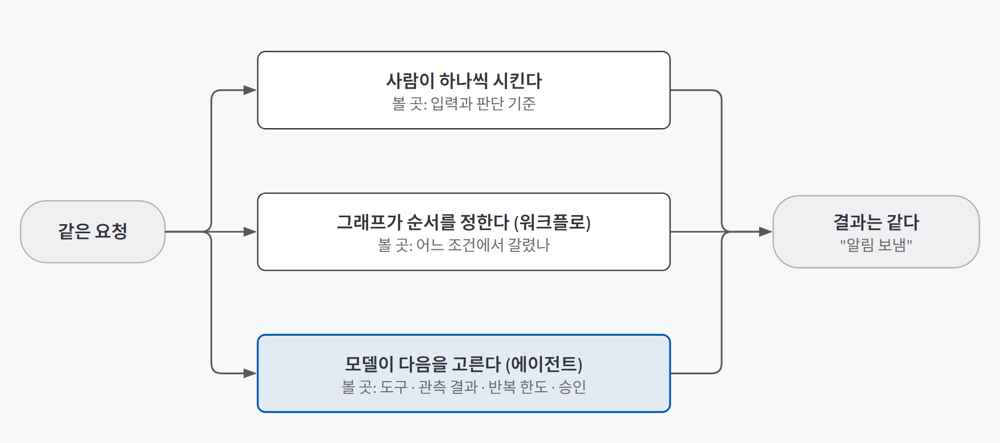
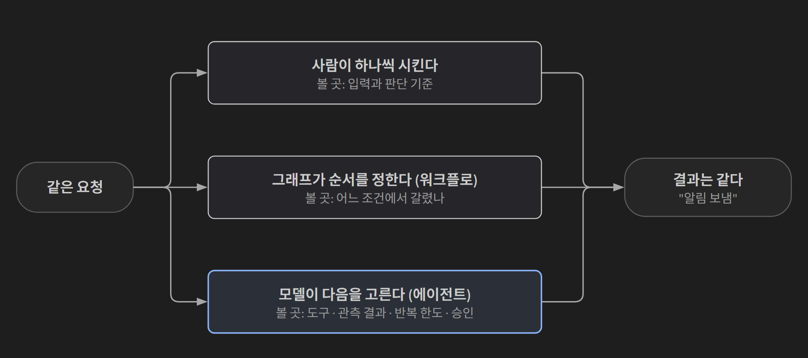
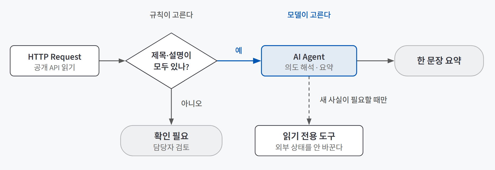
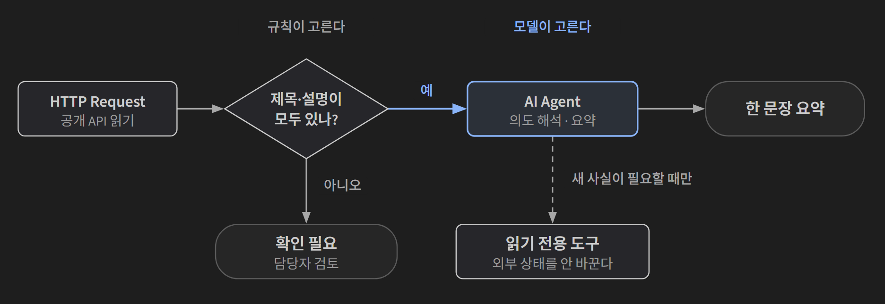

## 한 줄 요약

**반복 업무를 AI에게 맡기기 전에 먼저 물을 것은 "다음 행동을 누가 정하는가"다.** 사람이 하나씩 시키는지, 미리 그린 그래프(워크플로)가 순서를 정하는지, 모델이 도구를 골라 가며 정하는지에 따라 확인할 기록과 걸어야 할 통제가 달라진다.

운전대에 비유하면 쉽다. 사람이 직접 잡는 운전, 정해진 차선을 따라가는 자동 조향, 상황을 해석해 길을 고르는 조수석의 동승자는 목적지가 같아도 **브레이크를 확인할 곳**이 다르다. 결과만 봐서는 누가 운전했는지 알 수 없다.

## 필요한 이유

"AI 에이전트로 자동화했다"는 말 아래에는 서로 다른 통제 방식이 섞여 있다. 고객 문의를 담당 팀에 알리는 일을 예로 들면, 세 방식 모두 화면에는 **"알림 보냄"** 한 줄만 남는다. 그런데 알림이 엉뚱한 팀으로 갔을 때 고칠 곳은 전혀 다르다.

| 다음 행동을 고른 주체 | 문제가 생기면 볼 곳 |
|---|---|
| 사람 | 사람이 받은 입력과 판단 기준 |
| 그래프(워크플로) | 어느 조건에서 다른 경로로 갔는지 |
| 모델(에이전트) | 제공한 도구, 도구가 돌려준 결과, 반복 한도, 승인 규칙 |

이 구분 없이 도구부터 고르면 두 가지 실수가 생긴다. 규칙으로 충분한 일에 모델을 넣어 결과가 매번 달라지거나, 판단이 필요한 일을 규칙으로 밀어붙여 예외가 조용히 새어 나간다. 그래서 도구를 고르기 전에 **업무의 어느 부분을 누구에게 맡길지**부터 나눈다.

## 개념과 동작

### 세 국면

{: .light }
{: .dark }

| 국면 | 다음 행동을 고르는 것 | 맞는 일 |
|---|---|---|
| **자동화** | 미리 적은 규칙 | 규칙이 분명한 반복 (접수 번호 붙이기, 매일 아침 전날 매출 옮기기) |
| **워크플로** | 사람이 설계해 연결한 여러 단계와 조건 | 단계가 정해진 업무 흐름 |
| **에이전트** | 모델이 연결된 도구와 다음 경로를 고른다 | 판단이 필요해 경우를 미리 다 적기 어려운 일 |

Anthropic은 이 경계를 "코드 경로가 미리 정해져 있으면 워크플로, 모델이 과정과 도구 사용을 동적으로 이끌면 에이전트"로 나눈다. 중요한 건 이것이 **제품 목록이 아니라는 점**이다. 한 도구 안에서도 세 국면이 섞인다. 워크플로 한가운데에 AI 노드를 하나 넣었다고 전체가 에이전트가 되지는 않는다. 모델이 고르는 범위가 어디까지인지를 따로 봐야 한다.

### 규칙인지 아닌지 가르는 시험

자동화에 맡길 부분을 고를 때는 업무를 말로 설명해 본다.

- **"무조건", "항상", "매번"**으로 설명이 되면 규칙이 비교적 선명하다. 첨부 없는 신청서에 안내 메일 보내기가 그렇다.
- **"친절하게", "중요한 것부터"**처럼 사람 판단이 들어간 말은 아직 규칙이 아니다.
- 낯선 동료에게 가르친다고 상상한다. "이 경우엔요?"라는 질문에 **"알아서 해 주세요"**라고 답하게 되는 부분이 규칙이 아닌 곳이다.

자동화는 빈틈을 알아서 메우지 않는다. 빈틈까지 적어 둔 조리법처럼 움직인다. 예외를 만나면 잘못 분류된 문의가 여러 팀에 가거나, 멈춰야 할 작업이 계속 돈다.

### 규칙 분기와 모델 판단을 한 흐름에 놓기

워크플로 도구(n8n 등) 안에서는 두 종류의 분기를 함께 쓴다.

{: .light }
{: .dark }

| 구분 | IF 노드 (규칙) | AI Agent 노드 (모델) |
|---|---|---|
| 판단 기준 | 미리 작성한 조건 | 입력의 의미와 현재 맥락 |
| 같은 입력의 결과 | 늘 같은 경로 | 모델과 도구 결과에 따라 달라질 수 있다 |
| 맞는 일 | 값·상태·수치 검사 (필드가 비었나, 상태코드가 200인가) | 의도 해석, 도구 선택, 요약 |
| 확인할 기록 | 조건 결과와 실행된 경로 | 도구 호출, 도구 결과, 최종 답 |
| 주요 통제 | 조건식과 예외 경로 | 도구 권한, 지시문, 호출 범위, 사람 승인 |

원칙은 **분명한 규칙은 IF 노드에, 해석이 필요한 부분만 제한된 도구를 가진 AI Agent에** 맡기는 것이다. IF 노드는 잘못된 입력이 다음 단계로 넘어가지 않게 막는 통제 지점이 된다. 응답에 설명이 비어 있으면 요약하지 않고 "확인 필요"로 담당자에게 넘기는 식이다.

### 새 사실을 가져왔나, 표현만 바꿨나

AI Agent 노드에 공개 API를 읽는 읽기 전용 도구를 달고 "이 문서의 제목과 설명은 무엇인가"를 물으면, 도구 없이는 답할 수 없어 **도구 호출이 실행 기록에 남는다.** 이어서 "방금 받은 내용을 한 문장으로 정리해 줘"라고 하면 이미 받은 정보의 **재형식화**라서 새 호출이 생기지 않는다.

두 답은 화면에서 똑같이 그럴듯하다. 하나는 바깥에서 새 사실을 가져온 답이고, 다른 하나는 있던 내용의 표현만 바꾼 답이다. **둘을 가르는 근거는 답의 문장이 아니라 실행 기록의 도구 호출 유무**다. 모델이 정하는 범위가 넓어질수록 결과 화면보다 기록을 봐야 하는 이유다.

## 적합한 경우와 피할 경우

| 에이전트(모델 판단)가 맞는 경우 | 규칙·워크플로가 맞는 경우 |
|---|---|
| 입력의 의도를 해석해야 하는 일 (자유 문장으로 들어오는 문의) | 조건을 정확히 쓸 수 있는 검사 (필드 유무, 상태코드, 점수 기준) |
| 지금 정보로 답할 수 있는지부터 판단해야 하는 일 | 같은 입력에 늘 같은 결과가 나와야 하는 일 |
| 여러 읽기 도구 중 필요한 것을 골라야 하는 일 | 단계의 조합을 미리 다 적을 수 있는 일 |
| 예외가 많아 경우를 다 적기 어려운 일 | 결과를 재현하고 검토해야 하는 일 |

에이전트를 피해야 하는 때는 앞의 표 오른쪽만이 아니다. **발송·수정·삭제처럼 외부 상태를 바꾸는 동작**은 모델이 고르게 두지 않는다. 사람 승인이나 별도 IF 조건을 통과한 뒤에만 실행한다. 워크플로와 에이전트 사이의 더 자세한 기준과 다섯 가지 패턴은 [다섯 가지 에이전트 패턴, 언제 쓰고 언제 쓰면 안 될까](/posts/agent-patterns-when-not-to-use/)에 정리했다.

## 장점과 한계

| 장점 | 한계 |
|---|---|
| 결과가 같아 보여도 원인을 찾을 위치를 미리 알 수 있다 | 세 국면은 한 도구 안에서도 섞여, 경계를 매번 직접 그어야 한다 |
| 규칙 부분과 판단 부분을 나누면 판단 부분만 집중해서 검증하면 된다 | 모델에 선택을 더 맡길수록 비용과 오류가 쌓이고, 결과가 실행마다 달라진다 |
| 규칙 분기(IF)가 앞에서 걸러 주면 모델이 받는 입력이 깨끗해진다 | 규칙 분기는 의미 해석을 못 한다. 예외 경로를 비워 두면 예외가 조용히 사라진다 |
| 판정 근거와 재검토 조건이 기록으로 남아 다음 논의가 이어진다 | 같은 업무도 무엇을 먼저 확인하느냐에 따라 판정이 갈린다 |

## 적용 방법

### 1단계. 업무를 한 문장으로 좁힌다

"고객 지원 자동화"는 판정할 수 없다. "매일 오전 새로 들어온 공개 문의를 읽고 담당자가 확인할 세 줄 요약을 만든다"처럼 **읽는 대상, 받는 사람, 확인 지점**이 드러나게 쓴다.

### 2단계. 규칙 부분과 판단 부분을 나눈다

"알아서 해 주세요" 시험으로 업무를 쪼갠다. 규칙으로 쓸 수 있는 부분은 코드나 IF 분기로, 해석이 필요한 부분만 모델에 둔다. 모델에게 주는 도구는 **읽기 전용부터** 시작한다. 범용성은 권한을 다 주는 데서가 아니라 허용된 도구 안에서 고르게 하는 데서 생긴다.

### 3단계. 도구는 다섯 질문으로 비교한다

기능 수나 모델 이름 대신 업무의 위험을 기준으로 본다.

| 질문 | 확인할 것 |
|---|---|
| **통제** | 누가 시작·중지·승인·쓰기 권한을 정하나 |
| **관측** | 입력, 도구 호출, 응답, 실패 지점을 기록으로 되짚을 수 있나 |
| **이식성** | 프롬프트·연결 규칙·코드·비밀값을 다른 환경으로 옮길 때 무엇을 다시 준비하나 |
| **비용** | 구독, 모델 처리량, 실행 횟수 중 어떤 단위로 요금이 붙나 |
| **데이터 경로** | 입력·로그·결과·비밀값이 어느 서비스와 저장 위치를 지나나 |

이 표는 승자를 가리는 도구가 아니라 **빈칸을 찾는 도구**다. 공식 문서에서 확인하지 못한 가격이나 기능은 "미확인"으로 남긴다.

### 4단계. 예외 경로와 승인 지점을 먼저 연결한다

IF 분기의 `false` 경로는 오류 기록, 재시도, 사람 확인 중 하나로 반드시 잇는다. 외부 상태를 바꾸는 단계 앞에는 승인을 둔다. 코딩 에이전트에게 워크플로 생성을 맡길 때도 **생성 전에 정의(JSON)를 보여 달라고** 해서, 그 검토를 승인 지점으로 삼는다.

### 5단계. 실행 기록을 근거로 도입·보류·거절을 판정한다

결과 화면 대신 실행 기록(상태코드, 원 응답, 도구 호출)을 보고 판정문을 남긴다.

| 판정 | 조건 |
|---|---|
| **도입** | 필요한 기능, 책임 범위, 확인 절차가 업무 조건 안에서 확인됐다. 작은 범위로 시작한다 |
| **보류** | 쓸모는 보이지만 안전성·권한·운영 조건이 아직 미확인이다 |
| **거절** | 확인한 위험이나 비용이 목적과 맞지 않는다 |

판정문에는 **확인한 사실, 미확인 사실, 재검토 조건**을 함께 적는다. 공개 API를 읽어 내부 메모를 만드는 일이라면, 실행 기록에 원 응답이 남는 건 도입 근거지만 데이터 보관 위치와 쓰기 권한이 미확인이라 보류이고, 재검토 조건은 "운영 환경과 보관 위치 확인"이 된다.

## 다른 방법과 비교

### 도구 지형

| 도구 | 다음 행동을 정하는 방식 | 과금 단위 | 기록을 보는 곳 |
|---|---|---|---|
| 대화창 (ChatGPT, Claude) | 사람이 말로 요청 | 구독 | 어떤 연결을 거쳤는지는 대화창 밖에서 살펴야 한다 |
| Zapier | "트리거 → 액션" 규칙 | 실행 횟수(task) | 규칙별 실행 내역 |
| Make | 시각적 시나리오 (필터·반복·에러 분기) | 연산량(operation) | 시나리오 실행 내역 |
| **n8n**, Node-RED | 노드와 선으로 흐름을 그림. 직접 띄울 수도 있다 | 워크플로 실행(execution) | 노드별 입출력이 실행 한 건 단위로 남는다 |
| 코드·코딩 에이전트 | 코드로 세밀하게 정함 | 모델 처리량 등 | 흐름과 기록을 한 화면에서 보기 어렵다 |

과금 단위가 도구마다 달라서 **숫자만 나란히 놓고 비교하면 안 된다.** 연결 가능한 앱 수가 많아도 입력을 어디서 읽었는지 기록이 없으면 잘못된 요약을 고치기 어렵다. 반대로 기능이 적어도 읽기 전용 공개 데이터로 검토용 초안만 만드는 일에는 더 안전할 수 있다.

### 직접 띄울지 맡길지

n8n처럼 직접 띄울 수 있는 도구는 규모가 아니라 **운영 책임**으로 구성을 고른다. 서비스가 문을 닫아도 흐름을 계속 돌릴 수 있는 대신, 데이터 보관·업데이트·장애 대응·백업이 모두 내 몫이 된다. 데이터가 내 컴퓨터에 있다고 안전한 것도 아니다.

| 상황 | 구성 | 함께 맡는 책임 |
|---|---|---|
| 혼자 관찰 | 로컬 실행 + SQLite | 컴퓨터와 데이터 파일의 보관·백업 |
| 소규모 팀 | Docker + PostgreSQL | 접근 권한, DB 백업, 업데이트 |
| 실행이 많이 겹침 | + Redis queue mode | 대기열, 실행자 상태, 실패 작업 기록 |
| 여러 서버 | Kubernetes 배포 | 배포 상태, 장애 복구, 권한과 비용 |

## 주의할 점

**AI 노드를 넣었다고 에이전트가 되는 건 아니다.** 반대로 그래프 모양이라고 해서 모델이 아무것도 안 고르는 것도 아니다. 모델이 판단하는 범위와 그 앞뒤의 연결·권한을 나눠서 본다. 결과 화면은 세 국면 모두 똑같이 "알림 보냄"만 보여 주므로, 실행 기록에서 원 응답과 도구 호출을 확인한다.

그 밖에 기억할 것:
- **`false` 경로를 비워 두면** 예외가 아무 기록 없이 사라진다.
- **에이전트가 빨리 끝냈다고 믿지 않는다.** 30초 만에 워크플로를 만들어도, 화면에서 같은 이름의 워크플로와 실행 기록을 열어 다시 대조한다.
- **도구마다 할 수 있는 일의 경계가 있다.** n8n CLI로는 워크플로 생성·조회는 되지만 수동 실행을 새로 시작하는 명령은 없다. 첫 실행은 화면에서 하거나 다른 연결 방식을 쓴다.
- **로그인이 막혔을 때** 인증 방법을 추측해 여러 방식으로 계정을 만들지 않는다. 권한 경계와 기록이 흐려진다. 멈춘 화면, 오류 문구, 접속 주소를 남기는 편이 정확하다.
- **셀프 호스팅 시** 데이터를 볼륨에 연결하지 않으면 컨테이너를 다시 만들 때 워크플로가 사라진다.
- **API 키나 비밀번호가** 요청문, 터미널 기록, 공유 화면에 남지 않았는지 확인한다.

## 용어 정리

| 용어 | 뜻 |
|---|---|
| 워크플로 | 사람이 설계한 단계와 조건이 다음 행동을 정하는 흐름. 코드 경로가 미리 정해져 있다 |
| 에이전틱 워크플로 | 고정된 흐름 안의 일부 구간에서만 모델이 도구와 다음 경로를 고르게 한 구조 |
| IF 노드 | 값의 상태에 따라 경로를 `true`/`false`로 나누는 규칙 분기 |
| AI Agent 노드 | 워크플로 안에서 모델이 입력을 해석하고 연결된 도구를 골라 쓰게 하는 노드 |
| 재형식화 | 새 사실을 가져오지 않고 이미 받은 정보의 표현만 바꾸는 것 |
| 실행 기록 (execution) | 워크플로 전체가 한 번 실행된 단위의 기록. 노드별 입출력이 남는다 |
| 판정문 | 확인한 사실·미확인 사실·판정(도입/보류/거절)·재검토 조건을 적은 한 쪽짜리 기록 |
| 셀프 호스팅 | 서비스를 남의 클라우드가 아닌 내 컴퓨터나 서버에 직접 띄워 운영하는 것 |
| 볼륨 | 컨테이너를 지워도 남도록 데이터를 컨테이너 밖에 보관하는 저장 공간 |

---

→ 이 개념을 검증한 프로젝트: [판단할 곳에만 AI를 둔 워크플로 검증 — 뉴스 모니터링 이슈 레이더로 확인한 세 가지](/posts/issue-radar/)
