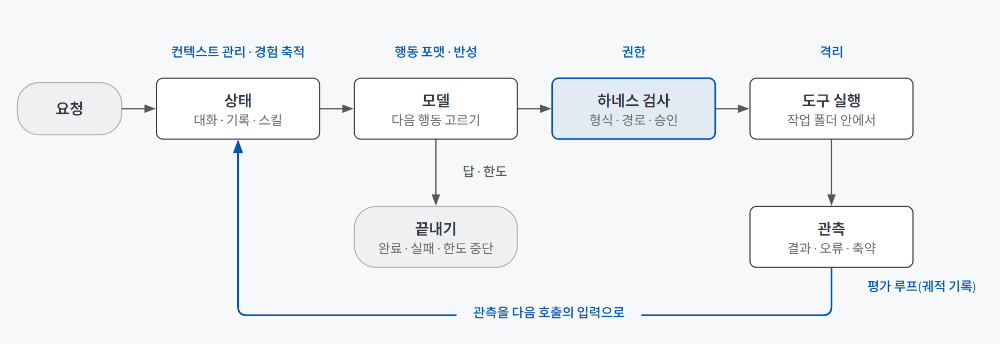
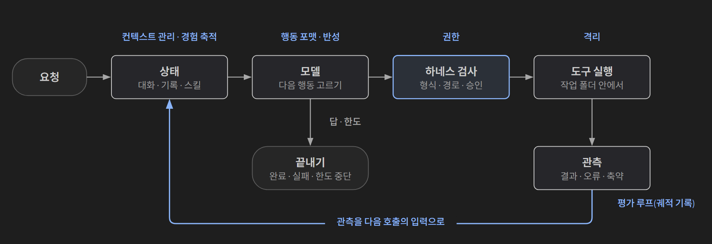
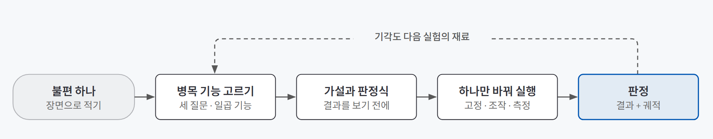
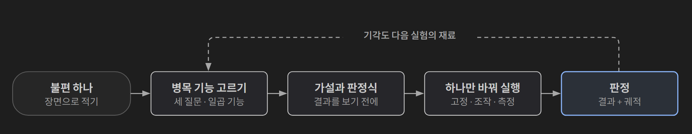

## 한 줄 요약

**하네스는 모델이 일하는 동안 요청·도구·기록·승인·관측을 이어 주는 실행 환경이고, 같은 모델이라도 하네스가 다르면 결과가 달라진다.** 그래서 에이전트가 막혔을 때는 모델을 바꾸기 전에 "하네스의 어느 기능에서 막혔는가"를 먼저 묻는다.

주방을 떠올리면 쉽다. 같은 요리사라도 동선, 칼, 레시피 노트, 위생 규칙, 맛보기 절차가 다른 주방에 서면 다른 음식이 나온다. 요리사가 모델이고, 주방이 하네스다. 음식이 이상할 때 요리사부터 바꾸면 비용은 크고, 정작 고장 난 칼은 그대로 남는다.

[도구 설계 글](/posts/tool-design/)에서는 하네스를 "모델의 도구 호출을 검사하고 실행하는 집행 장치"로, 도구 한 번 호출되는 자리를 중심으로 봤다. 이 글은 한 걸음 물러나 **하네스 전체가 어떤 기능들로 이루어지는지, 그리고 그중 무엇을 어떻게 고칠지**를 다룬다.

## 필요한 이유

에이전트가 일을 망치면 보통 둘 중 하나를 탓한다. 모델이 약하거나, 프롬프트가 부족하다. 그런데 실패를 뜯어 보면 모델 바깥에서 생긴 경우가 많다.

| 막히는 장면 | 실제로 비어 있던 곳 |
|---|---|
| 고칠 줄은 아는데 편집이 자꾸 깨진다 | 변경을 표현하는 형식 (행동 포맷) |
| 긴 작업 중 처음 본 실패 조건을 잊는다 | 무엇을 남기고 무엇을 줄일지 (컨텍스트 관리) |
| 지난번에 푼 일을 또 처음부터 한다 | 해결한 경험을 다시 쓰는 장치 (경험 축적) |
| 승인 창이 너무 많거나, 반대로 아무것도 안 묻는다 | 권한 규칙과 격리 |
| "완료했습니다"라는데 정말 됐는지 모른다 | 결과와 과정을 따로 확인하는 장치 (평가 루프) |

숫자로도 드러난다. SWE-agent 연구에서는 같은 모델로 실제 GitHub 이슈를 풀 때, 전용 편집 인터페이스를 쓰면 18.0%, 편집 기능을 뺀 조건에서는 10.3%를 풀었다. 지난 관측을 전부 넣는 대신 **최근 관측 5개만 자세히** 남기자 15.0%에서 18.0%로 올랐다. 모델은 그대로였고 바뀐 건 하네스였다.

반대 방향의 사례도 있다. Anthropic은 Claude Code의 시스템 프롬프트를 80% 이상 지워도 코딩 평가에서 측정 가능한 손실이 없었다고 보고했다(벤더 자체 보고). 모델이 좋아지면 예전 최악 상황을 대비해 넣은 규칙이 오히려 과잉 제약이 된다. **하네스는 부족해도 문제고 무거워도 문제다.** 그래서 "어디가 병목인가"를 먼저 찾아야 한다.

## 개념과 동작

### 하네스 한 바퀴

하네스는 다섯 단계를 반복한다. 요청과 쓸 수 있는 도구 설명을 모델에게 보내고, 모델이 요청한 도구를 해석하고, 실행해도 되는지 검사한 뒤 실행하고, 결과나 오류를 모델에게 돌려주고, 답·오류·한도에 따라 다음 행동을 잇거나 끝낸다.

{: .light }
{: .dark }

역할 분담이 핵심이다. **어떤 파일을 읽을지는 모델이 고르고, 작업 폴더·허용 기능·승인·중단 조건은 하네스가 쥔다.** 모델이 "파일을 읽었다"고 말하는 것과 실제로 읽은 것은 다르며, 그 차이는 하네스의 실행 기록으로만 확인할 수 있다.

### 일곱 기능

하네스를 일곱 기능으로 나눠 보면 "맡긴 일이 왜 막혔나"를 찾는 지도가 된다. 도구의 등급표가 아니다.

| 기능 | 하는 일 | 근거 | 반론·한계 |
|---|---|---|---|
| **행동 포맷** | 바꿀 대상과 내용을 확인 가능한 단위로 표현하게 한다 | 행동을 Python 코드 한 덩어리로 쓰는 CodeAct가 17개 모델에서 기존 형식 대비 최대 +20%p | Aider 자체 측정에서 GPT-3.5는 파일 전체 다시 쓰기 46%, 바뀐 줄만 쓰기 30%였지만 GPT-4는 차이가 거의 없었다 |
| **컨텍스트 관리** | 정해진 예산 안에 무엇을 넣고, 빠진 건 어디서 다시 찾을지 정한다 | 최근 관측 5개 유지 18.0% vs 전체 이력 15.0% (SWE-agent) | 예산이 충분하면 원문을 다 넣는 쪽이 평균 성능이 높았다는 비교도 있다. 줄이는 게 늘 답은 아니다 |
| **경험·스킬 축적** | 한 번 해결한 일을 다음 실행의 입력으로 만든다 | ExpeL(경험에서 뽑은 교훈 재사용) WebShop 보상 0.701 vs ReAct 0.665 | 그럴듯하지만 틀린 교훈 하나가 여러 과업에 반복 주입된다(오염) |
| **반성** | 실패 기록에서 다음에 바꿀 행동 하나와 근거를 남긴다 | Reflexion, 기억만 둔 조건보다 반성을 더한 이점 8%p | 같은 연구의 코딩 과제(MBPP)는 77.1%로 기준선 80.1%보다 낮았다 |
| **미니멀** | 과업을 끝낼 수 있는 가장 작은 루프의 조건을 찾는다 | Bash만 쓰는 약 100줄 에이전트(mini-swe-agent)가 SWE-bench Verified 74% 초과를 자체 보고 | 자체 보고이고 모델·시점이 고정되지 않았다. 아직 가설이다 |
| **권한·격리** | 읽기·실행·외부 메시지의 입구를 나누고, 실행 뒤 피해 범위를 가둔다 | 외부 입력의 출처를 표시하는 Spotlighting으로 공격 성공률 50% 초과 → 2% 미만 | 많이 막으면 정상 작업도 못 끝낸다 |
| **평가 루프** | 최종 결과와 거기에 이른 과정(궤적)을 따로 확인한다 | SWE-bench는 실제 이슈를 테스트로 채점한다 | 테스트 통과가 유지보수 품질 전체는 아니다. 공개 문제는 학습 데이터에 섞였을 수 있다 |

표의 숫자는 정답이 아니라 **조건이 붙은 가설**이다. 모델·과업·시점이 다르면 같은 차이가 나지 않는다.

### 경험과 반성은 틀린 것도 기억한다

경험 축적에서 남기는 형태는 넷이다. 원문 궤적은 검토하기 좋지만 길고, 요약은 빠르지만 실패 조건이 빠질 수 있고, 교훈(insight)은 검색하기 좋지만 오염될 수 있고, 코드 스킬은 바로 실행되지만 오래된 절차를 그대로 반복한다. 배포 체크리스트 스킬에 예전 서버 주소가 박혀 있으면, 그 스킬을 쓰는 모든 작업이 틀린 주소로 배포한다.

반성도 같다. "검색이 부족했다"는 반성은 다음 행동을 바꾸지 못한다. "오류가 난 파일의 호출 지점을 먼저 읽고, 그 뒤에만 검색 범위를 넓힌다"처럼 관찰 가능한 행동으로 적고, 작성 시각과 근거 기록을 붙여야 틀렸을 때 지울 수 있다. 스킬을 파일로 남기는 방법은 [규칙 파일과 스킬 글](/posts/coding-agent-skills-rules/)에서, 요약이 손실 압축이라는 점은 [컨텍스트 엔지니어링 글](/posts/context-engineering/)에서 다뤘다.

### 권한과 격리는 서로 대신하지 못한다

권한은 **실행 전 판단**이다. 어떤 행동을 자동으로 허용하고 어떤 행동에서 멈출지 정한다. 격리는 **실행 뒤 피해 가두기**다. 컨테이너 같은 외부 환경이 프로세스가 닿는 파일·네트워크 범위를 제한한다.

도구마다 이 둘을 다르게 배치한다. Claude Code는 권한 모드와 승인 화면으로 실행 전에 다루고, OpenCode는 `allow`·`ask`·`deny` 규칙에서 여러 규칙이 맞으면 마지막 규칙을 적용한다. 네 도구만 가진 미니멀 에이전트(pi)는 내장 권한 체계 없이 격리를 컨테이너에 맡긴다. 어느 쪽이 정답이 아니라, 같은 위험을 다른 자리에서 막는 설계다. 그리고 **작업 폴더를 지정했다고 운영체제 격리가 생기지는 않는다.** 승인한 코드는 사용자 권한으로 돈다.

### 결과와 궤적을 따로 본다

패치가 테스트를 통과했어도 궤적을 보면 같은 검색을 다섯 번 반복했을 수 있다. 결과 점수만으로는 이런 낭비, 우연한 성공, 과도한 권한 사용이 보이지 않는다. 그래서 점수와 함께 실행 환경, 모델, 권한 정책, 비용, 승인 횟수, 궤적을 같은 실행 단위로 남긴다.

반대로 하네스가 보고하는 `completed`는 "모델이 텍스트로 답했다"는 뜻일 뿐 정답이 아니다. 한도에 닿아 멈춘 실행은 "완료"가 아니라 **"제한에 도달해 중단"**으로 구분해야 한다.

### 직접 만들 때 먼저 정할 것

하네스를 직접 짠다면, 구현 전에 아래를 먼저 정한다. 개발 AI에게 "하네스 만들어 줘"라고만 하면 터미널 도구를 원했는데 웹 서버가 나오거나, 확인 없이 파일을 저장하는 기능이 들어갈 수 있다.

| 정할 것 | 핵심 |
|---|---|
| 화면·하네스·모델의 실행 위치 | 서로 다른 결정이다. 로컬 하네스가 외부 모델 API를 부를 수도 있다 |
| 첫 기능 범위 | 작더라도 입력 → 모델 → 도구 → 결과를 **끝까지 관통하는** 작업 하나부터 (수직 구현) |
| 실패할 때의 동작 | 파일 없음, 범위 밖 경로, 인증 실패, 해석 불가 요청을 각각 어떻게 할지도 기능으로 적는다 |
| 세 인터페이스 | 화면 ↔ 작업 처리부, 하네스 ↔ 모델 제공자, 하네스 ↔ 도구. 제공자마다 다른 형식은 **어댑터**가 내부 공통 형식으로 맞춘다 |
| 승인의 단위 | "앞으로 다 바꿔도 된다"가 아니라 제시한 변경 **하나**에 대한 허용. 범위 밖 경로는 승인을 묻기 전에 거절한다 |
| 종료 조건 | 모델 호출·도구 호출·시간 상한. 계속할 수 있는 오류와 끝내야 할 오류를 구별한다 |
| 완료 기준 | 모의 모델(준비한 응답을 순서대로 돌려주는 테스트용 구성)로 한도·거절을 재현하고, 실제 모델로 연결·품질을 따로 확인한다 |

모델 연결을 바꾸려는데 파일 권한 코드까지 고쳐야 한다면 경계가 섞인 것이다.

## 적합한 경우와 피할 경우

| 하네스를 손볼 때 | 하네스부터 의심하지 않을 때 |
|---|---|
| 같은 종류의 실패가 반복되고, 모델을 바꿔도 비슷하게 막힌다 | 한 번의 실패. 모델, 과업 난이도, 저장소 상태, 네트워크, 내 요청 문장일 수도 있다 |
| 에이전트 도구를 고르거나 비교해야 한다 | 기능 칸이 많이 채워진 도구를 좋은 도구로 순위 매기려 할 때 |
| 반복·권한·기록을 내 코드로 통제해야 한다 | 빨리 결과가 필요하면 기존 엔진(Claude Agent SDK, OpenCode)을 부품으로 조립하는 편이 낫다. 단 입력·결과 계약과 검수는 여전히 앱이 설계한다 |
| 설정 하나를 바꿔 효과를 숫자로 판정하고 싶다 | 고정할 과업 세트가 없을 때. 비교 기준이 없으면 효과를 말할 수 없다 |

## 장점과 한계

| 장점 | 한계 |
|---|---|
| 모델을 바꾸지 않고도 결과를 바꿀 수 있다. 비용이 가장 낮은 개선 경로다 | 공개된 수치 대부분이 특정 모델·과업 조건의 결과다. 내 환경에서 같은 효과가 난다는 보장이 없다 |
| 실패를 "모델 탓"이 아니라 기능 단위로 쪼개 원인에 빨리 닿는다 | 클로즈드 도구는 내부 구현을 볼 수 없다. 화면에 보이는 것만 관찰할 수 있다 |
| 기능 하나만 바꾸는 실험으로 효과를 반증 가능하게 판정할 수 있다 | 실험 한 번에 시간과 비용이 든다. 작은 표본은 우연한 결과를 낸다 |
| 권한과 기록을 쥐고 있어 사고를 실행 단계에서 막고 되짚을 수 있다 | 하네스를 무겁게 만들수록 문맥 비용과 과잉 제약이 는다 |

## 적용 방법

{: .light }
{: .dark }

### 1단계. 불편 하나를 장면으로 적는다

"에이전트가 이상하다"가 아니라 **어떤 과업에서, 어떤 입력 뒤에, 무엇이 지연되거나 잘못됐는지**로 적는다. 이때 원인이 하네스가 아닐 수도 있다고 같이 적어 둔다.

### 2단계. 세 질문으로 병목 기능을 고른다

이 일은 어디서 막히는가, 그 병목을 줄일 기능은 무엇인가, 그 기능이 작동했다는 기록은 어디서 확인하는가. 도구를 비교할 때는 같은 칸으로 관찰한다.

| 관찰 칸 | 볼 것 |
|---|---|
| 입구 · 상태 | 요청이 들어가는 곳, 세션·작업 기록이 남는 위치 |
| 대표 행동 · 권한 경계 | 화면에서 확인한 읽기·수정·실행, 그 전에 보이는 승인이나 제한 |
| 1차 근거 · 한계 | 다시 열 수 있는 실행 기록·설정, 이번 관찰로 확인 못 한 범위 |

관찰은 시험할 때마다 결과가 같도록 미리 준비한 고정 자료(fixture)로 한다. 자료가 같아야 달라진 게 도구라고 말할 수 있다.

### 3단계. 반증 가능한 가설과 판정식을 먼저 쓴다

"결과가 반대면 틀렸다"고 말할 수 있는 문장으로 가설을 쓰고, **결과를 보기 전에** 어떤 수치면 지지이고 어떤 수치면 기각인지 판정식을 적는다. 근거로 가져온 수치에는 학술·벤더·공식 문서 등급을 붙인다. 벤더 자체 보고는 독립 비교가 아니다. 판정식은 실행 뒤에 고치지 않는다.

### 4단계. 하나만 바꾸고 나머지는 고정한다

| 구분 | 내용 |
|---|---|
| 고정 | 모델, 과업 세트, 토큰·시간 예산, 실행 환경 |
| 조작 | 관측 개수, 편집 포맷, 권한 정책, 메모리 표현 중 **하나** |
| 측정 | 해결률과 함께 토큰, 승인 횟수, 시간 |

점수의 분모는 고정한다. 10문항 중 성공 3, 실패 4, 실행 오류 2, 미완료 1이면 3/10이다. 오류를 빼고 3/8로 계산하지 않는다. 문항당 세 번씩 돌렸다면 분모는 30이다.

### 5단계. 결과와 궤적으로 판정하고, 기각도 남긴다

점수가 바뀌었다면 궤적을 열어 정말 바꾼 기능 때문인지 확인한다. 기각은 실패가 아니라 다음 실험의 재료다.

## 다른 방법과 비교

| 방법 | 드는 비용 | 한 줄 평가 |
|---|---|---|
| 모델 교체 | 큼 | 하네스의 병목은 그대로 남는다. 바꾼다면 "조건이 다른 실험"으로 따로 기록한다 |
| 프롬프트 다듬기 | 작음 | 지시는 행동을 유도할 뿐 강제하지 못한다. 권한·종료 조건은 코드가 지켜야 한다 |
| **하네스 기능 하나 조정** | 작음~보통 | 병목이 분명하면 효과가 가장 크고, 실험으로 판정할 수 있다 |
| 하네스 직접 구현 | 큼 | 반복·권한·기록을 완전히 통제한다. 손이 많이 간다 |
| 기존 엔진 조립 | 보통 | 빠르지만 계약·상태·검수 설계는 여전히 내 몫이다 |

## 주의할 점

**표본이 작으면 우연한 지지가 나온다.** 고정 과업 세트를 작게 잡으면 한 번의 결과가 그럴듯한 결론처럼 보인다. 규모를 키워 다시 돌리거나 반복 횟수를 늘린 뒤에 판정한다.

**변경 두 개를 한 실행에 넣지 않는다.** 개선 쪽에 변경이 둘 이상 섞이면 결과가 좋아져도 무엇 덕분인지 가를 수 없다.

그 밖에 기억할 것:
- **실험 세션은 내 환경을 물려받는다.** 전역 설정(훅, 개인 지침)이 실험 세션에도 상속되어 결과를 오염시킬 수 있다.
- **승인 창이 안 떴다고 안전한 게 아니다.** 권한 규칙을 열어 보기 전까지는 "미확인"으로 적는다.
- **개발 AI가 대신 읽고 답한 결과는 내 하네스의 결과가 아니다.** 만든 프로그램을 따로 실행해 그 기록을 확인한다.
- **같은 문항으로 계속 고치면 그 문항은 개발용 평가 세트가 된다.** 처음 보는 과업에서도 낫다는 결론으로 넓히지 않는다.
- **빨리 끝났다고 효율적인 게 아니다.** 한도 때문에 멈췄는지 기록을 본다.

## 용어 정리

| 용어 | 뜻 |
|---|---|
| 하네스 | 모델이 일하는 동안 요청·도구·기록·승인·관측을 이어 주는 실행 환경 |
| 행동 포맷 | 모델이 다음 행동(편집, 명령)을 표현하는 형식. 파일 전체 다시 쓰기, 바뀐 줄만 쓰기, 코드로 쓰기 등 |
| ACI (Agent-Computer Interface) | 모델이 쓰기 좋게 만든 전용 행동·관측 인터페이스. SWE-agent가 제안했다 |
| 궤적 (trajectory) | 결과에 이르기까지의 검색·편집·실행 순서 기록 |
| 오염 | 그럴듯하지만 틀린 경험이나 교훈이 저장되어 다른 과업에 반복 주입되는 것 |
| Reflexion | 가중치를 바꾸지 않고 시도 → 오류 → 반성 → 기억을 반복하는 방법 |
| 격리 | 실행된 프로세스가 닿는 파일·네트워크·운영체제 범위를 외부 환경이 제한하는 것 |
| fixture | 시험할 때마다 결과가 같도록 미리 준비해 둔 고정 자료 |
| 사전 판정식 | 결과를 보기 전에 정해 두는 지지·기각 기준 |
| 수직 구현 | 작더라도 입력부터 결과까지 끝까지 관통하는 기능 하나를 먼저 완성하는 방식 |
| 어댑터 | 모델 제공자마다 다른 요청·응답 형식을 내부 공통 형식으로 맞추는 연결부 |
| 모의 모델 | 준비한 응답을 순서대로 돌려주는 테스트용 모델. 한도·거절 같은 상황을 확실히 재현한다 |
