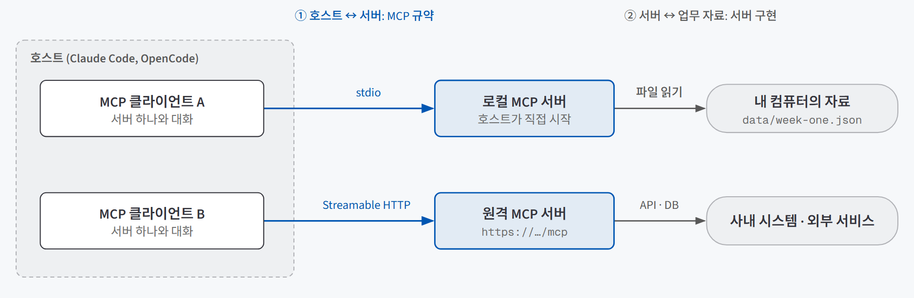
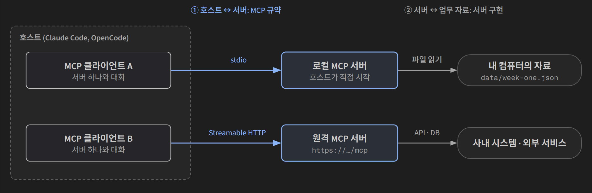
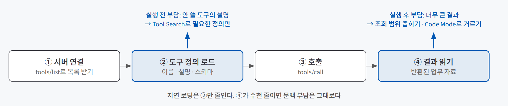
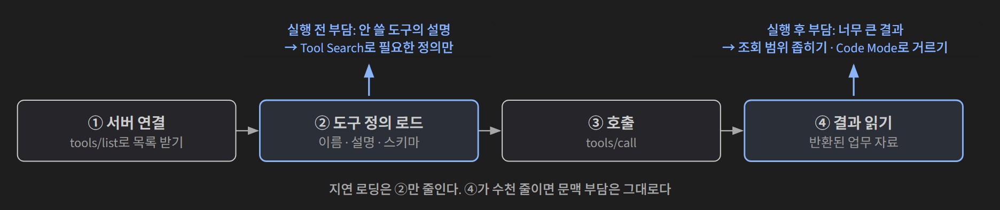

## 한 줄 요약

**MCP(Model Context Protocol)는 도구를 제공하는 프로그램과 AI 앱 사이에 둔 공통 규칙이다.** 한 번 만든 도구를 Claude Code든 OpenCode든 같은 방식으로 발견하고 호출하게 해 준다. 다만 MCP가 맡는 건 **자료를 가져오는 연결**까지다. 가져온 자료를 우리 팀 기준으로 해석하는 일은 따로 설계한다.

콘센트 규격과 비슷하다. 플러그(서버)를 규격에 맞춰 두면 어느 집(앱)에서든 꽂히지만, 콘센트가 벽 어디에 달렸는지(등록 설정 파일)는 집마다 다르다. 그리고 꽂힌 전기로 무엇을 할지는 꽂은 사람이 정한다.

## 필요한 이유

AI가 대화 밖의 자료를 쓰려면 도구가 필요하다. 도구 하나를 어떻게 설계하는지(설명·스키마·권한·중단)는 [에이전트에게 도구를 줄 때 정할 것](/posts/tool-design/)에서 다뤘다. 이 글은 그다음 문제, **만든 도구를 앱에 어떻게 붙이느냐**를 다룬다.

MCP가 없을 때는 앱마다 연결 코드를 따로 짰다. 모델이 읽는 도구 설명 형식에 맞추고, 모델이 쓴 호출을 읽어 내고, 실제 서비스에 연결하는 부분을 앱마다 다시 만든다. 앱이 하나뿐이면 이것도 된다. 문제는 늘어날 때다.

| 상황 | MCP 없이 | MCP로 |
|---|---|---|
| 같은 조회 기능을 두 앱에서 쓴다 | 앱마다 연결 코드를 따로 만든다 | 서버 하나를 두 앱에 등록한다 |
| 자료 저장 위치가 바뀐다 | 연결한 곳을 전부 고친다 | 서버 하나만 고친다 |
| 여러 사람이 같은 기능을 쓴다 | 각자 자기 환경에 맞춰 다시 만든다 | 같은 서버를 붙인다 |

연결이 표준이 되면 바뀌는 곳이 한 군데로 모인다. 대신 그 한 군데가 **여러 앱과 여러 사람에게 동시에 열리는 입구**가 된다는 점도 같이 따라온다.

## 개념과 동작

### 세 역할과 두 통로

{: .light }
{: .dark }

| 역할 | 하는 일 |
|---|---|
| **호스트** | 사용자가 대화하는 앱(Claude Code, OpenCode). 대화, 모델, 서버 연결, 실행 허용을 관리한다 |
| **클라이언트** | 호스트 안에서 **서버 하나와** 메시지를 주고받는 부분. 호스트가 갖추고 있어 따로 만들지 않는다 |
| **서버** | 기능을 제공하는 프로그램. 내 컴퓨터의 작은 Python 프로그램이어도 서버다. **실행 위치가 아니라 역할 이름**이다 |

그림의 통로는 두 개다. **① 호스트와 서버 사이**는 MCP 규약을 따른다. **② 서버와 업무 자료 사이**는 MCP와 상관없이 서버 구현이 정한다. 로컬 서버가 안에서 Google API를 부를 수도 있고, 원격 서버가 사내 DB만 읽을 수도 있다. 문제가 생기면 이 두 통로를 따로 의심해야 원인이 좁혀진다.

### 메시지는 JSON-RPC로 오간다

MCP의 메시지는 **JSON-RPC**(JSON으로 요청과 응답을 주고받는 약속)를 쓴다. 핵심 작업은 둘이다. `tools/list`는 "어떤 도구가 있나" 목록 요청이고, `tools/call`은 실행 요청이다.

```json
{ "jsonrpc": "2.0", "id": 2, "method": "tools/call",
  "params": { "name": "get_weekly_records", "arguments": { "week": "week-one" } } }
```

`tools/call`은 MCP의 공통 작업 이름이고, 그 안의 `name`이 우리가 만든 도구 이름이다. `id`는 요청과 응답을 짝짓는 번호다. 둘째 요청의 응답이 먼저 와도 `id`를 보고 맞는 요청에 붙인다. 업무 데이터에 있는 ID(예: `TASK-102`)와는 이름만 같고 전혀 다른 것이다.

MCP는 **모델의 출력을 읽는 파서가 아니다.** 모델이 쓴 호출 요청을 읽어 도구 이름과 인자를 뽑는 일은 호스트(또는 모델 제공자의 API)가 한다. MCP는 그렇게 정해진 호출을 서버에 전달하고 결과를 받아 오는 구간을 맡는다.

### 서버가 내주는 세 가지

같은 업무라도 "실행할 기능"으로 줄지, "읽을 자료"로 줄지, "대화 틀"로 줄지 고를 수 있다.

| 종류 | 무엇인가 | 예 |
|---|---|---|
| **Tool** | 호출마다 입력을 받아 실행하는 기능 | 주차를 받아 그 주의 업무 기록 조회 |
| **Resource** | 식별자(URI)로 가리켜 읽는 자료 | `team://guide/terms` 팀 용어 안내 |
| **Prompt** | 인자를 채워 시작하는 대화 템플릿 | 주차가 들어간 주간 보고 시작 대화 |

**읽기 전용 조회도 Tool이 될 수 있다.** "도구는 무언가를 바꾸는 것"이라는 오해를 피하면 설계가 쉬워진다. 세 가지를 다 구현해야 MCP 서버가 되는 것도 아니다. Tool 하나만 있는 서버도 흔하다. Resource와 Prompt를 화면에서 어떻게 고르게 하는지는 호스트마다 다르다.

### 전송 방식: stdio와 Streamable HTTP

| 방식 | 호스트가 알아야 하는 것 | 모습 |
|---|---|---|
| **stdio** | 실행할 프로그램과 인자 | 호스트가 내 컴퓨터에서 서버를 직접 시작하고, 표준 입력·출력으로 메시지를 주고받는다 |
| **Streamable HTTP** | 서버 주소(`https://…/mcp` 같은 엔드포인트) | 따로 실행 중인 서버에 메시지를 보낸다 |

"인터넷을 쓰느냐"로 외우면 틀린다. HTTP 서버도 내 컴퓨터에서 띄울 수 있고, stdio 서버가 안에서 외부 API를 부를 수도 있다. 기준은 **호스트가 서버를 직접 띄우는가, 이미 떠 있는 주소로 붙는가**다.

stdio는 웹 주소 없이 바로 시작할 수 있고, 호스트가 서버 프로세스를 관리해 주므로 따로 터미널을 띄워 둘 필요가 없다. 원격 HTTP 서버는 소스와 원본 DB를 서버 쪽에 두고 호출 규칙과 결과만 내줄 수 있다. 다만 **원격으로 둬도 응답에 넣은 자료는 호스트로 간다.** 숨길 수 있는 건 소스와 원본이지, 돌려준 결과가 아니다.

### 연결된 뒤의 네 단계와 문맥 부담

{: .light }
{: .dark }

서버를 붙이면 **연결 → 도구 정의 로드 → 호출 → 결과 읽기**가 따로따로 일어난다. 이걸 나눠 봐야 "짧게 말했는데 왜 문맥(모델이 이번 응답에 참고하는 정보 전부)이 이미 크지?"에 답할 수 있다.

부담이 생기는 자리는 두 곳이다.

- **실행 전 부담:** 쓰지도 않을 도구의 설명이 매 요청에 실린다. 도구 100개에 정의당 500토큰씩이라고 가정하면 약 5만 토큰이 도구 안내에만 쓰인다. 필요한 도구만 찾아 정의를 불러오면 "검색 안내 + 찾은 두 도구" 정도인 약 2천 토큰으로 줄어들 수 있다.
- **실행 후 부담:** 조회 결과 자체가 크다. 1년 치 기록 수천 줄을 돌려받으면 정의를 아무리 아껴도 문맥은 그대로 찬다.

MCP가 모든 정의를 매번 모델에 읽히라고 강제하지는 않는다. 언제 읽힐지는 호스트가 정하고, 호스트마다 방법이 다르다.

| 방법 | 어디서 | 하는 일 | 줄이는 부담 |
|---|---|---|---|
| **Tool Search** | Claude Code | 연결된 도구 중 필요한 것을 먼저 찾고, 그 도구의 정의만 불러온다(지연 로딩) | 실행 전 |
| **Code Mode** | OpenCode | 모델이 도구를 하나씩 부르는 대신 도구 호출을 담은 짧은 코드를 쓰고, 앱이 정해진 범위에서 실행한다. 받은 결과에서 필요한 값만 골라 모델에 넘길 수 있다 | 실행 전 + 실행 후 일부 |

둘 다 공짜는 아니다. 검색 단계가 끼면 모델 호출이 한 번 더 늘 수 있어서, **문맥이 줄었다고 시간과 비용도 같이 준다고 단정할 수 없다.** 도구가 몇 개뿐이면 검색 왕복 때문에 오히려 느려질 수도 있다. Code Mode는 코드 실행 단계가 끼는 만큼 읽어야 할 기록이 늘고, 모델마다 코드를 쓰는 실력이 달라 내 조합에서 따로 확인해야 한다.

연결 상태에 따라 **제공하는 도구 목록 자체가 바뀌는** 서버도 있다(동적 도구 목록). 서버가 "목록이 바뀌었다"고 알리고 호스트가 그 알림을 받아 갱신해야 새 도구를 쓸 수 있으므로, 이런 서버는 그 알림을 지원하는 호스트에서만 제대로 돈다.

### MCP와 스킬은 맡는 일이 다르다

자료를 **가져오는 것**과 그 자료를 **우리 팀 기준으로 해석하는 것**은 다른 일이다. 같은 업무 기록을 보고도 개발 진척을 공유하는 팀은 "구현 완료, 배포 대기"로, 고객 성과를 보고하는 팀은 "진행 중"으로 쓴다. 기록은 같고 기준만 다르다.

| 전달 방식 | 맡기는 내용 | 주간 보고 작업이라면 |
|---|---|---|
| 이번 요청 | 이번 작업의 목적·대상·범위 | "새 팀원이 이해할 보고서로" |
| 규칙 파일 | 프로젝트 전반의 관례 | 문서 언어, 기본 용어 |
| 스킬 | 특정 과업에서 반복할 지식·절차·자료 | 완료·진행·위험 분류 기준과 예시 |
| **MCP** | 프로그램의 도구·자료 연결 | 업무 기록 조회 |

규칙 파일과 스킬은 [같은 설명을 두 번 하지 않게](/posts/coding-agent-skills-rules/)에서 다뤘다. 여기서 기억할 것은 하나다. **스킬에 "이 자료를 읽어라"라고 써도 접근 기능이 생기지는 않는다.** 반대로 MCP로 자료를 붙여도 해석 기준은 생기지 않는다. 둘은 함께 쓰는 부품이다. 스킬에 CLI 사용법을 적어 두고 셸로 외부 서비스를 부르게 하면 MCP 없이 가는 길도 있다.

## 적합한 경우와 피할 경우

| MCP로 내주는 게 맞는 경우 | MCP가 필요 없는 경우 |
|---|---|
| 같은 기능을 **여러 앱이나 여러 사람**이 써야 한다 | 앱 하나에서 나 혼자 쓴다 (그 앱의 도구 기능에 바로 붙여도 된다) |
| 자료가 **다른 서비스**(사내 시스템, 클라우드 문서)에 있다 | 자료가 로컬 파일이고 호스트가 이미 읽을 수 있다 |
| 매주처럼 **반복해서** 같은 자료를 가져온다 | 몇 줄짜리 자료를 한 번만 정리하면 끝난다 (대화창에 붙여 넣는 게 낫다) |
| 저장 위치나 방식이 바뀔 수 있어 **한 곳에서 고치고** 싶다 | 막힌 이유가 자료 접근이 아니라 **해석 기준**이다 (스킬이나 규칙을 고친다) |

## 장점과 한계

| 장점 | 한계 |
|---|---|
| 앱마다 등록 방법은 달라도, 연결 뒤의 발견·호출은 같은 규약을 쓴다 | 등록하는 설정 형식까지 같아지지는 않는다. 같은 서버를 두 앱에 등록하면 앱마다 서버 프로세스가 따로 뜰 수 있다 |
| 자료 위치가 바뀌어도 서버 하나만 고치면 된다 | 그 서버 하나가 여러 앱에 동시에 열리는 입구가 된다 |
| 원격 서버는 소스와 원본 DB를 숨기고 결과만 줄 수 있다 | 돌려준 결과는 호스트로 간다. 인증(누구인지)과 접근 권한(무엇을 허용할지)은 MCP가 대신하지 않는다 |
| 지연 로딩·Code Mode로 문맥 부담을 줄일 길이 있다 | 지연 로딩은 실행 전 부담만 줄인다. 결과 크기는 조회 범위를 설계해서 줄여야 한다 |

## 적용 방법

### 1단계. 새 MCP가 정말 필요한지부터 가른다

내 업무를 **데이터**(이번에 처리할 사실), **업무 지식**(그 사실을 해석하는 기준), **실행 기능**(자료를 읽거나 계산하는 동작)으로 나눈다. MCP가 맡는 건 세 번째뿐이다. 자료가 호스트가 읽을 수 있는 곳에 있으면 새 서버는 만들지 않는다. 다른 서비스에 있거나 여러 앱에서 써야 할 때 연결을 만든다.

### 2단계. 서버는 원본을 그대로 돌려주는 작은 기능으로 둔다

조회 도구 안에 요약이나 판정을 넣지 않는다. 같은 원자료를 보고서에도, 일정 확인에도 쓰려면 조회는 작게 두고 해석은 바깥에서 한다. 입력은 **파일 경로를 직접 받지 말고** 허용 목록(주차 → 파일)으로 고정한다. 경로를 받으면 아무 파일이나 열 수 있게 된다.

입력 검사는 두 겹이다.

| 검사 | 막는 것 | 못 막는 것 |
|---|---|---|
| 스키마 검사 (SDK가 자동) | 자료형이 틀리거나(`week: 1`) 필수값이 빠진 호출 | 형식은 맞는데 없는 값(`"week-three"`) |
| 허용값 검사 (함수 안) | 허용 목록에 없는 값 | — |

대소문자나 공백 정리 같은 **정규화는 하되, 없는 값을 비슷한 값으로 추측해 바꾸지는 않는다.** `week-three`를 `week-one`으로 바꿔 주는 친절은 틀린 자료를 맞는 자료처럼 내보낸다.

### 3단계. 전송과 등록을 정한다

stdio 서버라면 **표준 출력이 메시지 통로**라는 점을 지킨다. 여기에 "서버가 시작되었습니다" 같은 일반 출력이 섞이면 받는 쪽이 그 줄을 메시지로 읽으려다 실패한다. 로그는 표준 오류로 보내고, 도구 결과는 반환값으로 돌려준다. 자료 위치는 실행한 폴더가 아니라 **소스 파일 기준**으로 잡아야 호스트가 어디서 서버를 띄워도 자료를 찾는다. 등록 범위는 이 프로젝트에서만 쓰면 프로젝트 범위로, 여러 프로젝트에서 쓰면 사용자 범위로 둔다.

### 4단계. 호출 기록으로 경로를 확인한다

"됐다"는 답 대신 **호출 기록**에서 세 가지를 본다. 어떤 도구를 불렀는지, 무엇을 보냈는지, 무엇을 받았는지. 그리고 받은 결과를 원본 자료와 나란히 대조한다. 결과가 이상할 때는 어디서 멈췄는지부터 가른다.

| 관찰 | 뜻 |
|---|---|
| 없는 주차를 요청했더니 오류가 돌아왔다 | 요청이 도구에 도달했고 **함수가 거절**한 것. 서버는 정상이다 |
| 호출 전에 모델이 "지원하지 않는 주"라고 답했다 | 도구까지 가지 않은 **모델의 사전 판단** |
| 답은 맞는데 기록에 MCP 호출이 없다 | AI가 파일 읽기 같은 다른 도구로 원본을 직접 읽은 것. **MCP 경로는 확인하지 못했다** |
| 소스를 고쳤는데 결과가 그대로다 | 재연결이나 재시작 전이라 옛 코드가 돌고 있다 |

### 5단계. 문맥이 커지면 부담의 종류부터 가른다

| 관찰한 상황 | 먼저 볼 곳 |
|---|---|
| 대화를 거의 안 했는데 사용량이 크다 | 도구 정의를 필요할 때만 불러오는 설정 |
| 한 번 조회에 수천 줄이 돌아온다 | 조회 범위와 반환 항목 |
| 비슷한 이름의 다른 도구를 호출했다 | 발견한 도구 설명과 실제 호출 입력 |
| 도구는 찾았는데 인증 만료 오류가 난다 | 해당 서비스의 인증 상태 |

## 다른 방법과 비교

| 방법 | 언제 맞나 | 한 줄 평가 |
|---|---|---|
| 대화창에 붙여 넣기 | 몇 줄짜리 자료를 한 번 정리할 때 | 가장 빠르지만 매주 반복되면 손이 계속 간다 |
| 앱별 직접 연결 코드 | 앱이 하나뿐일 때 | 충분히 된다. 앱이 늘면 같은 코드를 다시 짠다 |
| 일반 원격 API | 소스를 숨기고 기능만 내줄 때 | 숨기는 건 된다. 여러 호스트가 같은 방식으로 발견하고 부르는 건 MCP가 더하는 부분이다 |
| 스킬 + CLI | 이미 좋은 CLI가 있는 서비스 | MCP 서버 없이 셸로 부른다. 대신 셸 실행 권한이 필요하다 |
| **MCP** | 같은 기능을 여러 앱·사람이 반복해서 쓸 때 | 연결이 한 곳에 모인다. 그 한 곳의 인증·권한 설계는 내 몫이다 |

## 주의할 점

**서버에 꽂은 순간 그 서버가 닿는 모든 곳이 에이전트의 손이 된다.** 에이전트는 보이는 도구로만 행동할 수 있으니, 연결한 도구 목록이 곧 권한 목록이다. 연결 경계에서 지킬 것은 이렇다.

- **비밀값은 도구 설명이나 결과에 넣지 않는다.** API 키나 토큰이 설명에 들어가면 매 요청마다 모델 입력에 실리고, 결과에 섞이면 답에 인용될 수 있다.
- **앱 설정과 사용자 인증을 구분한다.** OAuth(비밀번호 대신 허용할 접근을 고르는 절차)를 쓰는 서버라면, 콘솔에서 받은 앱 설정 파일과 로그인 뒤 생기는 토큰 파일은 다른 것이다. 둘 다 저장소나 대화에 넣지 않고, 에이전트에게는 **경로만** 알려 준다. 재로그인은 별도 프로그램이 맡고, 서버는 저장된 토큰으로만 읽게 나누면 호출 도중 브라우저 로그인을 기다리는 일이 없다.
- **허용 범위(scope)와 파일 공유 권한은 다른 조건이다.** 표 읽기 범위에 동의해도 공유받지 않은 표는 못 읽고, 읽기 전용 범위는 한 파일이 아니라 **접근 가능한 모든 표**의 읽기 권한이다. 범위를 바꿔도 이미 받은 토큰의 권한은 저절로 바뀌지 않는다.
- **읽어 온 문서는 판단 재료일 뿐 실행 허가가 아니다.** 웹 문서나 메일에 섞인 명령 같은 문장이 원래 과업보다 앞서 행동하게 만드는 것이 프롬프트 인젝션이다. 바깥 내용을 읽는 역할에는 읽기 전용 도구만 주고, 쓰기와 명령 실행은 별도 승인 뒤에 한다. 권한을 어떻게 겹겹이 쌓는지는 [도구 설계 글의 안전 4층](/posts/tool-design/)과 같다.

그 밖에 기억할 것:
- **도구 검색 결과에 이름이 보인 것은 조회 성공이 아니다.** 검색이 돌려주는 건 사용법이고, 업무 내용은 실제 호출 결과로만 온다.
- **같은 대화에서 검색 흔적이 안 보인다고 고장은 아니다.** 이미 찾은 정의를 다시 쓰는 중일 수 있다.
- **호스트 버전마다 등록 설정 형식이 다를 수 있다.** 남의 설정 예시를 가져오기 전에 내 호스트의 버전부터 확인한다.

MCP 서버로 낼 도구 네 개를 계약·권한·실패 규칙부터 문서로 설계해 본 기록은 [제출서류 검증 챗봇 설계 검증](/posts/rfp-document-checker/)에 있다.

## 용어 정리

| 용어 | 뜻 |
|---|---|
| MCP (Model Context Protocol) | 도구를 제공하는 프로그램과 AI 앱이 메시지를 주고받는 공통 규칙 |
| 호스트 / 클라이언트 / 서버 | 사용자가 쓰는 앱 / 앱 안에서 서버 하나와 대화하는 부분 / 기능을 제공하는 프로그램 |
| JSON-RPC | JSON으로 요청과 응답을 주고받고, 요청 번호(id)로 짝짓는 약속 |
| `tools/list` · `tools/call` | 도구 목록 요청 · 도구 실행 요청 |
| Tool · Resource · Prompt | 서버가 내주는 실행 기능 · 식별자로 읽는 자료 · 대화 템플릿 |
| stdio | 호스트가 서버를 직접 띄우고 표준 입력·출력으로 메시지를 주고받는 전송 방식 |
| Streamable HTTP | 이미 실행 중인 서버의 주소로 메시지를 보내는 전송 방식 |
| 지연 로딩 | 도구는 연결해 두고, 상세 정의는 필요할 때만 불러오는 방식 |
| Tool Search | Claude Code가 필요한 도구를 먼저 찾아 그 정의만 불러오는 기능 |
| Code Mode | OpenCode에서 모델이 도구 호출 코드를 쓰고 앱이 정해진 범위에서 실행하는 방식 |
| 동적 도구 목록 | 연결 상태에 따라 서버가 내주는 도구 목록 자체가 바뀌는 것 |
| scope | OAuth로 허용한 작업 범위 (예: 표 읽기) |
