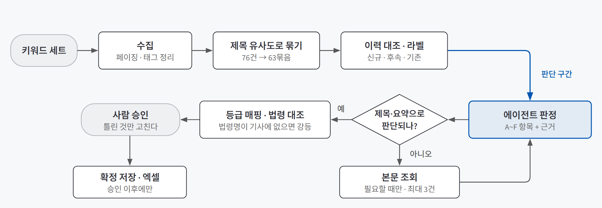
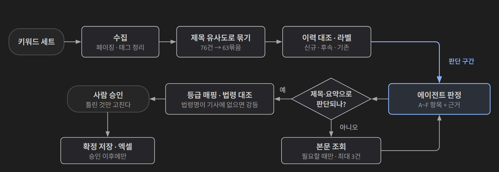

## 한 줄 소개

**순서는 코드가 정하고 판단이 필요한 곳에서만 AI가 움직이는 워크플로가, 내 컴퓨터의 작은 모델로도 실무 뉴스 모니터링을 맡을 수 있는지 확인하려고 이슈 레이더를 만들어 검증했다.** 키워드로 모은 기사를 같은 사건끼리 묶고, 묶음마다 신규·후속·기존 라벨과 중요도, 판단 근거를 붙여 사람이 검토·승인하게 하는 도구다.

저장소: [beginner-driver/Main_Quest_4](https://github.com/beginner-driver/Main_Quest_4)

> **검증한 것:** 판단 구간만 에이전트에 맡겨 로컬 4B 모델로 끝까지 판정하기 ✅ · 도구 실패·상한·중단을 설계로 흡수하기 ✅ · 기사를 지우지 않고 정렬만 해서 누락을 숫자로 관리하기 ✅(하루치 표본)
>
> **발견한 것:** AI보다 먼저 기존 수집 코드가 조용히 기사를 놓치고 있었다 · 등급 분포가 좋아진 것과 판정이 맞는 것은 달랐다 · 큰 모델이 작은 모델보다 빨랐다
{: .prompt-tip }

## 만든 이유

매일 키워드로 뉴스를 검색해 엑셀 100줄 이상을 눈으로 훑으며 "새 이슈인가, 어제 본 건가, 후속보도인가"를 가리는 업무가 있었다. 감시 대상은 사회연대경제 분야(사회적기업, 마을기업, 소셜벤처, 관련 법·제도)의 생태계 동향이다. 100줄 중 실제로 서로 다른 이슈는 일부이고 나머지는 같은 사건을 여러 매체가 받아쓴 기사인데, 매일 처음부터 훑었다. AI에 맡기지 못한 이유는 하나였다. **중요한 기사를 조용히 빠뜨릴까 봐서다.**

[다음 행동을 누가 정하나 — 자동화·워크플로·에이전트 구분하기](/posts/automation-vs-agent/), [에이전트에게 도구를 줄 때 정할 것 — 계약·권한·기록·중단](/posts/tool-design/), [지시는 부품으로, 답은 계약으로 — 시스템 프롬프트와 구조화 출력](/posts/system-prompt-structured-output/)을 배우고 나서 세 가지가 궁금했다.

1. 다음 행동을 대부분 **코드가 정하고**, 해석이 필요한 구간에서만 에이전트가 루프를 돌게 하면, GPU 없는 노트북의 4B 모델로도 하루치 판정을 끝까지 마칠까?
2. 도구가 실패하거나 시간·토큰 상한에 닿거나 실행이 중간에 끊겨도, **설계로 정한 규칙대로** 기록하고 이어 갈 수 있을까?
3. 에이전트가 기사를 **고르는 대신 묶고 정렬만** 하게 하면, "빠뜨릴까 봐"라는 걱정을 재고 관리할 수 있는 숫자로 바꿀 수 있을까?

## 실험 설계

### 동작 흐름

{: .light }
{: .dark }

1. **코드**가 네이버 뉴스 검색 API로 기사를 모으고, 제목이 비슷한 기사끼리 묶고, 과거 이슈와 대조해 신규·후속·기존 라벨을 붙인다.
2. **에이전트**는 묶음마다 중요도 기준(A~F) 중 어디에 해당하는지와 근거를 판정한다. 제목과 요약만으로 판단이 안 되면 본문을 요청한다(실행당 최대 3건).
3. 다시 **코드**가 항목을 등급(최우선·필수·참고)으로 바꾸고, "법·제도 변경(B)"이라고 주장한 묶음은 법령 이름이 실제 기사에 있는지 대조한다.
4. **사람**이 결과를 보고 틀린 것만 고친 뒤 확정한다. 저장과 엑셀 출력은 확정 이후에만 일어난다.

설계 제1원칙은 **"에이전트는 기사를 지우지 않는다"**였다. 중요도가 낮게 매겨져도 목록에서 사라지지 않고 순서만 뒤로 간다. 라벨을 못 믿겠으면 전부 펼쳐 예전처럼 훑으면 된다.

### 사용 기술

| 기술 | 어디에 썼나 |
|---|---|
| **네이버 뉴스 검색 API** | 키워드별 기사 수집. 기존에 쓰던 수집 스크립트의 결함을 고쳐 다시 짰다 |
| **Ollama + qwen3:4b** | 내 컴퓨터에서 도는 4B 모델로 중요도 판정. qwen3.5:2b와 비교한 뒤 바꿨다. GPU 없는 노트북(Ryzen 7 PRO 4750U)에서 CPU로 돌렸다 |
| **구조화 출력(JSON 스키마)** | 판정 결과를 정해진 칸(항목 코드, 법령명, 근거, 본문 필요 여부)으로만 받았다 |
| **SQLite** | 기사·묶음·실행 기록 저장. 에이전트에게는 읽기 전용 조회만 열었다 |
| **Streamlit** | 파이썬만으로 만드는 웹 화면. 승인, 실행 로그, 키워드 세트, 이력 화면 4개 |
| **pytest** | 수집 결함, 저장 오류 같은 실제로 겪은 실패를 회귀 테스트 60개로 고정했다 |

에이전트 프레임워크는 쓰지 않았다. 도구 4개짜리 루프라 상태는 SQLite가 맡고, 루프는 직접 짰다.

### 도구와 실패 규칙

| 도구 | 권한 | 실패하면 |
|---|---|---|
| `search_news` | 읽기 | 그 키워드만 건너뛰고 기록한다. 수집 상한에 닿으면 화면에 경고를 띄운다 |
| `lookup_history` | 읽기 전용 | **즉시 중단한다.** 이력 없이 판정하면 모든 묶음이 신규로 잘못 붙고, 다음 날 판단까지 오염된다 |
| `fetch_article` | 읽기 | 재시도하지 않고 요약문으로 판정한 뒤 "본문 확인 실패"를 표시한다 |
| `export_excel` | 쓰기 | 사람이 확정한 뒤에만 호출된다 |

종료 조건은 **묶음당 반복 3회, 본문 조회 3건, 30분, 5만 토큰**이다. 상한에 닿는 것은 실패가 아니라 기록되는 상태로 두고, 판정하지 못한 묶음도 "보류"로 목록에 남긴다.

### 판단 기준과 샘플

| 지표 | 세는 것 |
|---|---|
| **누락률** | 확정한 묶음 중 사람이 등급을 **올린** 비율. 놓칠 뻔한 건이라 가장 중요하다 |
| **과잉** | 사람이 등급을 **내린** 건수. 귀찮을 뿐 안전한 실수다 |
| **수정률** | 확정할 때 라벨이나 중요도를 하나라도 고친 비율 |

목표는 **누락률 10% 이하**로 미리 정했다. 샘플은 실제 감시 키워드 7개로 2026-09-10에 수집한 하루치 기사 76건이다. 이것이 63묶음으로 접혔고, 63묶음 전부를 직접 검토·확정해 정답으로 삼았다. 모델 비교는 별도로, 같은 기사(77건 → 59묶음)를 빈 이력에서 각 모델이 따로 판정하게 했다.

## 검증 결과

| 질문 | 결과 | 근거 |
|---|---|---|
| 1. 판단 구간만 에이전트에 맡기기 | ✅ 완주 | 63묶음 전건 판정, 미판정 0건. 단 처음 맡긴 일 4가지를 코드로 되돌린 뒤였다 |
| 2. 실패·상한·중단을 설계로 흡수하기 | ✅ 동작 | 도구 호출 23단계가 이유·소요시간과 함께 전부 기록됐고, 상한에 걸린 실행을 이어서 마쳤다 |
| 3. 누락을 숫자로 관리하기 | ✅ 하루치 기준 | 누락률 7.9%(5건)로 목표 10% 이하. 표본이 하루치뿐이다 |

### 질문 1. 판단 구간만 맡기면 4B 모델로 끝까지 도는가

결과적으로는 돌았다. 하루치 63묶음이 사람 개입 없이 전부 판정됐고 판정하지 못한 묶음은 0건이었다. 다만 처음부터 이 구조였던 것은 아니다. **처음에는 에이전트에게 더 많이 맡겼다가, 틀리는 걸 확인할 때마다 코드로 옮겼다.**

| 원래 에이전트가 하던 일 | 실측 | 어디로 갔나 |
|---|---|---|
| 신규·후속·기존 라벨 | 5건 중 1건만 정답 | 코드: 제목 유사도 비교 |
| 등급 직접 고르기 | 2b는 전부 `필수`, 4b는 전부 `B`로 몰림 | 코드: 항목 → 등급 매핑 |
| "법이 바뀌었다"는 주장 | 9건 모두 근거 법령 없음 | 코드: 기사 원문과 법령명 대조 |
| 배치 안에서 항목 맞추기 | 근거가 한 칸씩 밀려 붙음 | 코드: 제목으로 다시 정렬 |

남은 에이전트의 일은 "이 기사가 공모 공고인가, 그냥 행사인가"처럼 **도메인 맥락을 읽어야 하는 해석**뿐이다. 제목이 비슷한지는 계산이지 판단이 아니다. 그래서 이 도구는 도구를 스스로 골라 쓰는 자율 에이전트가 아니라 **판단 지점이 정해진 에이전트**다. 로컬 4B 모델에는 그 편이 맞았다. 등급 하나를 고르는 것조차 자유도를 줄여야 맞췄기 때문이다.

### 질문 2. 실패·상한·중단을 설계대로 처리하는가

설계한 규칙은 실제 실행에서 대부분 그대로 동작했다.

| 상황 | 일어난 일 |
|---|---|
| 도구 호출 기록 | 하루치 실행의 23단계(`search_news` 1, `lookup_history` 1, 판정 21)가 이유·결과·소요시간과 함께 전부 남았다. 빠진 항목은 0건이었다 |
| 본문 조회 실패 | 네이버 뉴스 링크가 없는 기사는 `no_naver_link`로 기록된 뒤 요약문으로 판정을 이어 갔다 |
| 시간 상한 도달 | 다른 실행에서 당시 상한(20분)에 닿아 20묶음이 보류로 남았다. 이어서 실행하는 명령으로 나머지를 판정해 전부 마쳤다 |

설계에 없던 실패도 하나 있었다. Ollama가 모델을 막 불러오는 동안(콜드 스타트, 약 10초)에는 상태 확인에는 응답하면서 판정 요청은 거절하는 구간이 있는데, 그 순간 판정 호출 한 번이 실패하자 **실행 전체가 멈췄다.** 지금은 3번까지 다시 시도하고, 그래도 안 되면 그 배치만 미판정으로 남긴 채 다음 배치로 넘어간다. 30분짜리 무인 실행이 순간적인 오류 하나로 통째로 날아가지 않게 한 것이다.

### 질문 3. 누락을 숫자로 관리할 수 있는가

하루치 63묶음을 직접 확정한 결과다.

| 지표 | 값 |
|---|---|
| 수정률 | 14.3% (9건 수정) |
| **누락률** | **7.9% (5건)** |
| 과잉 | 4건 |

**누락 5건**은 대규모 특례보증대출 신설, 지방세제 개편을 다룬 기고, 같은 박람회를 다룬 기사 2건, 유관 기관의 투자 상담회였다. 에이전트가 참고로 내린 것을 사람이 필수·최우선으로 올렸다.

**과잉 4건은 전부 "유사·경쟁 기관 동향(D)" 오판이었다.** 그중 하나는 기사에 나오지 않는 기관명을 지어낸 환각이었다(지역 템플스테이 기사에 "협력 기관 동향"이라는 근거를 붙였다). D에도 원문 대조를 걸면 이 4건은 잡히겠지만, 감시 목록에 없는 진짜 유관 기관 소식이 참고로 밀린다. 이 표가 보여 주듯 **누락이 과잉보다 비싼 실수**라서 D에는 대조를 걸지 않았다.

중요한 건 0이 아니라는 점이다. **놓치는 것이 없어진 게 아니라, 놓치는 것이 보이게 됐다.** 예전 방식은 누락이 있어도 그 사실을 알 수 없었다. 아래 발견이 그 이유다.

## 직접 만들며 알게 된 것

### AI보다 먼저, 기존 코드가 조용히 놓치고 있었다

"AI가 빠뜨릴까 봐" 미뤄 왔는데, 기존 수집 스크립트를 다시 읽어 보니 **AI를 붙이기도 전에 이미 기사를 놓치고 있었다.** 키워드당 100건만 받고 다음 페이지를 요청하지 않았다(페이징 없음). 같은 날 같은 키워드로 비교했다.

| 키워드 | 기존 코드 | 고친 뒤 | 되찾은 기사 |
|---|---|---|---|
| 사회적기업 | 40 | 86 | +46 |
| 사회연대경제 | 23 | 43 | +20 |
| 마을기업 | 15 | 26 | +11 |
| 나머지 4개 | 32 | 32 | 0 |
| **합계** | **110** | **187** | **+77 (+70%)** |

흔한 키워드 세 개가 하루치만으로 100건 천장에 걸렸다. 오류도 로그도 없었다.

설계 단계에서는 다른 결함을 더 걱정했다. 네이버가 검색어를 `<b>` 태그로 감싸 돌려주는데, 기존 코드는 태그를 지우기 전에 키워드를 다시 확인했다. 긴 기관명이 형태소 단위로 쪼개져 감싸지면 매칭에 실패해 버려질 거라고 예측했다. **실측해 보니 이 결함으로 잃은 기사는 0건이었다.** 예측은 틀렸고 원인은 전부 페이징이었다. 태그 처리는 비용이 없고 터지면 조용히 잃는 종류의 실패라 고친 채로 뒀다.

판정이 아무리 정확해도 **모이지 않은 기사는 판정 대상에 오르지도 못한다.** 그래서 순서를 "수집 재현율을 먼저 확보하고, 그 위에 판단 계층을 얹는다"로 잡았다.

### 등급 분포가 좋아진 것과 판정이 맞는 것은 달랐다

qwen3.5:2b는 최우선을 한 건도 내지 않고 절반을 `필수`로 몰아 정렬이 의미가 없었다. 모델을 qwen3:4b로 바꾸자 분포가 최우선 10 / 필수 10 / 참고 39로 살아났다. 숫자만 보면 해결된 것 같았다.

그런데 4b가 최우선으로 올린 9건을 하나씩 열어 보니 **9건 모두 근거가 "B·법 제정"이었고, 실제로 법이 제정된 기사는 하나도 없었다.** 기업 행사, 업무협약, 조직 개편, 분석 칼럼이었다. 2b가 전부 `필수`로 몰았다면 4b는 전부 `B`로 몰았다. 문제가 풀린 게 아니라 자리를 옮긴 것이다. **사람이 결과를 열어 보지 않으면 알 수 없는 실패였다.**

두 단계로 고쳤다.

| 단계 | 바꾼 것 | 같은 9건의 최우선 |
|---|---|---|
| 시작 | 모델이 등급을 직접 고름 | 9건 |
| 기준 구체화 | B의 정의를 좁히고 "정책 논의·조직 개편·업무협약·의원 발언·칼럼은 B가 아니다"를 넣음 | 3건 |
| 구조 변경 | 모델은 항목 코드와 법령명만 답하고, 등급은 코드가 매핑. 법령명이 비었거나 기사에 없으면 자동 강등 | 1건 |

"법령 이름을 못 적으면 B가 아니다"라고 프롬프트에 써도 지켜지지 않던 것이, **답의 칸을 바꾸자** 지켜졌다. 지시로 안 되는 것은 구조로 막는다. 라벨 판정을 코드로 옮긴 것과 같은 처방이고, 같은 이유로 통했다. 작은 모델은 자유도가 줄수록 덜 흔들린다.

### 큰 모델이 더 빨랐다

같은 59묶음에서 4b는 861초, 2b는 943초가 걸렸다. 토큰을 하나 만드는 속도는 4b가 더 느린데(3.7 대 5.3 토큰/초), 4b는 근거를 25자 이내로 쓰라는 지시를 지켜 평균 14자로 썼고 2b는 34자로 썼다. **만들어 낸 글자가 적어서 전체 시간이 뒤집혔다.** 지시를 지키는 것이 곧 속도였다.

이 결론은 표본 크기에 따라 뒤집히기도 했다. 본 실험 전에 묶음 2건으로 미리 재 봤을 때는 "4b가 2.4배 느리고 지시도 더 못 지킨다"는 정반대 결과가 나왔다. 설정 하나로도 크게 갈렸다. qwen3.5는 답하기 전에 길게 생각하는 모드가 기본으로 켜져 있는데, 켠 채로는 짧은 질문 하나에 569초가 걸리고 답 칸은 비어 있었다. 끄자 6.9초에 올바른 JSON이 나왔다. 작은 모델의 성능은 **모델 이름보다 설정과 표본에 먼저 좌우됐다.**

## 검증 범위와 한계

| 구분 | 내용 |
|---|---|
| **표본 크기** | 누락률 7.9%는 하루치 63묶음에서 나온 값이다. 처음 계획은 7일치였고, 안정된 값이 되려면 최소 5일은 쌓여야 한다 |
| **판정 정확도** | 사람이 고치지 않은 묶음은 맞다고 본 것이지 따로 정답을 매겨 비교한 것은 아니다. 구조 변경 뒤 남은 최우선 1건도 옳은지 확실하지 않다 |
| **검토 시간** | "훑을 때보다 빨랐고, 판정이 도는 30분 동안 다른 일을 할 수 있었다"는 직접 써 본 확인이다. 초시계로 잰 값은 아니다 |
| **묶기 기대치** | "100건이 20묶음으로 접힌다"는 처음 기대는 낙관적이었다. 실제로는 76건이 63묶음이 됐다. 같은 사건은 잘 묶였지만, 한 번만 보도되는 기사가 많았다 |
| **실행 환경** | README 절차로 실행되는 것은 이 컴퓨터에서만 확인했다. 매일 아침 자동 실행 스크립트는 만들었지만 등록해서 며칠 연속으로 돌려 보지는 않았다 |
| **비교 범위** | 클라우드 모델(Claude Haiku 4.5)과의 비교는 계획만 하고 실행하지 않았다. 본문 조회는 네이버 뉴스 링크만 지원한다 |

## 결론

세 질문 모두 하루치 기준으로는 그렇다는 답을 얻었다. 그중 가장 크게 남은 건 1번이다. **비교하면 되는 일은 코드가, 해석해야 하는 일은 에이전트가 맡게 나누자, 로컬 4B 모델로도 하루치 판정을 끝까지 마쳤다.** 그 경계는 처음에 그린 대로가 아니라, 에이전트가 틀리는 지점을 볼 때마다 코드 쪽으로 옮겨 가며 정해졌다.

또 하나는 걱정의 위치가 바뀐 것이다. "AI가 빠뜨릴까 봐" 미뤘던 일인데, 실제로 가장 많이 빠뜨리던 것은 예전 수집 코드였다. 지금은 누락이 0은 아니지만 **누락률이라는 숫자로 보인다.** 다음 단계는 표본을 며칠 더 쌓아 이 숫자가 안정되는지 보는 것이다.
