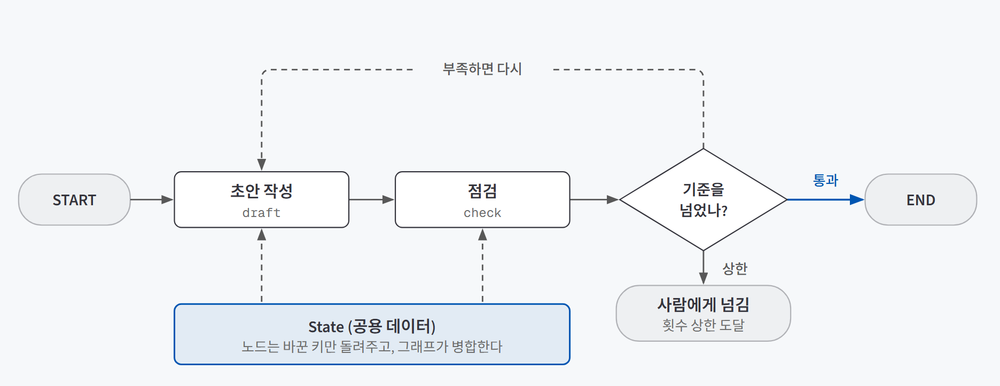
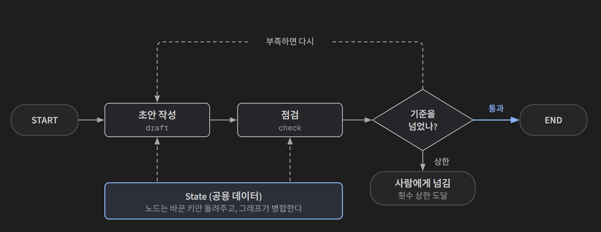
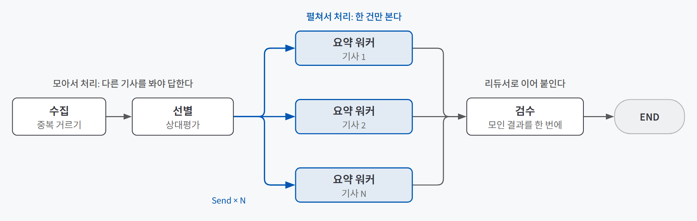
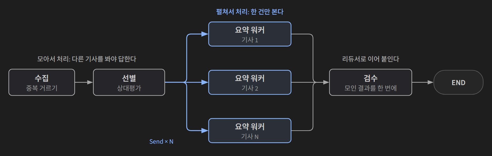

## 한 줄 요약

**LangGraph는 LLM에게 맡길 일을 여러 단계로 쪼개고, 그 단계들이 어떤 순서로 이어지는지를 그래프로 그려 두는 도구다.** 재료는 세 가지다. 단계들이 함께 읽고 쓰는 공용 데이터(State), 한 단계를 맡는 함수(Node), 다음에 어디로 갈지 정하는 화살표(Edge). 흐름을 모델에게 맡기지 않고 **개발자가 코드로 쥔다**는 점이 핵심이다.

식당 주방의 주문표와 비슷하다. 주문표(State) 한 장이 조리대(Node)를 차례로 돌고, 각 조리대는 자기 칸만 채워 넘긴다. 어느 조리대로 넘길지는 동선(Edge)이 정해 두고, "간이 부족하면 다시 볶는 자리로" 같은 갈림길도 동선에 그려 둔다.

## 필요한 이유

LLM 한 번에 긴 일을 통째로 시키면 세 가지 문제가 생긴다.

| 문제 | 무슨 일이 생기나 |
|---|---|
| 요구를 흘린다 | 지시가 많을수록 일부를 빠뜨린다 |
| 어디서 틀렸는지 모른다 | 결과 하나만 남아서 중간 어느 단계가 잘못됐는지 짚을 수 없다 |
| 중간에 끼어들 수 없다 | 점검하거나 사람이 확인할 자리가 없다 |

그래서 단계를 쪼갠다. 그런데 쪼갠 단계를 파이썬 `while`문과 `if`문으로 이어 붙이다 보면 금방 배관 공사가 엉킨다. 지금 어느 분기에 있는지, 결과를 어디에 누적하는지, 반복을 언제 멈추는지가 코드 곳곳에 흩어진다. LangGraph는 이 배관을 **그래프라는 한 장의 그림**으로 모은다.

워크플로로 만들지 에이전트로 만들지부터 고민된다면 그 판단 기준은 [다음 행동을 누가 정하나](/posts/automation-vs-agent/)에서 다뤘다. 이 글은 워크플로로 가기로 정한 뒤, **그 흐름을 어떻게 그리는가**를 다룬다.

## 개념과 동작

{: .light }
{: .dark }

### 세 재료: State · Node · Edge

| 재료 | 정체 | 지킬 것 |
|---|---|---|
| **State** | 노드들이 함께 읽고 쓰는 공용 데이터. `TypedDict`로 모양을 선언한다 | 단계 사이를 **건너가는 값만** 담는다. 프롬프트 문자열이나 HTTP 세션은 올리지 않는다 |
| **Node** | State를 받아 딕셔너리를 돌려주는 평범한 파이썬 함수. 안에서 LLM을 불러도, DB를 조회해도 된다 | **자기가 바꾼 키만** 돌려준다. 그러면 LangGraph가 기존 State에 병합한다(부분 업데이트) |
| **Edge** | "A가 끝나면 B로 간다". `START`가 입구, `END`가 출구다 | 마지막에 `compile()`로 실행 가능한 객체를 만든다 |

부분 업데이트 덕분에 State에 칸이 스무 개로 늘어도 각 노드는 자기 관심사만 다룬다. 노드를 따로 떼어 테스트하기도 쉽다.

다만 `TypedDict`는 **모양 선언일 뿐 값이 있다는 보장이 아니다.** 글자 수를 세는 노드를 공백 정리 노드보다 먼저 연결하면, 정리된 텍스트 칸이 아직 비어 있어 `KeyError`가 난다. 순서는 엣지가 책임진다.

### 조건부 엣지: 분기와 반복을 한 가지로

고정 엣지는 늘 같은 곳으로 가지만, **조건부 엣지**는 노드가 끝난 뒤 State를 보고 다음 목적지를 고른다. 라우터 함수가 다음 노드 이름(또는 라벨)을 돌려주는 방식이다.

- 목적지를 앞쪽 노드로 주면 **반복(루프)**이 된다. 위 그림의 "부족하면 다시"가 그렇다. 분기와 반복을 같은 장치 하나로 표현한다.
- 라벨을 딕셔너리로 번역할 수 있어서, 노드 이름은 영문으로 두고 화살표 라벨만 "보류"·"통과"처럼 한국어로 보이게 할 수 있다.
- `draw_mermaid()`로 그래프를 그려 보면 **실선은 항상 가는 길, 점선은 조건에 따라 고르는 길**이다. 그림을 보고 설계 의도대로 이어졌는지 확인한다.

### 슈퍼스텝과 리듀서: 동시에 같은 칸에 쓸 때

LangGraph는 **슈퍼스텝** 단위로 움직인다. 한 스텝에서 준비된 노드를 모두 동시에 돌리고, 끝나면 반환값을 한꺼번에 병합한다. 그래서 같은 스텝의 두 노드가 같은 키에 쓰면 무엇을 살릴지 몰라 `InvalidUpdateError`가 난다.

이때 붙이는 것이 **리듀서**다. "여러 값이 오면 이렇게 합쳐라"를 State 선언에 적어 둔다.

```python
class Brief(TypedDict):
    picked: list                             # 선별 결과: 덮어쓰기 (줄이는 값)
    drafted: Annotated[list, operator.add]   # 워커들의 결과: 이어 붙이기 (합치는 값)
```

규칙은 하나다. **리듀서는 여러 노드가 같은 키에 쓰는 자리에만 붙인다.** 9건을 5건으로 줄이는 노드가 쓰는 칸에 `operator.add`를 붙이면 결과가 5건이 아니라 14건이 된다. 줄인 결과가 기존 값 뒤에 이어 붙기 때문이다.

### Send: 실행해 봐야 개수를 아는 일

오늘 요약할 기사가 3건일지 5건일지는 실행해 봐야 안다. 노드는 컴파일 전에만 추가할 수 있으니, 미리 노드를 다섯 개 만들어 둘 수도 없다. 이때 조건부 엣지가 **`Send` 리스트**를 돌려주면, 같은 워커 노드가 리스트 길이만큼 복제되어 동시에 실행된다.

{: .light }
{: .dark }

- 워커는 메인 State 전체가 아니라 **자기 몫(기사 한 건)만** 받는다.
- 워커가 돌려준 결과는 리듀서가 메인 State에 합친다. `Send`가 나누고(map), 리듀서가 모으는(reduce) 구조다.
- 그래프 그림에는 워커가 하나만 그려진다. 구조는 그대로인데 실행 횟수만 입력에 따라 달라진다.

### 종료 조건은 두 겹으로

루프에 종료 조건이 없으면 영원히 돈다. 그래서 두 겹을 건다.

| 겹 | 방식 | 걸렸을 때 |
|---|---|---|
| **State 안의 카운터** | 반복 횟수를 State에 세고, 상한을 넘으면 "사람에게 넘김" 같은 정상 경로로 보낸다 | 그동안 다듬은 결과를 들고 **정상 종료**한다 |
| **`recursion_limit`** | 실행 설정에 전체 스텝 상한을 건다(기본 25) | `GraphRecursionError` 예외로 **강제 종료**된다. 중간 결과까지 날아간다 |

`recursion_limit`은 마지막 안전망이다. 이것만 믿으면 상한에 걸리는 순간 그때까지의 작업이 모두 사라진다.

### 그래프 위에 패턴을 얹는다

다섯 가지 워크플로 패턴(체이닝·라우팅·병렬화·오케스트레이터-워커·평가자-최적화자)은 모두 위 재료의 조합이다. 각 패턴을 언제 쓰면 안 되는지는 [다섯 가지 에이전트 패턴, 언제 쓰고 언제 쓰면 안 될까](/posts/agent-patterns-when-not-to-use/)에 정리했고, 여기서는 그래프로 옮길 때 무엇을 쓰는지만 짚는다.

| 패턴 | 그래프에서 쓰는 재료 |
|---|---|
| 프롬프트 체이닝 | 순차 엣지 + 단계 사이의 코드 검사(게이트) |
| 라우팅 | 분류 노드 + 조건부 엣지(하나만 실행) |
| 병렬화 | `START`에서 여러 노드로 가는 고정 엣지 + 리듀서 |
| 오케스트레이터-워커 | 계획 노드 + `Send`로 워커 복제 + 리듀서 |
| 평가자-최적화자 | 평가 노드에서 생성 노드로 되돌아가는 조건부 엣지 + State 카운터 |

사람이 승인할 때까지 그래프를 멈춰 두는 `interrupt`와 체크포인터는 [에이전트는 어디서 멈추고 승인받나](/posts/hitl-theory/)에서 다뤘다.

## 적합한 경우와 피할 경우

| LangGraph가 맞는 경우 | 맞지 않는 경우 |
|---|---|
| 단계가 여럿이고 **분기·반복·병렬**이 섞여 있다 | LLM 한 번 호출로 끝나는 일 |
| 중간 산출물을 남겨 **어느 단계가 틀렸는지** 짚어야 한다 | 단순한 도구 호출 루프 하나 (프리빌트 `create_agent` 한 줄이면 된다) |
| 반복 상한, 특정 단계 앞 승인 같은 **통제**가 필요하다 | 아직 무엇을 만들지 탐색하는 단계 (노트북 셀 순서대로 실험하는 편이 빠르다) |
| 매일 자동 실행처럼 **같은 흐름을 오래** 돌린다 | 단계 조합을 미리 적을 수 없는 일 (워크플로가 아니라 에이전트 쪽 문제다) |

## 장점과 한계

| 장점 | 한계 |
|---|---|
| 흐름이 그림 한 장으로 보여서 설계 의도와 실제 연결을 대조할 수 있다 | State를 처음에 설계해야 한다. 미리 정할 것은 칸 목록보다 **누가 무엇을 넘겨주는가**다 |
| 노드가 자기 키만 다뤄 하나씩 떼어 고치고 테스트하기 쉽다 | 리듀서·슈퍼스텝을 모르면 병렬 구간에서 바로 에러가 나거나, 더 나쁘게는 결과가 조용히 늘어난다 |
| `Send`로 구조를 바꾸지 않고 실행 개수만 바꿀 수 있다 | 펼친 만큼 토큰 비용은 그대로 늘고, 동시 호출이 많으면 요청 한도에 걸린다 |
| 반복 상한과 정상 종료 경로를 그래프 안에 명시할 수 있다 | 특정 모델에 얽매이지 않는 대신, 한 줄짜리 프리빌트보다 코드가 길다 |

## 적용 방법

### 1단계. 빈 노드로 끝까지 연결한다

할 일을 단계로 쪼갠 뒤, 처음에는 로그만 남기는 **빈 노드**로 처음부터 끝까지 이어 붙인다. 그다음 한 번에 노드 하나씩 진짜 코드로 바꾸고, 바꿀 때마다 전체를 다시 돌린다. 이렇게 하면 단계 사이 규격(State 키)이 안 맞는 문제를 가장 먼저 발견한다. 빈 노드에 조건 분기나 임시 로직을 넣기 시작하면 뼈대가 두꺼워져 의미가 없어진다.

### 2단계. State에는 건너가는 값만, 그릇은 하나로

State 칸은 "앞 단계가 뒷 단계에 넘겨줘야 하는가"로 고른다. 여러 소스에서 같은 종류의 데이터가 들어온다면 **항목 하나를 담는 그릇을 먼저 통일**한다(예: 제목·주소·출처·시각). 소스마다 다른 이름을 여기서 맞춰 두지 않으면 뒤쪽 노드마다 출처별 분기가 생긴다.

### 3단계. 갈림길과 반복은 조건부 엣지로, 종료는 두 겹으로

기준을 못 넘으면 점검 노드 뒤 조건부 엣지로 보정 노드나 앞 노드로 되돌리고, 반복 횟수는 State 카운터로 센다. 상한을 넘으면 "사람에게 넘김" 같은 정상 경로로 보내고, `recursion_limit`은 마지막 안전망으로만 둔다.

### 4단계. 펼칠 구간과 모을 구간의 경계를 찾는다

`Send`로 펼칠지 정하는 질문은 하나다. **"이 단계는 다른 항목을 봐야 답할 수 있는가."**

| 답 | 처리 | 예 |
|---|---|---|
| 봐야 한다 | 모아서 한 노드에서 | 중복 판정, 상대평가로 고르기, 상한 적용 |
| 안 봐도 된다 | 건별로 펼친다 | 본문 추출, 요약, 건별 검수 |

펼칠 수 있다고 늘 펼칠 필요는 없다. 다섯 건 정도면 한 노드 안에서 순서대로 도는 편이 단순하고 동시 호출도 줄인다.

### 5단계. 실행 기록으로 확인한다

개발할 때는 `stream()`으로 스텝마다 어느 노드가 무엇을 바꿨는지 보고, 서비스에서는 최종 State만 돌려주는 `invoke()`를 쓴다. `stream()`은 State 변화만 보여 주므로, 모델이 **실제로 받은 프롬프트 전문과 돌려준 응답**까지 봐야 할 때는 LangSmith 같은 트레이스 도구를 켠다. 환경 변수만 설정하면 호출이 자동으로 기록되고, 병렬 노드가 시간축에서 겹쳐 그려져 속도 이득도 눈으로 확인된다.

## 다른 방법과 비교

| 방법 | 언제 맞나 | 한 줄 평가 |
|---|---|---|
| 노트북 셀을 순서대로 실행 | 무엇을 만들지 탐색할 때 | 빠르지만 되돌아가기·펼치기를 표현 못 하고, 자동 실행으로 옮길 때 다시 짠다 |
| `while`문으로 직접 | 분기가 한두 개뿐일 때 | 가볍다. 분기와 누적이 늘면 상태 관리가 곳곳에 흩어진다 |
| 프리빌트 `create_agent` | 도구 호출 루프 하나면 충분할 때 | 한 줄로 끝난다. 호출 상한이나 승인 끼워 넣기 같은 통제는 어렵다 |
| 다른 에이전트 프레임워크 (CrewAI·AutoGen·Claude Agent SDK) | 각 프레임워크의 기본 구조가 일에 맞을 때 | LangGraph를 고르는 이유로는 특정 모델에 얽매이지 않는 점, 흐름을 낮은 수준까지 통제하는 점, LangSmith로 관측된다는 점이 꼽힌다 |
| **LangGraph 직접 조립** | 분기·반복·병렬·승인을 내가 통제해야 할 때 | 코드는 길어지지만 흐름 전체가 그래프로 드러난다 |

## 주의할 점

**프로그램은 잘 도는데 결과만 달라지는 실수가 가장 위험하다.** 에러가 나는 실수는 바로 고치지만, 이런 실수는 매일 "성공"으로 끝난다.

- **리듀서를 줄이는 칸에 붙인다.** 줄였는데 오히려 늘어난다. 합치는 칸과 줄이는 칸을 나눠 선언한다.
- **고르는 단계를 건별로 펼친다.** 기사마다 따로 "중요한가"를 물으면 워커가 각자 자기 기사만 보고 중요하다고 답한다. 상대평가가 독립 채점으로 바뀌는 것이다.
- **실패를 `except: pass`로 넘긴다.** 펼친 갈래나 소스 하나가 실패하면 그 건만 조용히 빠진다. 파이프라인이 멈추지 않는 건 좋지만, 기록이 없으면 몇 달 뒤에야 빠진 걸 안다. 실패한 갈래는 빈 결과와 함께 로그를 남긴다.
- **프롬프트로 부탁한 규칙을 보장으로 믿는다.** 구조화 출력은 형식만 지켜 준다. "같은 사건은 하나만" 같은 규칙은 코드로 센다. 병렬 결과도 순서가 보장되지 않으니, 순서가 중요하면 정렬하거나 라벨을 함께 담는다.

## 용어 정리

| 용어 | 뜻 |
|---|---|
| State | 그래프의 노드들이 함께 읽고 쓰는 공용 데이터 |
| 조건부 엣지 | 노드가 끝난 뒤 State를 보고 다음 목적지를 고르는 화살표. 분기와 반복을 함께 표현한다 |
| 슈퍼스텝 | 준비된 노드를 동시에 실행하고 결과를 한꺼번에 병합하는 실행 단위 |
| 리듀서 | 같은 스텝에서 여러 값이 같은 키에 들어올 때 합치는 규칙 (`operator.add` 등) |
| 팬아웃 / 팬인 | 여러 갈래로 동시에 펼치기 / 갈라진 결과를 하나로 모으기 |
| Send | 실행 중에 같은 워커 노드를 원하는 개수만큼 복제해 띄우는 장치 |
| recursion_limit | 그래프 전체 스텝 수의 상한. 넘으면 예외로 강제 종료된다 |

---

→ 이 개념을 검증한 프로젝트: [공공 채용정보 뉴스레터 검증 — API 세 곳을 LangGraph로 묶어 발행까지 확인한 세 가지](/posts/gov-job-newsletter/)
