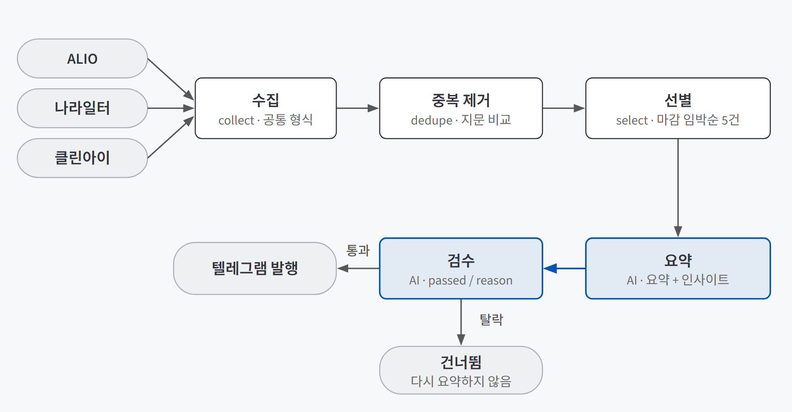
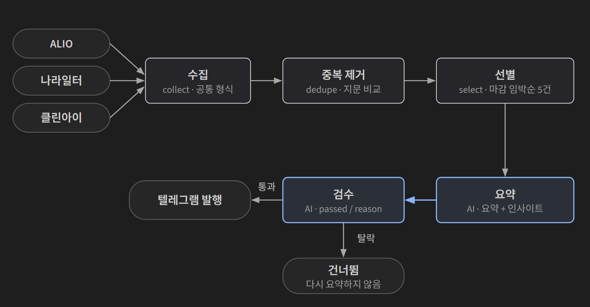

## 한 줄 소개

**수집 → 선별 → 요약 → 검수 → 발행으로 순서를 정해 둔 LangGraph 워크플로가 RSS가 아닌 공공 API에서도 끝까지 굴러가는지, 그리고 AI 검수 단계가 요약의 오류를 실제로 걸러 내는지 확인하려고 공공 채용정보 뉴스레터를 만들어 검증했다.** 공공기관·공무원·지방공기업 채용공고를 세 곳에서 모아 중복을 지우고, 다섯 건을 골라 요약한 뒤 텔레그램으로 보낸다.

저장소: [beginner-driver/my-newsletter](https://github.com/beginner-driver/my-newsletter)

> **검증한 것:** 공공 API 세 곳을 공통 형식으로 묶어 발행까지 끝까지 돌리기 ✅ · 규칙으로 다섯 건 고르기 △ · AI 검수로 요약 오류 거르기 ❌(근거 없음)
>
> **발견한 것:** 검수가 "작동한 증거"로 남긴 탈락 사례는 대부분 날짜 오판이었다 · 선별 기준이 비어 있다는 걸 문서를 쓰다가 알았다
{: .prompt-tip }

## 만든 이유

공공기관·공무원 채용정보는 사이트가 나뉘어 있다. 공공기관은 ALIO, 중앙부처·지자체 공무원은 나라일터, 지방공기업은 클린아이다. 원하는 공고를 놓치지 않으려면 매번 세 곳을 돌아야 한다. 이걸 하루 한 번 텔레그램 메시지로 받아 보는 뉴스레터를 목표로 잡았다.

[그래프로 그리는 에이전트 작업 순서 — LangGraph 워크플로 설계](/posts/langgraph-workflow/)와 [지시는 부품으로, 답은 계약으로 — 시스템 프롬프트와 구조화 출력](/posts/system-prompt-structured-output/)을 배우고 나서 세 가지가 궁금했다.

1. 다섯 단계 워크플로는 RSS 뉴스를 예로 배웠다. 응답 형식이 서로 다른 **공공 API 세 곳**을 넣어도 같은 뼈대로 발행까지 끝까지 돌까?
2. 900건이 넘는 공고에서 다섯 건을 **규칙으로** 고르면, 그 기준이 실제로 의도대로 동작했다고 말할 수 있을까?
3. 요약을 만든 뒤 **AI에게 한 번 더 검수**를 맡기면, 요약에 섞인 틀린 내용을 걸러 낼 수 있을까?

## 실험 설계

### 동작 흐름

{: .light }
{: .dark }

1. **수집(collect):** 세 소스의 공고를 받아 하나의 공통 형식으로 바꾼다. 제목, 기관명, 기관 유형, 지역, 접수기간, 원문 링크, 그리고 받은 응답 원본을 그대로 담는다.
2. **중복 제거(dedupe):** 기관명·제목·마감일을 정규화한 "지문"이 같으면 같은 공고로 본다.
3. **선별(select):** 지역·경력·기관 유형 조건으로 거른 뒤, 이미 마감된 공고를 빼고 **마감이 임박한 순**으로 정렬해 앞의 다섯 건을 고른다.
4. **요약(summarize):** AI가 공고마다 요약 한두 문장과 구직자에게 도움 될 포인트 한 문장을 쓴다.
5. **검수(verify):** AI가 요약에 사실과 다른 내용이 없는지 판정한다. 탈락한 건은 보내지 않는다.
6. **발행(publish):** 통과한 건만 제목·기관·접수기간·요약·링크 형식으로 텔레그램에 보낸다.

그래프는 되돌아가는 길이 없는 한 줄짜리다. AI는 요약과 검수 두 곳에서만 쓰고, 선별 자리는 AI 순위 매기기를 붙일 수 있게 비워 두었다.

### 사용 기술

| 기술 | 어디에 썼나 |
|---|---|
| **LangGraph** | 여섯 단계를 노드로 잇고, 단계 사이에 넘기는 상태(수집분·선별분·요약·검수 결과)를 정의했다 |
| **공공데이터 API 3종** | ALIO(JSON), 나라일터·클린아이(공공데이터포털, XML). 모두 인증키로 호출한다 |
| **OpenAI API (gpt-4o-mini)** | 요약과 검수. 호출은 래퍼 하나로만 거치게 해서, 설정값 하나로 AI를 완전히 끄거나 다른 제공자로 바꿀 수 있게 했다 |
| **Pydantic** | 요약은 `{summary, insight}`, 검수는 `{passed, reason}` 칸으로만 받도록 출력 모양을 고정했다 |
| **Telegram Bot API** | 발행 채널. 테스트 중에는 콘솔에만 찍는 모드(dry run)로 돌렸다 |

### 판단 기준과 샘플

| 질문 | 판단 근거 |
|---|---|
| 1. 끝까지 도는가 | 한 번 실행으로 수집부터 텔레그램 도착까지 오류 없이 끝나는지 |
| 2. 선별이 의도대로인가 | 단계별 처리 건수 기록, 선별 코드가 실제로 쓰는 기준 |
| 3. 검수가 오류를 거르는가 | 검수가 탈락시킨 건의 사유와 실행별 판정 |

샘플은 2026-09-15 하루에 돌린 실행 세 번이다. 결과가 0건이 되지 않도록 수집 기간을 운영 기본값(1일)보다 넓은 14일로 잡았다. 매 실행의 단계별 건수와 검수 사유는 실행 기록 파일(`metrics.jsonl`)에 남겼다.

## 검증 결과

| 질문 | 결과 | 근거 |
|---|---|---|
| 1. 공공 API 세 곳으로 끝까지 돌리기 | ✅ 됨 | 마지막 실행에서 중복 제거 후 948건 → 선별 5건 → 검수 5건 통과 → 텔레그램 5건 도착. 그 전에 API마다 다른 이유로 여섯 번 막혔다 |
| 2. 규칙으로 다섯 건 고르기 | △ 기준은 생김 | 처음엔 사실상 "먼저 수집된 다섯 건"이었다. 마감 임박순으로 고쳤지만, 그 다섯 건이 독자에게 맞는지는 재지 않았다 |
| 3. AI 검수로 요약 오류 거르기 | ❌ 근거 없음 | 탈락 5건 중 4건이 날짜 의심이나 "확인할 수 없다"였고, 지어낸 내용을 짚은 사유는 없었다. |

### 질문 1. 공공 API 세 곳으로도 끝까지 도는가

돈다. 마지막 실행 기록은 이렇다.

| 단계 | 건수 |
|---|---|
| 중복 제거 | 948건 남김, 2건 제거 |
| 선별 | 948건 중 5건 |
| 검수 | 5건 중 5건 통과 |
| 발행 | 텔레그램 5건 도착 |

다만 여기까지 오는 길에 **API마다 다른 이유로** 막혔다. 세 곳 모두 "공공 API"지만 실제로 붙여 보니 약속이 제각각이었다.

| 막힌 곳 | 원인 | 고친 방법 |
|---|---|---|
| 나라일터·클린아이 인증 | 이미 인코딩되어 발급된 인증키를 요청 도구가 한 번 더 인코딩했다 | 키를 한 번 디코딩한 뒤 넘긴다 |
| 클린아이 지역 조회 | 표준 행정구역코드("11"=서울)를 넣었더니 "데이터 없음" 오류가 났다. 이 시스템은 전용 코드("007001")를 쓴다 | 실제 사이트의 선택 목록 값을 확인해 교체 |
| 나라일터 정렬 | 정렬값에 문자열("내림차순")을 넣자 2008년 공고가 돌아왔다 | 날짜 형식×정렬값 8가지 조합을 돌려 보고 숫자 코드 "2"로 교체 |
| XML 응답 | 같은 계열 API인데 본문 태그 이름이 서비스마다 달랐다 | 특정 경로 대신 트리 전체에서 공고 목록을 찾는 공용 파서 하나로 통일 |
| 나라일터 상세 조회 | 공고마다 상세를 한 번씩 부르다 일부가 시간 초과로 실패하면 실행 전체가 멈췄다 | 한 건의 실패를 그 건 안에 가두는 예외 처리 |
| 세 소스 공통 | 첫 페이지(최대 100건)만 받고 있었다 | 전체 건수 기준으로 페이지를 넘기되, 소스당 10페이지 상한을 뒀다 |

마지막 줄은 실행이 "성공"하는 동안에도 조용히 공고를 놓치고 있던 경우다. 오류가 나지 않으니 "왜 100건까지만 보지?"라고 따져 보기 전까지 아무도 몰랐다.

워크플로 쪽은 손댈 일이 없었다. 소스마다 다른 사정은 **어댑터**(소스별로 받아 와서 공통 형식으로 바꾸는 파일) 안에 가뒀고, 그래프는 세 소스가 합쳐진 목록만 봤다. 소스를 새로 붙일 때도 어댑터 파일 하나와 등록 한 줄이면 되도록 짰지만, 네 번째 소스를 실제로 붙여 보지는 않았다.

### 질문 2. 규칙으로 고른 다섯 건은 의도대로인가

처음 답은 "아니다"였다. 실행 기록을 정리하면서 **"948건 중 5건을 어떤 기준으로 골랐나"**를 설명하려다 보니, 설명할 기준이 없었다. 지역·경력 조건은 모두 비워 둔 상태였고, AI 순위 매기기는 자리만 있고 내용이 없었다. 그래서 선별 단계는 **수집된 순서대로 앞의 다섯 건**을 자르고 있었다. 오류 없이 다섯 건이 나왔으니 겉으로는 멀쩡했다.

지금은 이렇게 고른다.

| 순서 | 규칙 |
|---|---|
| 1 | 지역·경력·기관 유형 조건으로 거른다 (비워 두면 전체) |
| 2 | 이미 마감된 공고를 뺀다. 마감일을 못 읽은 공고는 맨 뒤로 보낸다 |
| 3 | 제목이나 고용형태에 "정규직"이 있고 "비정규직·계약직" 등이 없는 공고를 앞에 둔다 |
| 4 | 마감이 임박한 순으로 정렬해 앞의 다섯 건을 자른다 |

규칙이라서 같은 입력이면 항상 같은 다섯 건이 나오고, 왜 이 다섯 건인지 설명할 수 있다. 하지만 △로 둔 이유가 있다.

- **"곧 마감"이 "유용함"은 아니다.** 마감 임박순은 설명하기 쉬운 기준일 뿐, 이 다섯 건이 구직자에게 가장 쓸모 있는지는 재지 않았다.
- **마지막 실행의 다섯 건은 모두 ALIO 공고였다.** 세 곳을 묶은 뉴스레터인데 발행 결과에서는 한 곳만 보였다.
- **소스 사이 중복은 2건뿐이었다.** 나라일터에서 공공기관 공고를 처음부터 받지 않게 해 ALIO와 겹칠 일을 줄였기 때문이다. 중복 제거가 잘 동작했다기보다 **겹칠 일이 적게 설계된 것**에 가깝다.
- **필드 하나가 틀린 값으로 채워져 있었다.** 나라일터의 "경력 조건" 칸에는 사실 기관 구분 코드가 들어가 있었다. 경력 조건으로 거르면 이 소스가 통째로 빠질 뻔해서, 진짜 필드를 찾을 때까지 비워 두었다.

### 질문 3. AI 검수는 요약의 오류를 걸러 내는가

처음에는 걸러 낸다고 봤다. 테스트 실행에서 다섯 건 중 두 건이 탈락했기 때문이다. 그런데 탈락 사유를 하나씩 읽어 보니 근거가 되지 못했다.

같은 날 세 번 돌린 검수 결과는 이렇다.

| 실행 | 검수 | 탈락 사유 |
|---|---|---|
| 14:13 (콘솔 출력) | 5건 중 3건 통과 | "모집기간이 2026년으로 잘못 기재됐다", "'2026년 하반기'라는 시기와 세부 자격 요건을 확인할 수 없다" |
| 15:23 | 5건 중 2건 통과 | "'계약직'을 '비정규직'으로 일반화해 오해의 소지가 있다", "2026년 하반기·접수기간이 사실인지 검증할 수 없다", "부정확하거나 누락된 부분이 있을 수 있다" |
| 15:33 | 5건 중 5건 통과 | — |

**탈락 다섯 건 중 요약이 지어낸 내용을 짚은 사유는 없다.** 네 건은 "2026년이라 이상하다"거나 "확인할 수 없다"였다. 나머지 한 건은 제목의 "계약직"을 요약에서 "비정규직"으로 쓴 표현을 문제 삼았는데, 계약직은 비정규직의 한 종류라 틀렸다고 보기는 어렵다. 날짜 사유의 첫 번째는 검수 AI가 오늘이 몇 년인지 몰라, 정상적인 2026년 접수기간을 오기로 본 **오판**이다. 그래서 검수 지시에 오늘 날짜를 넣고 "미래 날짜라는 이유만으로 틀렸다고 하지 말라"고 덧붙였다. 마지막 실행에서는 날짜 혼동이 사라지고 다섯 건이 모두 통과했다. 이 수정이 정확히 두 실행 중 어느 사이에 들어갔는지는 기록에 없다.

판정도 흔들렸다. 같은 공고가 14:13에는 통과, 15:23에는 탈락, 15:33에는 다시 통과했다. 요약을 실행마다 새로 만들기 때문에 입력이 완전히 같지는 않지만, 기준이 일정하지 않다는 신호로는 충분하다.

정리하면 확인된 건 **"검수가 오판으로 정상 공고를 떨어뜨렸다"**와 **"날짜를 알려 주자 그 오판이 사라졌다"**뿐이다. 검수가 요약 속의 지어낸 내용을 잡아낸 사례는 하나도 없다.

## 직접 만들며 알게 된 것

### "작동한 증거"를 의심해야 했다

검수 단계에서 탈락이 나오자 "검수가 일을 한다"고 받아들였다. 탈락이 없으면 의심했겠지만, 탈락이 있으니 오히려 안심했다. 그런데 탈락 사유를 하나씩 읽어 보니 오판이었다.

이론은 "검수 불합격이 계속 0이면 통과 도장만 찍는 중일 수 있다"고 경고한다. 이번에 알게 된 건 그 반대도 있다는 점이다. **불합격이 나왔다고 검수가 맞게 일하는 것도 아니다.** 검수가 정말 오류를 잡는지 보려면 탈락 건수가 아니라 탈락 사유를 읽어야 하고, 더 확실하게는 일부러 틀린 숫자를 넣은 요약을 만들어 검수가 잡아내는지 시험해야 한다. 이번에는 그 시험을 하지 않았다.

### 선별 기준이 비어 있다는 걸 문서를 쓰다가 알았다

선별 기준이 없다는 문제와 첫 페이지만 받던 문제는 둘 다 **실행이 아니라 설명하다가** 드러났다. 실행은 매번 성공했고 다섯 건도 매번 나왔다. "948건 중 왜 이 다섯 건인가", "왜 100건까지만 보는가"를 남에게 설명할 문장으로 쓰려는 순간에야 비어 있는 곳이 보였다. 오류 없이 끝나는 워크플로는 무엇을 안 하고 있는지 알려 주지 않는다.

## 검증 범위와 한계

| 구분 | 내용 |
|---|---|
| **실행 횟수** | 하루에 세 번 돌린 기록이 전부다. 매일 자동 실행은 만들지 않았고 수동 실행만 확인했다 |
| **수집 기간** | 결과가 0건이 되지 않게 14일치를 모았다. 운영 기본값인 1일치로 돌렸을 때의 건수는 확인하지 않았다 |
| **검수 품질** | 일부러 틀린 내용을 넣은 요약으로 검수를 시험하지 않았다. |
| **검수 탈락 처리** | 탈락한 건은 다시 요약하지 않고 건너뛰기만 한다 |
| **사람 확인** | 발행은 되돌릴 수 없는 단계인데 사람이 확인하는 자리가 없다. [HITL 이론](/posts/hitl-theory/)대로라면 발행 직전에 둘 자리다 |
| **AI 끄기** | 설정값 하나로 AI 없이 규칙만으로 도는 경로를 만들었지만, 그 경로로 실제로 돌린 기록은 없다 |
| **설정과 기록** | 리포트에는 지역·경력 조건을 비워 두고 돌렸다고 적었는데, 저장소의 조건 파일에는 지역·경력 조건이 채워져 있다. 기록된 실행이 어느 설정으로 돌았는지는 남아 있지 않다. 실행 시간을 남기는 코드도 기록 파일에 값이 없다 |
| **링크 누락** | 나라일터 공고는 원문 링크 필드를 아직 쓰지 않아 링크 없이 발행된다 |

## 결론

1번은 확인했다. **순서를 정해 둔 워크플로는 소스가 RSS에서 공공 API로 바뀌어도 그대로 쓸 수 있었다.** 소스마다 다른 사정은 어댑터에 가두면 그래프는 손댈 일이 없었다. 대신 그 어댑터 안에서 API 세 곳의 약속이 짐작과 달라 여섯 번 막혔다.

2번과 3번은 "있다"와 "작동한다"가 다르다는 걸 보여 줬다. 선별 단계는 있었지만 기준이 없었고, 검수 단계도 있었지만 오류를 잡은 사례가 없었다. 둘 다 실행은 늘 성공했다. 가장 크게 남은 건 3번이다. **AI 검수를 붙였다는 것만으로는 아무것도 보장되지 않는다. 검수기가 무엇을 보고 판정하는지, 탈락 사유가 무엇인지, 일부러 틀린 입력을 잡아내는지까지 확인해야 검수라고 부를 수 있다.**
