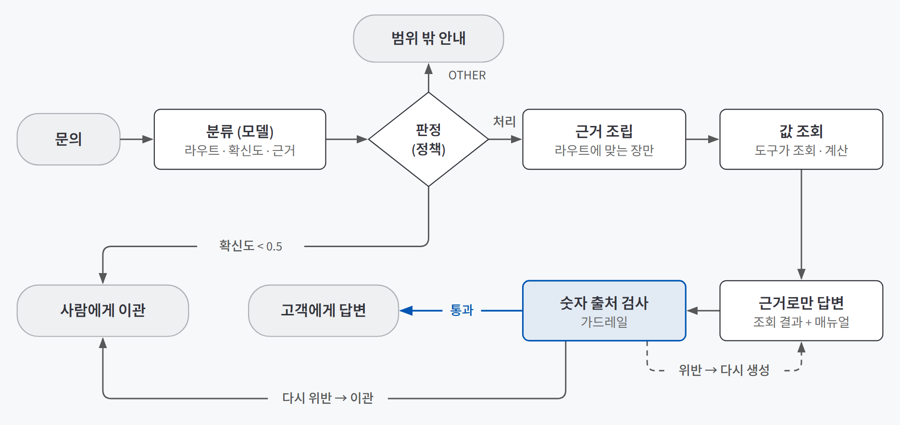
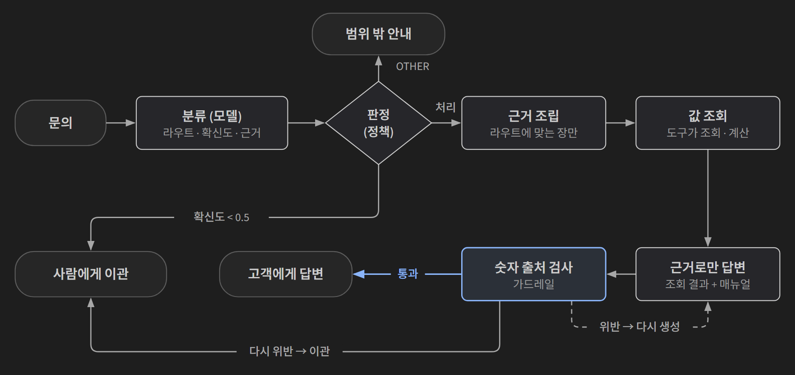
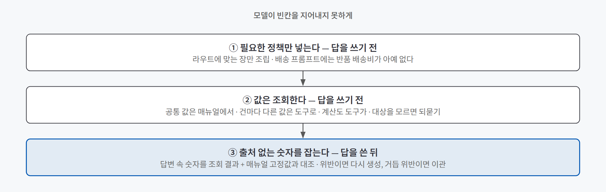
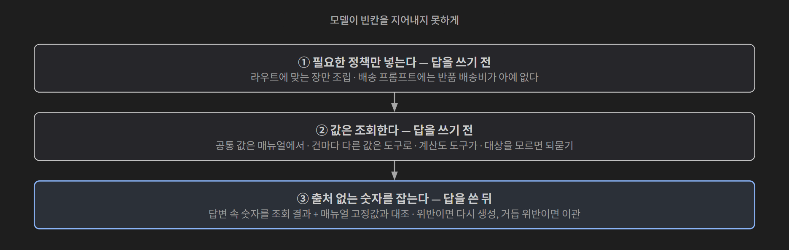

## 한 줄 요약

**라우팅은 들어온 문의를 몇 갈래로 나눠 갈래마다 다른 처리를 붙이는 일이고, 그라운딩은 답을 넣어 준 근거(문서·조회 결과)에만 기대게 하는 일이다.** 둘을 같이 쓰는 이유는 하나다. 모델은 모르는 값을 아주 자연스럽게 지어내기 때문이다. 그래서 **필요한 정책만 넣고, 값은 조회하고, 출처 없는 숫자는 기계로 잡는** 세 겹으로 막는다.

콜센터를 떠올리면 쉽다. 대표번호는 문의를 주문·배송·반품 부서로 돌린다(라우팅). 연결된 상담원은 매뉴얼과 조회 화면에 있는 것만 말하고, 거기 없는 건 "확인 후 연락드리겠습니다"라고 한다(그라운딩). 어느 부서인지 애매한 전화는 책임자에게 넘긴다(이관).

## 필요한 이유

가상 쇼핑몰의 상담 매뉴얼을 통째로 넣고 "무료배송 되나요?"에 답하게 하면 "무료배송 기준은 40,000원입니다"가 나온다. 실제 상담에서 가장 흔한 금액이라 그럴듯하다. 그런데 이 기준은 의류 기준이고, 고객이 묻는 신발은 100,000원이다. 같은 쇼핑몰 안에서도 무료배송 기준액은 액세서리 20,000원부터 신발 100,000원까지 다섯 배 차이가 난다. **하드코딩하든 모델이 기억으로 답하든 의류에서만 우연히 맞는다.** 우연히 맞는 경우가 있다는 게 가장 위험하다. 테스트에서는 통과하기 때문이다.

틀리는 방식은 크게 세 가지다.

| 틀리는 방식 | 예 | 막는 장치 |
|---|---|---|
| 관련 없는 정책을 끌어다 쓴다 | 배송 문의에 반품 배송비 5,000원을 섞는다 | 라우트별로 필요한 정책만 넣기 |
| 건마다 다른 값을 지어낸다 | 상품을 모르는데 무료배송 기준을 단정한다 | 값은 조회하고, 모르면 되묻기 |
| 숫자를 직접 계산한다 | 무료배송까지 부족한 금액을 모델이 셈한다. 맞게 셈해도 출처가 없어 검사할 수 없다 | 계산은 도구가, 숫자 출처는 기계가 검사 |

금액·기간이 틀리면 고객은 그 말을 믿고 행동한다. 환불 안내가 틀리면 금전 분쟁이 된다. 프롬프트에 "지어내지 마"라고 쓰는 것만으로는 막히지 않는다. 프롬프트는 요청이지 보장이 아니다.

## 개념과 동작

{: .light }
{: .dark }

### 라우트 체계는 회사 문서에서 가져온다

몇 갈래로 나눌지는 개발자의 감이 아니라 **회사가 이미 쓰는 체계**에서 정한다. 상담 매뉴얼에 문의 유형이 네 가지(주문·구매, 상품, 배송, 교환·반품·환불)로 나뉘어 있다면 라우트도 그 넷이다. 데이터에 세부 의도가 18종 있어도 18갈래로 나누지 않는다. 라우트는 에이전트 안의 처리 경로라, 하나 늘 때마다 그 경로의 정책·도구·평가셋을 따로 관리해야 한다. 18종 중 상당수는 결국 같은 정책 장을 본다.

여기에 다섯 번째 갈래 `OTHER`(응대 범위 밖)를 둔다. 온라인 전용 쇼핑몰이라도 매장 위치를 묻는 문의가 여섯 건에 한 건꼴로 들어온다. `OTHER`는 **"분류 실패"를 던져 넣는 곳이 아니라 "네 유형 어디에도 속하지 않는다고 확인된 상태"**다. 실패를 여기로 보내면 답할 수 있는 문의까지 사람에게 넘어가고, 이 갈래가 아예 없으면 존재하지 않는 매장 주소를 지어낸다.

문서에서 가져오면 덤이 있다. 규칙의 **순서**에도 근거가 생긴다. "반품 배송비 얼마예요?"는 배송일까 반품일까. 매뉴얼에 "진행 중인 반품·교환 건 문의는 교환·반품·환불로"라고 적혀 있으면 개발자가 새로 정할 필요가 없다. 정책이 바뀌면 어디를 고칠지도 분명하다.

### 분류는 모델이, 판정은 정책이 한다

라우터를 노드 하나로 만들지 않고 둘로 나눈다.

| 노드 | 하는 일 | 바꾸고 싶을 때 |
|---|---|---|
| **분류**(classify) | 문의를 읽고 라우트 + 확신도 + 근거 한 문장을 낸다 | 규칙 → LLM → LLM+예시로 이 노드만 갈아 끼운다 |
| **판정**(gate) | 확신도가 임계값 미만이면 이관, `OTHER`면 범위 밖 안내, 나머지는 처리 | 임계값만 바꿔 다시 판정한다. 모델을 다시 부르지 않는다 |

섞어 두면 모델만 바꾸고 싶을 때 정책까지 건드리게 된다. 나눠 두면 점수가 바뀌었을 때 원인도 분명하다. 키워드 규칙 라우터를 LLM 라우터로 바꿨더니 macro F1이 0.677에서 0.945로 오른 비교가 있다. 평가셋과 지표는 그대로고 분류 노드 하나만 바뀌었으니, 오른 이유를 다른 데서 찾을 필요가 없다.

LLM 분류기의 출력은 구조화 출력으로 묶는다. 라우트는 다섯 값 중 하나만 나오게 막고(`배송문의`, `Shipping` 같은 변형 방지), 확신도(0~1)와 판단 근거 한 문장을 같이 받는다. 근거 문장은 틀린 건을 분석할 때 쓰이고, 판단의 질 자체도 높인다. 모양을 강제하는 방법은 [시스템 프롬프트와 구조화 출력](/posts/system-prompt-structured-output/)에서 다뤘다.

### 키워드는 표면이고, 라우팅은 의도다

규칙 라우터는 기준선으로 먼저 만든다. "환불", "배송비"처럼 전용 어휘가 있는 라우트는 규칙으로도 잘 맞는다. 무너지는 곳은 어휘가 겹치는 라우트다.

| 문의 | 정답 | 이유 |
|---|---|---|
| "낱개로도 구매 가능한가요?" | 상품 문의 | 낱개 판매를 하는지라는 **상품 구성**을 묻는다 |
| "이 반지 남성용만 따로 구매 가능한지 알려주세요" | 주문·구매 | **그렇게 살 수 있는지**, 구매 진행을 묻는다 |

어휘는 거의 같다. 매뉴얼의 분류 원칙이 답을 준다. **"고객이 쓴 단어가 아니라, 고객이 원하는 결과로 판단한다."** 이 문장을 그대로 분류 프롬프트에 옮기는 것이 LLM 라우터의 핵심이다. 개발자가 새 기준을 발명하지 않고 회사가 합의한 기준을 쓴다.

규칙만으로 충분한 점수가 나오면 API 비용을 쓸 이유가 없다. 규칙 라우터를 남겨 두면 LLM이 장애일 때 쓸 폴백도 된다.

### 확신도는 지시해야 신호가 된다

판정 노드는 확신도로 이관을 정한다. 그런데 모델에게 아무 말 없이 확신도를 내라고 하면 거의 늘 0.9 이상을 낸다. **"두 라우트 사이에서 결정하기 어려우면 0.5 미만으로"**처럼 애매할 때 애매하다고 말하라고 명시해야 확신도가 쓸 수 있는 숫자가 된다.

지시해도 한계는 남는다. 확신도는 모델이 **스스로 보고하는 값**이다. 앞 대화를 알아야 하는 문의는 확신도가 평균 0.3까지 떨어져 거의 다 이관됐지만, 사람도 판단이 갈리는 경계 문의는 0.8대로 자신 있게 처리됐다. 정답은 이관이었다. [다섯 가지 패턴 글](/posts/agent-patterns-when-not-to-use/)에서 짚은 그 장면이다. **헷갈려야 할 자리에서 헷갈리지 않는 것**이 더 위험하다. 그래서 확신도 자체도 평가셋으로 검증한다.

임계값을 정할 때는 두 숫자를 같이 본다.

| 지표 | 뜻 | 임계값을 올리면 |
|---|---|---|
| **자동화율** | 이관 없이 처리된 비율 | 떨어진다. 사람 일이 는다 |
| **처리된 건의 정확도** | 이관 안 한 건만의 정확도. 고객이 실제로 받는 품질 | 오른다 |

둘은 반대로 움직인다. 잘못된 환불 안내가 금전 분쟁이 되는 쇼핑몰이라면 이관을 조금 더 감수하는 쪽이 합리적이다. 기준을 숫자로 두고 비교하는 방법은 [HITL 글](/posts/hitl-theory/)의 개입률·놓침·헛멈춤과 같은 사고방식이다.

### 그라운딩은 세 겹으로 막는다

{: .light }
{: .dark }

**첫째 겹, 필요한 정책만 넣는다.** 1만 3천 자가 넘는 매뉴얼을 장 단위로 쪼개고, 라우트에 맞는 장만 프롬프트에 붙인다. 응대 원칙·분류 기준·응대 범위·말투처럼 모든 라우트에 필요한 장은 항상 넣는다. 그러면 배송 라우트의 프롬프트에는 반품 배송비 5,000원이 **아예 없다.** 없는 값은 끌어다 쓸 방법이 없다.

항상 넣는 장이 커서 길이는 전문의 3분의 1에서 절반 남짓밖에 줄지 않는다. 그래도 된다. 줄여야 할 것은 총 길이가 아니라 **관련 없는 정책**이다. 라우트와 장의 연결은 매핑표 하나로 두고, 매뉴얼이 개정되면 코드 수정 없이 따라가게 한다. 정책은 데이터이지 코드가 아니다. 무엇을 넣고 뺄지 고르는 일반 원칙은 [컨텍스트 엔지니어링](/posts/context-engineering/)에서 다뤘다.

**둘째 겹, 값은 조회한다.** 모든 값을 조회할 필요는 없다. 경계는 역시 문서에서 나온다.

| 구분 | 예 | 다루는 법 |
|---|---|---|
| **고정값** — 매뉴얼 본문에 적힌 전 상품 공통 값 | 기본 배송비 2,500원, 반품 배송비, 출고 마감 시각, 처리 기간 | 매뉴얼 값으로 바로 답한다 |
| **조회값** — 건마다 달라지는 값 | 무료배송 기준액, 재고, 주문·반품 진행 단계, 재입고일 | 조회 결과에 있는 값만 쓴다. 대상을 모르면 되묻는다 |
| **계산값** — 두 값에서 나오는 값 | 무료배송까지 부족한 금액 | 도구가 계산해 결과에 담는다. 모델에게 산술을 맡기지 않는다 |

매뉴얼이 조회값 자리에 "어드민 조회" 같은 표시와 화면 경로만 적어 두었다면, 그 표시를 모은 목록이 그대로 도구 명세가 된다. 같은 화면이 반복되면 **화면 하나에 함수 하나**로 묶는다. 고객이 상품을 말하지 않고 "배송비 얼마예요?"라고 물으면 고정값(2,500원)은 답하고 변동값(무료배송 기준)은 되묻는다. 이것이 응대의 기본형이다.

도구 응답에는 빈칸을 만들지 않는다. 없는 상품 ID에는 추측 대신 명확한 오류를, 검품 전이라 정해지지 않은 배송비 부담 주체에는 `null`을 돌려주고, `null`은 "아직 확정되지 않았다"로 답하게 한다. 근거 문서에 아예 없는 항목이면 도구가 "없다"(`found: false`)고 답하게 만든다. 도구 계약을 짜는 일반 원칙은 [도구 설계](/posts/tool-design/)에서 정리했다.

**셋째 겹, 출처 없는 숫자를 기계로 잡는다.** 답변 속 숫자를 모두 뽑아 출처를 거꾸로 찾는다. 허용되는 출처는 **조회 결과에 나온 숫자와 매뉴얼 고정값** 둘뿐이다. 실제로 쓰려면 세 가지를 손본다.

- **표기 정규화:** 답변의 "100,000원"과 조회 결과의 `100000`을 같은 값으로 본다.
- **작은 숫자:** "2~3영업일"까지 잡으면 경고가 쏟아진다. 금액대를 주 검사 대상으로 두고 작은 수는 고정값 목록으로 허용한다. 다만 3년·70%처럼 작은 수가 사실을 가르는 도메인이면 이 하한을 없앤다.
- **한 단계 산술:** 부족액처럼 두 값의 합·차는 허용한다. 허용 범위가 넓어지는 만큼 놓치는 것도 생긴다.

위반이면 바로 막지 않고 **다시 만들게 한 뒤, 그래도 위반이면 이관**한다. 검사기도 틀리기 때문이다. 앞의 "무료배송 기준 40,000원" 답변은 "출처 없는 40,000"과 "조회 없이 기준액 단정" 두 위반으로 걸린다. 일반적으로는 맞는 답이라 사람 눈에는 잘 안 보이는데, 기계는 자연스러움에 속지 않는다.

### 행동부터 맞아야 한다

그라운딩된 에이전트의 출력은 문장이기 전에 **행동**이다.

| 행동 | 언제 |
|---|---|
| 답변 | 조회·매뉴얼 근거로 답할 수 있을 때 |
| 되묻기 | 상품·주문을 특정하지 못했을 때 |
| 범위 밖 안내 | 주제 자체가 응대 범위 밖일 때 |
| 이관 | 확신이 없거나, 주제는 맞는데 문서에 답이 없거나, 검사를 끝내 통과하지 못했을 때 |

"범위 밖"과 "문서에 답이 없음"은 다른 경로다. 앞은 주제가 문서 밖이고, 뒤는 주제는 맞는데 근거가 빠진 경우다. 행동이 틀리면 문장이 아무리 좋아도 실패다. 가장 위험한 건 **되물어야 할 문의에 답해 버리는 것**이다. 정보가 부족한데 답을 만든 것이기 때문이다. 반대로 답할 수 있는데 되물은 건 안전한 실패다.

### 측정은 만들기 전에 정한다

"좋아진 것 같다"가 아니라 좋아졌는지 말하려면 같은 자를 먼저 만든다. 라우터 평가셋은 용도별로 갈라 둔다.

| 묶음 | 용도 | 규칙 |
|---|---|---|
| 예시용 | 프롬프트에 넣을 few-shot 예시 | 예시는 여기서만 뽑는다 |
| 범위 밖용 | 정답이 전부 `OTHER` | 네 갈래를 가르는 능력과 범위 밖을 거르는 능력은 다른 능력이라 따로 잰다 |
| 측정용 | 점수 계산 | **절대 프롬프트에 넣지 않는다.** 넣으면 점수가 부푼다(데이터 누수) |

측정용은 라우트마다 개수를 맞춘다. 치우친 평가셋에서는 큰 라우트의 성적이 전체 점수를 덮어 작은 라우트의 실패가 안 보인다. 같은 이유로 라우트마다 같은 무게를 주는 **macro F1**을 주 지표로 쓰고, **혼동 행렬**로 어느 라우트가 어디로 흘러갔는지 본다. "주문 문의의 절반이 상품 문의로 간다"가 보이면 "그 둘의 구분 기준을 프롬프트에 명시한다"는 처방이 바로 나온다. 다만 숫자는 어디가 틀렸는지만 알려 준다. 왜 틀렸는지는 틀린 문장을 직접 열어 읽어야 안다.

답변은 같은 뜻을 여러 문장으로 쓸 수 있어 문자열 일치로 채점할 수 없다. 대신 **반드시 만족해야 할 조건**으로 잰다.

| 축 | 무엇으로 재나 | 실패하면 |
|---|---|---|
| **능력** | 불러야 할 도구를 불렀나(`tools`), 담아야 할 사실을 담았나(`must`) | 고객이 답을 못 받는다 |
| **안전** | 나오면 안 되는 값이 나왔나(`forbid`), 되물어야 할 때 되물었나 | 고객이 틀린 답을 받는다 |

`forbid`에는 문서를 안 읽었을 때 나오기 쉬운 **그럴듯한 오답**을 넣는다. 상품을 특정하기 전의 "배송비 얼마예요?"라면 `must`에 2,500, `forbid`에 100,000·40,000·50,000이 들어간다. 고정값은 답해야 하고, 무료배송 기준액은 어떤 값도 말하면 안 된다. 두 축은 같이 움직이지 않는다. 조회를 적극적으로 시키면 능력은 오르지만 되물어야 할 문의에 답해 버리는 건수도 는다.

채점기 자체도 먼저 검증한다. 모범 답안은 전부 통과해야 하고, 모범 답안에 금지 표현을 끼워 넣으면 반드시 실패해야 한다. 앞이 깨지면 틀린 것은 에이전트가 아니라 채점기다.

## 적합한 경우와 피할 경우

| 잘 맞는 경우 | 피할 경우 |
|---|---|
| 갈래가 3~5개이고, **갈래마다 답하는 내용이 실제로 다르다** | 갈래를 나눠도 답이 거의 같다. 라우팅이 의미가 없다 |
| 규정·약관·매뉴얼처럼 **근거 문서가 있고**, 갈래별로 나눠 넣을 만큼 길다 | 근거 문서가 없거나 짧다. 붙일 근거가 없으면 그라운딩할 대상도 없다 |
| 문서에 근거가 없는데 **그럴듯하게 답할 수 있는 질문**이 있다 | 틀려도 바로 다시 하면 되는 일. 세 겹 장치의 비용이 더 크다 |
| 금액·기간·자격처럼 **틀리면 분쟁이 되는 값**이 답에 들어간다 | 모든 문의가 같은 처리를 받는다. 라우터 없이 한 경로면 된다 |

예를 들면 이런 곳이다. 사내 규정 문의(IT 지원·인사·총무·경비정산), 대학 학사 안내(수강·장학·학적·생활), 숙박 예약(예약·변경·취소·환불), 금융 상품 문의(가입·해지·납입 변경·지급 청구)다. 모두 갈래마다 보는 규정이 다르고, 숫자 하나가 틀리면 사고가 나는 일이다.

## 장점과 한계

| 장점 | 한계 |
|---|---|
| 분류·판정·조회·검사가 노드로 나뉘어 **고칠 곳이 분명하다** | 확신도는 모델의 자기 보고라 **틀린 확신**이 남는다 |
| 관련 없는 정책을 프롬프트에서 빼 **오답의 재료를 없앤다** | 가드레일은 **숫자가 아닌 오류**("개별 구매 가능합니다")를 못 잡는다. 정답셋이 따로 필요하다 |
| 매뉴얼이 바뀌면 매핑표와 문서만 고친다. 정책이 코드에 박히지 않는다 | 자동화율은 모델보다 **연결 부품**(주문 이력, 상품명 연결)에 좌우된다 |
| 숫자 출처 검사는 자연스러운 오답에 속지 않는다 | 장을 잘못 고르면 근거가 아예 사라진다. 조립 자체도 검증 대상이다 |

## 적용 방법

### 1단계. 갈래는 문서에서 가져오고, 범위 밖 갈래를 하나 둔다

갈래는 3~5개로 잡고, 왜 그렇게 나눴는지 설명할 수 있어야 한다(문서 구분, 담당 조직, 처리 방식). 갈래마다 **근거 문서의 어느 부분과 이어지는지 매핑표**를 만든다. 이어질 부분이 없는 갈래는 그대로 두지 않는다. 그 갈래의 답은 전부 지어낸 것이 된다. 갈래를 다시 나누거나 문서를 보강한다.

### 2단계. 프롬프트보다 평가셋을 먼저 만든다

예시용·범위 밖용·측정용을 가르고, 측정용은 갈래마다 개수를 맞춘다. 문항마다 **불러야 할 도구, 담아야 할 사실, 나오면 안 되는 값**을 적는다. 문서에 답이 없어 이관이 정답인 문항을 몇 건 섞는다. 그런 문항이 없으면 이관 경로를 잴 수 없다.

### 3단계. 분류는 모델에게, 판정은 정책에 둔다

| 정할 것 | 기준 |
|---|---|
| 분류 출력 | 갈래 목록 밖의 값이 못 나오게 구조화 출력으로 막고, 확신도와 근거 한 문장을 같이 받는다 |
| 분류 지침 | 문서의 분류 원칙과 우선순위를 그대로 옮긴다. 확신도 지침("애매하면 0.5 미만")을 명시한다 |
| 임계값 | 자동화율과 처리된 건의 정확도를 같이 보고, 오답 비용이 큰 쪽으로 기운다 |
| 기준선 | 키워드 규칙 라우터를 먼저 재고 남겨 둔다. LLM 장애 때 폴백이 된다 |

### 4단계. 갈래별로 근거를 조립하고, 값은 조회한다

항상 넣는 장과 갈래별 장을 매핑표로 이어 붙인다. 문서에서 고정값과 조회값을 가르고, 조회값마다 도구를 둔다. 계산은 도구가 하고, 결과가 없거나 미확정이면 그렇다고 답하는 응답 형태를 정한다. 조회 순서는 규칙 목록에 한 줄로 묻지 말고 **번호 붙은 절차로 앞에** 쓴다.

### 5단계. 숫자는 기계로, 나머지는 정답셋으로 잰다

숫자 출처 검사를 마지막 노드로 두고, 위반이면 재생성 → 이관 순서로 처리한다. 답변은 능력·안전 두 축으로 채점하고, 채점기를 모범 답안(통과해야 함)과 금지 표현을 넣은 답안(실패해야 함)으로 먼저 검증한다. 고칠 때는 **한 번에 하나씩** 바꾸고 매번 다시 잰다.

## 다른 방법과 비교

| 방법 | 한 줄 평가 |
|---|---|
| 매뉴얼 전문을 프롬프트에 넣기 | 만들기는 가장 쉽다. 관련 없는 정책이 그대로 오답의 재료가 된다 |
| 키워드 규칙 라우터 | 전용 어휘가 있는 갈래는 잘 맞고 비용이 없다. 의도를 읽어야 하는 갈래에서 무너진다. 기준선과 폴백으로 남긴다 |
| 전통 ML 분류기 (TF-IDF + 로지스틱 회귀) | 빠르고 싸다. 갈래마다 라벨 붙은 문의가 충분히 있어야 한다 |
| 절 단위 검색으로 근거 고르기 (RAG) | 프롬프트가 훨씬 짧아진다. 관련 절을 잘못 고르면 근거가 통째로 사라진다 |
| LLM-as-a-judge로 답변 검사 | 숫자가 아닌 의미 오류까지 잡는다. 심판도 틀리고 비용이 두 배다. 규칙 검사와 역할을 나눈다 |
| **라우팅 + 장 단위 조립 + 조회 + 숫자 검사** | 갈래별 정책이 분명한 문서 기반 응대에 맞는 무게다. 고칠 곳이 노드 단위로 보인다 |

## 주의할 점

**자동화율은 모델 성능보다 시스템이 쥔 연결 부품에 좌우된다.** 정답셋에서는 잘 돌던 에이전트에 실제 고객 문의 40건을 흘려보내면, 답변까지 간 건이 한 건도 없을 만큼 낮게 나올 수 있다. 병목은 세 갈래였다. 식별자가 없는 발화("이거 언제 와요?"), 카탈로그와 이어지지 않는 상품명, 규칙에 안 맞아 넘어간 이관이다. 첫째는 되묻는 게 정상이다. 문제는 둘째다. 고객이 "원피스"라고 말하는데 카탈로그에는 "슬립 원피스"가 있어 이어지지 않는 경우다. 이 연결을 **엔티티 링킹**이라 하고, 상품명 임베딩 검색이나 카탈로그 검색으로 푼다. 프롬프트를 고쳐서는 거의 움직이지 않는다. **만들지 않은 부품을 찾아내는 것**이 실제 데이터로 돌려 보는 이유다.

**이관 건의 라우트 기록을 "범위 밖"으로 읽지 않는다.** 셋째 병목이 여기서 생긴다. 규칙에 안 맞아 이관된 건도 라우트가 `OTHER`로 찍힐 수 있다. 구분하지 않으면 "범위 밖 문의가 대다수"라는 엉뚱한 결론이 나온다.

그 밖에 기억할 것:
- **측정용 문항을 예시로 쓰면 점수가 거짓말이 된다.** 예시는 예시용 묶음에서만 뽑는다.
- **범위 밖 문항을 측정용에 섞어 한 숫자로 재지 않는다.** 어느 능력이 무너졌는지 가를 수 없다.
- **정책 값을 코드 상수로 박지 않는다.** 개정 때 고치는 걸 잊으면 옛 정책을 계속 안내한다.
- **도구 응답에 내부 메모를 섞어 보내지 않는다.** 정답 설명이 든 내부 필드를 그대로 넘기면 모델이 그걸 읽고 답해 평가가 무의미해진다. 실무 API에서도 내부 메모가 응답에 섞여 나가는 일이 있다.
- **프롬프트를 고친 뒤에는 표현만 살짝 다른 입력 서너 개로 흔들어 본다.** 규칙 목록 중간의 한 줄은 모델에게 "선택지 중 하나"로 보여, 어순만 바꿔도 조회를 건너뛸 수 있다.
- **같은 원인을 두 번 세지 않는다.** 도구를 안 불러서 사실이 빠졌다면 "도구 미호출"과 "사실 누락"은 한 건이다.

## 용어 정리

| 용어 | 뜻 |
|---|---|
| 라우팅 | 들어온 입력을 몇 갈래로 나눠 갈래마다 다른 처리·근거를 붙이는 것 |
| 그라운딩 | 답을 넣어 준 근거(문서·조회 결과)에만 기대게 하고, 근거 밖의 내용을 막는 것 |
| 분류 노드 / 판정 노드 | 모델이 라우트와 확신도를 내는 단계 / 정책이 처리·이관·범위 밖을 정하는 단계 |
| 이관 (escalate) | 확신이 없거나 근거가 없는 건을 사람 상담원에게 넘기는 것 |
| 자동화율 / 처리된 건의 정확도 | 이관 없이 처리된 비율 / 이관하지 않은 건만 놓고 잰 정확도 |
| macro F1 | 갈래마다 F1을 구해 같은 무게로 평균 낸 값. 작은 갈래의 실패가 묻히지 않는다 |
| 혼동 행렬 | 행은 정답, 열은 예측인 표. 어느 갈래가 어디로 잘못 갔는지 보인다 |
| 데이터 누수 | 모델에게 이미 보여 준 문항으로 시험을 쳐 점수가 부푸는 것 |
| 컨텍스트 조립 | 문서를 쪼개 이번 갈래에 필요한 부분만 프롬프트에 이어 붙이는 것 |
| 고정값 / 조회값 | 문서 본문에 적힌 공통 값 / 건마다 달라 도구로 조회해야 하는 값 |
| 가드레일 (숫자 출처 검사) | 답변 속 숫자가 조회 결과나 고정값에 있는지 기계로 역추적하는 검사 |
| must / forbid | 답변에 반드시 들어가야 할 사실 / 나오면 실패인 값 |
| 엔티티 링킹 | 고객이 말한 이름("원피스")을 카탈로그의 실제 항목에 잇는 것 |
| LLM-as-a-judge | 다른 모델에게 답변이 근거로 뒷받침되는지 판정하게 하는 방법 |

---

→ 이 개념을 검증한 프로젝트: [근거를 좁혀 답하는 문의 응대 에이전트 검증 — 초기창업패키지 공고로 확인한 세 가지](/posts/startup-package-agent/)
