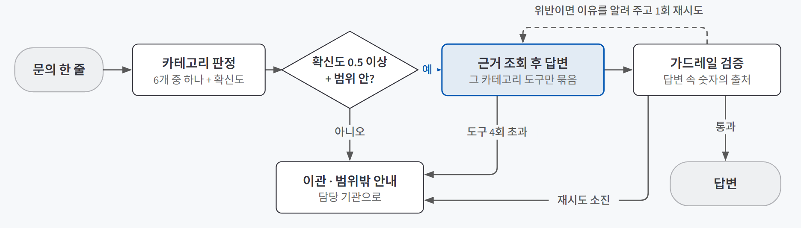
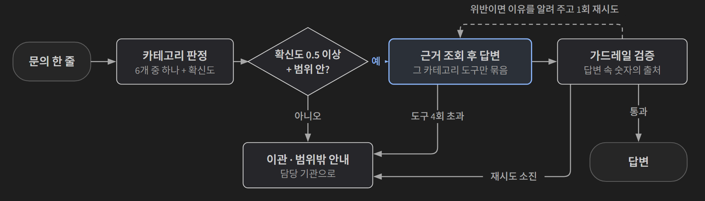

## 한 줄 소개

**문의를 먼저 분류하고, 분류된 카테고리의 근거만 조회해서 답하게 하면 지원사업 안내처럼 틀리면 안 되는 질문에도 지어낸 답 없이 응대할 수 있는지 확인하려고, 「2026년도 초기창업패키지(일반형)」 공고 문의 응대 에이전트를 만들어 검증했다.** 신청자가 문의 한 줄을 넣으면 카테고리를 판정하고, 그 카테고리에 묶인 조회 도구로 공고 원문에서 근거를 찾아 답하고, 답변 속 숫자가 정말 근거에서 나왔는지 기계적으로 대조한다.

저장소: [beginner-driver/my-routing-agent](https://github.com/beginner-driver/my-routing-agent)

> **검증한 것:** 카테고리 판정과 이관 판단을 나눠 라우팅 통제하기 △ · 카테고리별로 좁힌 근거로만 답하기 ✅(평가 20건 범위) · 답변 속 숫자의 출처를 가드레일로 대조하기 △
>
> **발견한 것:** 점수가 낮았던 이유의 대부분은 에이전트가 아니라 채점기였다 · 재시도할 때 이유만 알려 줘도 불필요한 이관이 사라졌다 · 공고를 읽기 전 세운 가정이 틀려 있었다
{: .prompt-tip }

## 만든 이유

[문의를 나누고 근거로만 답하기 — 라우팅과 그라운딩](/posts/routing-grounding/)을 배우고 나서 세 가지가 궁금했다.

1. "어느 카테고리인가"를 고르는 일과 "확신이 없으니 사람에게 넘길까"를 정하는 일을 **서로 다른 단계로 나누면**, 라우팅을 숫자로 재고 통제할 수 있을까?
2. 카테고리마다 **볼 수 있는 근거와 도구를 좁혀 두고** 도구 결과로만 답하게 하면, 그럴듯하게 지어낸 답이 나오지 않을까?
3. 답변에 들어간 금액·기한·비율 같은 **숫자의 출처를 코드로 역추적**하면, 근거 없는 숫자를 기계적으로 막을 수 있을까?

실험 대상인 중소벤처기업부 공고에는 라우팅이 필요한 조건이 그대로 들어 있었다. 지원자격·사업계획서·증빙서류·온라인 신청·협약 후 관리가 서로 다른 별첨과 담당에 나뉘어 있고, 지원금액·기한·자격조건은 비슷한 다른 사업(예비창업패키지 등)과 헷갈려 지어내기 쉽다.

## 실험 설계

### 동작 흐름

{: .light }
{: .dark }

1. **판정(classify):** AI가 문의를 6개 카테고리 중 하나로 고르고, 확신도(0~1)와 근거 한 문장을 정해진 양식(구조화 출력)으로 돌려준다.
2. **이관 판단(gate):** AI를 쓰지 않는 평범한 규칙이다. 확신도가 0.5 미만이면 사람에게 넘기고, "범위 밖"이면 안내 문구로 보낸다.
3. **답변(answer):** 그 카테고리에 묶인 조회 도구만 쥐고 답한다. 도구는 공고에서 뽑아 출처와 함께 정리한 사실 원장(`facts.json`)을 조회하고, 원장에 없는 내용은 "찾지 못함"으로 돌려준다. 도구 호출이 4회를 넘으면 이관한다.
4. **검증(verify):** 답변에 나온 (숫자, 단위) 쌍이 이번 턴 도구 결과에 있는지 대조한다. 출처를 못 찾으면 한 번 다시 답하게 하고, 그래도 안 되면 이관한다.

카테고리는 공고 문서의 구분과 **처리 주체**를 함께 보고 나눴다.

| 카테고리 | 다루는 문의 | 근거 문서 |
|---|---|---|
| 지원자격·모집개요 | 업력, 지원 규모, 일정, 평가 절차 | 공고문 본문과 붙임표, 통합관리지침 일부 |
| 사업계획서 작성 | 분량, 작성 항목, 평가지표 | 별첨1 양식 |
| 증빙서류·제출 | 제출서류, 공공 마이데이터 대체 | 별첨2, 별첨6 |
| 신청방법·시스템 이용 | 회원가입, 인증, 온라인 신청 단계 | 별첨4, 별첨5 |
| 협약 후 관리·제재 | 사업비 집행, 제재, 환수, 이의신청 | 통합관리지침(신청자에게 해당하는 조항만) |
| 범위 밖 | 위 다섯에 해당하지 않는 문의 | 없음 (근거를 붙이지 않는 것이 정의) |

"범위 밖"은 **분류기가 직접 고르는 여섯 번째 라벨**로 뒀다. 그래야 "주제가 문서 밖이다"와 "분류에 확신이 없다"라는 서로 다른 이관 사유가 섞이지 않는다.

증빙서류 별첨처럼 제출서류 목록·약관 동의·협약 후 확약서가 함께 든 문서는 세 카테고리로 나눠 붙였다. 통째로 넣으면 "창업 유지 의무가 몇 년이냐"가 서류 문의로 흘러간다. 통합관리지침 109개 절 중 주관기관 내부 행정 조항 64개는 그럴듯한 오답의 재료만 늘리므로 근거에서 뺐다.

### 사용 기술

| 기술 | 어디에 썼나 |
|---|---|
| **LangGraph** | 판정 → 이관 판단 → 답변 → 검증 → 이관의 다섯 단계와 갈림길을 그래프로 연결 |
| **LangChain + OpenAI API** | 분류용 모델(gpt-5.6-luna)과 답변용 모델(gpt-5.6-terra)을 나눠 호출하고, 답변 모델에 조회 도구를 묶었다 |
| **Pydantic** | 분류 결과의 양식(카테고리·확신도·근거). 카테고리 값은 6개 중 하나만 받도록 강제했다 |
| **Python 정규식** | 가드레일. 답변과 도구 결과에서 (숫자, 단위) 쌍을 뽑아 대조했다 |
| **pdfplumber · 한글 COM 자동화** | 근거 문서 추출(hwp는 한컴오피스 자동화, PDF는 pdfplumber, 글자층 없는 PDF 2종은 직접 옮겨 적음) |
| **scikit-learn · pandas** | 분류 정확도와 macro F1(카테고리별 점수의 평균) 계산 |
| **Streamlit** | 판정·호출 도구·반환값·출처·검증 결과를 펼쳐 보이는 데모 화면 |

### 평가셋과 기준

평가 문항은 **채점용 20건과 예시용 7건**을 따로 두고, 프롬프트에는 예시용만 들어가게 코드에서 걸렀다. 채점 문항이 프롬프트에 들어가면 점수는 오르지만 의미가 없다.

| 문항 유형 | 건수 | 무엇을 재나 |
|---|---|---|
| 쉬움 | 5 | 도구 하나로 사실 하나를 조회 (카테고리마다 1건) |
| 어려움 | 5 | 도구 둘 이상을 조합하거나 개인·법인 같은 조건으로 갈리는 문의 |
| 함정 | 5 | 문서를 안 읽으면 나오기 쉬운 그럴듯한 오답을 겨냥 |
| 범위 밖 | 3 | 이 문서들로는 원래 답할 수 없는 문의 → 정답 행동은 범위 밖 안내 |
| 답 없음 | 2 | 주제는 범위 안인데 문서에 답이 실제로 없음 → 정답 행동은 이관 |

함정 문항은 예비창업자도 신청할 수 있는지(불가), 첨부파일 용량이 15MB인지 30MB인지(화면마다 다른 제한), 마감 뒤 보완 기간이 있는지(없음), 노트북 구매가 금지인지(조건부 허용) 같은 문의다.

| 지표 | 통과 조건 |
|---|---|
| **분류 정확도·macro F1** | 판정한 카테고리가 정답과 같은가 |
| **도구 호출 적절성** | 실제로 부른 도구 묶음이 기대한 묶음과 **정확히 같은가**. 빠뜨려도, 더 불러도 실패 |
| **답변 적절성** | 반드시 들어가야 할 사실(must)이 있고, 들어가면 안 되는 오답(forbid)이 없는가 |

채점기도 먼저 검사했다. 모범 답안을 넣으면 20건 모두 통과하고(양성 대조), 모범 답안에 오답 문구를 하나씩 끼워 넣으면 20건 모두 실패하는지(음성 대조) 확인했다.

## 검증 결과

| 지표 | 처음(v0) | 최종(v4) |
|---|---|---|
| 분류 정확도 / macro F1 | 1.000 / 1.000 | 1.000 / 1.000 |
| 도구 호출 적절성 | 0.90~0.95 | **1.000** |
| 답변 적절성 | 0.40~0.50 | **1.000** (5회 반복 모두 20/20) |

처음 점수가 범위인 건 실행마다 답이 조금씩 달라지기 때문이다. 개선은 한 번에 하나씩 바꾸고 다시 재는 방식으로 네 번 했다.

| 버전 | 바꾼 것 | 도구 적절성 | 답변 적절성 |
|---|---|---|---|
| v1 | 가드레일이 도구가 돌려준 "단위 없는 숫자"도 출처로 인정 | 1.000 | 0.550 |
| v2 | 범위 밖 답변을 고정 문구에서 "질문 주제 + 담당 기관"을 짚는 짧은 답으로 교체 | 1.000 | 0.700 |
| v3 | 채점기가 조사 차이(을/를 등)는 같은 것으로 보도록 완화, 경직된 정답 문구 정리 | 0.95~1.00 | 0.850~0.900 |
| v4 | 재시도할 때 "무엇이 왜 걸렸는지"를 모델에게 알려 줌 | 1.000 | 1.000 |

| 질문 | 결과 | 근거 |
|---|---|---|
| 1. 판정과 이관 판단 나누기 | △ 구조는 됨, 이관 경로는 못 잼 | 분류는 처음부터 만점이었지만 20건이 전부 한 주제짜리라 변별력이 없었다. 확신도 기준(0.5)은 한 번도 발동하지 않았다 |
| 2. 좁힌 근거로만 답하기 | ✅ 평가 20건 범위 | 처음부터 사실이 틀린 답은 0건. 최종에는 도구 묶음과 답변 모두 20/20 |
| 3. 숫자 출처 대조 | △ 잡기는 하지만 오탐이 있다 | 정상 답을 막는 오탐이 두 종류 나왔다. 하나는 고쳤고 하나는 남았다. 숫자가 없는 날조는 설계상 못 잡는다 |

### 질문 1. 판정과 이관 판단을 나누면 라우팅이 통제되는가

분류는 처음부터 **20건 모두 맞았다.** 그런데 이 만점은 **"이 평가셋으로는 분류 실력을 가를 수 없다"**는 뜻이었다. 20건이 전부 한 주제만 묻는 문의라 카테고리 경계에 걸친 질문(예: 사업비를 "계획서에 어떻게 쓰나"와 "실제로 어떻게 쓰나")이 없었다. 확신도도 전 문항이 0.98~0.99에 몰려, 0.5 미만이면 넘기는 이관 기준은 **한 번도 작동하지 않았다.**

구조 자체는 의도대로 나뉘어, 규칙 함수인 이관 판단은 "확신도가 낮으면 범위 밖 라벨보다 먼저 이관한다" 같은 정책을 테스트로 고정할 수 있었다. 실제 애매한 문의에서 제대로 갈라지는지는 확인하지 못했다.

### 질문 2. 근거를 좁히면 지어낸 답이 나오지 않는가

처음 실행(v0)에서 답변 적절성은 0.40~0.50으로 낮았지만, 실패한 답을 하나씩 읽어 보니 **사실이 틀린 답은 0건**이었다. 낮은 점수의 이유는 아래 "직접 만들며 알게 된 것"에서 다룬다.

도구 호출 쪽에서는 진짜 버그가 하나 나왔다. 외주 계약 선금 상한을 도구가 `15000000`처럼 단위 없이 돌려줬는데, 답변이 이를 "15,000,000원"으로 쓰자 가드레일이 출처를 못 찾았다. 재시도에서도 같은 일이 반복되자 모델이 이관을 골랐다. **맞는 답이 검증 때문에 취소된 것이다.** 단위 없는 숫자도 출처로 인정하게 고치자(v1) 도구 호출 적절성이 1.000이 됐다.

v4에서는 다섯 번 반복해 모두 20/20이었다. 함정 5건에서도 오답 문구는 없었고, 범위 밖 3건은 도구 없이 담당 기관을 안내했으며, 답 없음 2건은 찾아본 뒤 이관했다.

### 질문 3. 숫자 출처를 코드로 대조하면 근거 없는 숫자를 막는가

가드레일은 날짜도 정규화해서 도구의 `2026-02-13`과 답변의 "2월 13일"을 같은 값으로 잡는다. 이 분야에서는 3년·70%·30MB처럼 **작은 숫자가 사실을 가르기 때문에** 작은 수를 건너뛰는 하한을 두지 않았다. 막는 일은 했지만, 정상 답을 잘못 막는 **오탐이 두 종류** 나왔다.

| 오탐 | 원인 | 처리 |
|---|---|---|
| 도구가 계산해 준 숫자 | 도구 결과에 단위 글자가 없었다 | v1에서 고침 |
| 사업명에 든 연도 | "2026년 초기창업패키지"의 2026을 근거 없는 숫자로 봤다. 고유명사 속 숫자와 사실 주장을 같은 규칙으로 뽑기 때문이다 | 오탐 자체는 남아 있다. v4의 재시도 안내로 신청자에게 보이는 결과(불필요한 이관)는 없어졌다 |

그리고 이 방식은 **숫자가 없는 날조는 잡지 못한다.** 존재하지 않는 서류 이름을 지어내는 오류는 그대로 통과한다. 잡으려면 도구 반환값과 답변 문장을 의미 단위로 대조하는 검사가 따로 필요하다.

## 직접 만들며 알게 된 것

### 점수가 낮았던 이유의 대부분은 채점기였다

v0의 실패 12건을 직접 읽어 원인을 나눴더니, **9건이 조사 하나 차이**였다. 정답 기준은 "업력 요건 충족"이라는 문구를 요구했는데, 실제 답변은 "업력 요건**을** 충족합니다"였다. 채점기가 글자를 그대로 비교하다 보니 "을" 한 글자 때문에 실패로 셌다.

나머지는 설계끼리 어긋난 경우였다. 범위 밖 안내는 고정 문구인데 채점 기준은 질문 주제어(예: "종합소득세")를 요구했다. 또 도구가 "흔한 오답"을 주의 표시로 함께 돌려주는데, 모델이 그 오답을 **바로잡는 문장**에 인용하자 금지 문구에 걸렸다.

그래서 v2와 v3는 에이전트보다 채점 쪽을 많이 고쳤고, 채점기가 느슨해지지 않게 고칠 때마다 양성·음성 대조 20/20을 다시 돌렸다. **채점기도 검증 대상**이라는 것과, 숫자가 낮을 때는 고치기 전에 실패를 하나씩 읽어야 한다는 것은 직접 해 보고서야 알았다.

### 재시도할 때 이유만 알려 줘도 불필요한 이관이 사라졌다

v3까지는 가드레일에 걸리면 이유 없이 "다시 답하라"고만 했다. 그러자 모델이 무엇을 고칠지 몰라 **아예 이관을 택하는** 경우가 생겼다. 사업명 속 "2026년" 오탐이 걸린 문항이 그랬다.

v4에서는 "직전 답변에서 이 값(2026년)이 출처 불명으로 표시됐다"는 이유를 그대로 전달했다. 모델은 그 값이 사업 이름일 뿐이라고 판단하고 정상적으로 답했다. 특정 값을 예외 처리한 게 아니라 **가드레일에 걸리는 모든 경우에 통하는 고치기 경로**를 만든 것이다. 다만 이 효과는 문항 하나를 처리하는 동안에만 유지된다.

### 공고를 읽기 전 세운 가정이 틀려 있었다

처음 설계에서는 신청 대상을 "예비창업자와 기존 기업 모두"로 잡았다. 공고문을 읽어 보니 일반형은 **사업 개시와 사업자등록을 마쳐야** 신청할 수 있었고, 답이 갈리는 축은 **개인사업자냐 법인사업자냐**(업력 기산일과 인증 수단이 다르다)였다. 그대로 뒀다면 평가셋 전체가 틀린 전제 위에 섰을 것이고, 결국 이 착오는 함정 문항 하나가 됐다. 첨부파일 용량(공고문 30MB, 마이데이터 별첨 15MB)처럼 문서끼리 어긋난 값은 임의로 통일하지 않고 각 화면의 제한으로 뒀다.

## 검증 범위와 한계

| 구분 | 내용 |
|---|---|
| **평가셋 크기** | 20건은 변화의 방향은 보여 주지만 정확한 성능이라 하기엔 얇다. 확신도가 전부 0.98~0.99라 이관 기준이 한 번도 발동하지 않았고, 카테고리 경계에 걸친 질문을 넣어야 지금 못 보는 실패가 드러난다 |
| **복합 문의** | 한 번에 카테고리 하나만 고른다. "계획서는 어떻게 쓰고 신청은 어디서 하나요?"처럼 두 카테고리를 묻는 문의는 한쪽이 빠질 수 있다 |
| **가드레일** | 사업명 속 연도 오탐은 남아 있다. 숫자가 없는 날조는 이 검사로 잡지 못한다 |
| **근거 범위** | 주관기관 소개자료(별첨3)는 배경 정보라 뺐다. 사실 원장은 평가 문항에 필요한 사실만 사람이 뽑아 만든 것이다 |
| **실사용** | 공개 배포는 하지 않았다. 실제 신청자 문의로 써 본 적이 없다 |

## 결론

세 질문 중 확실하게 확인한 건 2번이다. **카테고리마다 볼 수 있는 근거와 도구를 좁혀 두고 도구 결과로만 답하게 하면, 비슷한 사업과 헷갈리기 쉬운 함정 문항에서도 지어낸 사실 없이 답했다.** 1번과 3번은 구조는 의도대로 섰지만, 이관 기준은 평가셋이 너무 쉬워 작동하지 않았고 숫자 가드레일은 오탐과 사각지대를 함께 안고 있다.

가장 크게 남은 건 숫자를 읽는 순서다. 점수가 0.40에서 1.000으로 오른 과정의 상당 부분은 채점기를 고친 일이었다. **점수가 낮을 때 바로 프롬프트를 고치지 않고 실패를 하나씩 읽어 "진짜 오류인가, 채점 오류인가"부터 가른 것**이 이번 프로젝트에서 가장 쓸모 있었던 습관이었다.
