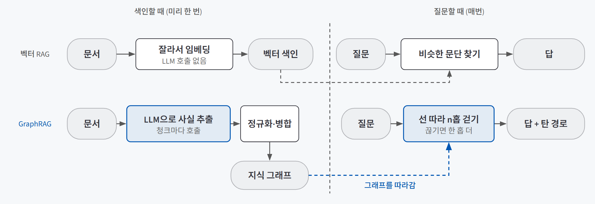
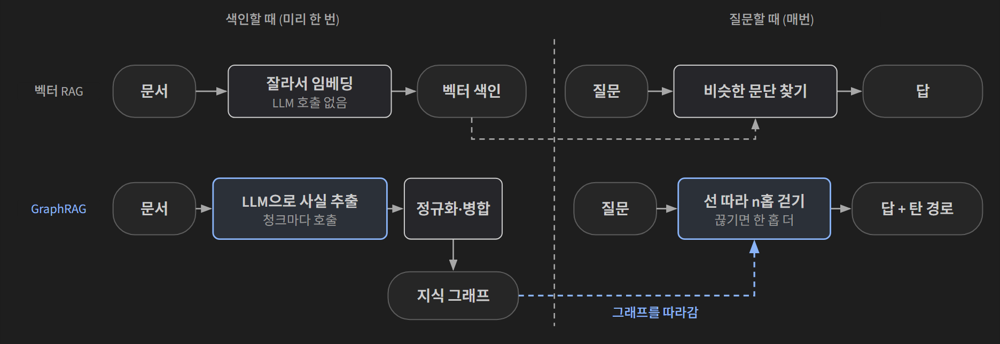
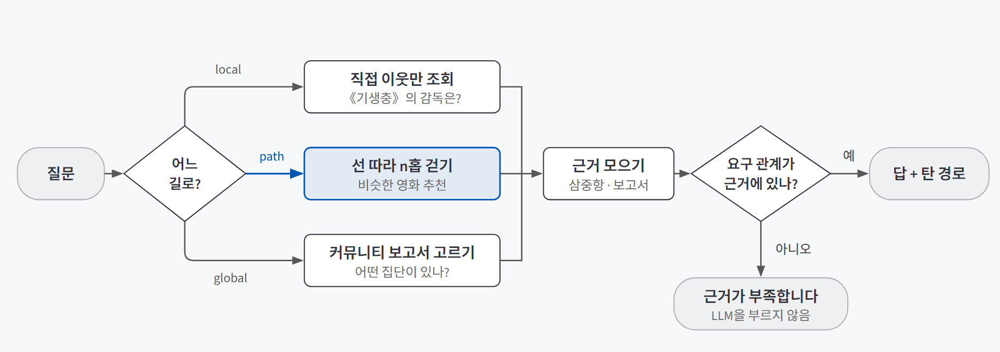
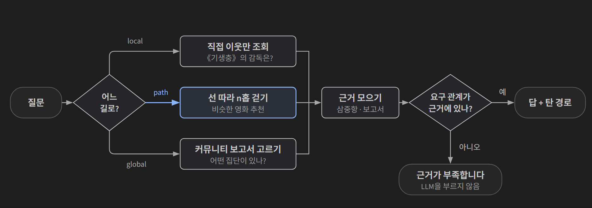

## 한 줄 요약

**GraphRAG는 문서를 넣을 때 미리 `(주어, 관계, 목적어)` 사실로 쪼개 지식 그래프를 만들어 두고, 질문이 오면 그 그래프의 선을 따라 걸으며 답하는 방식이다.** 보통 RAG가 "질문과 비슷한 문단 찾기"라면, GraphRAG는 "사실과 사실을 이어 걷기"다. 비용이 사라지는 게 아니라 **질문할 때에서 색인할 때로 옮겨 가고**, 정말 어려운 일은 그래프를 만드는 것보다 **믿을 수 있게 다듬는 것**이다.

수사 드라마의 벽면 관계도와 같다. 사건 기록철을 아무리 잘 뒤져도 "피해자의 동업자가 다니던 회사의 대표"는 한 장에 적혀 있지 않다. 그래서 형사들은 인물 사진을 벽에 붙이고 실로 잇는다. 실을 미리 이어 두면 질문이 와도 실만 따라가면 된다. 대신 실을 잘못 이으면 엉뚱한 사람에게 닿는다.

## 필요한 이유

벡터 RAG(질문과 뜻이 가까운 문서 조각을 찾아 근거로 붙이는 방식)의 기본 구조는 [근거로만 답하는 RAG 챗봇 검증](/posts/claude-code-rag-bot/)과 [컨텍스트 엔지니어링](/posts/context-engineering/)에서 다뤘다. 이 방식은 **답이 한 문단 안에 있는 질문**에 강하다. 문제는 답이 여러 문서에 흩어져 있을 때다.

"송강호와 같은 영화에 나온 배우들의 다른 작품"처럼 **징검다리를 두 번 이상 건너야 답이 나오는 질문**을 멀티홉 질문이라고 한다. 이 질문의 근거인 《부산행》 문서는 상위 50개 후보에도 들어오지 않는다. 질문에 '부산행'도, 그 영화에 함께 나온 배우 이름도 없기 때문이다.

검색 후보에 정답 근거가 없으면 어떤 LLM을 붙여도 맞힐 수 없다. 그래서 먼저 "후보 안에 정답이 들어 있는가(정답 포함률)"를 재면 시스템의 **상한선**이 보인다. 멀티홉 질문의 결과는 세 갈래로 갈린다.

| 결과 | 뜻 | 대응 |
|---|---|---|
| 어휘가 우연히 겹쳐 성공 | 질문과 근거 문서에 같은 낱말이 있었다 | 운이다. 다른 질문에서 재현되지 않는다 |
| 후보 수를 늘리면 구제 | 근거가 순위 밖에 있었다 | 잡음도 같이 늘어난다 |
| 50개로 늘려도 실패 | 질문에 근거 문서를 부를 단서가 없다 | 검색이 아니라 **추적**이 필요하다 |

하이브리드 검색과 리랭킹은 "후보 안에 정답이 있다"는 전제에서 순서를 다시 매길 뿐이라, 정답 문서를 아예 못 데려온 상황(재현율 0)은 구하지 못한다. 재현율을 올리는 길은 검색을 여러 번 하거나(반복 검색), **연결을 미리 만들어 두는 것**(GraphRAG)이다.

## 개념과 동작

### 사실 하나를 삼중항으로 적는다

지식 그래프는 **노드**(개체: 봉준호, 기생충)와 **엣지**(관계: DIRECTED, ACTED_IN)로 이루어진다. 엣지 하나가 사실 하나이고, 이를 `[봉준호] -(DIRECTED)-> [기생충]` 같은 **삼중항**으로 적는다.

문서 조각은 서로 이어 붙일 수 없지만 삼중항은 된다. `(봉준호, DIRECTED, 기생충)`과 `(송강호, ACTED_IN, 기생충)`이 있으면 "봉준호 영화에 나온 배우는?"에 답할 수 있다. 노드에 Film·Person 같은 **타입**을 붙이면 "《기생충》의 감독은?"에 배우 이름이 후보로 올라와도 거를 수 있다. 한계도 분명하다. 삼중항에는 **서술이 없어서** 줄거리·분위기·평가처럼 문장으로만 전할 수 있는 내용은 그래프로 답하지 못한다.

### 비용이 색인 시점으로 옮겨 간다

{: .light }
{: .dark }

벡터 RAG는 색인할 때 문서를 잘라 임베딩만 해 두면 된다. GraphRAG는 **문서 조각마다 LLM을 불러 사실을 뽑아서**, 전체 토큰의 대부분이 이 단계에서 나간다. 입력의 절반 가까이는 본문이 아니라 **청크마다 다시 붙는 추출 지시문**이라, 청크를 잘게 자를수록 지시문이 그만큼 반복된다. 출력 단가가 보통 몇 배 비싸서 금액은 출력 쪽이 더 크다.

### 스키마는 답하고 싶은 질문에서 거꾸로 정한다

제약 없이 "관계를 다 뽑아라"고 하면 세 가지 문제가 생긴다.

| 문제 | 예 |
|---|---|
| 관심 없는 관계가 잔뜩 생긴다 | 등장인물끼리의 가족 관계 |
| 잘못된 관계가 생긴다 | 같은 문단에 나왔다는 이유로 두 영화를 "수상작" 관계로 잇는다 |
| 같은 것이 다른 노드로 흩어진다 | `72회 칸 영화제` / `제72회 칸 영화제` / `칸 영화제` |

그래서 **스키마**(뽑아도 되는 노드 타입과 관계 목록)를 먼저 정한다. 순서는 답하고 싶은 질문 → 필요한 관계 → 스키마다. **관계 종류가 곧 그래프가 답할 수 있는 질문의 범위**다.

관계는 이름만이 아니라 `(Person, ACTED_IN, Film)`처럼 **출발·관계·도착 타입을 묶은 삼중항**으로 준다. 이름만 주면 문서마다 방향이 뒤집힌 엣지가 섞인다. 스키마로 전할 수 없는 "어떻게 뽑을지"(조사 떼기, 일반명사 제외, 수상 부문은 노드가 아니라 속성으로)는 도메인 지침으로 따로 적고, 결과를 보며 하나씩 늘린다.

### 구조가 있는 곳은 규칙으로, 자유 서술만 LLM으로

추출 직후의 그래프는 길이 끊겨 있다. 같은 영화가 `기생충`과 `기생충 (영화)`로 따로 있으면 두 노드를 지나는 경로가 이어지지 않는다. 그래서 **정규화**가 그래프 프로젝트에서 가장 흔한 실패 지점이다.

| 정규화 | 하는 일 | 주의 |
|---|---|---|
| 표기 변형 병합 | `황금종려상` = `황금 종려상` | 합치기 전·후 숫자와 병합 목록을 남겨 사람이 한 번 훑는다 |
| 한정어 괄호 병합 | `기생충 (영화)` = `기생충` | `김윤석 (1968년)`처럼 동명이인을 가르는 괄호도 있다 |
| 고아 노드 정리 | 연결 없는 노드, 일반명사, 연도 정리 | 《1987》처럼 연도가 작품 제목일 수 있다 |

괄호를 무조건 지우면 동명이인이 한 노드로 합쳐져 그 노드를 지나는 모든 경로가 망가진다. 그래서 **타입을 같이 보고**, 개체(작품·사람·조직·상)와 속성(장르·소재·장소)은 이름이 같아도 합치지 않는다.

위키 분류, 태그, 입력 양식처럼 **사람이 미리 정리해 둔 구조**가 있으면 규칙으로 싸고 정확하게 사실을 더한다. "○○ 감독 영화"라는 분류 줄은 그 자체로 `(○○, DIRECTED, 작품)`이다. 다만 출연 정보는 본문에만 있어 LLM만 뽑을 수 있다. 그래서 둘을 섞고, 엣지마다 `origin`(규칙/LLM)과 신뢰도를 남겨 틀린 사실이 어느 단계에서 들어왔는지 되짚을 수 있게 한다. 정규화는 **둘을 합친 뒤 한 번** 한다. 따로 하면 `기생충`과 `기생충 (영화)`가 겹쳐지지 않고 나란히 쌓인다.

### 허브는 가짜 다리가 된다

연결이 비정상적으로 많은 노드를 **허브**라고 한다. 허브에는 진짜 중심(자주 협업한 감독·배우)과, `드라마` 장르나 `대한민국`처럼 **너무 흔해서 정보가 없는 노드**가 섞여 있다. 후자는 서로 관계없는 영화 수십 편을 두 홉 만에 잇는 **가짜 다리**가 된다. 흔한 노드를 지우는 대신 원본은 두고, 조회할 때 **차수 감점**(`1 / (1 + √연결 수)`)을 거는 방법이 있다. 검색에서 흔한 낱말의 가중치를 낮추는 IDF와 같은 발상이다.

### 질문마다 걷는 길이 다르다

{: .light }
{: .dark }

| 경로 | 질문 예 | 하는 일 |
|---|---|---|
| **local** | "《기생충》의 감독은?" | 출발 개체의 직접 이웃만 본다 |
| **path** | "《기생충》과 비슷한 영화 추천" | 목적 타입(영화)에 닿을 때까지 선을 따라 걷고, **지나온 경로를 추천 이유로 남긴다** |
| **global** | "이 자료에는 어떤 집단이 있나" | 출발할 개체가 없다. 미리 만든 커뮤니티 보고서에서 고른다 |

global 경로의 재료는 **커뮤니티 탐지**다. Louvain 방법으로 촘촘한 노드 무리를 찾고, 무리마다 요약 보고서를 미리 만들어 둔다(GraphRAG 원논문 *From Local to Global*의 "미리 요약해 두기"). 이 무리는 섞여 들어온 무관한 문서를 한 덩어리로 드러내는 품질 진단 도구이기도 하다.

경로를 가르는 라우터는 [라우팅과 그라운딩](/posts/routing-grounding/)과 같은 생각으로 짠다. **규칙이 먼저 판정하고, 규칙이 "모르겠다"고 할 때만 LLM에 묻는다.** 같은 정확도에서 LLM 호출이 크게 준다. 애매하면 넓은 쪽(path)으로 보낸다. "송강호가 출연한 영화 중 대종상을 받은 작품은?"은 단순 조회처럼 보이지만 두 홉이라, 규칙 라우터는 표면에 속기 쉽다.

### 지어내기는 두 겹으로 막는다

근거가 경로로 드러나면, 근거가 부족한 것도 코드가 먼저 알 수 있다.

| 층 | 막는 방법 | 못 막는 것 |
|---|---|---|
| **코드** | 질문이 요구한 관계(감독·출연·수상)가 근거에 한 줄도 없으면 한 홉 더 걷고, 끝내 없으면 **LLM을 아예 부르지 않는다** | 코퍼스 밖 사실("2035년 신작") |
| **지시문** | "근거만 써라, 확정 못 하면 '근거가 부족합니다'" | 지시를 어기는 경우 |

"근거가 충분한가"를 **개수로 판정하면 안 된다.** 유명한 개체는 연결이 수십 개라 늘 충분해 보이지만, 그중 감독 관계는 하나뿐일 수 있다. 판정은 **질문이 요구한 관계에 대한 연결 수**로 한다. 이 분기와 반복은 [LangGraph 워크플로](/posts/langgraph-workflow/)의 조건부 엣지로 짠다.

## 적합한 경우와 피할 경우

| 적합한 경우 | 피할 경우 |
|---|---|
| 사람·조직·작품·사건처럼 **여러 종류의 개체가 한 자료에 섞여 있고** 문서 사이에 겹친다 | 답이 대부분 한 문단 안에 있다 (FAQ, 매뉴얼 조회) |
| "A의 B의 다른 C" 같은 **연쇄 질문**이 반복해서 들어온다 | 질문이 몇 개뿐이거나 자료가 자주 바뀐다. 미리 정리한 비용을 회수하지 못한다 |
| 답과 함께 **왜 그런지(경로)**를 보여 줘야 한다 | 줄거리·분위기·의견처럼 **서술**이 답의 핵심이다 |
| 위키 분류·태그처럼 사람이 단 구조가 있다 | 질문에서 스키마를 거꾸로 정할 수 없다. 관계 목록이 안 서면 빽빽하고 모호한 그래프가 된다 |

질문이 적을 때 비용을 뽑지 못한다는 계산은 [다섯 가지 에이전트 패턴](/posts/agent-patterns-when-not-to-use/)에 따로 적었다.

## 장점과 한계

| 장점 | 한계 |
|---|---|
| 근거가 경로로 드러나 답이 틀리면 **어느 홉에서 틀렸는지** 짚을 수 있다 | 색인 비용이 크다 |
| 검색으로는 데려올 단서가 없는 근거에 **선을 따라** 닿는다 | 원문의 부가 정보를 버려, 단순 질문은 보통 RAG가 더 잘 맞힌다 |
| 커뮤니티 보고서로 **전역 질문**에 답한다 | 커뮤니티 묶음이 설정값에 민감하다. 속성 노드 가중치를 안 낮추면 모든 작품이 장르 노드로 한 덩어리가 된다 |
| `origin`으로 사실의 출처를 남겨 품질을 추적한다 | 정규화·허브 처리·스키마처럼 사람이 판단할 곳이 많다 |

## 적용 방법

### 1단계. 벽부터 잰다

그래프를 만들기 전에 보통 RAG(또는 BM25 같은 낱말 검색)로 기준선을 잡고, 질문마다 **정답 포함률**을 잰다. 실패한 질문을 위의 세 갈래로 나눠 남기면 그 목록이 그래프로 풀 대상이 된다. 벽을 먼저 재지 않으면 다 만든 뒤에도 나아졌는지 알 수 없다.

### 2단계. 질문에서 스키마를 거꾸로 정한다

같은 질문으로 스키마를 정하고 채점하면 점수가 후하게 나오니 설계용과 평가용 질문을 나눈다. 문서 제목은 **본문 앞에 직접** 쓴다. 제목이 없으면 배역 목록만 있는 조각에 다른 작품의 배역이 붙는다. 작은 표본으로 먼저 돌리고, 결과는 파일로 캐시한다.

### 3단계. 규칙과 LLM을 나눠 뽑고, 합친 뒤 한 번 정규화한다

시상식 이름처럼 **목록이 닫힌 것은 정규식보다 사전**이 정확하다.

### 4단계. 쓰기 전에 그래프를 점검한다

관계·타입 분포에서 스키마 밖 관계를, 연결이 많은 노드에서 가짜 다리를, 덩어리 수에서 정규화가 덜 된 곳을 찾는다. 추출 오류는 통계보다 특정 개체 주변 그림에서 먼저 보인다.

### 5단계. 세 층으로 나눠 평가한다

| 층 | 묻는 것 | 비용 |
|---|---|---|
| ① 색인 | 답에 필요한 사실이 그래프 안에 있는가 | 없음 (문자열 비교) |
| ② 검색 | 그 사실이 이번에 모은 근거에 들어왔는가 | 없음 |
| ③ 생성 | 최종 답이 맞는가 | LLM 채점 |

공짜인 ①②를 먼저 세우고 ③을 붙인다. 틀린 문항을 깨진 층별로 분류해 두면 고칠 곳의 순서가 데이터로 정해진다. 보통 RAG와 비교할 때는 **같은 답변 지시문과 같은 모델**을 붙여 근거 출처만 다르게 하고, LLM 채점은 생성 모델과 **다른 모델**에 **원문 근거를 함께** 준다.

## 다른 방법과 비교

| 방법 | 멀티홉 | 단순 조회 | 색인 비용 | 한 줄 평가 |
|---|---|---|---|---|
| 벡터 RAG | 약함 | 강함 | 작음 | 답이 한 문단 안에 있으면 이것으로 충분하다 |
| 하이브리드 검색 + 리랭킹 | 약함 | 강함 | 작음 | 후보 안에서 순서만 다시 매긴다 |
| 반복 검색 (에이전틱 RAG) | 보통 | 강함 | 작음 | 질문할 때 여러 번 찾는다. 질문마다 비용과 지연이 쌓인다 |
| **GraphRAG** | 강함 | 보통 | 큼 | 연결을 미리 만든다. 경로로 설명할 수 있다 |
| 관계형 DB | 강함 | 강함 | 스키마 설계 | 구조가 처음부터 표로 정해진 자료라면 그래프보다 낫다 |

같은 모델·같은 답변 지시문으로 비교해 보면 단순 질문은 보통 RAG가 앞서고 추천·전역 질문은 GraphRAG가 크게 앞선다. **총점이 아니라 유형별로 봐야** 어느 질문에 그래프를 쓸지가 보인다. 노드 수천 개까지는 메모리 위 NetworkX로 충분하다.

## 주의할 점

- **정답 근거가 동점에서 잘려 나갈 수 있다.** 관계별로 담는 개수를 제한하면 무엇을 버릴지를 신뢰도가 정하는데, 같은 신뢰도의 엣지가 많으면 **삽입 순서**가 정답 근거를 잘라 버린다. 규칙이 확인한 엣지는 할당량에서 빼 주고, 근거 총량도 같이 흔들어 봐야 진짜 병목이 보인다.
- **지표가 무엇을 비교하는지 먼저 확인한다.** 문자열 유사도로 근거 재현율을 재면, 삼중항 근거(그래프)와 문단 근거(보통 RAG)를 비교할 때 문단 쪽이 0에 가깝게 나온다. 성능이 아니라 평가 설계의 문제다.
- **채점기도 틀린다.** 정답 목록에 장편만 적혀 있으면 단편까지 넣은 맞는 답이 오답 처리된다. 10문항쯤은 사람이 채점해 채점기와의 일치율부터 본다.
- **경로는 LLM이 쓰게 하지 않는다.** 실제 탐색 기록에서 뽑아야 지어낼 여지가 없다.

## 용어 정리

| 용어 | 뜻 |
|---|---|
| 멀티홉 질문 | 사실 두 개 이상을 이어 붙여야 답이 나오는 질문 |
| 삼중항 (triple) | `(주어, 관계, 목적어)`로 적은 사실 하나. 지식 그래프의 엣지 하나에 해당한다 |
| 스키마 (허용 삼중항) | 뽑아도 되는 노드 타입과 `(출발 타입, 관계, 도착 타입)` 목록. 그래프가 답할 수 있는 질문의 범위를 정한다 |
| 정답 포함률 | 검색 후보 안에 정답 근거가 들어 있는 비율. 시스템이 맞힐 수 있는 상한선이다 |
| 정규화 (개체 병합) | 표기가 다른 같은 개체를 한 노드로 합치는 일 |
| 허브 / 가짜 다리 | 연결이 비정상적으로 많은 노드 / 흔해서 정보가 없는 허브가 무관한 개체끼리 잇는 경로 |
| 차수 감점 | 연결 수가 많은 노드를 지날수록 점수를 낮추는 방법. 검색의 IDF와 같은 발상 |
| 커뮤니티 탐지 (Louvain) | 안쪽은 촘촘하고 바깥과는 성긴 노드 무리를 찾는 방법. 전역 질문용 보고서의 재료가 된다 |

---

→ 이 개념을 검증한 프로젝트: [관계를 따라 답하는 GraphRAG 검증 — 노란봉투법 입법 과정 지식그래프로 확인한 세 가지](/posts/yellow-envelope-graphrag/)
