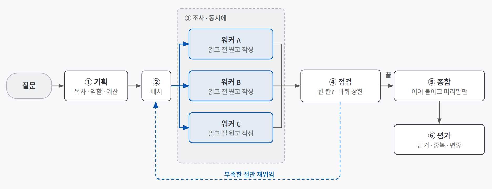
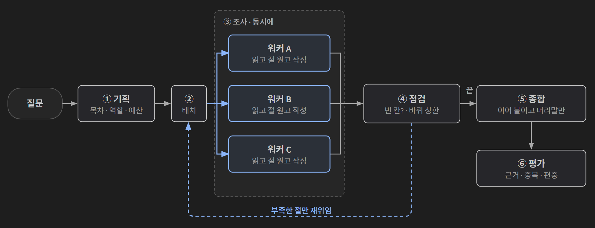
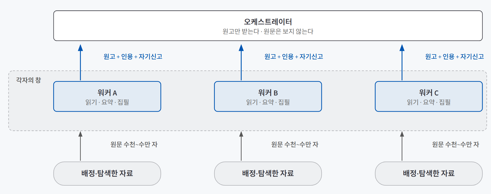
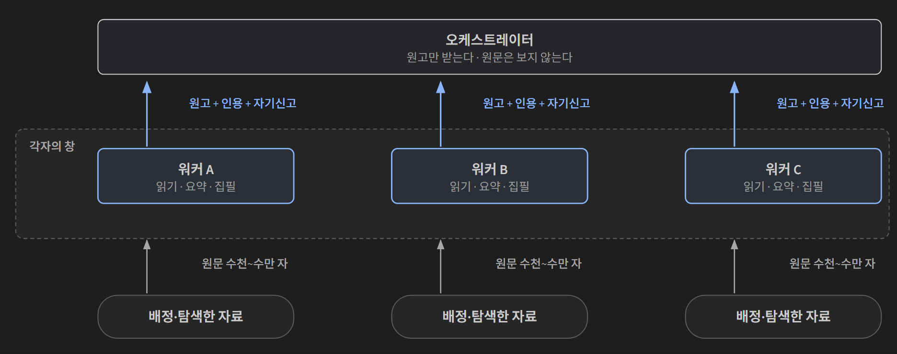

## 한 줄 요약

**오케스트레이터가 일을 나눠 여러 워커에게 동시에 맡기고, 워커가 돌려준 결과를 모아 하나로 합치는 구조다.** 나누는 쪽을 오케스트레이터(코디네이터·리드), 나뉜 몫을 하는 쪽을 워커(서브에이전트)라고 부른다. 핵심은 많이 나누는 법이 아니라 **나눌 일인지 먼저 판정하고, 나눈 장치가 정말 값을 하는지 하나씩 꺼 보며 재는 법**이다.

신문사 편집국을 떠올리면 쉽다. 데스크가 지면을 꼭지로 나눠 기자들을 동시에 취재 보낸다. 기자는 취재 노트를 자기 손에 쥔 채 기사를 써서 올리고, 데스크는 노트 전부가 아니라 기사만 받는다. 빈 꼭지가 있으면 그 꼭지만 다시 취재를 보내고, 마지막에 머리기사와 맺음말을 붙인다. 데스크가 모든 취재를 직접 하면 지면이 늦고, 꼭지를 형식으로 나누면(개요 담당·연표 담당) 기자들이 같은 현장에 몰린다.

## 필요한 이유

에이전트 하나로 버티기 어려운 순간은 두 가지가 겹칠 때 온다.

| 조건 | 무슨 일이 생기나 |
|---|---|
| **자료가 모델 창보다 크다** | 자료 34건, 44만 7천여 자(약 22만 토큰)를 12만 8천 토큰 창의 모델에 맡기면 물리적으로 다 못 넣는다 |
| **산출물이 절 여러 개로 된 장문이다** | 절마다 필요한 자료가 다르다. 한 명이 다 읽고 쓰면 앞 절만 촘촘하고 뒤로 갈수록 헐거워진다 |

창이 넉넉해도 문제는 남는다. 검색 결과와 중간 판단이 한 창에 쌓이면 처음 질문과 근거가 밀려나고, 앞서 본 자료에 끌려 다음 판단이 바뀌는 **경로 의존성**이 생긴다. 많이 넣는다고 잘 읽지 않는다는 점은 [컨텍스트 엔지니어링](/posts/context-engineering/)에서 다뤘다. 오케스트레이터-워커는 그 창을 **병렬로 여러 개** 두는 방법이다.

## 개념과 동작

### 누가 다음 행동을 정하나: 네 가지 구조

"에이전트 여러 명"이라는 말만으로는 누가 나누고 누가 결과를 되돌리는지 알 수 없다. 소통 경로로 먼저 가른다. 모든 소통이 리드를 거치면 **허브형**, 에이전트끼리 결과와 제어권을 바로 넘기면 **직접형**이다.

| 패턴 | 소통 경로 | 맞는 일 | 주요 위험 |
|---|---|---|---|
| **오케스트레이터-워커** | 허브형. 리드가 전략·위임·합성을 맡는다 | 독립 조사가 여럿인 열린 과업 | 중복 조사, 가장 늦은 워커를 기다리는 병목 |
| 팬아웃·합성 | 허브형. 독립 결과를 리드가 비교한다 | 자료 수집, 관점 비교 | 근거 반복과 누락 |
| 비평-수정 | 직접형. 작성자와 비평자가 주고받는다 | 반례 점검, 설계안 검토 | 끝없는 되돌림 |
| 인계 | 직접형. 앞 담당이 다음 담당에게 넘긴다 | 역할 전환이 필요한 대화 | 잘못된 인계와 반복 |

이 글은 첫 줄, 오케스트레이터-워커를 다룬다. 구조마다 위험이 정해져 있어서 막을 장치도 미리 고를 수 있다.

### 한 바퀴의 흐름: 기획 → 배치 → 조사 → 점검 → 종합 → 평가

{: .light }
{: .dark }

| 단계 | 하는 일 | 누가 |
|---|---|---|
| **① 기획** | 목차를 짜고 절마다 역할·시작 자료·읽기 예산을 배정한다 | 오케스트레이터 |
| **② 배치** | 절마다 워커를 한 명씩 **동시에** 보낸다. 다른 절이 맡은 자료는 피하라고 알려 준다 | 오케스트레이터 |
| **③ 조사** | 예산만큼 자료를 읽고, 자기 절 원고를 써서 올린다 | 워커 |
| **④ 점검** | "부족하다"고 신고한 절만 다시 보낸다. 바퀴 수에 상한이 있다 | 오케스트레이터 |
| **⑤ 종합** | 원고를 이어 붙이고 머리말·맺음말만 새로 쓴다 | 오케스트레이터 |
| **⑥ 평가** | 정답표 없이 근거·중복·편중을 잰다 | 코드 |

②에서 갈라지고 ④에서 돌아오는 것이 이 구조의 모양이다. LangGraph로 짜면 ②는 `Send`로 워커를 여러 벌 띄우는 팬아웃이고, 여러 벌이 같은 칸에 쓰는 결과는 리듀서로 합친다. 문법은 [LangGraph 워크플로 설계](/posts/langgraph-workflow/)에 정리했다. 여기서 중요한 건 **워커 수가 그래프에 박히지 않고 ① 기획이 실행 중에 정한다**는 점이다.

### 컨텍스트 격리: 원문은 아래에, 위로는 원고만

{: .light }
{: .dark }

이 구조가 창을 넓히는 방법은 **격리**다. 문서 한 건이 1만 자를 넘어도 워커 안에서만 읽히고, 위로는 몇백 자 요약이나 절 원고만 올라간다. 격리의 상한이 워커 수만큼 곱해진다. 한 사례에서 오케스트레이터가 본 글자는 팀 전체가 읽은 글자의 5.0%였다.

그래서 설계의 중심 질문은 **"워커에게서 무엇을 돌려받을까"**다.

| 돌려받는 것 | 장점 | 문제 |
|---|---|---|
| 원문 그대로 | 정보 손실이 없다 | 열 건만 넘어도 수만 토큰이라 격리가 무너진다 |
| 원고 + 근거 발췌 | 감사(監査)가 가능하다 | 위층 부담이 커진다. 근거 확인이 필요한 문서에 맞다 |
| **자기 절 원고 + 인용 + 자기신고** | 원문을 쥔 사람이 쓰니 인용이 정확하고, 위로는 원고만 간다 | 요약에서 빠진 대목은 위층에서 복구할 수 없다 |
| 질문 맞춤 요약만 | 가볍다 | 글쓰기가 오케스트레이터 한 명에게 몰려 장문에서 병목이 된다 |

격리는 되돌릴 수 없다는 점을 기억해야 한다. 워커는 서로의 절을 못 보니 **절끼리 겹치거나 어긋나도 아무도 모른다.**

### 구조가 굳는 시점으로 고르기

"에이전트가 워크플로보다 좋은가" 대신 **"이 문제에서 구조를 언제 굳혀도 되는가"**를 물으면 패턴 선택이 쉬워진다.

| | 라우팅 | 그래프 인덱스 검색 | 오케스트레이터-워커 |
|---|---|---|---|
| 구조가 굳는 시점 | 코드를 짤 때 | 인덱스를 만들 때 | 질문이 도착한 뒤 |
| 재사용 | 전부 | 인덱스 전부 | 없다 |
| 질문당 모델 호출 | 한두 번 | 검색 + 몇 번 | 수십 번 |
| 근거가 모이는 곳 | 한 창 | 한 창 | 워커마다 따로 |
| 틀렸을 때 | 잘못된 갈래로 끝난다 | 인덱스에 없으면 못 찾는다 | 읽고 나서 되돌릴 수 있다 |

판단은 두 질문이면 된다. 코드를 짜는 지금 갈래를 다 적을 수 있으면 [라우팅](/posts/routing-grounding/)이다. 같은 자료에 질문이 수천 번 들어오면 미리 인덱스를 만들어 비용을 나눈다. **둘 다 아닐 때만** 오케스트레이터-워커를 꺼낸다. 늦게 정할수록 질문에 잘 맞지만, 그만큼 비싸고 실행마다 목차와 인원이 달라진다.

## 적합한 경우와 피할 경우

아래 판정표에서 하나라도 "아니오"면 **단일 연속 컨텍스트가 기본**이다. 나누지 않기로 한 판단도 결과다.

| 판정 항목 | 나눌 조건 | 나누지 않을 조건 |
|---|---|---|
| 질문의 독립성 | 서로의 중간 결과 없이 시작할 수 있다 | 앞 결과가 다음 질문을 정한다 |
| 자료 크기 | 총량이 창을 넘는다 (먼저 세어 본다) | 한 창에 들어간다 |
| 책임 경계 | 워커마다 목표와 반환 형식을 정할 수 있다 | 누가 무엇을 확인할지 갈리지 않는다 |
| 산출물 | 절 단위 장문 | 짧은 한 덩어리 답 |
| 대기 위험 | 한 워커가 늦어도 나머지가 진행된다 | 하나가 늦으면 전체가 멈춘다 |
| 비용 가치 | 추가 토큰을 감당할 이유가 있다 | 짧은 확인으로 충분하다 |

정답이 문서 한 건에 다 있는 질문에 워커 넷을 띄우면 나머지는 헛읽고 인용이 한 문서에 몰린다. 그런 질문은 앞단 라우팅이 "한 명이면 된다"고 걸러야 한다. 서로의 맥락을 계속 공유해야 하는 일(코딩처럼 의존이 많은 일)도 맞지 않는다. 쓰면 안 되는 순간은 [다섯 가지 에이전트 패턴](/posts/agent-patterns-when-not-to-use/)에서도 짧게 다뤘다.

## 장점과 한계

| 장점 | 한계 |
|---|---|
| 창을 병렬로 넓힌다. 원문은 워커 안에서 끝나고 위로는 원고만 올라간다 | 토큰을 많이 쓴다. Anthropic은 멀티에이전트 리서치가 내부 평가에서 단일보다 90.2% 나았지만 일반 채팅 대비 약 15배 토큰을 썼다고 밝혔다 |
| 같은 읽기 예산으로 혼자 하는 구조와 견준 사례에서 근거율 48.3% 대 44.8%, 인용 편중 31.7% 대 35.5%로 앞섰다 | 같은 사례에서 호출은 1.8배였다. 시간은 병렬 덕에 19% 짧았다 |
| 워커마다 도구·지시·탐색을 따로 두어 경로 의존성을 줄인다 | 역할 경계가 흐리면 **중복**(둘이 같은 자료)과 **누락**(경계 밖은 아무도 안 봄)이 함께 생긴다 |
| 읽어 본 뒤 빈 칸만 다시 보낼 수 있다 | 오류가 요약을 거치며 더 그럴듯한 결론으로 퍼진다. 반환물마다 근거와 불확실성을 남겨야 한다 |
| 워커를 그래프 없이 따로 불러 테스트할 수 있다 | 실행마다 목차·인원이 달라져 테스트와 비용 예측이 어렵다 |

## 적용 방법

### 1단계. 나눌 일인지 먼저 판정한다

자료 총량을 세어 창과 견준다. 그다음 두 가지를 묻는다. ① 서로의 중간 결과 없이 **독립적으로 탐색**할 수 있는가, ② 결과를 **독립 기준으로 검증**할 수 있는가. 둘 다 "예"일 때만 다음 단계로 간다. 질문 세트에는 한 건으로 답이 나오는 질문도 일부러 넣어 둔다. 그래야 이 구조가 낭비인 경우가 보인다.

### 2단계. 목차를 내용 단위로 짜고, 배정은 코드가 검사한다

| 정할 것 | 원칙 |
|---|---|
| 목차의 축 | **내용 단위**(사건·시기·인물·쟁점). '개요·연표·분석' 같은 형식 단위는 모든 워커가 같은 자료를 읽게 만든다 |
| 오케스트레이터에게 보여 줄 것 | 아직 아무것도 안 읽었으니 자료마다 제목 + 앞부분 몇백 자 같은 **카드**를 준다. 전체의 2% 안팎으로도 배정이 눈에 띄게 달라진다 |
| 절마다 배정 | 역할 · 시작 자료 · 읽기 예산. 역할은 별도 코드가 아니라 지시문 한 줄이다 |
| 검증 | 구조화 출력으로 받고, 역할이 명단에 있는지·시작 자료가 실제로 있는지·절끼리 겹치지 않는지를 코드가 확인한다. 모델은 그럴듯한 가짜 문서 제목을 지어낸다 |

배정은 출발점이지 울타리가 아니다. 워커는 읽은 자료의 링크를 따라 다음 자료를 스스로 고를 수 있어야 한다.

### 3단계. 동시에 보내되, 남의 구역을 알려 준다

병렬 워커는 서로를 볼 수 없어서 출발 전에 나누는 수밖에 없다. 워커를 보낼 때 다른 절의 시작 자료를 **피할 목록**으로 들려 보내고, 재위임 바퀴에서는 이미 읽힌 자료까지 더한다. 이 구역 분할은 질문을 바꿔도 효과 방향이 바뀌지 않은 장치였다. 끄면 중복률이 배로 뛰고, 이미 읽힌 자료를 골랐다가 다시 고르느라 호출은 오히려 늘었다. 다만 **낭비를 줄이는 장치이지 품질을 올리는 장치는 아니다.**

### 4단계. 점검 루프는 겨냥하고, 두 겹으로 멈춘다

| 정할 것 | 원칙 |
|---|---|
| "부족"을 누가 말하나 | 원고를 쓴 워커의 **자기신고**. 원고 쓰는 호출에 충분·부족 칸만 얹으면 "무엇이 비었는지"를 문장으로 얻는다. 점검 단계는 모델 호출 없이 집계와 배차만 한다 |
| 다시 보낼 때 | "지난번에 무엇을 읽었지만 무엇이 비었다. 그 빈 칸을 겨냥해 안 본 자료를 찾아라"를 붙인다. 이 문장이 없으면 둘째 바퀴가 첫 바퀴와 같은 선택을 한다 |
| 종료 조건 | 내용 기준(빈 칸 없음) + 예산 기준(바퀴 상한). 예산을 먼저 검사하고, **멈춘 이유를 상태에 남긴다** |
| 둘째 원고 처리 | 무조건 덮어쓰지 않는다. 인용을 빠뜨린 둘째 원고가 멀쩡한 첫 원고를 지울 수 있다. 인용이 촘촘한 쪽을 남기거나 합친다 |

모델은 자기 일을 후하게 보고, "부족"을 근거가 아니라 형식(분량 미달)으로 신고하기도 한다. 그래서 바퀴 상한은 "혹시 몰라서"가 아니라 **반드시 필요해서** 둔다.

### 5단계. 정답표 없이 재고, 장치를 하나씩 꺼 본다

| 신호 | 뜻 | 보는 장치 |
|---|---|---|
| 근거율 | 문장 중 출처가 붙은 비율 | 읽기 깊이·재위임 |
| 허위 인용 | 아무도 안 읽은 자료를 인용 | **경보**. 0이어야 한다 |
| 읽고 안 쓴 자료 | 읽었는데 보고서에 안 나온 자료 | 배정 품질 |
| 편중·중복률 | 인용이 한 자료에 몰림 · 같은 자료를 여러 절이 읽음 | 배정·구역 |

높낮이를 견주는 신호와 0이어야 하는 경보를 나누고, 지표로는 명백한 실패만 거른 뒤 남은 보고서를 사람이 읽고 고른다. 장치의 값은 **절제 실험**으로 가린다. 스위치를 한곳에 모아 두고 늘 기준 설정에서 출발해 **한 번에 하나만** 끈다. 혼자 하는 대조군에는 같은 자료·모델·도구·**같은 읽기 예산**을 주고, 예산을 끝까지 쓰는지 확인한다.

## 다른 방법과 비교

| 방법 | 다음 행동을 정하는 주체 | 비용 | 한 줄 평가 |
|---|---|---|---|
| 단일 에이전트 | 한 모델 | 낮음 | 창에 들어가는 일이면 기본값이다 |
| 워크플로 | 코드 | 낮음 | 순서가 고정돼 재현이 쉽다. 갈래를 미리 적을 수 있을 때 쓴다 |
| 라우팅 | 코드 (분류는 모델) | 낮음 | 갈래가 정해진 문의에 맞다. 분류가 틀리면 그대로 끝난다 |
| **오케스트레이터-워커** | 리드 모델 | 높음 | 창을 병렬로 넓힌다. 질문마다 분해가 다를 때만 값을 한다 |
| 팀원끼리 직접 소통 (Agent Teams 등) | 팀원들 | 팀원 수에 비례 | 워커 결과가 리드에게만 돌아오는 단절을 푼다. 기준선을 다시 세워야 한다 |
| 소유자가 다른 에이전트 연결 (A2A) | 각 시스템 | 상황마다 다름 | 부서·공급자가 다른 에이전트를 잇는 규격이다. 같은 하네스 안이라면 과하다 |

## 주의할 점

**서브에이전트를 정의했다고 분업이 일어난 건 아니다.** 리드가 워커를 실제로 불렀는지, 워커 보고가 결과로 이어졌는지는 실행 기록으로 확인한다. "스위치를 껐다"는 로그와 실제 코드 경로가 같은지도 따로 본다.

그 밖에 기억할 것:
- **조건이 다른 실행을 숫자 하나로 견주지 않는다.** 턴 예산이나 읽기 예산이 다르면 구조의 효과라고 말할 수 없다.
- **한 번 돌린 결과로 방향을 단정하지 않는다.** 같은 설정도 시행마다 십몇 %p씩 흔들린다. 차이가 작으면 "효과 없음"이 아니라 "이 표본으로는 효과를 보지 못했다"가 맞다.
- **지표는 대리 신호다.** 출처를 촘촘히 단 형편없는 보고서도 가능하다. 읽은 자료를 엉뚱한 문장에 붙이는 오귀속은 원문과 대조해서 읽어야만 보인다.
- **병렬 워커가 같은 칸에 쓰면 리듀서를 붙인다.** 빠뜨리면 동시 쓰기 오류가 나거나 결과가 하나만 남는다.
- **넷이 동시에 부르면 속도 제한에 걸린다.** 호출에 타임아웃을 두고, 일시적 오류만 재시도하고, 설정 오류는 바로 드러낸다.
- **워커 안의 반복은 그래프가 지켜 주지 않는다.** 중간에 실패하면 그 워커 작업 전체가 날아가니 루프 안에 상한과 재시도를 직접 둔다. 하네스의 반복·종료 설계는 [에이전트 하네스](/posts/agent-harness/)와 같은 문제다.
- **보고서가 멀쩡해 보이는 실패가 많다.** 엉뚱한 배정, 빈 절을 상식으로 채운 문장이 그렇다. 질문과 절 제목을 나란히 놓고 읽는다.

## 용어 정리

| 용어 | 뜻 |
|---|---|
| 오케스트레이터 (코디네이터·리드) | 일을 나누고 워커를 보내고 결과를 합치는 쪽 |
| 워커 (서브에이전트) | 나뉜 몫 하나를 자기 창에서 처리하고 결과만 돌려주는 쪽 |
| 허브형 / 직접형 | 모든 소통이 리드를 거치는 구조 / 에이전트끼리 바로 주고받는 구조 |
| 팬아웃 | 한 단계에서 같은 작업을 여러 벌 동시에 띄우는 것. LangGraph에서는 `Send` |
| 컨텍스트 격리 | 원문은 워커 안에서만 읽고, 위층에는 압축된 결과만 올리는 것 |
| 경로 의존성 | 앞서 본 자료에 끌려 다음 판단이 바뀌는 현상 |
| 구역 분할 | 병렬 워커에게 다른 워커가 맡은 자료를 피하라고 미리 알려 주는 것 |
| 재위임 | 점검 뒤 부족한 절만 다시 워커에게 보내는 것 |
| 자기신고 | 워커가 원고와 함께 "충분/부족, 무엇이 비었나"를 스스로 적어 올리는 것 |
| 절제 실험 (ablation) | 장치를 하나씩 끄고 무엇이 나빠지는지 보는 실험 |
| 대조군 | 같은 자료·모델·예산으로 나누지 않고 혼자 처리하는 비교 기준 |
| 오귀속 | 읽은 자료를 그 내용과 관계없는 문장의 출처로 붙이는 것 |
| A2A (Agent2Agent) | 소유자가 다른 에이전트끼리 기능 소개·작업 상태·결과물을 주고받는 공개 규격 |

---

→ 이 개념을 검증한 프로젝트: [나눠서 조사하는 딥리서치 에이전트 검증 — 개인정보 보호법 제개정 연혁으로 확인한 세 가지](/posts/privacy-law-deep-research/)
