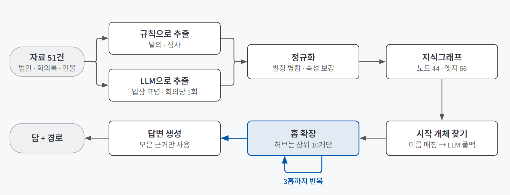
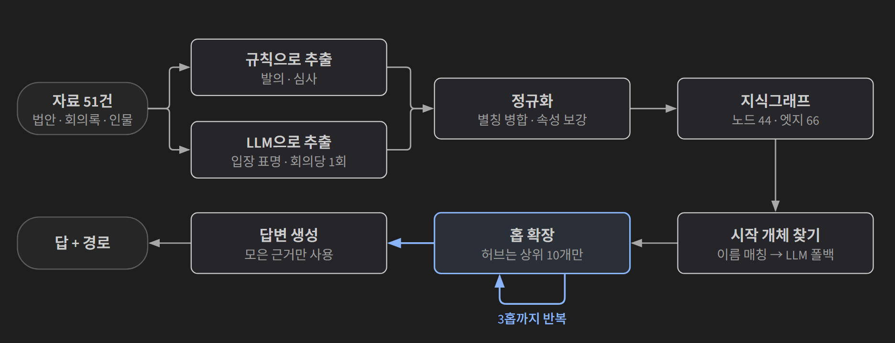
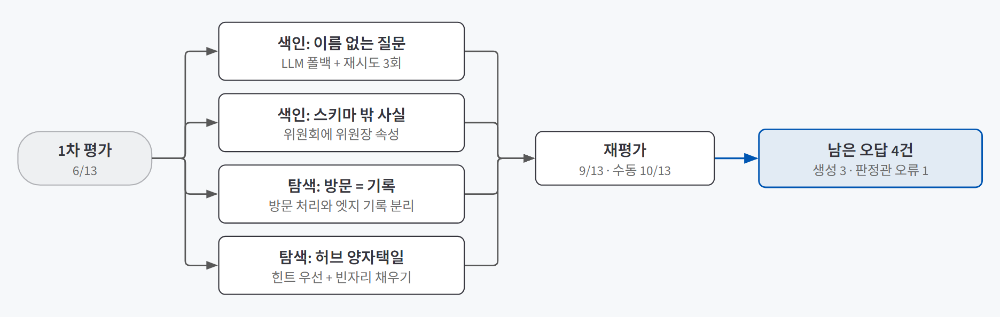
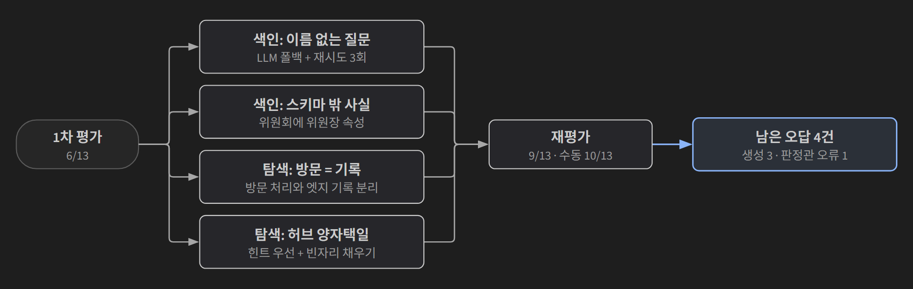

## 한 줄 소개

**문서 여러 건에 흩어진 사실을 이어 붙여야 답이 나오는 질문을 지식그래프가 정말 더 잘 푸는지 확인하려고, 22대 국회의 노란봉투법 입법 과정을 그래프로 엮은 챗봇을 만들어 검증했다.** 노란봉투법은 「노동조합 및 노동관계조정법」 개정안의 통칭이다. 법안·회의록·인물 프로필을 법안–사람–위원회 관계로 묶고, 질문이 오면 선을 따라가며 답과 함께 **어떤 경로로 그 답에 도달했는지**를 보여 준다.

저장소: [beginner-driver/my-graph-agent_legislative-trends](https://github.com/beginner-driver/my-graph-agent_legislative-trends)

> **검증한 것:** 관계형·멀티홉 질문에서 그래프가 키워드 검색 RAG를 앞서는가 ✅ · 스키마를 노드 3종·관계 3종으로 좁게 두기 △ · 실패를 색인·탐색·생성으로 나눠 고칠 곳 찾기 ✅(생성 단계는 못 고침)
>
> **발견한 것:** 손으로 고른 6문항은 다 맞았는데 13문항을 자동으로 돌리자 6/13이었다 · temperature 0에서도 결과가 흔들렸다 · 채점하는 LLM도 틀렸다 · 회의록 한 건의 96%가 다른 안건이었다
{: .prompt-tip }

## 만든 이유

[찾는 대신 이어 걷기 — RAG에서 GraphRAG로 넘어가는 기준](/posts/rag-to-graphrag/)을 배우고 나서 세 가지가 궁금했다.

1. "이 의원이 낸 법안은 결국 어느 대안에 합쳐졌나"처럼 **관계를 따라가야 하는 질문**에서 그래프가 키워드 검색 RAG보다 실제로 나을까?
2. 뽑을 관계를 **좁게 정해 두면**, 안 뽑은 관계 때문에 못 푸는 질문은 어떻게 감당할까?
3. 틀린 답을 **색인(그래프에 사실이 있나)·탐색(그 사실까지 갔나)·생성(답으로 잘 옮겼나)** 세 층으로 나누면 어디를 고쳐야 할지 가려낼 수 있을까?

노란봉투법 입법 과정(22대 국회 개원 2024-05-30 ~ 공포 2025-09-09)은 GraphRAG가 필요한 조건에 들어맞았다.

| GraphRAG가 필요한 조건 | 이 주제에서는 |
|---|---|
| 개체가 여러 문서에 겹쳐 나온다 | 22대 국회에서만 같은 이름으로 48건이 발의됐고, 각자 낸 법안이 위원장 대안으로 합쳐진다 |
| 정답이 흔들리지 않는다 | 2024년(통과 후 재의요구로 폐기)과 2025년(통과·공포) 두 차례 과정이 모두 끝나 있다 |
| 문서를 건너뛰어야 답이 나온다 | 2024년 고용노동부 장관은 반대, 2025년 장관은 지지했다. 두 회의록을 이어야 대조할 수 있다 |

## 실험 설계

### 동작 흐름

{: .light }
{: .dark }

1. **자료 수집:** 법안 원문 19건, 회의록 발언 전문 5건(발언 2,144개), 인물 프로필 27건, 모두 51건을 모았다.
2. **관계 추출:** 발의·심사는 공식 기록에 이미 구조화돼 있어 **규칙(정규식)으로** 뽑았다. "누가 어떤 입장을 밝혔나"만 회의록을 읽어야 해서 **LLM으로**, 회의당 한 번 호출해 발언자 전원을 찬성·반대·조건부·설명으로 분류했다.
3. **정규화:** "위원장 안호영" 같은 직함을 떼고, 위원장 대안의 제안자로 찍히는 "환경노동위원장"을 실제 재임자와 합쳤다.
4. **질문 응답:** 질문에서 시작 개체를 찾고, 선을 따라 최대 3홉까지 펼쳐 모은 근거만으로 답을 쓴다.

**답에 붙는 경로는 LLM이 쓰지 않는다.** 탐색하며 실제로 지나간 선을 상태(State)에 쌓아 두고 프로그램이 그대로 보여 준다. 경로를 지어낼 여지를 없앤 것이다.

### 사용 기술

| 기술 | 어디에 썼나 |
|---|---|
| **열린국회정보 Open API** | 법안 제안이유·주요내용, 위원회 심사 정보, 국회의원 인적사항 수집 |
| **Playwright** | 브라우저를 코드로 조작해 국회도서관 사이트에서 회의록 발언을 모았다 |
| **NetworkX** | 파이썬 그래프 라이브러리. 노드 44개 규모라 그래프 DB 없이 메모리에서 처리했다 |
| **LangGraph** | 시작 개체 찾기 → 홉 확장(반복) → 답변 생성 흐름을 상태 그래프로 짰다 |
| **OpenAI gpt-4o-mini** | 입장 추출, 시작 개체 찾기 폴백, 답변 생성, 자동 채점 |
| **Streamlit** | 답변·지나간 경로·근거를 보여 주고 키워드 검색 RAG 답과 나란히 비교하는 데모 화면 |

### 스키마

| 구분 | 내용 |
|---|---|
| 노드 3종 | 법안(Bill), 사람(Person, 국회의원과 정부위원을 속성으로만 구분), 위원회(Committee) |
| 관계 3종 | 발의(`PROPOSED_BY`), 심사(`REVIEWED_BY`), 입장 표명(`STATED_POSITION_ON`) |
| 탐색 한도 | 최대 3홉. 연결이 6개를 넘는 **허브** 노드는 이웃을 다 펼치지 않고 질문과 관련 높은 10개만 남긴다 |

일부러 **뽑지 않은 관계**도 정해 두었다. 이 결정이 질문 2의 실험 조건이다.

| 안 뽑은 것 | 이유 |
|---|---|
| 법안–법안 병합 관계 | 위원회를 거치는 2~3홉으로 표현할 수 있다고 봤다 |
| 위원장의 절차 발언(개의·상정·산회) | 회의마다 모든 법안에 나오므로, 다 뽑으면 위원장 노드가 거대한 허브가 된다 |

### 판단 기준과 샘플

골든셋(정답을 미리 적어 둔 평가 문항) 13문항에 기대 정답, 필요한 최소 경로, 원문 근거를 기록했다.

| 유형 | 문항 수 | 예시 |
|---|---|---|
| 단순(1홉) | 4 | "위원장 대안(2211924)의 제안자는 누구인가?" |
| 멀티홉(2~3홉) | 5 | "박해철 의원이 2024년에 발의한 법안은 어느 위원장 대안에 흡수되었는가?" |
| 전역(문서 종합) | 4 | "22대 국회 입법 과정을 시간 순서대로 요약하면?" |

**함정 문항**도 넣었다. 같은 위원회를 거치고도 계류로 남은 법안이 있어서, 위원회 공유만으로 "병합됐다"고 답하면 틀린다. **거절 문항**은 정답이 "그런 사람은 없다"다.

비교군은 **키워드 검색 RAG**다. 그래프 없이 질문과 단어가 많이 겹치는 문서 상위 5개를 주고 같은 방식으로 답하게 했다. 채점은 LLM 판정관이 기대 정답과 대조해 맞음·틀림으로 매겼다.

## 검증 결과

| 질문 | 결과 | 근거 |
|---|---|---|
| 1. 그래프가 키워드 검색 RAG를 앞서는가 | ✅ 앞섬 | 9/13 대 1/13. 1홉 질문에서 5/6 대 0/6 |
| 2. 스키마를 좁게 두기 | △ 보강이 필요했다 | 안 뽑은 두 관계 때문에 막힌 질문이 나왔고, 속성을 채워 풀었다 |
| 3. 세 층으로 나눠 고칠 곳 찾기 | ✅ 진단됨 | 색인·탐색 실패를 고쳐 6/13 → 9/13. 남은 4건은 생성 3건, 판정관 오류 1건으로 특정됐다 |

### 질문 1. 관계를 따라가야 하는 질문에서 그래프가 나은가

| 홉 | 그래프 에이전트 | 키워드 검색 RAG | 경로 재현율 |
|---|---|---|---|
| 1홉 | 5/6 | 0/6 | 100% |
| 2홉 | 2/3 | 1/3 | 90% |
| 3홉 | 0/1 | 0/1 | 100% |
| 전역 | 2/3 | 0/3 | — |
| **전체** | **9/13** | **1/13** | |

경로 재현율은 정답에 필요한 선 중 에이전트가 실제로 지나간 비율이다.

**가장 뚜렷한 차이는 1홉이었다.** "누가 제안했나"는 그래프에서 선 하나만 찾으면 되는데, 키워드 검색은 6문항 중 하나도 못 맞혔다. 겹치는 문서를 가져와도 "제안자"라는 **관계**가 문장 속에 흩어져 있어서다. 키워드 검색 RAG가 맞힌 1문항은 "없다"가 정답인 거절 문항이었다.

긴 문서에서도 비교군이 약했다. 17만 자짜리 회의록을 앞 1,500자만 넣어 맨 끝 4%의 노동조합법 표결이 빠졌다. 그래프는 노드와 선 단위로 근거를 찾아가 이 문제가 없다.

### 질문 2. 관계를 좁게 뽑으면 감당할 수 있는가

**안 뽑기로 한 두 관계가 모두 실제 문제로 돌아왔다.**

| 안 뽑은 관계 | 막힌 질문 | 해결 |
|---|---|---|
| 법안–법안 병합 | "어느 대안에 흡수됐나"에 "확인되지 않습니다". 처리 결과가 "대안반영폐기"뿐이라 **어느** 대안인지 근거가 없었다 | 처리 결과에 대안 번호를 채웠다. "대안반영폐기(2202444)" |
| 위원장 절차 발언 | "2024·2025년을 모두 주재한 위원장은?"에 답을 못 했다. "누가 위원장이었나"가 그래프에 없었다 | 관계 대신 위원회 노드에 `chair_2024`, `chair_2025` **속성**을 추가했다 |

**위원회를 공유한다는 구조만으로는 "병합됐다"를 증명할 수 없었다.** 함정 문항이 노린 지점이다. 스키마는 두고 정규화 단계에서 속성을 보강해 그래프가 복잡해지지는 않았다.

△로 둔 이유는 대안 번호를 직접 확인해 채웠기 때문이다. 법안 19건이라 손으로 가능했지만, 코퍼스가 커지면 병합 관계를 다시 뽑는 쪽이 나을 수 있다.

### 질문 3. 실패를 세 층으로 나누면 고칠 곳이 보이는가

{: .light }
{: .dark }

**1차 평가는 6/13이었다.** 틀린 문항마다 "사실이 그래프에 없나(색인) → 있는데 못 갔나(탐색) → 갔는데 답을 못 썼나(생성)" 순서로 원인을 짚었다.

| 층 | 증상 | 원인 | 수정 |
|---|---|---|---|
| 색인 | "동일 인물인가?"에 시작 개체를 못 찾았다 | 이름을 노드명과 글자로만 맞췄는데, 질문에 이름이 없었다 | 글자 매칭이 실패하면 LLM이 시작 노드를 고르는 폴백 |
| 색인 | 위원장 질문에 답을 못 했다 | 스키마에 그 사실이 없었다 | 위원회 노드에 위원장 속성 추가(질문 2) |
| 탐색 | "김영훈 장관은 어떤 입장이었나"(1홉)를 틀렸다 | 시작 개체 둘 중 먼저 처리된 위원회 쪽이 법안 노드를 "방문 완료"로 찍어, 김영훈의 입장 선이 기록되지 못했다 | "더 펼칠지"와 "이 선을 기록할지"를 분리 |
| 탐색 | 계류 법안 수를 묻는 질문을 틀렸다 | 허브에서 질문 단어("재발의")에 맞는 관계만 남겼는데, 정답의 핵심은 버린 쪽(심사)이었다 | 힌트에 맞는 관계를 먼저, 남는 자리에 다른 관계도 채우기 |

같은 문항에서 "계류"와 "계류**로**"가 글자 비교에서 다른 단어가 되는 **한국어 조사** 문제도 나와, 자주 쓰는 조사를 떼는 보정을 넣었다. 정답 법안 번호가 오답 후보 속성에도 나와 점수가 섞이는 문제는 허브 후보를 6개에서 10개로 늘려 우회했다.

고친 뒤 재평가는 **9/13**이었다. 남은 4건은 층이 분명했다.

- **생성 3건:** 그중 2건은 필요한 사실(처리 결과와 발의자)이 근거에 다 들어왔는데도 답이 "확인되지 않습니다"였다. "처리 결과를 하나씩 대조하라"고 지시해도 그대로여서, 흩어진 근거를 종합하는 일이 이 모델에서 프롬프트로 넘기 어려운 한계로 봤다.
- **판정관 오류 1건:** 아래에서 다룬다.

세 층으로 나누자 **"점수가 낮다"가 "어느 함수의 어느 줄을 고칠지"로 바뀌었다.** 다만 생성 층 3건은 위치만 특정했고 고치지는 못했다.

## 직접 만들며 알게 된 것

### 손으로 고른 6문항은 다 맞았다

**평가를 자동으로 돌리지 않았다면 못 찾았을 버그가 있었다.** 6문항을 직접 돌렸을 때는 전부 정답이었는데, 13문항을 자동으로 돌리자 **6/13**으로 떨어졌다. 위의 "방문 완료" 버그는 시작 개체 둘이 같은 노드를 서로 다른 관계로 가리킬 때만 드러나서, 한 문항씩 시험할 때는 걸리지 않았다.

### 평가 숫자도 흔들리고, 채점하는 LLM도 틀렸다

**LLM이 들어간 평가는 한 번 돌린 숫자가 아니라 범위로 봐야 했다.** 시작 개체를 고르는 폴백은 `temperature=0`(무작위성을 끈 설정)인데도 4~5번에 1번꼴로 빈 결과를 냈고(재시도 3회로 줄였지만 남았다), 평가를 연달아 돌리면 8/13과 9/13처럼 ±1이 차이 났다.

채점도 틀렸다. "이수진 의원이 법안을 몇 건 발의했나"는 3건 발의와 처리 결과(계류 1건, 대안반영폐기 2건)까지 맞았는데 오답으로 채점됐다. 골든셋은 법안을 **의안번호**로, 에이전트는 **제목과 발의일**로 적었기 때문이다. "식별 방식이 달라도 같은 사실이면 정답"이라는 규칙을 넣어도 고쳐지지 않아, 오답 항목은 원문을 직접 대조했다. **실질 정답률은 10/13**이다.

### 회의록 한 건의 96%가 다른 안건이었다

**수집한 문서가 주제에 맞는지는 파일이 아니라 내용 단위로 확인해야 했다.** 위원들의 발언이 노동조합법 **반대**로 잘못 분류돼 열어 보니, 그 회의록(17만 자)의 96%는 무관한 장관 후보자 인사청문회였고 노동조합법 상정은 맨 끝 4%뿐이었다. 이 파일만 상정 시점 이후로 잘라 해결했다. 한 회의록에 안건이 섞여 있으면 LLM 추출은 그 경계를 가려 주지 않는다.

## 검증 범위와 한계

| 구분 | 내용 |
|---|---|
| **표본 크기** | 골든셋 13문항, 코퍼스 51건, 노드 44개다. 3홉은 1문항뿐이라 3홉 결과(0/1)로는 아무것도 말할 수 없고, 9/13도 실행마다 ±1 흔들리는 값 중 한 번이다 |
| **비교군의 수준** | 키워드 검색 RAG는 단어 겹침 상위 5개와 문서 앞 1,500자만 썼다. 임베딩 검색이나 문서 분할을 한 RAG와는 비교하지 않았다. 그래프의 우위는 이 비교군 기준이다 |
| **생성 단계** | 근거가 다 모였는데 답을 못 쓴 3건은 고치지 못했다. 근거를 표로 정리해 주거나 더 큰 모델을 쓰는 방법은 시도하지 않았다 |
| **수동 보강과 우회** | 대안 번호와 위원장 속성은 직접 확인해 채웠고, 허브 후보를 10개로 늘린 것도 근본 해결이 아니다. 코퍼스가 커지면 유지하기 어렵다 |

## 결론

**관계를 따라가야 하는 질문에서는 그래프가 키워드 검색을 크게 앞섰고(9/13 대 1/13), 실패를 색인·탐색·생성으로 나누자 고칠 곳이 함수 단위로 보였다.** 1차 6/13에서 색인·탐색 실패 네 가지를 고쳐 9/13까지 올렸고, 남은 오답은 생성 단계와 채점기로 위치가 좁혀졌다.

2번은 절반만 성립했다. 관계를 좁게 뽑아 그래프를 단순하게 둘 수는 있었지만, 안 뽑은 관계의 빈자리는 속성 보강으로 메워야 했다. 그 빈자리는 함정 문항이 미리 짚어 줬다.

이론에 없던 교훈은 평가 쪽에서 나왔다. **골든셋 전체를 자동으로 돌려야 버그가 드러났고, 그 자동 채점도 범위와 사람 확인을 함께 봐야 믿을 수 있었다.**
