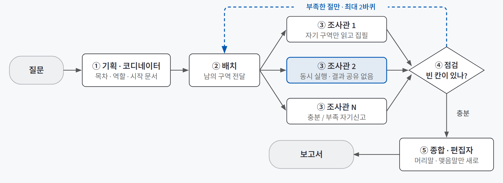
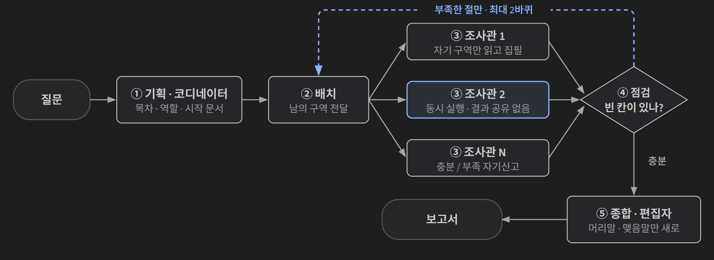
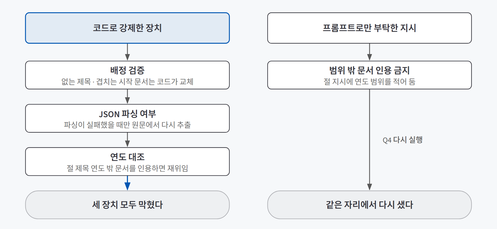
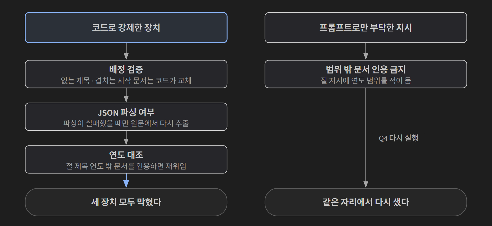

## 한 줄 소개

**질문을 여러 절로 나눠 조사관들에게 맡기는 구조가 혼자 조사하는 것보다 정말 나은지, 그 구조 안의 어떤 장치가 실제로 일하는지 확인하려고 개인정보 보호법 제개정 연혁을 조사하는 딥리서치 에이전트를 만들어 검증했다.** 코디네이터가 목차를 짜고, 절마다 조사관을 동시에 보내 법령 원문을 읽고 쓰게 한 뒤, 하나의 보고서로 잇는다.

저장소: [beginner-driver/deep-researcher-agent_legislative-analysis](https://github.com/beginner-driver/deep-researcher-agent_legislative-analysis)

> **검증한 것:** 같은 예산의 혼자 조사보다 나은가 △(여러 갈래 질문에서만) · 배정·역할·재위임 중 무엇이 일하나 ✅(배정·구역만 일관됨) · 프롬프트 지시와 코드 검사 중 무엇이 실패를 막나 ✅(코드 검사)
>
> **발견한 것:** 채점 지표 자체에 버그가 있었다 · 지표로는 안 잡히는 실패가 세 종류 있었다 · "절수는 상한이지 목표가 아니다" 한 줄로 절 수가 질문에 맞춰졌지만 인용이 한쪽으로 몰렸다
{: .prompt-tip }

## 만든 이유

[일을 나눠 맡기고 다시 모으기 — 오케스트레이터와 워커](/posts/orchestrator-worker/)를 배우고 나서 세 가지가 궁금했다. 이론은 "나눌 것이 실제로 나뉘어 있을 때만 나눈다"고 했고, 장치를 하나씩 꺼 보는 절제 실험으로 무엇이 일하는지 재라고 했다.

1. 같은 자료, 같은 모델, **같은 읽기 예산**을 주면, 나눠서 조사하는 팀이 혼자 조사하는 쪽보다 나은 보고서를 쓸까?
2. 팀 구조 안의 장치 세 가지(**배정·구역, 역할, 재위임**) 중 무엇이 실제로 효과를 낼까?
3. 실패를 막을 때 **프롬프트로 부탁하는 것**과 **코드로 검사하는 것**은 얼마나 다를까?

개인정보 보호법(법률과 시행령)의 제정·개정 연혁은 "나눠서 조사할 만한 일"의 조건에 들어맞았다.

| 나눠서 조사할 만한 조건 | 개인정보 보호법 연혁에서는 |
|---|---|
| 자료가 모델 창에 다 안 들어간다 | 문서 71건, 539,170자. gpt-4o-mini 창(약 281,600자로 환산)의 1.91배다 |
| 한 질문에 여러 문서가 필요하다 | 제정 1건과 실질 개정 25건의 개정이유·조문이 서로 다른 문서에 흩어져 있다 |
| 자료끼리 서로를 가리킨다 | 법 개정이 시행령 후속 정비로 이어지고, 개정마다 앞뒤 개정과 시간으로 이어진다 |

## 실험 설계

### 동작 흐름

{: .light }
{: .dark }

1. **기획:** 코디네이터가 문서 목록(원문이 아니라 카드)만 보고 목차를 짜고, 절마다 역할과 시작 문서를 정한다. "개요·연표" 같은 형식이 아니라 "개정 사건", "개념" 같은 **내용 단위**로 나누게 했다. 형식으로 나누면 모든 조사관이 같은 문서를 읽기 때문이다.
2. **배치:** 절마다 조사관을 동시에 보내면서, 다른 절이 맡았거나 이미 읽은 문서(**남의 구역**)를 알려 줘 겹치지 않게 한다.
3. **조사:** 조사관은 예산만큼 문서를 읽고, 모은 자료만 근거로 절 원고를 쓴 뒤 "충분/부족"을 스스로 신고한다.
4. **점검:** 부족하다고 신고한 절만 다시 보낸다. 최대 2바퀴다.
5. **종합:** 편집자는 절 원고를 고치지 않고 머리말과 맺음말만 써서 잇는다.

### 사용 기술

| 기술 | 어디에 썼나 |
|---|---|
| **LangGraph** | 다섯 단계를 그래프로 짜고 `Send`로 절마다 조사관을 동시에 보냈다. 같은 칸에 여럿이 쓰므로 합치는 규칙(리듀서)을 붙였다 |
| **OpenAI gpt-4o-mini** (LangChain 경유) | 코디네이터·조사관·편집자 모두 같은 모델 |
| **국가법령정보 공동활용 Open API** | 법률·시행령의 제개정이유, 현행 조문, 과거 버전 조문 수집. 이 단계만 AI를 쓰지 않는다 |
| **정규식·집합 연산** | 정답표 없이 보고서를 채점하는 지표. AI 채점이 아니라 어떤 설정에도 같은 잣대가 적용된다 |
| **Streamlit** | 절마다 누가 무엇을 읽고 썼는지와 지표를 한 화면에서 보는 데모 |

### 자료 구성

문서 71건은 현행 조문 21건(법률 10개 장 + 시행령 11개 장), 제정·개정이유 원문 26건(자체 이유가 없는 "타법개정"은 뺐다), 개정 전 조문 변경분 24건(버전별 조문을 비교해 실제로 바뀐 "이전 문구"만)이다.

### 비교 설계와 지표

질문 9개 중 성격이 다른 세 개로 비교했다.

| 질문 | 유형 | 내용 |
|---|---|---|
| Q1 | 단일형 | 2025년 개정에서 과징금 제도를 강화한 이유. 답이 개정이유 한 건에 다 있는 **대조 사례**다 |
| Q4 | 다갈래형 | 2020년 데이터 3법 개정과 2023년 개정의 문제의식 비교. 근거 자료가 겹치지 않는 두 사건이다 |
| Q6 | 계보추적형 | 가명정보 개념과 처리 특례가 법과 시행령에서 어떻게 도입·확장됐는가 |

질문마다 다섯 편을 만들었다.

| 설정 | 뜻 |
|---|---|
| 기준 | 장치를 전부 켠 팀 |
| 배정·구역 끔 / 역할 끔 / 재위임 끔 | 장치를 **한 번에 하나씩만** 끈 팀. 둘을 같이 끄면 무엇 때문에 바뀌었는지 알 수 없다 |
| 혼자 | 절을 나누지 않는 대조군. **같은 읽기 예산(절수×절당 예산)**을 줬다. 예산이 다르면 "더 읽어서 이긴 것"이 된다 |

지표는 정답표 없이 잰다.

| 지표 | 뜻 | 방향 |
|---|---|---|
| 근거율 | 보고서 문장 중 «문서명» 출처가 붙은 비율 | 높을수록 좋다 |
| 허위인용 | 읽지도 않은 문서를 인용한 건 | 0이어야 한다 |
| 인용편중 | 인용이 한 문서에 몰린 정도 | 낮을수록 좋다 |
| 중복률 | 서로 다른 절이 같은 문서를 다시 읽은 정도 | 낮을수록 좋다 |

지표는 순위표가 아니라 **명백한 실패를 거르는 그물**로만 쓰고, 어느 보고서가 왜 나은지는 원문을 직접 읽고 판단했다.

## 검증 결과

| 질문 | 결과 | 근거 |
|---|---|---|
| 1. 혼자보다 나은가 | △ 질문에 따라 다름 | 근거율 1위가 Q4만 팀, Q1·Q6은 혼자였다 |
| 2. 무엇이 일하나 | ✅ 배정·구역만 일관 | 끄면 세 질문 모두 중복률이 5~14%에서 39~59%로 뛰었다. 역할·재위임은 질문마다 방향이 달랐다 |
| 3. 프롬프트 vs 코드 | ✅ 코드 검사가 막음 | 코드로 검사한 장치 세 개는 막혔고, 프롬프트로만 부탁한 지시는 같은 자리에서 다시 샜다 |

### 질문 1. 같은 예산이면 나눠서 조사하는 쪽이 나은가

| 질문 | 근거율 (기준 팀 / 혼자) | 읽어 보니 |
|---|---|---|
| Q1 단일형 | 45.5% / **80.0%** | 팀은 5절을 채우느라 무관한 2015년 벌칙 규정까지 끌어왔다. 혼자 쪽이 초점이 맞았다 |
| Q4 다갈래형 | **52.9%** / 26.3% | 팀은 2020년과 2023년을 다른 절에서 각각 깊게 팠다. 혼자는 인용이 한쪽에 몰렸다(편중 57.1%) |
| Q6 계보추적형 | 24.1% / **66.7%** | 혼자 쪽이 시간순으로 깔끔했지만 결합전문기관 지정 유효기간 같은 세부는 팀 쪽에만 있었다. **짧고 깔끔하지만 얕았다** |

**팀이 확실히 이긴 건 근거 자료가 서로 겹치지 않는 여러 갈래 질문(Q4)뿐이었다.** 답이 한 문서로 끝나는 질문(Q1)에서는 나누는 것이 오히려 손해였다. Q6처럼 근거율은 혼자가 높지만 내용은 팀이 깊은 경우도 있어, 근거율 하나로 순위를 매기면 안 된다.

### 질문 2. 구조 안의 장치 중 무엇이 실제로 일하는가

| 배정·구역을 끄면 | Q1 | Q4 | Q6 |
|---|---|---|---|
| 인용편중 | 24.0% → 32.0% | 19.2% → 43.8% | 23.1% → 52.4% |
| 중복률 | 5.9% → 38.9% | 11.8% → 58.8% | 14.3% → 50.0% |

**배정·구역은 질문 성격과 관계없이 세 질문 모두에서 효과가 있었다.** Q6에서 이 장치를 끄자 5개 절 중 4개 절이 같은 문서 하나("시행령 현행 제4장의2 가명정보의 처리에 관한 특례")를 반복 인용했다.

반면 역할과 재위임은 질문마다 방향이 달랐다. Q1에서는 역할을 끈 쪽이 근거율이 더 높았고(62.7%), Q6에서는 재위임을 끄자 인용편중이 85.7%까지 올랐다. **장치를 다 켠다고 다 좋아지는 게 아니었다.**

### 질문 3. 프롬프트로 부탁하는 것과 코드로 검사하는 것은 다른가

원문을 읽다 찾은 실패 두 가지를 고치면서 차이가 드러났다.

{: .light }
{: .dark }

**오귀속(Q4).** "2023년 개정의 배경" 절에 2026년 개정 내용이 섞여 들어갔다. 읽은 문서라 허위인용은 아니지만 절 제목과 다른 시기다. 조사관이 개정끼리 이어진 링크를 타고 범위를 넘어간 것으로 추정했다.

먼저 절 지시에 연도 범위와 "범위 밖 문서는 인용하지 마라"를 넣었다. 다시 돌리자 **같은 자리에 2026년 개정이 또 섞여 들어왔다.** 그래서 코드로 바꿨다. 절 제목에서 연도를 뽑아 인용 문서의 연도와 대조하고, 범위 밖이면 그 절을 "부족"으로 강제해 재위임하게 했다. 이 과정에서 두 번 더 고쳤다.

- 실패 사유 속 "2026"까지 허용 연도로 읽혀, 허용 연도는 **절 제목만으로** 계산하게 했다.
- 같은 문서를 계속 다시 골라서, 걸린 문서를 다음 바퀴의 "피하기" 목록에 넣었다.

5~6번 반복 실행 중 실제로 걸린 사례에서 그 절은 2023년 문서로만 다시 쓰였고, 최종 보고서에서 2026년 언급이 사라졌다.

**깨진 응답 노출(Q6, 배정·구역 끔).** 보고서 끝에 `"충분":false,"부족":"자료가 없습니다."}` 같은 JSON 조각이 남았다. 응답이 100자보다 짧으면 "JSON이 깨졌다"고 보고 원문을 잘라 넣는 코드가, 모델이 정말 짧게 쓴 경우까지 걸렀다. 조건을 "파싱이 실제로 실패했을 때만"으로 바꾸고 다시 돌려 깨진 조각 0건을 확인했다.

모델이 지어낸 제목이나 다른 절이 가져간 시작 문서를 코드가 교체하는 **배정 검증**까지, 코드로 검사한 장치 세 개는 모두 막혔다. 프롬프트로만 부탁한 지시는 확률적으로 샜다. **코드로 검사할 수 있는 것은 코드로 막아야 한다.**

## 직접 만들며 알게 된 것

### 채점 지표 자체에 버그가 있었다

**잣대 자체가 틀릴 수 있다는 점은 직접 겪어야 보였다.** 혼자 조사한 Q4 보고서의 근거율이 0.0%로 나와 원문을 열어 보니 문장마다 출처가 멀쩡히 붙어 있었다. 문장을 나누는 정규식이 출처 안의 날짜(`«... — 2020. 2. 4. 공포»`)의 마침표에서도 문장을 끊어, 출처가 붙은 문장을 "근거 없는 문장"으로 세고 있었다. 출처 안의 마침표를 잠시 숨겼다가 문장을 나눈 뒤 되돌리게 고쳤다.

### 지표로는 잡히지 않는 실패가 세 종류 있었다

| 실패 | 어디서 | 왜 지표로 안 잡히나 |
|---|---|---|
| 무관한 내용 끼워넣기 | Q1 팀 | 출처는 다 붙어 있다. 질문과 상관없을 뿐이다 |
| 오귀속 | Q4 팀 | 실제로 읽은 문서를 인용해 허위인용이 아니다 |
| 깨진 응답 노출 | Q6 배정·구역 끔 | 출처·편중·중복 어느 지표와도 관계없다 |

셋 다 원문을 직접 읽어서만 찾았다. 이론은 오귀속을 지표의 한계로 경고했는데, 실제로는 두 종류가 더 있었다.

### 한 줄 지시로 절 수가 질문에 맞춰졌지만, 대가가 있었다

Q1의 끼워넣기는 "절은 최대 5개"라는 상한을 목표처럼 채운 데서 왔다. 기획 프롬프트에 "절수는 상한일 뿐 목표치가 아니다. 사건 하나로 답이 나오면 1~2개로 줄여라"를 넣고 다시 돌렸다.

| | Q1 단일형 | Q4 다갈래형 | Q6 계보추적형 |
|---|---|---|---|
| 절 수 | 5 → **2** | 5 → **3** | 5 → 5 |
| 근거율 | 45.5% → 56.0% | 52.9% → 54.8% | 24.1% → 31.8% |
| 인용편중 | 24.0% → **35.7%** | 19.2% → **29.4%** | 23.1% → **42.9%** |
| LLM 호출 | 13회 | 38 → 19회 | 46 → 29회 |

절 수가 질문 성격에 맞춰 줄었고, 정말 여러 갈래인 Q6은 5절을 유지했다. 근거율은 셋 다 올랐고 호출 수도 줄었다. 그런데 **인용편중은 세 질문 모두 올랐다.** 절이 줄면서 팀 전체가 읽는 문서 수가 줄었기 때문으로 봤다.

그래서 절이 줄면 절당 읽기 예산을 늘려 총량을 유지하는 보정을 넣어 Q1으로 8번 돌렸다. 읽은 문서는 5건에서 평균 18.2건으로 늘었지만, 근거율 34.9%, 인용편중 50.9%로 오히려 나빠졌다. "6~12문장 써라"가 고정이라 더 읽어도 핵심 문서 몇 건을 반복 인용해 분량을 채운 것으로 추정했다. **가설이 틀렸으니 보정은 되돌렸다.** "많이 읽기"와 "다양하게 인용하기"는 다른 문제였다.

## 검증 범위와 한계

| 구분 | 내용 |
|---|---|
| **반복과 질문 범위** | 질문 9개 중 3개만, 대부분 한 번씩 돌렸다. 결론은 경향이라기보다 가설에 가깝고, 8회 반복은 예산 보정 실험(Q1)에서만 했다 |
| **지표의 성격** | 근거율·편중·중복률은 글이 좋은지를 말해 주지 않는 대리 지표다. 최종 판단은 원문을 직접 읽고 했다 |
| **확정 못 한 원인** | 역할 장치가 질문마다 다르게 작용하는 이유, 절 수를 줄인 뒤 편중이 오른 이유는 확정하지 못했다. 다양성 자체를 요구하는 방식은 시도하지 않았다 |
| **자료 범위** | 국회 심사보고서는 넣지 않아, 국회 논의 과정에서 무엇이 바뀌었는지는 추적하지 못한다 |
| **모델** | gpt-4o-mini 하나로만 돌렸다 |

## 결론

세 질문 중 가장 크게 남은 건 3번이다. **코드로 검사한 장치(배정 검증, JSON 파싱 여부, 연도 대조)는 막혔고, 프롬프트로만 부탁한 지시는 같은 자리에서 다시 샜다.**

1번과 2번은 "나누면 좋다"를 "언제 나누고, 무엇이 일하는가"로 좁혀 줬다. 나누는 이득은 근거 자료가 겹치지 않는 여러 갈래 질문에서만 났고, 일관되게 효과를 낸 장치는 배정·구역 하나였다. 판례, 정책 보고서처럼 **문서가 많고 서로를 가리키는 자료로 긴 보고서를 써야 하는 일**에 같은 방식을 붙여 볼 수 있다. 다만 질문이 한 문서로 끝나는지 먼저 가리는 단계가 앞에 있어야 한다.
