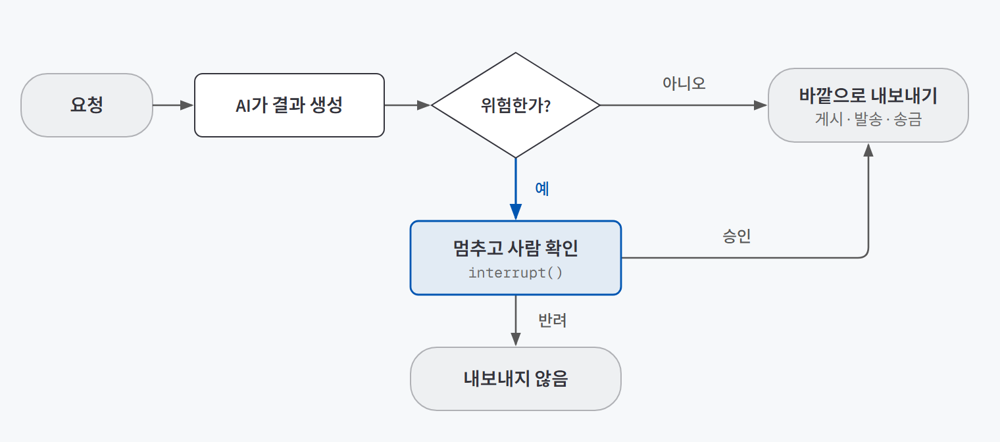
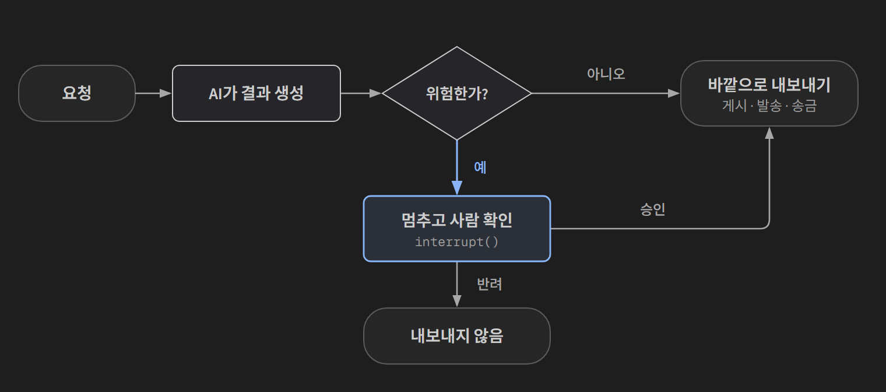

## 한 줄 요약

**AI가 되돌릴 수 없는 일을 하기 직전에만 멈춰서 사람에게 묻게 하는 방법이다.** 이름은 HITL(Human-in-the-Loop, 사람이 흐름 중간에 들어가 확인하는 방식)이다.

여기서 **에이전트**는 사람이 단계마다 지시하지 않아도 여러 단계를 스스로 이어서 처리하는 AI 프로그램을 말한다. 요청을 읽고, 자료를 찾고, 결과를 만들어 보내는 일까지 한 번에 하기 때문에, 중간에 사람이 끼어들 자리를 따로 만들어 줘야 한다.

은행 창구를 떠올리면 쉽다. 소액 송금은 창구 직원이 바로 처리하고, 큰돈이 나갈 때만 책임자 결재를 받는다. 모든 건을 책임자가 보면 창구가 멈추고, 아무것도 안 보면 사고가 난다. HITL은 "어떤 건만 결재를 받을지"를 정하는 일이다.

## 필요한 이유

정확도 95%인 AI에게 하루 200건을 맡기면 **매일 10건**이 틀린 채로 나간다. 프롬프트를 다듬어 99%로 올려도 **하루 2건**이 남는다.

틀린 결과가 화면에만 뜨고 끝나면 다시 하면 된다. 그런데 돈이 나가거나, 메일이 발송되거나, 공고가 게시되는 일이라면 이미 늦다. 받은 사람이 그걸 보고 행동해 버리기 때문이다. **정확도를 아무리 올려도 0건은 되지 않는다.** 그래서 틀린 결과가 바깥으로 나가기 전에 막을 자리가 따로 필요하다.

## 개념과 동작

에이전트가 일하는 흐름 중간에 **검문소**를 하나 둔다. 위험하지 않은 건은 검문소를 그냥 지나가고, 위험한 건만 멈춰서 사람의 답을 기다린다. 사람이 답하면 **멈춘 자리부터** 이어서 처리한다.

{: .light }
{: .dark }

핵심은 검문소의 **위치**다. 요청을 읽고 결과를 만드는 앞 단계는 틀려도 다시 하면 된다. 검문소는 **결과가 바깥으로 나가는 단계 바로 앞**에 둔다.

## 적합한 경우와 피할 경우

| 쓰는 게 좋은 경우 | 쓰면 안 되는 경우 |
|---|---|
| 돈이 나가거나 메일이 발송되는 등 **되돌릴 수 없는 일** | 틀려도 다시 하면 되는 일 (검색, 요약, 초안 작성) |
| 위험한 건이 **일부만** 섞여 있는 일 | 모든 건이 위험한 일 (그럴 땐 처음부터 사람이 하는 게 낫다) |
| 위험한지 아닌지를 **숫자나 규칙으로 가를 수 있는** 일 | 위험을 가를 기준을 못 세우는 일 (결국 전부 멈추게 된다) |

예를 들면 이런 곳이다.

| 자동화 | 사람이 봐야 할 건 |
|---|---|
| 고객 문의 자동 답변 | AI가 분류를 확신하지 못하거나, 근거 규정을 못 찾은 답변 |
| 뉴스레터 자동 발행 | 출처를 알 수 없는 숫자가 들어간 글 |
| 재고 자동 발주 | 평소 주문량의 두 배를 넘는 발주 |
| 공고문 자동 수정 | 마감일, 급여, 자격요건이 바뀌는 수정 |

## 장점과 한계

| 장점 | 한계 |
|---|---|
| 200건 중 위험한 20건만 사람이 보고, 나머지 180건은 자동으로 끝난다 | 멈춤 기준을 잘못 잡으면 사람이 내용을 안 읽고 승인만 누르게 된다 |
| 큰 사고는 내보내기 전에 사람이 막는다 | 나중에 붙이기 어렵다. 에이전트를 설계할 때 처음부터 넣어야 한다 |
| 누가 언제 왜 승인했는지 기록이 남는다 | 기준에 안 걸린 실수(놓침)는 아무도 모르게 지나간다 |

## 적용 방법

### 1단계. 멈출 자리를 정한다

"결과가 바깥으로 나가는 순간"이 어디인지 찾는다. 송금, 발송, 게시, 외부 시스템 등록 같은 단계다. 결과를 **만드는 단계**와 **내보내는 단계**를 나눠 두면 그 사이가 자연스럽게 검문소 자리가 된다.

### 2단계. 멈췄다가 이어 가게 만든다

LangGraph(에이전트의 흐름을 그래프로 짜는 도구)에서는 두 가지를 쓴다.

- `interrupt(...)`: 이 자리에서 멈추고, 괄호 안의 내용을 사람에게 보여준다.
- `Command(resume=답)`: 사람의 답을 넣어서 멈춘 자리부터 다시 출발시킨다.

```python
def review(state):
    # 여기서 멈춘다. 괄호 안의 내용이 그대로 승인 화면이 된다.
    answer = interrupt({"요청": state["request"], "승인하면": "공고가 바로 게시됩니다"})
    return {"decision": answer}

# 나중에 사람이 답하면, 같은 요청 번호(thread_id)로 이어서 실행한다.
# config에는 이 요청의 고유 번호(thread_id)가 들어 있다. 그래야 어느 요청을 이어 갈지 안다.
graph.invoke(Command(resume="approve"), config)
```

멈춘 상태는 어딘가에 저장해 둬야 이어 갈 수 있다. 이걸 맡는 게 **체크포인터**다. 사람의 답은 몇 시간, 며칠 뒤에 올 수도 있으니 실제 서비스에서는 메모리가 아니라 파일이나 DB에 저장한다.

| 체크포인터 | 저장 위치 | 프로그램을 껐다 켜면 |
|---|---|---|
| InMemorySaver | 메모리 | 대기 건이 사라진다 |
| SqliteSaver | 파일 하나 | 남아 있다 |
| PostgresSaver | 데이터베이스 | 남아 있고, 서버 여러 대가 같이 쓸 수 있다 |

### 3단계. 언제 멈출지 숫자로 정한다

"금액이 크면 멈춘다"는 기준이 될 수 없다. **"3만 원을 넘으면 멈춘다"**처럼 계산할 수 있어야 코드로 옮기고 결과를 비교할 수 있다.

그리고 기준이 잘 작동하는지 세 가지 숫자로 확인한다.

| 지표 | 뜻 | 많으면 생기는 일 |
|---|---|---|
| **개입률** | 사람에게 넘어간 비율 | 자동화한 의미가 줄어든다 |
| **놓침** | 사람이 봤어야 하는데 그냥 나간 건 | 사고가 난다. **가장 비싼 실수** |
| **헛멈춤** | 안 봐도 되는데 멈춘 건 | 사람이 지쳐서 안 읽고 승인한다 |

기준을 빡빡하게 하면 놓침은 줄지만 헛멈춤이 는다. 둘을 동시에 0으로 만드는 기준은 거의 없다. 그래서 이 업무에서는 둘 중 어느 쪽이 더 비싼지 따져서 고른다.

이때 금액 기준을 계속 낮추기보다 **종류가 다른 기준을 하나 더하는 것**이 낫다. 환불 요청 5건으로 실습해 보면 이렇다.

| 멈춤 기준 | 결과 |
|---|---|
| 금액 3만 원 초과 | 9천 원짜리 "그냥 마음에 안 들어요" 환불이 그대로 나갔다 (놓침 1건) |
| 금액 5천 원 초과 | 놓침은 없어졌지만 5건이 전부 멈췄다 (헛멈춤 2건). 전부 사람이 보는 것과 같다 |
| **금액 3만 원 초과 + "마음에 안", "단순 변심" 표현** | **놓침 0건, 헛멈춤 0건** |

금액만으로는 "작지만 수상한" 건을 잡을 수 없어서, 다른 종류의 위험에는 다른 기준이 필요했다.

### 4단계. 10초 안에 판단할 수 있는 승인 화면을 만든다

담당자가 정보를 찾느라 다른 시스템을 열어야 하면, 자동화로 아낀 시간이 그대로 사라진다. 승인 화면에는 다섯 가지를 넣는다.

1. 요청 원문
2. 핵심 정보 (금액, 날짜 등)
3. AI의 판단과 그 근거
4. **왜 멈췄는지**
5. **승인하면 무슨 일이 일어나는지** (환불 업무라면 "31만 원이 고객 계좌로 나갑니다")

버튼도 승인과 반려 둘로는 부족하다.

| 응답 | 언제 |
|---|---|
| 승인 | AI 결과가 맞을 때 |
| **수정 후 승인** | 대체로 맞는데 조금만 고치면 될 때. 실무에서 가장 많다 |
| 반려 (사유 필수) | 내보내면 안 될 때. 사유는 나중에 기준을 고치는 재료가 된다 |
| 다시 판정 | 지시를 보태서 AI에게 다시 시킬 때. **횟수 상한**을 둔다 |

### 5단계. 대기 건의 운영 규칙을 정한다

아무도 처리하지 않은 대기 건이 쌓이면 승인 목록은 금방 아무도 안 보는 목록이 된다. "3일 지나면 다른 담당자에게 넘긴다"처럼 오래 대기한 건을 어떻게 처리할지 미리 정한다.

## 다른 방법과 비교

| 방법 | 속도 | 안전 | 한 줄 평가 |
|---|---|---|---|
| 전부 사람이 확인 | 느림 | 높음 | 자동화로 줄어드는 일이 거의 없다 |
| 전부 자동 | 빠름 | 낮음 | 틀린 결과를 막을 방법이 없다 |
| 프롬프트를 더 다듬기 | 빠름 | 조금 오름 | 정확도는 오르지만 남은 실수가 0이 되진 않는다. HITL과 같이 하는 노력이다 |
| **HITL** | 대부분 빠름 | 높음 | 위험한 건만 사람이 본다 |

## 주의할 점

**멈췄던 단계는 이어 갈 때 처음부터 다시 실행된다.** 체크포인터는 "어느 단계에서 멈췄는지"만 기억하고 "그 단계의 몇 번째 줄인지"는 기억하지 못한다. 그래서 사람이 답하면 멈췄던 단계를 첫 줄부터 다시 돈다.

멈추기 직전에 "검토 중입니다" 알림을 보내도록 짜 두면, 사람이 승인하는 순간 그 단계가 다시 돌면서 **알림이 두 번** 나간다. 원칙은 하나다. **사람에게 묻는 단계 안에는 판단만 두고, 바깥으로 나가는 동작(알림, 파일 쓰기, DB 저장)은 다른 단계로 뺀다.**

그 밖에 기억할 것:
- 요청마다 고유한 번호(`thread_id`)를 붙이지 않으면 대기 건끼리 섞인다.
- 놓침은 승인 목록에 나타나지 않는다. "사람이 봤어야 하는가"라는 정답을 붙인 데이터로 따로 세야 알 수 있다.

## 용어 정리

| 용어 | 뜻 |
|---|---|
| HITL (Human-in-the-Loop) | 자동화 흐름 중간에 사람이 들어가 확인하는 방식 |
| interrupt | 에이전트를 그 자리에서 멈추고 사람에게 내용을 보여주는 기능 |
| resume | 사람의 답을 넣어 멈춘 자리부터 다시 출발시키는 것 |
| 체크포인터 | 멈춘 상태를 저장해 두는 장치. 이게 있어야 나중에 이어 갈 수 있다 |
| thread_id | 요청 한 건을 가리키는 고유 번호 |
| 개입률 / 놓침 / 헛멈춤 | 사람에게 간 비율 / 봤어야 하는데 그냥 나간 건 / 안 봐도 되는데 멈춘 건 |

---

→ 이 개념을 검증한 프로젝트: [사람이 승인하는 AI(HITL) 검증 — 공고문 수정 에이전트로 확인한 세 가지](/posts/hitl-posting-agent/)
