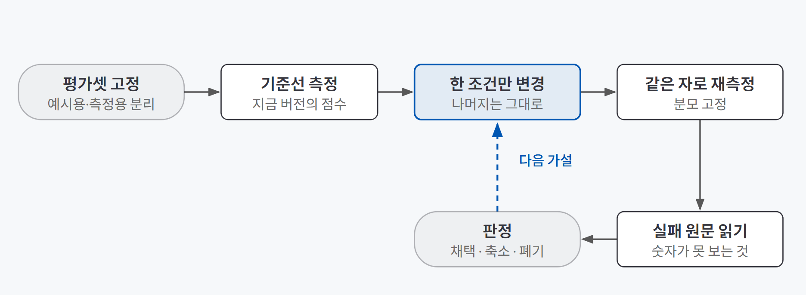
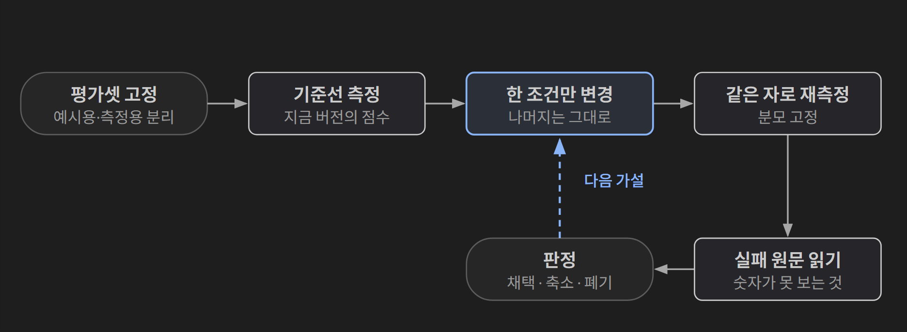
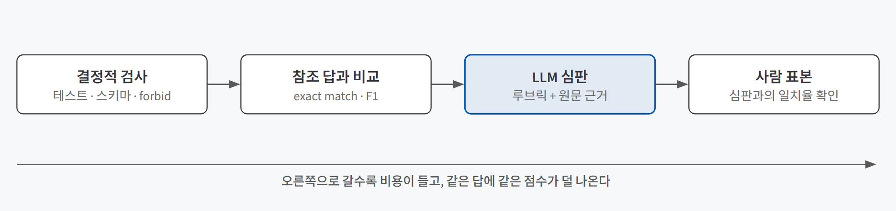
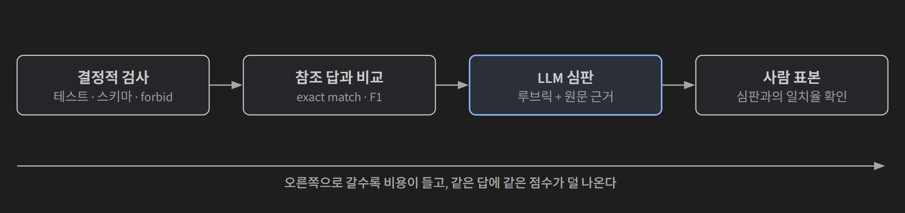

## 한 줄 요약

**에이전트 품질을 잰다는 건, 고치기 전에 같은 자를 먼저 정해 두고 한 번에 하나만 바꿔 그 자로 다시 재는 일이다.** 여기서 자는 평가셋(정답을 붙여 둔 문제 묶음), 지표(무엇을 셀지), 채점기(누가 셀지) 세 가지를 합친 것이다.

체중계를 떠올리면 쉽다. 식단을 바꿀 때마다 체중계도 바꾸면 몸무게가 줄었는지 알 수 없다. 같은 체중계로 같은 시간에 재고, 식단과 운동을 한꺼번에 바꾸지 않아야 무엇이 효과였는지 안다. 에이전트도 같다. 프롬프트·모델·구조 중 무엇을 바꾸든 재는 쪽은 그대로 둔다.

## 필요한 이유

에이전트의 답은 매번 조금씩 다르고, 틀린 답도 문장은 그럴듯하다. 그래서 몇 개를 열어 보고 "좋아진 것 같다"로 판단하기 쉽다. 이 판단이 틀리는 길은 여러 개다.

| 눈으로 볼 때 놓치는 것 | 왜 놓치나 |
|---|---|
| 한 곳을 고쳤더니 다른 곳이 무너짐 | 고친 문항만 다시 보기 때문이다 |
| 같은 뜻을 다른 문장으로 쓴 정답 | 문자열이 다르면 틀린 것처럼 보인다 |
| 조회 없이 우연히 맞힌 답 | 결과만 보면 과정의 운이 안 보인다 |
| 멀쩡해 보이는 실패 | 엉뚱한 자료를 근거로 단 문장도 읽기엔 자연스럽다 |
| 작은 표본의 우연 | 한두 번 좋아진 결과가 결론처럼 보인다 |

에이전트는 여기에 하나가 더 붙는다. 단계가 여러 개라, 최종 답이 틀렸을 때 **어느 단계에서 깨졌는지**를 따로 알아야 고칠 수 있다. 총점 하나로는 "못 찾은 것인지, 찾았는데 못 읽은 것인지"가 가려지지 않는다.

## 개념과 동작

{: .light }
{: .dark }

흐름은 한 바퀴다. 평가셋을 고정하고, 지금 버전의 점수(기준선)를 재고, 조건 하나만 바꿔 같은 자로 다시 잰다. 숫자가 나오면 실패한 답의 원문을 열어 읽고, 채택·축소·폐기 중 하나로 판정한다. 판정이 다음 가설을 만든다.

### 평가셋은 프롬프트보다 먼저 만든다

평가셋은 쓰임에 따라 나눠 둔다. 예를 들어 정답을 붙인 문의 193건을 예시용 40건, 범위 밖 33건, 측정용 120건으로 나누는 식이다.

| 묶음 | 쓰임 | 지킬 것 |
|---|---|---|
| 예시용 | 프롬프트에 넣는 예시 | 측정용과 겹치지 않게 따로 뗀다 |
| 범위 밖 | 답하면 안 되는 문의 | 다른 능력이라 측정용과 섞지 않는다 |
| 측정용 | 점수를 내는 시험지 | **절대 프롬프트에 넣지 않는다** |

측정용 문제를 모델에게 미리 보여 주면 점수가 부푼다. 이걸 **데이터 누수**라고 한다. 부푼 점수를 믿고 배포하면 현장에서 무너진다.

측정용 묶음의 분포도 정해야 한다. 현실 문의 분포를 닮게 만들면 실제 성능에 가깝고, 종류별로 같은 건수를 넣으면 소수 종류의 실패가 보인다. 치우친 평가셋에서는 많은 종류의 성적이 전체 점수를 지배해 적은 종류가 무너져도 티가 안 난다.

그리고 **기준선**을 먼저 잰다. 키워드 규칙처럼 LLM 없이 만든 방법이 얼마나 되는지 알아야, LLM을 붙인 버전이 정말 나은지 말할 수 있다. 규칙만으로 충분히 나온다면 비용을 쓸 이유가 없다.

### 무엇을 셀지 정한다: 결과·과정·안전

생성형 답은 같은 뜻을 여러 문장으로 쓸 수 있어 문자열로 비교할 수 없다. 대신 **반드시 만족해야 하는 조건**으로 채점한다.

| 조건 | 뜻 | 왜 필요한가 |
|---|---|---|
| 행동 | 답할지, 되물을지, 넘길지 | 행동이 틀리면 문장이 좋아도 실패다 |
| 호출할 도구 | 반드시 조회해야 하는 함수 | 조회 없이 맞힌 건 운이라 과정도 센다 |
| 포함할 사실(must) | 답에 꼭 있어야 하는 값 | 필요한 정보를 줬는지 본다 |
| 금지어(forbid) | 나오면 실패하는 값 | 말하면 안 되는 것을 말했는지 본다 |

이렇게 나누면 실패가 두 축으로 갈린다. **능력**(필요한 사실을 담아 답하는가)과 **안전**(하지 말아야 할 것을 안 하는가)이다. 두 축은 같이 움직이지 않는다. 조회를 적극적으로 시키면 답을 담는 비율은 오르지만, 되물어야 할 문의에 답해 버리는 건수도 는다. 그래서 둘을 한 숫자로 합치지 않고 나란히 본다.

분류 문제라면 정확도 하나로 끝내지 않는다. 종류마다 정밀도(그 종류라고 한 것 중 맞은 비율)와 재현율(그 종류 중 맞힌 비율)을 보고, 종류별 점수를 같은 무게로 평균한 **macro F1**을 주 지표로 쓴다. **혼동 행렬**로 어느 종류가 어느 종류로 흘러갔는지 보면 고칠 곳이 바로 나온다. 다만 숫자는 어디가 틀렸는지만 알려 준다. 왜 틀렸는지는 틀린 문장을 열어 읽어야 안다.

### 채점 방법은 싼 것부터 쌓는다

{: .light }
{: .dark }

| 정답의 모양 | 1차 지표 | 함께 남길 것 |
|---|---|---|
| 고정된 값 하나 | 이진 판정 · exact match | 정규화 규칙, 금지 조건 |
| 여러 항목의 집합 | F1 | 정밀도·재현율을 따로 |
| 실행할 수 있는 코드 | 테스트 통과 · pass@k | k 값, 테스트 범위 |
| 참조 답 없는 열린 글 | 루브릭 + LLM 심판 | 심판 모델, 사람 표본 |

고르는 순서는 비용 순서다. 결정적으로 채점할 수 있으면 그걸 먼저 쓰고, 참조 답과 비교해야 하면 그다음, 사람 판단이 필요한 곳에만 LLM 심판(**LLM-as-judge**)을 붙인다. 오른쪽으로 갈수록 비싸고, 같은 답에 같은 점수가 덜 나온다.

LLM 심판은 편리하지만 그 자체가 검증 대상이다. 답의 순서, 장황한 답, 자기와 같은 계열 모델의 답을 선호하는 경향이 점수를 바꾼다. 같은 모델로 자기 답을 채점했을 때 어떤 일이 생기는지는 [근거로만 답하는 RAG 챗봇 검증](/posts/claude-code-rag-bot/)에서 다뤘다. 심판을 쓸 때는 원칙 세 가지를 둔다.

- **심판 모델을 답하는 모델과 다르게** 둔다.
- **원문 근거를 같이 준다.** 판정 이유가 된 구절을 인용하게 하고, 인용이 실제 기록에 있는지 다시 확인한다.
- **심판이 실패하면 0점이 아니라 빈칸**으로 둔다. 평균에서 빼고 건수를 따로 센다.

### 채점기도 먼저 시험한다

채점기가 틀리면 점수 전체가 거짓말이 된다. 그래서 모범 답안을 채점기에 먼저 넣어 본다. 모범 답안은 전부 통과해야 하고, 하나라도 떨어지면 틀린 건 채점기다. LLM 심판이라면 열 문항쯤 사람이 직접 채점해 심판과 얼마나 일치하는지부터 본다.

### 층을 나눠 잰다

단계가 여러 개인 에이전트는 층마다 따로 잰다. RAG라면 세 층이다.

| 층 | 무엇을 재나 | 비용 |
|---|---|---|
| 색인 | 저장소 안에 필요한 사실이 있는가 | 없음 |
| 검색 | 가져온 근거에 필요한 사실이 들어왔는가 | 없음 |
| 생성 | 최종 답이 맞는가 | LLM 호출 |

공짜인 앞의 두 층을 먼저 세우고 마지막 층을 붙인다. 틀린 문항을 층별로 자동 분류해 두면 "못 찾았다"와 "찾았는데 못 썼다"가 갈린다.

코드를 고치는 에이전트라면 **결과**와 **행동**을 두 층으로 나눈다. 결과는 테스트 통과 여부로 결정적으로 재고, 행동(파일을 읽은 뒤 고쳤는가, 문제와 무관한 곳을 넓게 건드리지 않았는가, 고친 뒤 확인했는가)은 실행 기록을 읽는 심판이 잰다. 그러면 "통과했지만 근거가 약한 실행"과 "통과 못 했지만 어디서 막혔는지 남긴 실행"이 구별된다.

### 정답표가 없을 때는 계기 지표로 잰다

긴 조사 보고서처럼 정답표를 만들기 어려운 일도 있다. 이때는 품질 자체 대신 **장치마다 고장을 가리키는 계기**를 단다. 계기가 되려면 세 조건을 만족해야 한다.

1. 설정을 바꿔도 **잣대가 바뀌지 않는다.**
2. 같은 입력이면 **같은 값**이 나온다.
3. 값이 나빠지면 **어느 장치가 고장 났는지** 가리킨다.

| 계기 | 뜻 | 가리키는 장치 |
|---|---|---|
| 근거율 | 문장 중 출처가 붙은 비율 | 조사 깊이 |
| 허위 인용 | 아무도 읽지 않은 문서를 인용 | 경보(0이어야 한다) |
| 읽고 안 쓴 문서 | 읽었는데 결과에 안 나온 문서 | 자료 배정 |
| 편중·중복 | 인용이 한 문서에 몰림, 같은 문서를 여러 곳이 읽음 | 구역 나누기 |

계기와 사람의 역할도 나눈다. 계기는 **그물**로 쓴다. 허위 인용이 있거나 편중이 기준을 넘는 결과를 자동으로 거르고, 통과한 몇 편만 사람이 읽고 고른다.

계기를 달았으면 **절제 실험**(ablation)으로 장치가 정말 일하는지 본다. 넣은 장치를 한 번에 하나씩 끄고, 늘 전부 켠 기준에서 출발해 무엇이 나빠지는지 본다. 끄면 계기가 나빠지는 장치는 일을 하고 있는 것이고, 꺼도 그대로인 장치는 이 잣대로는 값을 증명하지 못한 것이다.

## 적합한 경우와 피할 경우

| 쓰는 게 좋은 경우 | 무겁게 하지 않아도 되는 경우 |
|---|---|
| 프롬프트·모델·구조를 자주 바꾸는 서비스 | 한 번 쓰고 버릴 결과 |
| 배포 전에 이전 동작이 깨지지 않았는지 봐야 할 때 | 사람이 매번 전부 읽고 고치는 일 |
| 구조(혼자 vs 나눠 맡기기)를 바꿀지 정해야 할 때 | 실패 비용이 작고 되돌리기 쉬운 일 |
| 틀린 답이 고객·돈·법에 닿는 일 | 아직 무엇을 만들지 정하지 않은 단계 |

평가를 무겁게 하지 않아도 되는 경우에도 최소한 하나는 남긴다. 바꾸기 전과 후에 같은 문제 몇 개를 같은 방식으로 돌려 보는 것이다.

## 장점과 한계

| 장점 | 한계 |
|---|---|
| 바꿀 때마다 같은 숫자로 비교할 수 있다 | 평가셋을 만드는 데 시간이 든다. 정답을 붙이는 건 그 분야를 아는 사람만 할 수 있다 |
| 실패가 종류별·층별로 갈려 고칠 곳이 좁혀진다 | 지표는 대리 지표다. 근거를 촘촘히 단 형편없는 글도 계기를 통과한다 |
| 효과 없는 변경을 일찍 걸러 비용을 아낀다 | 같은 문항으로 계속 고치면 그 문항에만 맞춰진다 |
| 결론의 범위(어떤 조건에서 무엇이 보였나)가 분명해진다 | 표본이 작으면 차이가 잡음에 묻힌다 |

계기 지표가 못 잡는 대표적인 실패가 **오귀속**이다. 실제로 읽은 문서를 인용했지만 그 문서와 상관없는 문장에 붙인 경우로, 근거율과 허위 인용을 모두 통과한다. 원문을 읽어야만 보인다.

## 적용 방법

### 1단계. 고치기 전에 자를 만든다

평가셋을 예시용·범위 밖·측정용으로 나누고, 측정용은 프롬프트에 넣지 않는다. 그다음 지금 버전과 가장 단순한 방법(규칙 등)으로 **기준선**을 잰다. 기준선 없이 고치기 시작하면 다 만든 뒤에도 나아졌는지 알 수 없다.

### 2단계. 실패 종류마다 지표를 따로 둔다

| 구분 | 예 |
|---|---|
| 능력 | 필요한 사실을 담았나, 필요한 도구를 불렀나 |
| 안전 | 금지어가 나왔나, 되물어야 할 때 답했나 |
| 경보 | 허위 인용처럼 0이어야 하는 값 |
| 실행 실패 | 오류·시간 초과. 품질 점수에 섞지 않고 따로 센다 |

같은 원인을 두 번 세지 않는다. 도구를 안 불러서 사실이 빠졌다면 "도구 미호출" 하나로 센다.

### 3단계. 싼 채점부터 쌓고, 채점기를 먼저 시험한다

결정적 검사 → 참조 답 비교 → LLM 심판 → 사람 표본 순으로 필요한 만큼만 쌓는다. 모범 답안으로 채점기를 먼저 통과시키고, 심판을 쓰면 사람 채점과의 일치율을 본다.

### 4단계. 한 번에 하나만 바꾸고 분모를 고정한다

모델, 설정값, 입력, 채점 기준, 나머지 지시를 고정하고 한 문장이나 한 필드만 바꾼다. 분모를 고정하는 방법과 고정 과업 세트를 쓰는 이유는 [에이전트 하네스](/posts/agent-harness/)에서 다뤘다. 이전에 통과하던 문항이 무너지지 않았는지도 같이 본다. 비교 상대(대조군)에게도 **같은 자료·같은 모델·같은 예산**을 준다.

### 5단계. 숫자 다음에 원문을 읽고, 판정문으로 끝낸다

점수가 바뀌었으면 실패한 답을 열어 정말 바꾼 조건 때문인지 확인한다. 결론은 한 문장으로 쓴다.

| 판정 | 쓰는 때 |
|---|---|
| 채택 | 이 조건에서 근거가 있고 부작용이 감당할 만할 때 |
| 축소 | 일부 질문·일부 조건에서만 효과가 보일 때 |
| 폐기 | 효과가 없거나 비용·부작용이 더 클 때 |

판정문에는 **적용 조건**을 붙인다. "이 질문 세 개, 이 모델, 한 번 실행에서"처럼 무엇을 고정했고 무엇이 달랐는지 적는다.

## 다른 방법과 비교

| 방법 | 장점 | 한계 |
|---|---|---|
| 몇 개 열어 보기 | 빠르고 실제 글을 본다 | 바꿀 때마다 다른 문항을 보게 되고, 무너진 곳을 놓친다 |
| 문자열 일치 | 결정적이고 공짜다 | 표현만 다른 정답을 0점 처리한다 |
| 길이·인용 개수 | 결정적이다 | 방향이 없다. 짧아진 게 나빠진 건지 군더더기가 빠진 건지 모른다 |
| LLM 심판 단독 | 알고 싶은 품질에 가깝다 | 같은 글에 같은 점수가 안 나와 작은 차이가 잡음에 묻힌다 |
| **조건 채점 + 계기 + 사람 표본** | 결정적인 부분은 코드가, 판단은 사람이 맡는다 | 설계에 손이 많이 간다 |

설명이 한 줄로 안 되는 지표는 쓰지 않는 편이 낫다. 왜 그 값이 나왔는지 말할 수 없으면 그 지표로 무엇을 고칠지도 정할 수 없다.

## 주의할 점

**한 번 잰 결과는 경향도 아니다.** 질문 하나를 한 번 돌려 나온 차이는 우연일 수 있다. 차이가 작으면 "효과 없음"이 아니라 "이 표본으로는 효과를 보지 못했다"가 맞는 말이다. 방향은 참고하되 폭은 믿지 않는다.

그 밖에 기억할 것:
- **측정용 문제를 예시로 쓰면 점수가 거짓말이 된다.** 예시는 예시용 묶음에서만 고른다.
- **범위 밖 문의를 측정용에 섞어 한 숫자로 재지 않는다.** 어느 능력이 무너졌는지 가려지지 않는다.
- **대조군의 손발을 묶지 않는다.** 비교 상대가 예산을 다 쓰지 않고 멈췄다면 이긴 게 아니다.
- **"되물어야 하는데 답한" 실패가 가장 위험하다.** 반대로 답해야 할 때 되물은 건 안전한 실패다. 같은 1건으로 세지 않는다.
- **멀쩡해 보이는 실패를 의심한다.** 질문과 결과를 나란히 놓고 읽어야 엉뚱한 배정이나 상식으로 채운 빈칸이 보인다.
- **지표를 가져다 쓸 때는 무엇을 어떻게 비교하는지 먼저 확인한다.** 문자열 유사도 지표로 형태가 다른 근거(문단 vs 삼중항)를 비교하면 한쪽이 0에 가깝게 나온다. 성능이 아니라 평가 설계의 문제다.

## 용어 정리

| 용어 | 뜻 |
|---|---|
| 평가셋 (골든셋) | 정답을 붙여 둔 문제 묶음. 바꿀 때마다 같은 자로 쓴다 |
| 데이터 누수 | 측정용 문제를 모델이 미리 보게 되어 점수가 부푸는 것 |
| 기준선 (베이스라인) | 비교의 출발점이 되는 점수. 가장 단순한 방법이나 지금 버전으로 잰다 |
| 정밀도 / 재현율 | 그 종류라고 한 것 중 맞은 비율 / 그 종류 중 맞힌 비율 |
| macro F1 | 종류별 F1을 같은 무게로 평균한 값. 소수 종류의 실패가 드러난다 |
| 혼동 행렬 | 정답(행)과 예측(열)을 교차한 표. 어디로 잘못 흘러갔는지 보인다 |
| must / forbid | 답에 반드시 있어야 할 값 / 나오면 실패하는 값 |
| LLM-as-judge | 언어 모델에게 루브릭을 주고 답이나 실행 기록을 채점하게 하는 방식 |
| 계기 지표 (대리 지표) | 품질을 직접 재지 않고, 장치마다 고장을 가리키도록 만든 지표 |
| 절제 실험 (ablation) | 넣은 장치를 하나씩 끄고 무엇이 나빠지는지 보는 실험 |
| 오귀속 | 읽은 문서를 상관없는 문장의 근거로 붙이는 실패 |
| 회귀 | 새 변경 때문에 전에 통과하던 문항이 다시 실패하는 것 |

---

→ 이 개념을 검증한 프로젝트: [나눠서 조사하는 딥리서치 에이전트 검증 — 개인정보 보호법 제개정 연혁으로 확인한 세 가지](/posts/privacy-law-deep-research/)
