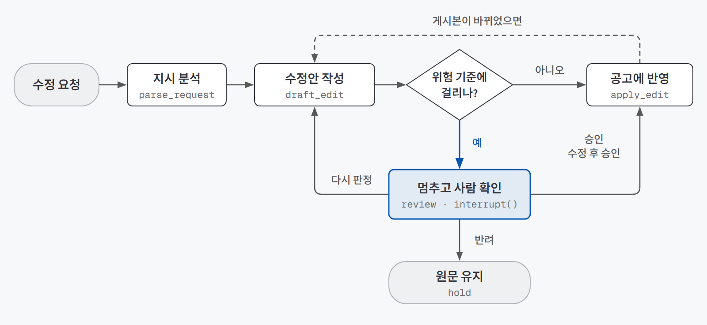
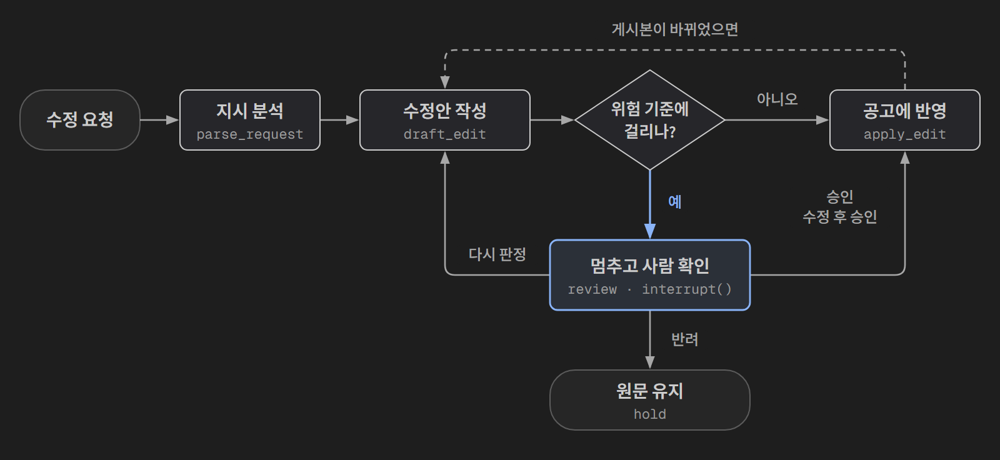

> 제작: 2026-09-28 · 정리: 2026-11 · 모두의연구소 AI 에이전트 과정 「에이전트 팀 꾸리기」 · 저장소: [beginner-driver/Posting-Hitl-Agent](https://github.com/beginner-driver/Posting-Hitl-Agent)
{: .prompt-info }

## 한 줄 소개

**HITL(사람이 중간에 승인하는 방식) 이론이 실제 업무에서도 통하는지 확인하려고 채용 공고 수정 에이전트를 만들어 검증했다.** 마감일·급여·자격요건이 바뀌는 수정은 게시 직전에 멈춰서 사람의 승인을 받고, 오탈자나 띄어쓰기 교정은 바로 반영된다.

> **검증한 것:** 규칙 판정으로 놓침·헛멈춤 통제 ✅ · 승인 후 같은 작업이 두 번 실행되는 문제를 설계로 차단 ✅ · "다시 판정" 버튼의 필요성 ✅
>
> **발견한 것:** 기다리는 동안 공고가 먼저 바뀌는 문제 · 멈춘 이유의 종류를 화면에서 구분해야 하는 문제
{: .prompt-tip }

## 왜 만들었나

[HITL 이론](/posts/hitl-theory/)을 배우고 나서 세 가지가 궁금했다.

1. **위험 판정을 AI 대신 규칙에 맡기면** 놓침과 헛멈춤을 통제할 수 있을까?
2. 승인 후 이어 갈 때 멈췄던 단계가 처음부터 다시 도는 문제를 **설계로 피할 수 있을까?**
3. 승인 버튼이 승인·반려 두 개가 아니라 **네 개(수정 후 승인, 다시 판정 포함)**일 필요가 정말 있을까?

이론만으로는 답이 안 나오는 질문들이라, 직접 에이전트를 만들어 확인해 보기로 했다.

실험 대상으로는 **채용 공고 수정**을 골랐다. 이론에서 정리한 HITL이 필요한 조건에 그대로 들어맞기 때문이다.

| HITL이 필요한 조건 | 채용 공고에서는 |
|---|---|
| 되돌릴 수 없는 일 | 게시된 공고는 지원자가 읽고 바로 행동한다. 나중에 고쳐도 이미 본 사람의 행동은 되돌릴 수 없다 |
| 위험한 건이 일부만 섞여 있다 | 오탈자 수정은 안전하고, 마감일·급여 변경은 위험하다 |
| 위험을 숫자나 규칙으로 가를 수 있다 | 날짜, 금액, 바뀐 줄 수, 섹션 이름으로 셀 수 있다 |

## 실험 설계

### 동작 흐름

{: .light }
{: .dark }

1. 담당자가 자유롭게 수정 지시를 쓴다. ("마감 1주 연장해 주세요")
2. AI가 수정안을 만들고, 원문과 무엇이 달라졌는지 비교한다.
3. 정해 둔 기준으로 위험한지 판정한다.
4. 안전하면 바로 반영하고, 위험하면 멈춰서 승인 화면에 올린다.
5. 담당자는 **승인 / 수정 후 승인 / 반려 / 다시 판정** 중 하나를 고른다.

### 사용 기술

| 기술 | 어디에 썼나 |
|---|---|
| **LangGraph** | 에이전트 흐름 설계. `interrupt`로 멈추고 `Command(resume)`으로 이어 가기 |
| **SqliteSaver** | 승인 대기 건 저장. 프로그램을 껐다 켜도 대기 목록이 남는다 |
| **OpenAI gpt-4o-mini** | 수정 지시를 읽고 수정안 작성. API 키 없이도 돌릴 수 있게 정해진 답을 내는 가짜 AI(mock) 모드도 만들었다 |
| **Python difflib · 정규식** | 글자 비교 도구(difflib)로 원문과 수정안의 차이를 찾고, 패턴 찾기(정규식)로 날짜·금액을 뽑았다 |
| **Streamlit** | 파이썬만으로 웹 화면을 만드는 도구. 승인 화면(대기 목록, 원문·수정안 비교, 응답 버튼 4개)에 썼다 |
| **pytest** | 파이썬 자동 테스트 도구. 위험 판정 기준이 맞게 동작하는지 테스트 6개로 확인했다 |

### 멈춤 기준 (질문 1의 실험 조건)

수정안은 AI가 만들지만, **그 수정안이 위험한지는 AI에게 묻지 않았다.** 날짜·금액·줄 수·섹션 이름을 세는 평범한 함수가 판정한다.

| 기준 | 계산 방법 | 막으려는 위험 |
|---|---|---|
| 날짜·시간 변경 | 원문과 수정안의 날짜를 모두 뽑아 비교 | 잘못된 마감일 |
| 급여·금액 변경 | 금액을 원 단위로 바꿔 비교 ("4,200만원" = "4200만 원") | 잘못된 급여 정보 |
| 대규모 변경 | 바뀐 줄이 5줄 이상 | 표현 교정 범위를 넘는 수정 |
| 핵심 섹션 변경 | 자격요건·우대사항·모집인원 섹션이 바뀜 | 지원 자격 관련 실수 |
| (안전장치) 분량 급감 | 수정안이 원문의 절반도 안 됨 | AI 출력이 중간에 잘린 경우 |

### 샘플

안전한 요청 2건, 위험한 요청 2건, 애매한 요청 1건을 만들고, 각 건에 **"사람이 봐야 하는가"라는 정답**을 미리 붙였다. 결과는 이 정답과 비교해서 세 가지 숫자로 센다.

| 지표 | 뜻 |
|---|---|
| **놓침** | 사람이 봤어야 하는데 그냥 반영된 건. 가장 위험한 실수 |
| **헛멈춤** | 안 봐도 되는데 멈춘 건. 많으면 담당자가 지쳐서 안 읽고 승인한다 |
| **개입률** | 전체 중 사람에게 넘어간 비율 |

## 검증 결과

| 질문 | 결과 | 근거 |
|---|---|---|
| 1. 규칙으로 판정하기 | ✅ 통제됨 | 5건 중 놓침 0건, 헛멈춤 0건. 실제 AI로 돌린 건도 판정이 같았다 |
| 2. 승인 후 같은 작업이 두 번 실행되는 문제 | ✅ 설계로 차단 | 사람에게 묻는 단계에는 판단만 두고, 파일 쓰기는 다음 단계로 분리했다 |
| 3. 응답 4개 | ✅ 다시 판정은 필요 | 모호한 지시는 승인·반려만으로는 처리할 수 없었다 |

### 질문 1. 규칙으로 판정하면 통제되는가

| 요청 | 종류 | 정답 | 판정 | 멈춘 이유 | 사람 처리 |
|---|---|---|---|---|---|
| REQ-001 | 표현 교정 | 자동 | 자동 반영 | — | — |
| REQ-002 | 마감일·급여 변경 | 멈춤 | 멈춤 | 날짜 2026-10-20 → 10-27, 금액 4,200만 → 4,500만 원 | 승인 |
| REQ-003 | "전체적으로 다듬어 주세요" | 멈춤 | 멈춤 | 7줄 변경, 우대사항 섹션 변경 | 다시 판정 → 승인 |
| REQ-004 | 모집인원 변경 | 멈춤 | 멈춤 | 모집인원 섹션 변경 | 반려 |
| REQ-005 | 띄어쓰기 | 자동 | 자동 반영 | — | — |

**5건 모두 정답과 일치했다. 놓침 0건, 헛멈춤 0건.** 개입률은 60%인데, 샘플에 위험한 요청을 일부러 많이 넣었기 때문이다.

규칙 판정의 장점은 두 가지로 확인됐다.

- **같은 입력이면 항상 같은 답이 나온다.** 그래서 기준 자체를 테스트로 증명할 수 있었다(pytest 6개 통과).
- **AI가 바뀌어도 판정은 그대로다.** mock 대신 실제 AI(gpt-4o-mini)로 REQ-002를 돌려도 같은 두 가지 위험(날짜·금액)이 잡혔다.

덤으로, AI가 **시키지 않은 부분까지 고치는 실수**도 기준이 잡아냈다. REQ-003이 그 경우다.

### 질문 2. 승인 후 같은 작업이 두 번 실행되는 문제를 설계로 피할 수 있는가

LangGraph에서 멈췄다가 이어 가면 **멈췄던 단계가 처음부터 다시 실행된다.** 이 단계 안에서 파일을 쓰거나 로그를 남기면, 승인할 때마다 같은 기록이 두 번 남는다.

그래서 처음부터 단계를 이렇게 나눴다.

| 단계 | 하는 일 | 바깥에 영향을 주나 |
|---|---|---|
| `review` | 승인 화면을 띄우고 답을 받아 다음 길을 고른다 | ❌ 판단만 한다 |
| `apply_edit` | 공고 파일을 덮어쓰고, 백업과 이력을 남긴다 | ✅ |
| `hold` | 반려 이력을 남긴다 | ✅ |

```python
def review(state):
    # 주의: 재개하면 이 함수가 처음부터 다시 돈다. 여기엔 바깥에 영향을 주는 코드를 두지 않는다.
    answer = interrupt(payload)   # 여기서 멈춤. 담당자의 답이 answer로 들어온다.
    if answer["action"] == "approve":
        return Command(goto="apply_edit", update={"decision": "approve"})
    if answer["action"] == "reject":
        return Command(goto="hold", update={"reject_reason": answer["reason"]})
    ...
```

중복 기록이 실제로 생겼다가 고친 게 아니라 **설계 단계에서 막은 것**이다. 이론에서 배운 함정을 미리 피하는 구조를 실제 코드로 옮길 수 있다는 것까지 확인했다.

### 질문 3. 응답 버튼이 네 개 필요한가

REQ-003이 답이었다. "공고가 딱딱하니 전체적으로 다듬어 달라"는 모호한 지시에, AI는 회사 소개뿐 아니라 **시키지 않은 우대사항까지 고쳤다.** 이 수정안은 승인하기도, 반려하기도 애매하다. 다듬는 것 자체는 필요했기 때문이다.

담당자는 **다시 판정**을 골라 "회사 소개 문단만"이라는 지시를 보탰고, 다시 만든 수정안을 한 번 더 확인한 뒤 승인했다. 버튼이 승인·반려 둘뿐이었다면 반려하고 사람이 직접 고쳐야 했을 건이다.

다시 판정에는 무한 반복을 막는 **횟수 상한**을 뒀다. 수정 후 승인도 구현했지만 이번 샘플에서는 쓰일 일이 없어서 필요성까지는 확인하지 못했다.

## 이론에 없던 발견

### 기다리는 동안 공고가 먼저 바뀐다

승인 대기가 여러 건 쌓이면 생기는 문제다. A건(모집인원 변경)이 승인을 기다리는 사이 같은 공고의 B건(띄어쓰기 교정)이 먼저 자동 반영됐다고 하자. A건의 수정안은 **B가 반영되기 전 원문**을 기준으로 만든 것이라, 그대로 덮어쓰면 B의 수정이 사라진다.

그래서 반영 직전에 "지금 게시된 공고가 수정안을 만들 때 본 원문과 같은가"를 확인하고, 다르면 최신 공고 기준으로 다시 만들어 **사람에게 한 번 더 묻게** 했다. 데모를 직접 써 보다가 이 장치가 **실제로 두 번 발동했다.**

### 멈춘 이유가 두 종류였다

데모를 써 보다가 "왜 같은 건을 두 번 승인해야 하지?"라는 의문이 들었다. 추적해 보니 멈춘 이유에 성격이 다른 두 가지가 섞여 있었다.

- **기준 위반:** 마감일이 바뀌었다 등
- **재확인 필요:** 기다리는 동안 공고가 바뀌어서 수정안을 다시 만들었다

기능은 설계대로 동작했지만 화면에서는 둘 다 같은 빨간 배지로 보였다. 색과 설명을 나눠 해결했다.

**"기준을 정확히 설계했는가"와 "그 판단 근거를 사람이 오해 없이 읽을 수 있는가"는 별개의 문제였다.** 이론에서는 승인 화면에 "왜 멈췄는지"를 보여주라고만 했는데, 멈춘 이유의 **종류**까지 구분해야 한다는 건 직접 써 보고서야 알았다.

## 검증 범위와 한계

이번 실험으로 확인한 것과 확인하지 못한 것을 나눠 둔다.

| 구분 | 내용 |
|---|---|
| **표본 크기** | 5건은 기준이 의도대로 동작하는지 보려고 일부러 설계한 샘플이다. 실제 요청이 쏟아질 때의 놓침·헛멈춤 비율은 확인하지 못했다 |
| **놓침 후보** | 근무형태(정규직 → 계약직), 근무지, 문의 이메일 변경은 날짜·금액·핵심 섹션 어디에도 안 걸린다. 지금 기준의 **가장 큰 구멍**이다 |
| **의도된 헛멈춤** | 자격요건 섹션 안의 단순 오탈자도 멈춘다. 지원 자격은 파급력이 커서 일부러 보수적으로 뒀다 |
| **실제 AI 검증 범위** | 실제 AI로는 REQ-002만 돌려 봤다. 모호한 지시에서 실제 AI가 얼마나 과하게 고치는지는 더 많은 샘플이 필요하다 |
| **운영 요소** | 승인자 로그인, 오래 대기한 건의 알림은 구현하지 않았다 |

## 결론

세 질문 모두 이론이 실제 코드에서도 성립한다는 걸 확인했다. 그중 가장 크게 남은 건 1번이다. **"AI가 만들고, 규칙이 판정하고, 사람이 결정한다"로 역할을 나누면 AI 모델을 바꿔도 판정 기준은 그대로 유지된다.**

이 구조는 공고문에만 해당하지 않는다. 공고 파일을 읽고 쓰는 부분만 채용관리시스템 API로 바꾸면 나머지는 그대로 쓸 수 있고, 정책 공지·약관·사내 규정처럼 **한 번 노출되면 되돌리기 어려운 문서** 전반에 같은 방식을 적용할 수 있다.

## 관련 글

- 이론: [에이전트는 어디서 멈추고 승인받나 — HITL](/posts/hitl-theory/)
- 저장소: [beginner-driver/Posting-Hitl-Agent](https://github.com/beginner-driver/Posting-Hitl-Agent)
