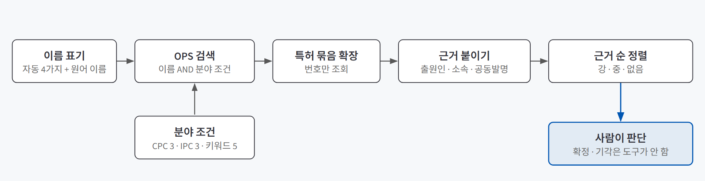
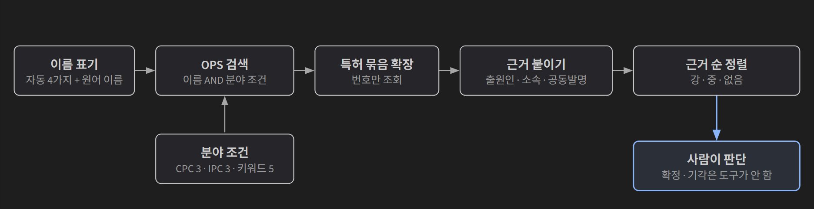
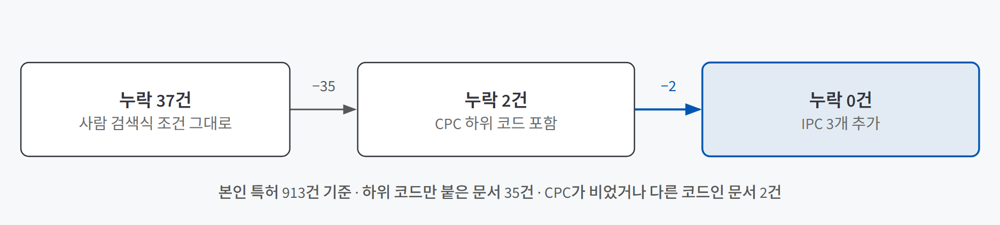
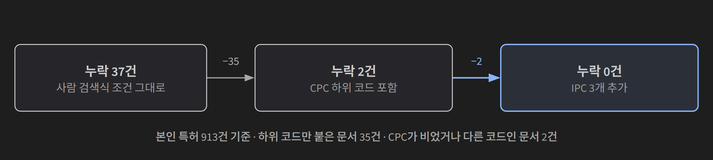

## 한 줄 소개

**사람이 Google Patents에서 인물마다 붙여 넣던 특허 검색식을 도구로 옮기면 같은 특허를 빠짐없이 찾는지 확인하려고, 연구자 78명의 2000년 이후 특허를 두 방식으로 검색해 한 건씩 대조했다.** 바이오 스타트업의 해커톤 과제로 만든 연구자 논문·특허 모니터링 도구 중, 이 글은 내가 맡은 **특허 검색** 부분을 다룬다. 해커톤은 팀 과제였고, 논문 쪽과 화면 구성은 이 글의 범위가 아니다.

도구는 등록해 둔 연구자들의 새 특허를 매주 모아 보여 준다. 이 부분에는 AI 모델을 쓰지 않는다. 검색은 규칙으로 하고, "정말 이 사람 것인가"는 근거를 붙여 사람에게 넘긴다.

> **검증한 것:** 사람의 검색식을 도구로 그대로 옮기면 같은 특허를 찾는가 ❌(본인 특허 37건 누락) · 조건을 고치면 놓치지 않으면서 더 넓게 찾는가 ✅(913/913, 예시 83/83) · 사람이 매주 볼 양과 운영 비용이 감당할 만한가 ✅(과거 기간 재현 기준)
>
> **발견한 것:** 같은 특허도 데이터 출처마다 분류 코드가 달랐다 · 막 공개된 국제출원과 중국 특허는 CPC가 비어 있었다 · 검증 도구의 번호 형식 하나가 결과를 반으로 줄였다 · 큰 특허 묶음은 한 번에 받을 수 없었다
{: .prompt-tip }

## 만든 이유

[에이전트는 어디서 멈추고 승인받나 — HITL](/posts/hitl-theory/)과 ["좋아진 것 같다"를 숫자로 바꾸기 — 에이전트 품질을 재는 평가 설계](/posts/agent-evaluation/)를 배우고 나서 세 가지가 궁금했다.

1. 사람이 쓰던 검색식을 도구로 **그대로 옮기면** 같은 특허가 나올까?
2. 검색 조건을 고치면, 사람이 찾던 특허를 **하나도 놓치지 않으면서** 더 넓게 찾을 수 있을까?
3. 넓게 찾은 만큼 사람이 볼 양이 늘 텐데, **매주 감당할 수 있는 양**일까?

특허 검색이 실험 대상으로 맞았던 이유는 셋이다.

| 검증에 필요한 조건 | 특허 검색에서는 |
|---|---|
| 비교할 기준이 있다 | 발주처가 인물마다 쓰던 검색식과, 꼭 찾아야 할 "모니터링 대상 특허 예시" 83행이 있었다 |
| 사람을 가리키는 번호가 없다 | 논문의 ORCID 같은 연구자 번호가 특허에는 없어, 이름·소속·분야를 조합해야 한다 |
| 틀리면 조용히 틀린다 | 놓친 특허는 화면에 안 나타나므로, 정답과 대조하지 않으면 누락을 알 수 없다 |

## 실험 설계

### 검색 흐름

{: .light }
{: .dark }

1. 인물마다 이름 표기를 여러 개 만든다. 로마자는 어순 2가지 × 가운데 이니셜 포함·제외로 도구가 만들고, 한글·한자 원어 이름은 사람이 넣는다.
2. **이름 AND 분야 조건**으로 검색한다. 분야 조건은 기술 분류 코드와 기술 용어 키워드다.
3. 찾은 특허를 **특허 묶음**(같은 발명의 각국 출원을 한데 모은 것)으로 펼쳐, 검색에서 놓친 나라 문서까지 모은다. 이름이 깨져 검색에 안 걸리던 중국 출원도 이렇게 찾았다.
4. 출원인(특허를 낸 기관), 소속 이력, 다른 추적 인물과의 공동발명 여부를 **근거**로 붙여 강·중·없음으로 정렬한다. 확정·기각은 사람이 한다.

사람이 쓰던 검색식은 두 줄이었다. 주 검색은 **발명자 이름 AND 분류 코드 3개**, 보조 검색은 **출원인 AND 키워드 2개**다. 도구에서는 출원인을 근거로만 쓰기로 했다. 같은 기관이 여러 표기로 적히고, 연구자가 옮기거나 창업하면 출원인이 바뀌어 조용히 0건이 되기 때문이다.

### 사용 기술

| 기술 | 어디에 썼나 |
|---|---|
| **Espacenet OPS** | 유럽특허청의 특허 검색 API. 전 세계 서지 정보를 검색하고 특허 묶음을 펼칠 수 있다. 무료이고 주간 4GB 한도가 있다 |
| **BigQuery (Google 특허 공개 데이터)** | 사람이 Google Patents에서 한 검색을 같은 조건으로 **재현**했다. 사람 쪽 결과를 건수로 셀 방법이 이것뿐이었다 |
| **CPC · IPC** | 특허에 붙는 기술 분류 코드. IPC는 국제 표준, CPC는 이를 더 잘게 나눈 유럽·미국 공동 체계다 |
| **INPADOC 특허 묶음 · DOCDB 패밀리** | 같은 발명의 각국 문서를 묶는 단위. 화면 한 행은 INPADOC 묶음, 건수 비교는 양쪽에 같은 번호가 있는 DOCDB 패밀리로 셌다 |

### 판단 기준

| 기준 | 뜻 |
|---|---|
| **본인 특허 누락** | 사람 방식으로 찾은 특허 중 추적 인물이 발명자인 913건을 도구가 몇 건 찾는가(가장 중요) |
| **예시 83행** | 발주처가 꼭 찾아야 한다고 준 특허 예시를 몇 행 찾는가 |
| **사람이 볼 양** | 과거 기간을 다시 돌렸을 때 매주 새로 보게 되는 특허 수 |

### 샘플과 비교 조건

추적 인물 78명의 2000년 이후 공개 특허를 대상으로, 차이가 검색 조건에서만 나오도록 나머지를 맞췄다.

| | 사람 방식 | 도구 방식 |
|---|---|---|
| 데이터 | BigQuery로 재현 | Espacenet OPS |
| 이름 | 검색식에 적힌 표기 그대로 | 표기 여러 개를 OR로 |
| 키워드 범위 | 제목·초록 (사람은 청구항까지 봤지만 맞추려고 줄였다) | 제목·초록 |
| 기간 | 2000-01-01 이후 공개 | 같음 |

먼저 **통일 기준**(분류 코드·키워드를 사람 검색식 값 그대로 둔 설정)으로 비교하고, 원인을 찾아 조건을 고친 **최종 설정**으로 78명을 다시 돌렸다.

## 검증 결과

| 질문 | 결과 | 근거 |
|---|---|---|
| 1. 그대로 옮기면 같은 특허를 찾는가 | ❌ | 본인 특허 913건 중 876건(95.9%). 37건 누락 |
| 2. 고치면 놓치지 않으면서 넓게 찾는가 | ✅ | 913건 모두(100%), 예시 83행 모두. 사람 방식에 없던 877개 패밀리 추가 |
| 3. 매주 감당할 양인가 | ✅ | 새 발명 주 평균 2.0건. 78명 한 번 검색에 약 18분, 비용 0원 (과거 기간 재현 기준) |

### 질문 1. 그대로 옮기면 같은 특허를 찾는가

이름 표기만 도구 방식으로 넓히고 분야 조건은 사람 검색식과 똑같이 두었다.

| 고유 DOCDB 패밀리 | 사람 | 도구 | 겹침 | 사람에만 | 도구에만 |
|---|---|---|---|---|---|
| 통일 기준 | 1,033 | 1,278 | 917 | 116 | 361 |

사람에만 있는 116건을 하나씩 나눴다.

| 사람에만 116건 | 건수 | 의미 |
|---|---|---|
| 추적 인물이 발명자가 아님 | 79 | 보조 검색(출원인)이 가져온 같은 기관 **다른 연구자**의 특허 |
| 추적 인물이 발명자 | **37** | 도구가 실제로 놓친 것 |

37건은 사람의 실수도 도구의 버그도 아니었다. **같은 특허라도 데이터 출처마다 분류 기록이 달랐다.**

- **35건**은 OPS에 핵산 분해효소 분류 `C12N9/22`의 **하위 코드만** 붙어 있었다. Google 데이터에는 상위 코드도 함께 있어 사람의 검색에는 걸렸다. CPC 공식 분류표에도 이 코드가 하위 코드로 재분류되는 중이니 상위·하위를 함께 검색하라는 안내가 있다.
- **2건**은 OPS에 CPC가 아예 비어 있거나 다른 코드로만 붙어 있었다.

도구에만 있는 361건은 한글·한자 원어 이름으로 찾은 특허와, 사람 검색식의 이름 표기가 특허 데이터와 달라 0건이던 인물에서 나왔다. 어느 인물은 성을 앞에 둔 표기로 26행을 찾았다.

결론은 ❌다. 문자 그대로 옮기면 조용히 37건이 빠진다. 다만 원인이 "출처 간 분류 기록 차이"로 좁혀져 무엇을 고칠지는 분명해졌다.

### 질문 2. 조건을 고치면 놓치지 않으면서 넓게 찾는가

누락 원인을 하나씩 막는 방향으로 분야 조건을 고쳤다.

{: .light }
{: .dark }

| 바꾼 것 | 이유 |
|---|---|
| **CPC 하위 코드 포함** (`C12N9/22`만) | 37건 중 35건이 하위 코드만 붙은 문서였다. 나머지 두 코드는 하위를 넣어도 달라지지 않았다 |
| **IPC 추가** (3개) | 거의 모든 특허청이 공개 시점에 붙여, CPC가 아직 없는 최신 문서를 잡는다. 남은 2건이 잡혔다 |
| **키워드 정리** (8개 → 5개) | "base editing"은 따로 두고, 효소 이름 세 개는 상위 단어 "deaminase"로 바꿨다. 세 단어로 걸리던 75개 패밀리가 모두 상위 단어에도 걸렸다 |
| **출원인은 검색에서 제외** | 근거로만 쓴다. 사람에만 남는 79건이 출원인 검색이 가져온 다른 연구자 특허였다 |

최종 설정으로 78명을 다시 돌린 결과다.

| | 통일 기준 | 최종 설정 |
|---|---|---|
| 도구 고유 DOCDB 패밀리 | 1,278 | **1,831** |
| 화면 행 (INPADOC 묶음) | 1,020 | 1,359 |
| 사람과 겹침 | 917 | 954 |
| 사람에만 | 116 (다른 연구자 79 · 본인 37) | **79 (다른 연구자 79 · 본인 0)** |
| 본인 특허 913건 중 찾음 | 876 (95.9%) | **913 (100%)** |
| 예시 83행 | 81 | **83** |

사람 방식은 예시 83행 중 76행을 찾았다. 사람이 놓친 7행도 도구는 모두 찾았다.

✅로 둔 이유는 **본인 특허 누락 0건**과 **예시 83행 전부**다. 대가도 있다. 도구에만 있는 877건에는 동명이인과 다른 분야 특허가 섞인다. 특히 IPC `C12N15/10`(DNA·RNA 실험 방법 전반)으로 새로 들어온 212개 패밀리는 제목으로 나눠 보니 약 85%가 편집 기술과 무관했다. 그래도 넣었다. CPC가 아직 없는 돌연변이 유발 분야 특허를 대비할 방법이 이것뿐이고, 무관한 특허는 버리지 않고 근거 순으로 아래에 보여 주기 때문이다.

### 질문 3. 사람이 매주 감당할 양인가

최종 설정으로 2025-01-01부터 2026-10-13까지(93주)를 다시 세었다.

| 단위 | 기간 합 | 주 평균 |
|---|---|---|
| **새 발명** (처음 공개된 특허 묶음) | 183 | **2.0** |
| 갱신된 화면 행 (그 주에 새 공개 문서가 붙은 묶음) | 673 | 18.8 (최대 33) |

다이제스트의 "신규"는 처음 공개된 특허만으로 정해, 사람이 매주 새로 볼 특허는 **약 2건**이다. 다른 나라 진입이나 등록 같은 갱신까지 보면 주 19행꼴이다. 운영 비용도 쟀다.

| 작업 | 소요 | 데이터량 |
|---|---|---|
| 정기 검색 (78명, 주 1회) | 약 18분 | 29.5MB (주간 한도의 0.7%) |
| 처음 전체 적재 (묶음 약 1,360개) | 약 80분 (추정) | 약 105MB (2.6%) |

API 비용은 0원이다. 시간의 대부분은 OPS 요청 제한에 맞춘 대기 간격이다. ✅는 **과거 기간을 다시 돌린 숫자 기준**이다.

## 직접 만들며 알게 된 것

### 분류 코드는 출처마다 다르고, 가장 새로운 문서에는 비어 있었다

**"같은 검색식이면 같은 결과"라는 가정을 버려야 했다.** 처음에는 "OPS가 CPC를 빠뜨린다"고 의심했지만, 두 출처에 다 있는 문서 중 Google 데이터에만 `C12N9/22`가 있는 경우는 0.7%(4,422건 중 30건)였다. 상위 코드는 자동으로 붙지 않고 코드마다 따로 부여되는데, 출처마다 그 기록이 조금씩 달랐다. 원인이 재분류 반영 시점 차이인지는 확인하지 못했다. 데이터 출처를 바꾸면 검색식도 다시 검증해야 한다.

CPC가 아예 빈 문서도 있었다. 받은 문서 1,607건 중 60건이 IPC만 있었고, 나라와 시점에 따라 달랐다.

| | CPC 없음 |
|---|---|
| 미국 · 유럽 | 382건 중 0 · 91건 중 0 |
| 국제출원(WO), 2026-09-24 · 10-08 공개 | 9건 중 5 |
| 중국, 2023~2024 공개 | 57건 중 17 |

국제출원은 공개 뒤 몇 주 안에 채워지는 것으로 보였고, 중국 특허는 몇 년이 지나도 빈 문서가 있었다(중국어 제목이라 영어 키워드로도 못 잡는다). 매주 먼저 알려야 할 신규 특허가 바로 이런 문서라, CPC만으로 검색하면 **가장 새로운 특허를 가장 늦게** 보게 된다. IPC를 보완으로 넣은 이유다.

### 검증 도구의 번호 형식 하나가 결과를 반으로 줄였다

**채점 도구도 먼저 확인해야 했다.** 도구가 놓친 특허를 OPS에 번호로 넣어 다시 확인하자 처음에는 39건 중 21건만 걸렸다. 원인은 **번호 형식**이었다. OPS는 2024년 이후 미국 공개번호를 11자리로 적는데 BigQuery 형식 그대로 넣었고, 등록번호로 조회하면 공개본을 돌려주기도 했다. 검증하는 쪽의 실수가 "도구가 절반을 놓친다"는 잘못된 결론으로 이어질 뻔했다.

### 큰 특허 묶음은 한 번에 받을 수 없었다

서지 정보를 포함해 특허 묶음을 펼치는 조회를 대규모로 돌리자 980개 중 117개가 실패했다(요청이 너무 크다는 413 오류 105건, 응답 오류 12건). "총 30건"이라면서 29건만 주는 응답도 있었다. 그래서 **번호만 받고 서지는 필요한 문서만 따로 받는** 구조로 바꾸고, 개수가 안 맞는 응답도 받은 만큼 쓰면서 표시를 달기로 정리했다.

## 검증 범위와 한계

| 구분 | 내용 |
|---|---|
| **사람 쪽은 재현이다** | Google Patents 화면이 아니라 BigQuery로 재현했다. BigQuery에는 한국·일본 문서의 발명자 정보가 비어 있어, 사람이 화면에서 봤다면 찾았을 특허가 있을 수 있다 |
| **키워드 범위를 줄였다** | 비교 조건을 맞추려고 청구항을 뺐다. 청구항까지 보면 사람 쪽 본인 특허가 2건 늘고, 도구는 최종 설정으로도 못 잡는다. 둘 다 응용(작물 형질, 검출 방법) 특허라 미조회 범위로 두었다 |
| **원어 이름은 일부만** | 한글·한자 원어 이름은 A등급 14명 중 6명만 넣었다. 모두 넣으면 도구 쪽 결과가 달라질 수 있다 |
| **관련성 판단은 대략값** | 도구에만 있는 특허가 편집 기술과 관련 있는지는 제목·초록을 보고 나눴다. 일부는 추정이다 |
| **운영은 확인 못함** | 사람이 볼 양은 과거 기간을 다시 돌린 숫자다. 실제 주간 운영에서 사람이 이 양을 다 읽는지는 확인하지 못했다 |

## 결론

세 질문 중 가장 크게 남은 건 1번이다. **사람이 쓰던 검색식을 문자 그대로 옮기면, 오류 하나 없이 본인 특허 37건이 조용히 빠졌다.** 정답 913건과 한 건씩 대조하지 않았다면 이 누락은 화면 어디에도 나타나지 않았을 것이다.

같은 조건으로 맞춰 차이를 재고, 원인별로 하나씩 막은 뒤 전체를 다시 돌리자 본인 특허 누락 0건, 예시 83행 전부를 찾았다. 넓어진 범위에 섞인 동명이인과 다른 분야 특허는 근거와 함께 아래에 보여 사람이 판단하게 했다. **도구는 빠짐없이 모으는 일을 맡고, 이 특허가 정말 그 사람 것인지는 근거를 본 사람이 정한다**는 역할 나누기가 이 검증의 결론이다.
