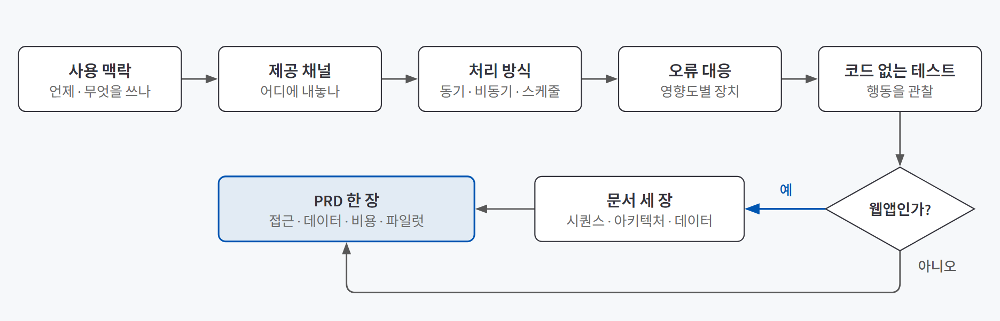
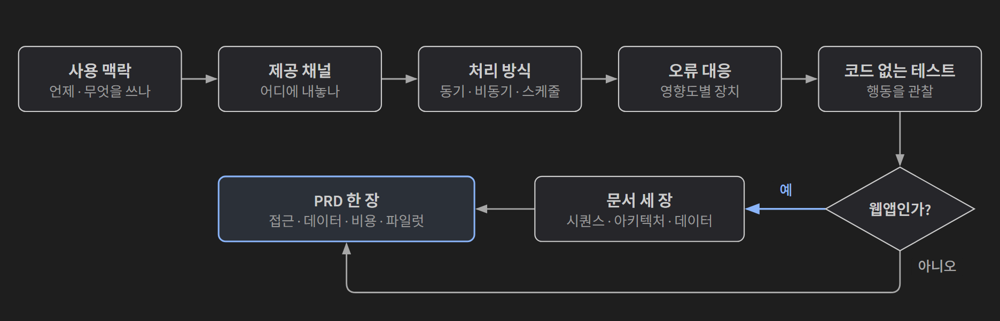
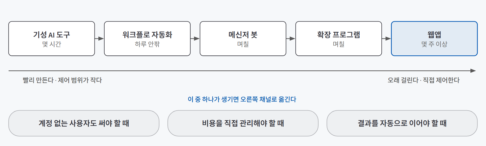
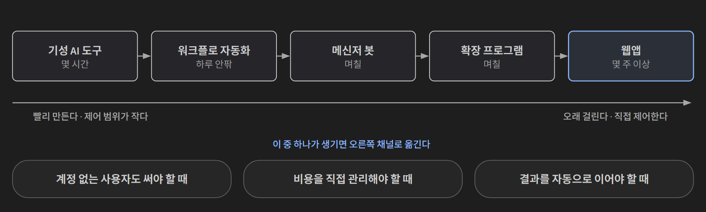

## 한 줄 요약

**AI 기능은 하루면 만들지만, 사람들이 계속 쓰게 만드는 건 따로 설계해야 한다.** 코드를 쓰기 전에 사용자가 언제 어떤 도구를 쓰고 있을 때 이 기능이 필요한지 보고, 그 맥락에 맞춰 **어디에 내놓을지(채널)·어떻게 돌려줄지(처리 방식)·틀렸을 때 어떻게 막을지(오류 대응)**를 정한다. 그다음 코드 없이 써 보게 해 가정을 확인하고, 결정을 PRD 한 장에 모은다.

식당 메뉴를 떠올리면 쉽다. 맛있는 요리를 개발했다고 끝이 아니다. 손님이 점심시간 30분 안에 먹고 가야 한다면 코스 요리가 아니라 한 그릇 메뉴로 내야 하고, 포장 손님이 많으면 포장 용기부터 정해야 한다. 요리가 같아도 **누가 언제 어디서 먹는지**가 내놓는 방식을 정한다.

## 필요한 이유

AI 기능을 만들고 주소를 공유하면 처음 며칠은 쓰인다. 그리고 사용률이 빠르게 떨어진다. 기능이 나빠서가 아니라 **사용자가 일하는 자리에서 떨어진 곳에 있기 때문**이다. 별도 주소로 들어가 로그인하고 붙여 넣어야 하는 기능은, 쓰던 도구 안에서 끝나는 기능을 이기기 어렵다.

여기에 AI만의 문제가 겹친다.

| 문제 | 설계하지 않으면 |
|---|---|
| **LLM 호출은 몇 초에서 몇 분이 걸린다** | 긴 작업을 화면에서 기다리게 하면 연결이 끊길 때 결과를 잃는다 |
| **LLM은 그럴듯한 오류를 낸다** | 원문에 없는 설명이나 틀린 정답이 그대로 사용자에게 간다 |
| **호출할 때마다 비용이 나간다** | 주소가 퍼지면 모르는 사람이 내 비용으로 호출하고, 멈출 방법이 없다 |
| **코딩 에이전트는 정하지 않은 칸을 가장 빠른 방법으로 채운다** | API 키가 브라우저 코드에 들어가고, 데이터가 서버 메모리에만 남는다 |

이 네 가지는 코드를 다 짠 뒤에 고치면 비싸다. 채널이 틀렸다는 걸 웹앱을 몇 주 만든 뒤에 알면 그 몇 주가 통째로 버려진다. 그래서 **만들기 전에 정하고, 만들기 전에 확인한다.**

무엇을 만들지 고르고 범위를 자르는 단계는 [AI에게 맡기기 전에](/posts/problem-selection-prd/)에서 다뤘다. 이 글은 그다음, **만들 기능이 정해진 뒤 그것을 사용자에게 어떻게 내놓을지**를 다룬다.

## 개념과 동작

### 설계 순서: 맥락에서 출발해 PRD로 모은다

{: .light }
{: .dark }

순서가 중요하다. 채널을 먼저 고르면 "웹앱으로 만들자"가 기본값이 된다. **사용 맥락을 먼저 보면 채널은 저절로 좁혀진다.** 웹앱을 고른 경우에만 구조 문서 세 장이 더 붙는다.

### 사용 맥락: 언제, 무엇을 쓰고 있을 때 필요한가

채널을 정하기 전에 다섯 칸을 채운다.

| 칸 | 묻는 것 |
|---|---|
| 대상 사용자 | 첫 버전에서 쓸 사람은 누구인가 |
| 필요한 시점 | 하루 중 언제 이 기능이 필요한가 |
| 쓰고 있는 기기와 도구 | 그때 노트북인가 휴대폰인가, 어떤 앱을 열어 두었나 |
| 결과를 받은 뒤의 다음 작업 | 결과로 무엇을 하는가 (저장, 공유, 수정) |
| 현재 방식 | 지금은 어떻게 하고 있고 얼마나 걸리나 |

확인하지 못한 칸은 "가정"이라고 적고 하나씩 줄인다. 근거를 모으는 방법은 둘이다.

- **인터뷰:** 기능을 설명하지 말고 "이 작업을 마지막으로 한 순간"을 묻는다. "이런 기능 있으면 쓰시겠어요?"는 대부분 "네"라서 근거가 안 된다.
- **데스크 리서치:** 비슷한 서비스의 별점 2~3점 리뷰와 커뮤니티 질문 글을 읽는다. 1점 리뷰는 결제·오류 불만이 많고, 2~3점에 구체적인 사용 맥락이 많다. 두 곳 이상에서 같은 내용이 나올 때만 "가정"을 "확인"으로 바꾼다.

예를 들어 강의 필기로 복습 노트와 퀴즈를 만드는 기능이라면, 노트는 강의 직후 노트북에서 만들고 퀴즈는 다음 날 아침 휴대폰에서 푼다. 그러면 결과는 **휴대폰에서 다시 열리는 곳**에 남아야 하고, 대화가 금방 밀려 올라가는 단체 대화방은 맞지 않는다는 결론이 맥락에서 나온다.

### 다섯 가지 제공 채널

같은 AI 기능도 내놓는 형태가 다섯 가지다. 왼쪽일수록 빨리 만들고, 오른쪽일수록 직접 제어할 수 있는 범위와 개발 부담이 커진다.

{: .light }
{: .dark }

| 채널 | 예 | 맞는 경우 | 개발 기간 |
|---|---|---|---|
| 기성 AI 도구 | Claude 프로젝트, GPTs | 사용자가 소수이고 모두 같은 AI 도구 계정을 쓸 때 | 몇 시간 |
| 워크플로 자동화 | 메일·시트에 파일이 들어오면 요약해 보내기 | 같은 작업을 정해진 조건이나 일정에 반복할 때 | 하루 안팎 |
| 메신저 봇 | 슬랙 앱, 팀즈 봇 | 사용자가 그 메신저를 이미 업무 도구로 쓸 때 | 며칠 |
| 확장 프로그램 | 브라우저 확장, 플러그인 | 쓰던 화면 안에서 바로 끝나야 할 때 | 며칠 |
| 웹앱 | 자체 서비스 | 외부 사용자 대상이고 화면·데이터·과금을 직접 정해야 할 때 | 몇 주 이상 |

같은 복습 기능이라도 혼자 쓰면 기성 AI 도구 하나로 충분하고, 다섯 명 스터디라면 매일 정해진 시각에 퀴즈를 올리는 메신저 봇이 맞다. 외부 학습자에게 공개하면 인증·보존 기간·과금이 필요해져 웹앱이 된다. **채널은 기능이 아니라 사용자가 정한다.**

처음에는 왼쪽에서 시작하고, 아래 셋 중 하나가 생기면 오른쪽으로 옮긴다.

- 도구 계정이 없는 사용자도 써야 한다
- 사용량과 비용을 직접 관리해야 한다
- 결과를 메신저나 사내 시스템에 자동으로 이어야 한다

### 처리 방식: 동기, 비동기, 스케줄 실행

LLM 호출이 걸리는 시간과 사용자가 결과를 원하는 시점에 맞춰 고른다.

| 방식 | 흐름 | 맞는 경우 | 나중에 구현하는 기술 |
|---|---|---|---|
| 동기 | 요청 → 몇 초 → 응답 | 수십 초 안에 끝나고 결과를 보고 바로 다음 일을 할 때 (대화, 짧은 글 수정) | 요청 시간 제한, 스트리밍 |
| 비동기 | 요청 → 접수 응답 … 워커가 처리 → 알림 | 몇 분 이상 걸리거나 사용자가 화면을 떠나도 될 때 (긴 녹음 요약, 문서 여러 개 분석) | 작업 큐와 워커 |
| 스케줄 실행 | 정한 시각에 배치 → 메일·메신저 | 요청하지 않아도 같은 결과가 주기적으로 필요할 때 (아침 뉴스 요약) | 크론 같은 스케줄러 |

처리 방식을 정할 때 **출력 형식**도 같이 정한다. "요약해 줘"만 하면 매번 길이와 순서가 달라진다. 사용자의 다음 작업에 맞춰 항목·순서·길이·값이 없을 때의 표기를 정하고, 이 형식은 그대로 시스템 프롬프트와 응답 스키마가 된다. 형식을 약속하는 방법은 [시스템 프롬프트와 구조화 출력](/posts/system-prompt-structured-output/)에서 다뤘다.

### 오류 대응 장치 다섯 가지

LLM의 오류는 없앨 수 없다. 대신 오류가 **사용자에게 그대로 전달되지 않게** 내놓는 방식 안에 장치를 둔다.

| 장치 | 하는 일 | 사용자에게 보이는 모습 |
|---|---|---|
| **출처 표시** | 결과마다 근거가 된 원문 위치를 함께 보여 줘 바로 검증하게 한다 | "정의: … (필기 12번째 줄)" |
| **사람 승인** | 여러 사람에게 나가는 결과는 사람이 승인한 뒤 내보낸다 | [올리기] [수정] 버튼 |
| **폴백 응답** | 근거가 없으면 생성하지 않고 정해 둔 응답을 돌려준다 | "필기에 정의가 없어요. 강의 자료를 확인해 주세요" |
| **에스컬레이션** | 틀리면 손해가 큰 내용은 결론 내지 않고 사람에게 넘긴다 | [담당자에게 질문 남기기] |
| **피드백과 되돌리기** | 사용자가 평가하고 되돌릴 수 있게 하고, 평가는 운영자가 모은다 | 👍👎, [이전 버전으로] |

장치가 늘수록 사용자가 확인할 단계도 는다. 그래서 생길 수 있는 오류를 세 가지쯤 적고 영향도(낮음·중간·높음)를 매긴 뒤, **영향도가 클수록 많이** 넣는다. 혼자 보는 복습 노트는 출처 표시 하나로 충분하고, 여럿이 보는 퀴즈에는 사람 승인을 더한다. 사람 승인을 어디에 둘지는 [HITL](/posts/hitl-theory/)에서 따로 정리했다.

문구도 실제 나갈 문장으로 쓴다. "오류가 발생했습니다"보다 "담당자를 녹음에서 찾지 못했어요. 직접 입력해 주세요"처럼 **다음에 할 일**이 보여야 한다.

### 코드 없는 사용성 테스트

여기까지 정한 채널·형식·오류 대응은 모두 가정이다. 코드를 쓰기 전에 확인하는 방법이 둘 있다.

| 방법 | 하는 일 | 확인하는 것 |
|---|---|---|
| **오즈의 마법사 테스트** | 시스템이 할 일을 사람이 뒤에서 대신한다. 메신저 봇이라면 진행자가 봇인 척 답하고, 웹앱이라면 종이·피그마 화면을 순서대로 보여 준다 | 채널과 흐름 |
| **기성 AI 도구 프로토타입** | 시스템 프롬프트·출력 형식·오류 대응 규칙을 AI 도구 프로젝트에 넣고 써 보게 한다 | 실제 응답 품질까지 |

진행자는 상황만 알려 주고 사용법은 설명하지 않는다. 기록은 **말보다 행동**을 본다. 설명 없이 처음 한 행동, 멈추거나 질문한 지점, 결과를 받은 직후 공유했는지·고쳤는지·무시했는지가 핵심이다. "좋네요"라고 하면서 결과 절반을 지우고 다시 쓰는 사람도 있다. 고쳐서 공유했다면 고친 부분이 출력 형식이나 오류 대응으로 돌아갈 항목이다.

복습 기능의 예로 보면, 참여자가 퀴즈와 함께 나온 정답을 먼저 봐 버리고 "내일 어디서 다시 찾아요?"라고 물을 수 있다. 그러면 정답은 요청할 때만 주도록 바꾸고, 결과가 묻히는 대화방 대신 기록이 남는 곳으로 채널을 바꾼다. **채널이 틀렸다는 걸 며칠 개발한 뒤가 아니라 15분 만에 안다.**

### 웹앱을 골랐다면: 문서 세 장

웹앱은 클라이언트·백엔드·저장소·LLM 호출을 직접 설계해야 한다. 정하지 않은 칸은 코딩 에이전트가 **가장 빨리 동작하는 방법**으로 채운다.

| 요청에 없던 항목 | 에이전트가 고르기 쉬운 방법 | 나중에 드러나는 문제 |
|---|---|---|
| API 키 위치 | 클라이언트 코드에 직접 적기 | 브라우저 개발자 도구로 키가 보인다 |
| 데이터 저장소 | 서버 메모리, 브라우저 저장소 | 재시작·기기 변경 때 데이터가 사라진다 |
| 데이터 소유자 | 정하지 않음 | 남의 데이터를 조회·수정할 수 있다 |
| 외부 API 실패 처리 | 처리하지 않음 | LLM이 늦거나 실패하면 화면이 멈추거나 빈 값이 저장된다 |
| 모듈 분리 | 한 파일에 전부 | 기능 하나를 고치다 다른 기능이 깨진다 |

이 다섯 칸을 문서 세 장으로 미리 채운다.

| 문서 | 그리는 것 | 드러나는 것 |
|---|---|---|
| **시퀀스 다이어그램** | 사용자 동작 하나가 처리되는 동안의 호출을 시간 순서로. 조건 분기는 `alt` 상자 | 타임아웃, 폴백, 중복 호출 비용, 오래 걸리는 작업 |
| **아키텍처 다이어그램** | 구성 요소와 호출 관계. 백엔드는 책임 하나에 모듈 하나, 비동기 부분은 점선 | **시크릿 위치**. LLM 키와 스토리지 키는 백엔드에만 있어야 한다 |
| **데이터 모델** | 엔티티마다 생성 시점·**소유자**·저장소·**보존 기간**. 저장하지 않는 것도 "저장 안 함"으로 적는다 | 소유자 칸은 인가(내 것인지 검사)로, 보존 기간 칸은 개인정보 처리와 저장 비용으로 이어진다 |

그리는 순서는 **시퀀스부터**다. 거기 나온 구성 요소로 아키텍처를 그리고, 저장소로 가는 화살표로 데이터 모델을 채운 뒤 위 다섯 칸을 점검한다. 시퀀스는 Mermaid 같은 도구로 텍스트로 그리면 코딩 에이전트 요청에 그대로 붙일 수 있다.

### PRD 한 장: 접근 제어, 데이터 처리, 비용, 파일럿

마지막으로 결정을 한 문서에 모은다. 채널·처리 방식·오류 대응에 더해 세 가지를 정한다.

| 항목 | 정할 것 | 안 정하면 |
|---|---|---|
| 접근 제어 | 공개 / 링크 공유 / 회원 인증 / 사내 계정 | 주소가 퍼져 모르는 사람이 내 비용으로 호출한다 |
| 데이터 처리 | LLM 제공사로 보내는 데이터, 저장하는 데이터, 보존 기간 | 남의 자료나 개인정보가 동의 없이 외부로 나간다 |
| 비용 | 부담 주체(회사 키, 사용자 키), 사용자별·월별 한도 | 사용량이 늘수록 비용이 늘고 멈출 방법이 없다 |

셋은 서로 묶여 있다. 공개로 열면 비용 한도가 필수이고, 개인정보가 들어가면 회원 인증과 소유자 기준 인가가 따라온다.

여기에 **파일럿**을 적는다. 이름을 댈 수 있는 몇 명, 기간, 숫자로 된 성공 지표다. "4명, 1주, 복습 노트 정리 시간 30분에서 5분 이내"처럼 적어야 끝났을 때 성공인지 판정할 수 있다. 피드백 채널과 장애가 났을 때 대응할 사람도 적는다. 혼자 만들면 둘 다 나다.

이 PRD의 각 칸은 이후에 배우는 운영 기술로 하나씩 구현된다.

| PRD 요구사항 | 웹앱에서 구현하는 기술 |
|---|---|
| 접근 제어 | 공개 설정, 인증과 인가 |
| 처리 방식 | 요청 시간 제한, 스트리밍, 작업 큐와 워커 |
| 비용 한도 | 인스턴스 수 제한, LLM 사용 한도, 사용자 API 키 |
| 데이터 처리 범위와 보존 기간 | 시크릿 관리, 데이터베이스, 환경 분리 |
| 파일럿 범위 | 트래픽 분할, 롤백 |
| 성공 지표와 피드백 | 로깅, 모니터링, LLM 평가 |
| AI 오류 대응 | 가드레일, 오류 처리, 에스컬레이션 |

## 적합한 경우와 피할 경우

| 이 설계 순서가 맞는 경우 | 줄여도 되는 경우 |
|---|---|
| 나 말고 **다른 사람이 계속 쓸** 기능 | 나 혼자 한두 번 쓰고 말 도구 |
| 사용자의 기기·시점이 나와 다를 수 있을 때 | 사용 맥락이 내 작업 환경과 똑같을 때 |
| 결과가 여러 사람에게 나가거나 틀리면 손해가 클 때 | 틀려도 다시 하면 되는 개인용 초안 |
| 웹앱으로 갈 가능성이 있어 비용·데이터·인증을 정해야 할 때 | 첫 버전이 기성 AI 도구로 끝나는 경우 (구조 문서 세 장은 비워 둔다) |
| 회사에 AI 기능을 제안해야 할 때 | 승인 절차 없이 바로 써 볼 수 있는 실험 |

혼자 쓰는 도구라도 사용 맥락과 오류 대응 두 칸은 채워 두는 게 낫다. 일주일 뒤의 나도 다른 맥락의 사용자이기 때문이다.

## 장점과 한계

| 장점 | 한계 |
|---|---|
| 채널이 틀렸다는 걸 개발 전에 15분 테스트로 안다 | 테스트 참여자가 적어 일반화하기 어렵다. 두 사람에게서 같은 문제가 나올 때만 바꾼다 |
| 기성 AI 도구로 먼저 확인하면 사용자가 정말 쓰는지 알기 전에 몇 주를 쓰지 않는다 | 기성 AI 도구는 모든 사용자에게 계정이 필요하고, 화면·저장·접근 범위를 그 도구가 정한다 |
| 오류 대응 장치를 영향도에 맞춰 고르면 확인 단계가 과하지 않다 | 장치가 많아질수록 편의성은 떨어진다 |
| 코딩 에이전트가 키 위치·저장소·소유자를 멋대로 채우지 못한다 | 구현하지 않은 설계라서 만들다 보면 없던 엔티티가 생기고 처리 방식이 바뀐다 |
| PRD 한 장이 이후 운영 기술의 요구사항 목록이 된다 | 문서는 갱신하지 않으면 금방 실제와 어긋난다. 바뀐 항목은 문서에 먼저 반영한다 |

## 적용 방법

### 1단계. 다섯 칸으로 맥락을 적고, 가정을 표시한다

대상 사용자·필요한 시점·쓰는 기기와 도구·다음 작업·현재 방식을 채운다. 인터뷰에서는 의견이 아니라 **최근에 실제로 한 행동**을 묻고, 확인하지 못한 칸은 "가정"으로 남긴다.

### 2단계. 채널은 두 개 고른다

첫 버전 채널과 나중에 옮겨 갈 채널을 함께 정한다. 후보는 네 가지로 비교한다.

| 비교 기준 | 묻는 것 |
|---|---|
| 이미 쓰는 도구 안에서 끝나는가 | 새 주소로 들어가야 하면 사용률이 떨어진다 |
| 사용자에게 새로 필요한 것 | 계정, 설치, 유료 요금제 |
| 직접 제어할 수 없는 것 | 화면, 저장 위치, 접근 범위 |
| 첫 사용까지 걸리는 시간 | 개발 기간 + 사용자가 처음 결과를 받기까지 |

전환 조건(계정 없는 사용자, 비용 관리, 자동 연동)을 PRD에 적어 두면 언제 옮길지가 분명해진다.

### 3단계. 처리 방식과 출력 형식을 함께 정한다

걸리는 시간과 결과를 원하는 시점으로 동기·비동기·스케줄을 고르고, 출력의 항목·순서·길이·빈 값 표기를 정한다. 몇 분 걸리는 작업을 동기로 두지 않는다.

### 4단계. 오류 세 개에 영향도를 매기고 장치를 고른다

| 영향도 | 넣는 장치 |
|---|---|
| 낮음 | 폴백 응답 또는 출처 표시 하나 |
| 중간 | 출처 표시 + 폴백 응답, 필요하면 피드백 |
| 높음 | 위에 더해 사람 승인 또는 에스컬레이션 |

사용자에게 보이는 문구는 실제 나갈 문장으로 적고, 다음에 할 일이 보이게 한다.

### 5단계. 코드 없이 확인하고, 웹앱이면 문서 세 장을 그린 뒤 PRD로 묶는다

오즈의 마법사나 기성 AI 도구 프로토타입으로 행동을 관찰한다. 웹앱으로 가면 시퀀스 → 아키텍처 → 데이터 모델 순서로 그리고, 코딩 에이전트에게는 **설계를 대신 정하지 말고 빠진 항목만 질문으로** 달라고 해 빈칸을 찾는다. 마지막으로 접근 제어·데이터·비용·파일럿을 채워 PRD 한 장으로 묶는다.

## 다른 방법과 비교

| 방법 | 드는 비용 | 한 줄 평가 |
|---|---|---|
| 바로 웹앱부터 만들기 | 큼 | 사용자가 정말 쓰는지 알기 전에 몇 주를 쓴다. 채널이 틀리면 통째로 버린다 |
| 기능만 만들고 주소 공유 | 작음 | 처음 며칠만 쓰인다. 쓰던 도구 밖에 있는 기능은 잊힌다 |
| 설문으로 수요 확인 | 작음 | "쓰시겠어요?"에는 대부분 "네"라고 답해 근거가 약하다 |
| **맥락 → 채널 → 처리 → 오류 대응 → 코드 없는 테스트 → PRD** | 보통 | 하루 안에 가정을 확인하고, 웹앱으로 갈 때 필요한 요구사항이 한 장에 모인다 |

## 주의할 점

**주소만 공유하고 끝내지 않는다.** 사용자가 이미 쓰는 도구 안에서 끝나는 채널을 먼저 찾는다. 새 유료 계정이나 설치가 필요한 채널은 첫 버전으로 맞지 않는 경우가 많다.

**긴 작업을 동기로 만들지 않는다.** 몇 분 걸리는 LLM 작업을 화면에서 기다리게 하면 연결이 끊길 때 결과를 잃는다.

그 밖에 기억할 것:
- **오류 대응 장치를 다 넣지 않는다.** 영향도에 맞춰 고르지 않으면 사용자가 확인할 단계만 는다.
- **LLM을 부르는 버튼은 요청 중에 막는다.** 누를 때마다 비용이 나간다.
- **보존 기간을 정한다.** 정하지 않으면 탈퇴한 사용자의 자료가 저장소에 계속 남고 비용도 계속 나간다.
- **소유자가 둘인 데이터를 따로 본다.** 거래 내역처럼 두 사람의 것인 데이터는 한 사람의 삭제 요청만으로 지우면 안 될 수 있다.
- **프로토타입 테스트에 남의 이름이나 연락처가 든 자료를 넣지 않는다.** 테스트 단계에서도 그 자료는 LLM 제공사로 나간다.

## 용어 정리

| 용어 | 뜻 |
|---|---|
| 사용 맥락 | 사용자가 이 기능이 필요한 시점에 쓰고 있는 기기·도구와, 결과를 받은 뒤 하는 일 |
| 제공 채널 | AI 기능을 사용자에게 내놓는 형태 (기성 AI 도구, 워크플로 자동화, 메신저 봇, 확장 프로그램, 웹앱) |
| 전환 조건 | 지금 채널에서 더 제어 범위가 큰 채널로 옮겨야 하는 조건 |
| 비동기 처리 | 요청을 접수만 하고 바로 응답한 뒤, 따로 처리해 끝나면 알리는 방식 |
| 폴백 응답 | 근거가 없거나 실패했을 때 생성 대신 돌려주는 미리 정한 응답 |
| 에스컬레이션 | 틀리면 손해가 큰 판단을 AI가 결론 내지 않고 사람에게 넘기는 것 |
| 오즈의 마법사 테스트 | 아직 만들지 않은 시스템의 역할을 사람이 뒤에서 대신하며 흐름을 확인하는 사용성 테스트 |
| 시퀀스 다이어그램 | 사용자 동작 하나가 처리되는 동안 구성 요소 사이의 호출을 시간 순서로 그린 그림 |
| 데이터 모델 | 저장하는 데이터마다 생성 시점·소유자·저장소·보존 기간을 정리한 표 |
| 인가 | 요청한 사람이 그 데이터에 접근할 권한이 있는지(내 것인지) 검사하는 것 |
| 파일럿 | 정한 소수의 사용자와 기간으로 먼저 운영해 보고 숫자로 된 지표로 판정하는 시범 운영 |
