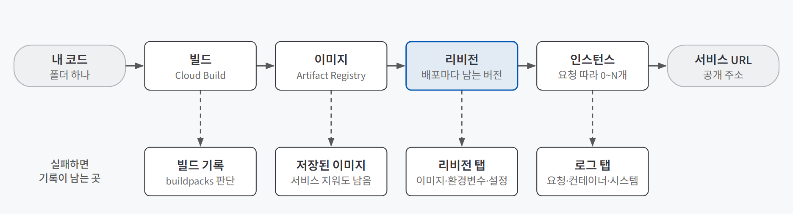
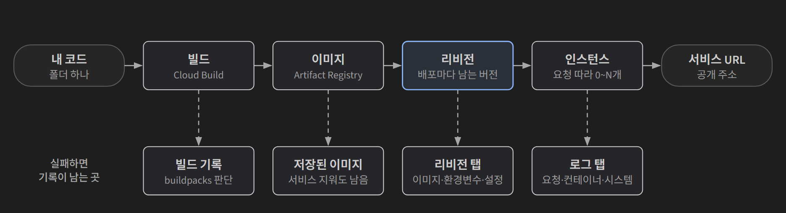
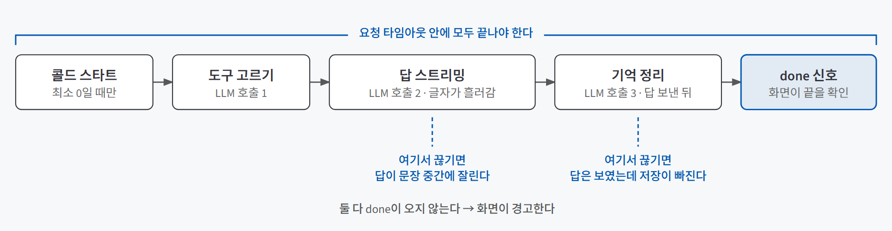
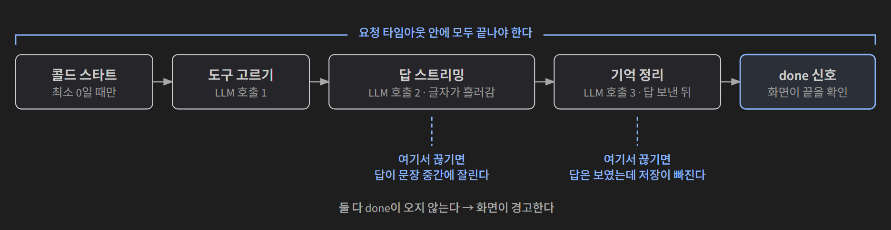

## 한 줄 요약

**Cloud Run은 내 코드와 실행 환경을 컨테이너 이미지 하나로 받아, 요청이 올 때만 서버를 켜서 실행하고 공개 주소를 붙여 주는 서비스다.** 이런 방식을 서버리스 컨테이너라고 부른다. 배포는 명령 하나로 끝나지만, 그다음부터가 운영이다. AI 서비스는 답이 느리고, 부를 때마다 돈이 들고, 걸리는 시간도 매번 다르다. 그래서 **요청 타임아웃, 인스턴스 수, 동시성, 데이터 저장 위치**를 AI 서비스에 맞게 정해 두고, 문제가 생기면 **로그**에서 원인을 찾는다.

공유 주방을 떠올리면 쉽다. 주방이 준비해 둔 재료로만 요리하는 곳(Vercel 같은 플랫폼)은 빠르지만, 없는 재료가 필요하면 방법이 없다. Cloud Run은 내 재료와 도구를 상자째 들고 가면, 주방이 손님이 올 때만 불을 켜고 손님이 몰리면 화구를 늘려 주는 곳이다. 상자에 빠진 게 있으면 그건 내 책임이고, 불을 몇 개까지 켤지, 요리 하나에 몇 분까지 줄지는 내가 정한다.

## 필요한 이유

LLM을 내 컴퓨터에서 돌리지 않고 API로 쓰기로 했다면([LLM 실행 위치 정하기](/posts/cloud-api-vs-local-llm/)), 그 API를 대신 불러 줄 서버가 어딘가에 있어야 한다. 내 컴퓨터에서 잘 돌던 서비스를 바깥에 올리면, 로컬에서는 안 보이던 세 가지 성질이 드러난다.

| AI 서비스의 성질 | 로컬에서는 | 배포하면 |
|---|---|---|
| **답이 느리다** | 기다리면 된다 | 플랫폼이 정한 시간이 지나면 요청이 끊긴다. 여러 문서를 읽고 정리하는 작업은 5분을 넘기기 쉽다 |
| **부를 때마다 돈이 든다** | 나 혼자 부른다 | 주소만 알면 누구나 부를 수 있고, 그때마다 내 LLM 비용이 나간다 |
| **걸리는 시간이 매번 다르다** | 느린 날도 그냥 넘어간다 | 느린 날에만 잘리는 답이 생긴다. 겉보기엔 정상이라 알아채기 어렵다 |

여기에 하나가 더 붙는다. 클라우드의 서버는 **언제든 새로 뜨고 사라진다.** 로컬에서는 서버 메모리에 대화 기록을 두어도 문제가 없지만, 배포하면 설정 하나만 바꿔 다시 올려도 메모리가 비워진다. 배포는 "올리기"보다 "계속 잘 돌게 하기"가 더 큰 일이다.

## 개념과 동작

### 배포 명령 하나가 만드는 다섯 가지

{: .light }
{: .dark }

소스 폴더를 넘기는 배포 명령 하나 뒤에서 다섯 단계가 차례로 일어난다.

| 단계 | 하는 일 | 맡는 곳 |
|---|---|---|
| **빌드** | 폴더를 보고 Python 앱임을 알아내 Python과 라이브러리를 설치해 이미지로 묶는다. 무엇을 설치할지 자동으로 정하는 도구가 **buildpacks**다 | Cloud Build |
| **이미지** | 빌드 결과물을 보관한다 | Artifact Registry |
| **리비전** | 배포할 때마다 남는 버전. 어떤 이미지와 환경변수, 요청 타임아웃, 인스턴스 수를 쓸지 기록된다 | Cloud Run 서비스 |
| **인스턴스** | 리비전으로 지금 실행되며 요청을 처리하는 컨테이너 | Cloud Run |
| **서비스 URL** | 마지막에 공개 주소가 붙는다 | Cloud Run |

이 구분이 쓸모 있는 순간은 배포가 실패했을 때다. 단계마다 기록이 남는 곳이 달라서, **어느 단계에서 막혔는지부터** 가를 수 있다. buildpacks는 파일 이름과 위치를 보고 판단하므로 의존성 목록, 시작 명령, Python 버전 파일 중 하나만 틀려도 빌드가 실패하거나 앱이 시작하지 않는다. 앱은 Cloud Run이 넣어 주는 포트 번호(환경변수 `PORT`, 기본 8080)를 열어 놓고 기다려야 요청을 받는다.

### 인스턴스는 요청을 따라 늘고 준다

| 규칙 | 뜻 |
|---|---|
| **스케일 투 제로** | 요청이 없으면 인스턴스가 0개가 된다. 실행 요금도 0이다 |
| **콜드 스타트** | 0개일 때 온 첫 요청은 인스턴스가 켜질 때까지 기다린다 |
| **동시성** | 인스턴스 하나가 동시에 처리하는 요청 수. 기본값은 80이다 |
| **자동 확장** | 동시성을 넘치면 인스턴스가 늘어난다. 따로 정하지 않으면 100개까지 늘 수 있다 |

AI 서비스에서 이 규칙이 특별한 이유는, 요청 하나가 **LLM 답을 기다리는 동안 CPU를 거의 쓰지 않는다**는 점이다. 서버는 놀고 있는데 요청은 오래 붙잡혀 있다. 그래서 동시성과 타임아웃을 일반 웹 서비스와 다르게 봐야 한다.

### AI 서비스 요청 하나의 시간

{: .light }
{: .dark }

대화형 에이전트라면 메시지 하나에 LLM을 여러 번 부른다. 도구 고르기, 답하기, 답을 보낸 뒤 기억 정리하기. 답은 조금씩 흘려보내는 **스트리밍**으로 보낸다. **요청 타임아웃**(요청 하나를 붙잡고 있을 수 있는 최대 시간, Cloud Run 기본 300초)은 이 전부를 덮어야 한다.

타임아웃이 짧으면 두 가지 일이 생긴다.

- **답이 문장 중간에 잘린다.** "내일 서울은 맑다가"에서 끊기면 뒤에 오던 "오후엔 비"가 사라져 맑은 날로 읽힌다.
- **답은 다 보였는데 저장이 빠진다.** 사용자는 정상으로 보지만, 다음 대화에서 방금 한 말을 기억하지 못한다.

둘 다 **겉보기엔 정상**이라는 게 문제다. 그래서 서버는 모든 일이 끝났을 때 "끝" 신호(`done`)를 보내고, 화면은 그 신호가 안 오면 "응답이 끝까지 오지 않았어요"라고 알린다. 잘림을 사람 눈 대신 신호로 잡는 장치다.

스트리밍은 전체 시간을 줄이지 않는다. 첫 글자가 바로 보여서 체감 속도만 빠르다. 한꺼번에 보내기는 구현이 쉽지만 사용자가 빈 화면을 오래 본다.

### 서버는 언제든 사라진다

새로 배포하면 새 인스턴스가 뜨고, 안 쓰면 인스턴스가 꺼진다. 그때 메모리에 있던 건 전부 사라진다. 인스턴스가 2개 이상이면 같은 사람의 요청이 다른 인스턴스로 가서 기억이 갈라진다. 남아 있어야 하는 데이터(대화 기록, 사용자 정보)는 **서버 밖 데이터베이스**에 둔다. 저장소를 같은 함수 이름으로 감싸 두면 메모리 저장(연습용)과 외부 DB(실서비스)를 설정값 하나로 바꿔 끼울 수 있다.

### 로그 세 종류: 터미널은 결과, 로그는 원인

| 로그 | 누가 남기나 | 무엇이 있나 |
|---|---|---|
| **요청 로그** | Cloud Run이 요청마다 자동으로 | 상태 코드, 걸린 시간 |
| **컨테이너 로그** | 내 앱이 직접 출력 | 앱의 판단과 오류. JSON에 `severity`를 넣으면 오류·경고로 분류된다 |
| **시스템 로그** | Cloud Run이 인스턴스를 켜고 끌 때 | 시작·종료 |

빌드 로그는 여기 없고 Cloud Build에 따로 있다. 로그 한 줄에서는 시각, 심각도, **리비전**(어느 배포 버전인지), 메시지를 먼저 본다.

가장 자주 쓰는 원칙은 **"터미널 메시지는 결과, 원인은 그보다 앞선 컨테이너 로그에 있다"**다. 필수 API 키 없이 배포하면 터미널에는 "컨테이너가 포트 8080에서 시작하지 못했다"가 뜬다. 실제로는 앱이 시작하자마자 키가 없다는 오류를 남기고 스스로 종료해서, 포트를 열 프로그램이 없어진 것이다. 포트 문제는 결과일 뿐이다. 터미널만 보고 코딩 에이전트에게 고쳐 달라고 하면 멀쩡한 포트 설정을 고치자고 할 수 있다.

### 리비전은 되돌릴 지점이다

다시 배포하면 새 리비전이 트래픽 100%를 받고, 이전 리비전은 지워지지 않고 0%로 남는다. 서비스 주소는 그대로다. 그래서 새 버전에 문제가 생기면 코드를 고쳐 다시 빌드하지 않고 **트래픽을 이전 리비전으로 돌리는 것만으로 몇 초 만에 롤백**된다. 배포가 실패한 리비전은 애초에 트래픽을 받지 않으므로, 실패해도 이전 버전이 계속 응답한다.

## 적합한 경우와 피할 경우

| 맞는 경우 | 맞지 않는 경우 |
|---|---|
| LLM을 오래 기다리는 백엔드. 플랫폼 함수의 짧은 제한 시간(무료 플랜 5분 등)을 넘길 수 있는 작업 | 화면만 있거나 짧은 함수뿐인 서비스. 플랫폼에 올리면 버튼 하나로 끝난다 |
| 플랫폼이 준비해 두지 않은 시스템 패키지가 필요한 서비스 | 요청과 상관없이 계속 돌아야 하는 작업. 요청이 없으면 인스턴스가 0이 되는 구조와 맞지 않는다 |
| 사용자가 드물거나 몰렸다 빠지는 서비스. 안 쓸 때 요금이 거의 없다 | 서버 메모리에 상태를 두고 그대로 쓰고 싶은 서비스. 배포·확장 때마다 사라진다 |
| 이미지·리비전·인스턴스·권한·로그를 직접 보고 다뤄야 하는 경우 | 배포 과정을 전혀 신경 쓰고 싶지 않은 경우 |

Cloud Run 요청 타임아웃은 기본 5분이고 최대 60분까지 늘릴 수 있다(2026년 10월 기준). 화면은 다른 플랫폼에 두고 백엔드만 컨테이너로 올리는 구성도 흔하다.

## 장점과 한계

| 장점 | 한계 |
|---|---|
| 명령 하나로 빌드부터 주소까지 끝나고, 단계마다 기록이 남아 하나씩 확인할 수 있다 | 런타임과 의존성을 내가 정하므로, 이미지에 빠진 게 있으면 원인도 내가 찾아야 한다 |
| 요청이 없으면 0개로 줄어 안 쓸 때 실행 요금이 없다 | 최소 0이면 한동안 안 쓰다 부를 때 첫 답이 몇 초 늦다(콜드 스타트) |
| 리비전이 남아 롤백이 빌드 없이 몇 초면 된다 | 트래픽을 특정 리비전에 고정해 두면 다음 배포가 반영되지 않는다 |
| 타임아웃을 길게 잡을 수 있어 느린 AI 작업에 맞는다 | 타임아웃을 짧게 잡으면 잘린 답이 정상처럼 보인다 |
| 이미지·리비전·서비스 계정 같은 개념이 다른 클라우드에도 거의 같은 이름으로 있다 | 최대 인스턴스 수는 비용 상한이 아니다. 시간이 지나며 쌓이는 호출 수는 막지 못한다 |

마지막 줄은 오해가 잦다. 최대 인스턴스는 "한 번에 처리하는 양"만 막는다. LLM 비용 총액은 LLM 제공사 쪽 사용 한도로 막아야 한다. 비용 상한을 거는 방법은 [공개 주소를 열기 전에 막을 세 구멍 — 비용 상한·키 관리·프롬프트 인젝션](/posts/cost-keys-prompt-injection/)에 따로 정리했다.

## 적용 방법

### 1단계. 빈 앱을 먼저 올린다

처음부터 AI 서비스를 올리지 않는다. 화면 한 장과 **헬스 체크 주소**(`/health`, 살아 있는지만 알려 주는 주소)만 있는 앱을 먼저 올린다. 이게 올라가면 계정·프로젝트·권한·빌드 설정은 맞다는 뜻이라, 다음 실패는 **내 코드 문제**로 좁힐 수 있다.

### 2단계. 필수 값이 없으면 시작하지 않게 만든다

API 키나 LLM 제공사 같은 필수 값이 없으면 앱이 오류 로그를 남기고 스스로 종료하게 한다. 그러면 키 없는 버전은 **배포 단계에서 실패**하고, 트래픽은 이전 리비전에 그대로 남는다. 사용자에게 오류를 내는 서비스가 열리기 전에 막히는 것이다. API 키는 일반 환경변수가 아니라 Secret Manager 같은 비밀 저장소에 두고, 서비스 설정에는 이름만 남긴다.

### 3단계. 걸리는 시간을 재고 타임아웃을 정한다

| 순서 | 할 일 |
|---|---|
| 재기 | 실제 요청의 지연 시간 분포에서 중간값(p50)과 느린 쪽(p99)을 읽는다 |
| 정하기 | 가장 느린 값보다 넉넉하게. LLM이 느린 날을 생각해 여유를 둔다 |
| 포함하기 | 답을 보낸 뒤의 뒤처리(기억 정리, 저장)까지 시간에 넣는다 |
| 확인하기 | 서버는 끝 신호를 보내고, 화면은 신호가 없으면 경고한다 |

뒤처리가 길다면 큐나 백그라운드 작업으로 빼서 요청을 짧게 만드는 방법도 있다. 대신 구조가 복잡해진다.

### 4단계. 인스턴스와 동시성을 정한다

| 설정 | 사용자가 적은 서비스 | 고려할 점 |
|---|---|---|
| 최소 인스턴스 | 0 | 1이면 콜드 스타트가 없지만 요금이 계속 나간다. 사용자가 꾸준할 때 고른다 |
| 최대 인스턴스 | 2 정도 | 몰리는 요청을 제한한다. 비용 상한은 아니다 |
| 동시성 | 기본값에서 시작해 측정 | LLM을 기다리는 일이 대부분이면 높게, 요청 하나가 CPU를 많이 쓰면 낮게 |

최대 인스턴스가 작고 동시성도 낮으면 넘친 요청은 기다리거나 거절된다(429 응답). 동시성은 부하 테스트로 비교해서 정하되, **LLM을 부르지 않는 테스트용 주소**(정해진 시간만큼 기다렸다 응답하는 주소)로 잰다. LLM을 부르는 서비스에 부하를 걸면 테스트하는 동안 비용이 나간다.

콜드 스타트 자체를 줄이려면 최소 인스턴스를 올리기 전에 이미지 크기와 앱 시작 시 하는 일부터 줄여 본다.

### 5단계. 실행 전에 명령을 분류한다

명령을 직접 치든 코딩 에이전트가 제안하든, 그 명령이 **무엇을 만들고 바꾸고 지우고 공개하는지** 먼저 읽는다.

| 분류 | 예 | 이유 |
|---|---|---|
| 실행하지 않음 | 서비스 계정 키 파일 만들기, 프로젝트 전체 편집자 권한 주기, 프로젝트 삭제 | 유출·과한 권한·되돌릴 수 없음 |
| 확인 후 판단 | 인증 없는 호출 허용, 서비스 삭제, 권한 추가 | 요청마다 LLM 비용이 드는가? 대상 이름·리전이 맞는가? 역할이 좁은가? |
| 실행 | 설정 조회, 정해 둔 이름으로 배포, 설정 하나만 바꾸기 | 바꾸려던 것만 바꾸는가 |

권한 오류가 나면 오류 메시지에 나온 작업에 필요한 **역할 하나만** 준다(최소 권한 원칙). 에이전트는 "빨리 해결되는" 넓은 권한을 제안하기 쉽다. 같은 기준을 프로젝트 규칙 파일과 에이전트 권한 설정에 적어 두면 매번 사람이 읽지 않아도 걸러진다. 결제 정보, 로그인, 비밀 값 입력은 에이전트에게 맡기지 않고 사람이 직접 한다.

## 다른 방법과 비교

| 방법 | 런타임·의존성 | 한 줄 평가 |
|---|---|---|
| 로컬 실행 | 내 컴퓨터 그대로 | 가장 빠르게 확인할 수 있다. 배포 전에 먼저 돌려 두면 서버에서만 안 될 때 둘의 차이만 찾으면 된다 |
| Vercel 같은 플랫폼 함수 | 플랫폼이 준비 | 화면이나 짧은 함수는 버튼 하나로 끝난다. 과정이 보이지 않고 제한 시간이 짧다 |
| 화면은 플랫폼, 백엔드만 컨테이너 | 백엔드만 내가 정함 | 실무에서 흔한 구성이다. 화면이 백엔드가 돌려주는 페이지 한 장이면 컨테이너 하나로 묶는 편이 단순하다 |
| **Cloud Run** | 이미지로 내가 정함 | 긴 요청과 시스템 패키지를 감당하고, 안 쓸 때 0으로 준다 |
| AWS ECS Express Mode·Fargate, Azure Container Apps, Cloudflare Containers | 이미지로 내가 정함 | 같은 계열이다. 이미지·리비전·인스턴스·트래픽·서비스 계정·로그 개념이 거의 그대로 옮겨 간다 |

Cloud Run을 고르는 이유가 "더 나아서"일 필요는 없다. 배포의 부품을 하나씩 직접 만져 볼 수 있고, 그 개념이 다른 클라우드로 그대로 옮겨 간다는 점이 크다.

## 주의할 점

**잘린 답은 정상처럼 보인다.** 타임아웃에 걸린 응답은 오류 화면이 아니라 문장이 끊긴 답이나, 저장이 빠진 정상 답으로 나타난다. 끝 신호를 확인하는 장치가 없으면 아무도 모른다.

**설정만 바꿔 다시 배포해도 메모리는 비워진다.** 타임아웃 하나 바꿨을 뿐인데 방금까지 쓰던 데이터가 사라진다. 남겨야 할 데이터는 처음부터 서버 밖에 둔다.

그 밖에 기억할 것:
- **명령에는 프로젝트 이름이 아니라 ID가 들어간다.** ID는 만든 뒤 못 바꾼다.
- **콘솔에서 다른 프로젝트가 선택돼 있으면** 서비스 목록이 비어 보여 배포가 안 된 줄 착각한다.
- **포트를 숫자로 고정하지 않는다.** 플랫폼이 넣어 주는 포트 환경변수를 쓴다.
- **트래픽을 특정 리비전에 고정했다면** 확인 뒤 다시 최신 리비전으로 돌려놓는다.
- **요청 내용을 통째로 로그에 남기지 않는다.** 키나 개인정보가 로그를 볼 수 있는 모든 사람에게 노출된다.
- **코딩 에이전트에게 오류를 물을 때는** 증상, 시간 범위, 서비스·리비전, 찾은 로그 줄을 함께 주고 "로그를 근거로, 아직 고치지 말고"를 붙인다. 붙여넣기 전에 키가 섞여 있지 않은지 본다.
- **서비스를 지워도 이미지는 남는다.** 정리할 때는 이미지 패키지만 지우고, 다른 서비스 이미지가 들어 있는 저장소째 지우지 않는다.

## 용어 정리

| 용어 | 뜻 |
|---|---|
| 서버리스 컨테이너 | 코드·런타임·의존성을 이미지 하나로 받아 실행하고, 서버 수 조절은 플랫폼이 맡는 방식 |
| 컨테이너 이미지 | 앱과 실행에 필요한 모든 것을 묶은 실행 단위 |
| buildpacks | 폴더의 파일을 보고 무엇을 설치해 이미지로 묶을지 자동으로 정하는 도구 |
| 리비전 | 배포할 때마다 남는 버전. 이미지와 설정이 함께 기록되고, 트래픽을 받을 대상이 된다 |
| 인스턴스 | 리비전으로 지금 실행 중인 컨테이너 하나 |
| 스케일 투 제로 | 요청이 없으면 인스턴스를 0개로 줄이는 것 |
| 콜드 스타트 | 인스턴스가 0개일 때 첫 요청이 서버가 켜질 때까지 기다리는 지연 |
| 동시성 (concurrency) | 인스턴스 하나가 동시에 처리하는 요청 수 |
| 요청 타임아웃 | 요청 하나를 붙잡고 있을 수 있는 최대 시간 |
| 헬스 체크 엔드포인트 | 서비스가 살아 있는지만 알려 주는 주소 |
| 롤백 | 트래픽을 이전 리비전으로 돌려 실행 중인 버전을 되돌리는 것 |
| 컨테이너 로그 / 요청 로그 / 시스템 로그 | 앱이 남긴 줄 / 플랫폼이 요청마다 남긴 줄 / 인스턴스를 켜고 끌 때 남긴 줄 |
| p50 / p99 | 요청 시간을 줄 세웠을 때 가운데 값 / 느린 쪽 1% 경계 값 |
| 런타임 서비스 계정 | 서비스가 실행되는 동안 다른 클라우드 자원에 접근할 때 쓰는 계정 |
| 최소 권한 원칙 | 필요한 작업에 필요한 역할 하나만 주는 것 |

---

→ 이 개념을 검증한 프로젝트: [AI 친구 에이전트 배포 검증 — 테스트·이미지 승격·무중단 배포로 확인한 세 가지](/posts/friend-agent/)
