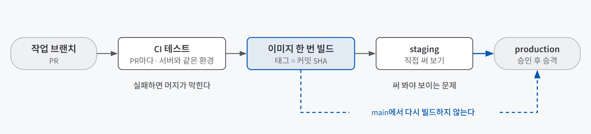
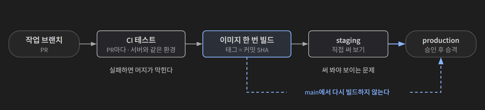
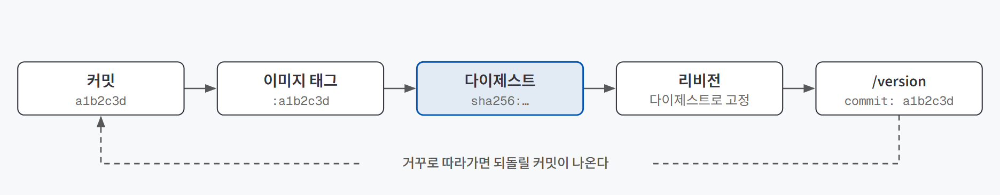
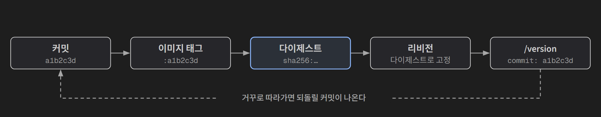

## 한 줄 요약

**배포를 누군가의 터미널이 아니라 저장소에 적힌 순서로 매번 똑같이 돌리고(CI/CD), 그 순서가 다루는 실행 환경까지 파일 한 장으로 고정하는(Docker) 방법이다.** 둘을 합치면 "테스트를 통과한 커밋으로 한 번 만든 이미지가, staging에서 확인한 그대로 production에 나간다"는 한 줄의 경로가 생긴다.

식품 공장과 같다. 레시피(Dockerfile)대로 밀키트(이미지)를 한 번 만들고, 검수대(CI)를 거쳐 시식 매장(staging)에 먼저 내놓는다. 문제가 없으면 **같은 상자를 그대로** 출고한다. 출고 직전에 다시 만들면 시식한 것과 파는 것이 달라질 수 있다.

## 필요한 이유

**손으로 배포할 때 생기는 문제는 대체로 세 가지로 모인다.**

| 문제 | 무슨 일이 생기나 |
|---|---|
| **기록이 사람에게 남는다** | 무엇이 언제 나갔는지가 명령을 친 사람의 터미널에만 남는다. 고치다 만 파일이 섞여 올라가도 모르고, 그 사람이 없으면 급한 수정도 못 낸다 |
| **환경이 사람마다 다르다** | 로컬에 직접 설치한 프로그램은 서버에 없다. 코드가 같아도 "로컬에선 되는데 서버에선 안 된다"가 생긴다 |
| **확인한 것과 내보낸 것이 다르다** | staging과 production에서 따로 빌드하면, 그사이 라이브러리 새 버전이 production 이미지에만 들어갈 수 있다 |

AI 서비스에서는 첫 번째가 더 아프다. 지시문 한 줄, 모델 이름, 도구 설명, 확신도 기준 같은 작은 변경으로 답이 달라지는데 화면만 봐서는 티가 나지 않는다. "언제 어떤 변경이 나갔나"를 커밋 단위로 남겨야 이상한 답이 나왔을 때 거슬러 올라갈 수 있다.

## 개념과 동작

### CI와 CD

| 말 | 뜻 |
|---|---|
| **CI** (지속적 통합) | 변경을 작게 나눠 자주 합치고, 합치기 전마다 같은 테스트를 자동으로 돌린다. PR 화면에 뜨는 결과를 **상태 체크**라고 한다 |
| **CD** (지속적 전달) | 언제든 배포할 수 있게 해 두고, 실제 배포는 사람이 버튼으로 정한다 |
| **CD** (지속적 배포) | main에 합쳐지는 즉시 나간다 |

GitHub Actions에서는 이 순서를 `.github/workflows/`의 YAML 파일 하나에 적는다. **트리거**(PR이 열림, main에 push, 실행 버튼)가 실행을 시작하고, **작업(job)** 안의 **단계(step)**가 차례로 돌다가 하나가 실패하면 거기서 멈춘다. 작업을 실행하는 컴퓨터인 **러너**는 실행마다 빈 상태로 준비되고 **커밋된 파일만** 받는다. 그래서 내 컴퓨터가 꺼져 있어도 배포되고, 로컬에만 있는 `.env`는 섞이지 않는다. 비밀 값은 워크플로 시크릿에 넣는다.

### 품질 게이트: 테스트 → staging → 승인

머지하면 바로 나가는 구조는 잘못된 코드도 머지하는 순간 사용자에게 보낸다. 그래서 기준을 통과해야 다음 단계로 넘어가는 자리(**품질 게이트**)를 세 곳에 둔다.

{: .light }
{: .dark }

| 게이트 | 잡는 문제 | 못 잡는 문제 |
|---|---|---|
| **CI 테스트** | 예시를 테스트로 옮겨 둔 동작이 깨진 변경 (위기 표현에 안전 응답이 빠짐, 약속 시각이 다른 시각으로 저장됨, 앱이 시작조차 안 됨) | 테스트가 보지 않는 것 (화면 모양, 말투) |
| **staging** | 테스트는 통과했지만 써 보면 이상한 변경 (버튼이 사라짐, 실제 LLM 답이 어색함) | 실제 사용자 규모에서만 드러나는 문제 |
| **배포 승인** | staging에서 확인한 것과 다른 커밋이 나가려는 경우, 지금 내보내면 안 되는 시점 | 승인자가 변경을 올린 본인이면 다른 사람의 검토는 아니다 |

세 환경(dev, staging, production)은 **코드는 같고 설정만 다르다.** 서비스 이름, 화면 배너를 켜는 `ENV` 값, LLM API 키와 사용 한도가 환경마다 다를 뿐이다. 코드에 `if staging:` 분기를 늘리지 않고 환경마다 값만 다르게 준다.

게이트에는 빈틈이 두 개 있다. 상태 체크가 빨간색이어도 **머지 버튼은 그대로 눌리고**, PR 없이 main에 바로 push하면 CI 자체를 건너뛴다. 이 둘은 **브랜치 보호**(PR로만 변경, 상태 체크 통과 필수, 관리자에게도 적용)로 막는다.

### LLM을 부르는 서비스의 테스트

CI 테스트에서 실제 LLM을 부르면 호출마다 돈이 들고, 느리고, 같은 질문에도 답이 달라 맞고 틀림을 정할 수 없다. 그래서 정해진 규칙으로만 답하는 **페이크 LLM**으로 바꿔 돌린다.

| 판정 방법 | 무엇을 확인하나 | 어디서 |
|---|---|---|
| 코드로 판정 | 코드가 정한 동작 (위기 표현이면 고정 안전 응답, 약속은 한국 시간으로 저장, 평범한 대화에는 도구를 쓰지 않음) | CI 자동 테스트 (페이크 LLM) |
| AI 판단 | 말투, 답의 내용 | 평가 데이터, staging에서 사람이 확인 |

말투와 내용을 재는 쪽은 [에이전트 품질 평가 설계](/posts/agent-evaluation/)의 영역이다. CI는 "같은 입력이면 같은 결과가 나와야 하는 것"만 맡는다.

### 이미지와 컨테이너, 그리고 Dockerfile

| 말 | 뜻 | Cloud Run에서는 |
|---|---|---|
| **이미지** | 운영체제 기본 파일, 프로그램, 라이브러리, 코드, 시작 명령까지 묶은 파일. 한 번 만들면 바뀌지 않는다 | 리비전 = 이미지 + 설정 |
| **컨테이너** | 그 이미지를 실행한 것. 컨테이너마다 메모리와 파일 변경을 따로 가진다 | 인스턴스 |

배포하면 대화 기록이 사라지는 것도 새 리비전이 새 컨테이너로 시작하기 때문이다. 이미지 안에 든 값은 **이미지를 받은 누구나 꺼내 볼 수 있으므로** 키는 넣지 않고 실행할 때 건넨다.

소스만 올리는 배포에서는 Cloud Run이 **buildpacks**(소스를 보고 이미지를 자동으로 만드는 도구)로 이미지를 만든다. `.python-version`과 `requirements.txt`는 읽지만, `apt`로 설치하는 **시스템 패키지**는 저장소 어디에도 적혀 있지 않아 설치하지 않는다. OCR 라이브러리처럼 운영체제 프로그램을 불러 쓰는 기능은 로컬에서만 동작한다. 서비스 시작은 정상이라 **배포는 성공으로 끝나고**, 그 기능을 부르는 순간에만 실패한다.

**Dockerfile**은 이 실행 환경을 처음부터 끝까지 적는 파일이다. 어떤 베이스 이미지에서 시작해, 무엇을 설치하고, 코드를 어디에 두고, 누구 권한으로 어떤 명령으로 실행할지 적는다. 줄 하나가 이미지의 **레이어** 하나가 되고, 내용이 안 바뀐 줄은 이전 레이어를 다시 쓴다. 그래서 오래 걸리는 설치는 위에, 자주 바뀌는 코드 복사는 아래에 둔다.

### 한 번 만들고 여러 곳에 배포하기

Dockerfile로 바꿔도 staging 머지 때 한 번, main 머지 때 또 한 번 빌드하면 확인한 이미지와 내보낸 이미지는 여전히 다르다. 그래서 이미지를 **GitHub Actions에서 한 번만** 만들고, staging에서 확인한 그 이미지를 다시 빌드하지 않고 production으로 보낸다(**승격**). 이때 이미지를 가리키는 방법을 구분해야 한다.

| 가리키는 방법 | 성질 | 언제 보나 |
|---|---|---|
| **태그** | 사람이 붙이는 이름. 옮겨 붙일 수 있어 어제의 `latest`와 오늘의 `latest`가 다를 수 있다 | 사람이 찾아갈 때. 커밋 SHA를 태그로 쓴다 |
| **다이제스트** | 이미지 내용으로 정해지는 `sha256:…` 값. 옮겨 붙일 수 없다 | 실제로 무엇이 도는지 확인할 때, 승격할 때 |

{: .light }
{: .dark }

Cloud Run은 태그로 배포해도 그 순간의 다이제스트로 바꿔 리비전에 기록한다. 앱이 `/version`으로 배포된 커밋을 돌려주게 해 두면 커밋, 이미지, 리비전, 실행 중인 앱이 한 줄로 이어져, 장애 때 세 질문에 몇 초 만에 답할 수 있다.

1. 지금 production에서 도는 코드는 어느 커밋인가
2. 바로 전에 정상이던 버전은 어느 이미지이고, 그 이미지로 되돌릴 수 있는가
3. 지금 production 이미지는 staging에서 확인한 그 이미지와 같은가

## 적합한 경우와 피할 경우

| 적합한 경우 | 피할 경우 (또는 아직 이른 경우) |
|---|---|
| 고치는 횟수가 늘거나, 고치는 사람이 둘 이상인 서비스 | 한 번 띄우고 끝낼 데모. 손 배포 한 번이 더 싸다 |
| 작은 설정 변경이 결과를 바꾸는 AI 서비스 | 테스트가 하나도 없는 상태. CI가 붙어도 버그 PR이 그대로 통과한다 |
| OCR·QR처럼 시스템 패키지가 필요한 기능 (Dockerfile) | 파이썬 라이브러리만 쓰는 앱. buildpacks 소스 배포로 충분하다 |
| staging에서 확인한 것을 그대로 내보내야 하는 서비스 (승격) | 환경이 하나뿐인 서비스. 승격할 곳이 없다 |

## 장점과 한계

| 장점 | 한계 |
|---|---|
| 누가 머지하든 같은 순서로, 커밋된 코드만 나가고 기록이 남는다 | 머지하면 바로 나가므로 게이트가 없으면 잘못된 코드도 바로 나간다 |
| 로컬·staging·production이 같은 실행 환경에서 돈다 | 이미지가 커진다(베이스 이미지와 시스템 패키지가 대부분). 베이스 이미지 보안 패치가 자동으로 들어오지 않는다 |
| 확인한 이미지와 내보낸 이미지가 다이제스트까지 같다 | 확인하는 사이 다른 변경이 staging에 머지되면 확인하지 않은 이미지가 승격된다 |
| 커밋 하나로 워크플로·클라우드·앱 기록이 이어진다 | 테스트가 보지 않는 문제(화면, 말투)는 모든 게이트를 통과할 수 있다 |

## 적용 방법

### 1단계. 배포를 워크플로 파일로 옮기고, 권한은 짧게 준다

main 머지를 트리거로 배포하는 워크플로를 만든다. 러너가 클라우드에 배포할 권한은 오래 남는 키 파일 대신 **Workload Identity Federation**(내 저장소에서 온 요청에만 배포할 때마다 짧은 토큰을 주는 방식)으로 받는다. 서비스 계정은 쓰이는 때가 다른 일끼리 나눈다. 요청을 처리하는 내내 쓰이는 **런타임** 계정은 필요한 시크릿 하나만 읽고, **빌드** 계정은 빌드에 필요한 역할만, 머지할 때마다 몇 분 쓰이는 **배포** 계정은 배포 역할과 위 두 계정을 지정할 권한만 갖는다.

### 2단계. 테스트를 먼저 넣고, CI는 그다음에 붙인다

테스트가 없는 CI는 버그 PR도 통과시킨다. 테스트를 만들 때는 세 가지를 지킨다.

- **실제 LLM을 부르지 않는다.** 페이크 LLM과 메모리 저장소로 돌린다.
- **코드 안쪽 형식보다 사용자가 보는 동작을 확인한다.** "저장된 시각에 시간대 정보가 붙어 있는가"는 시각이 틀려도 통과할 수 있다. "사용자가 보는 시각이 08:00인가"를 확인해야 같은 버그가 잡힌다.
- **버그를 일부러 넣어 테스트가 실패하는지 본다.** 코딩 에이전트에게 테스트를 맡겼다면 이 확인까지 함께 요청한다.

CI는 서버와 같은 환경에서 돈다는 점이 로컬 테스트와 다르다. 러너와 Cloud Run은 **UTC**로 돌기 때문에, 시간대를 뺀 시각은 한국 시간 로컬에서는 통과하고 CI에서만 9시간 어긋나 실패한다.

### 3단계. staging과 승인을 두고, 브랜치 보호로 우회로를 막는다

작업 브랜치 → staging으로 머지하면 staging에 자동 배포되고, staging → main으로 머지하면 production 배포가 **승인 대기**에서 멈추게 한다. staging 키는 production과 따로 두고 사용 한도를 낮게 잡는다. 같은 키면 staging 테스트 비용이 production 한도를 깎는다. 배포 승인은 사람이 누른다. 브랜치 보호는 CI가 한 번 돈 뒤에 건다. 상태 체크 목록에 테스트 이름이 있어야 필수로 고를 수 있다.

### 4단계. Dockerfile은 다섯 가지로 검토한다

에이전트가 쓴 파일이든 복사한 파일이든 같은 기준으로 본다. 에이전트는 버전 고정이나 root 실행 여부를 대신 판단해 주지 않는다.

| 확인할 것 | 이유 |
|---|---|
| 베이스 이미지와 언어 버전이 고정되어 있는가 (`latest`가 아닌가) | 빌드마다 다른 버전이 들어올 수 있다 |
| 필요한 시스템 패키지 설치 줄이 있는가 | 서버에 없던 것이다 |
| `.dockerignore`에 `.env`가 있는가 | 빠지면 코드 복사 줄이 키 파일을 이미지에 넣는다 |
| 시작 명령이 `PORT` 환경변수를 쓰는가 | Cloud Run은 정해 준 포트로 요청을 보낸다. 다르면 시작에 실패한다 |
| root가 아닌 사용자로 실행하는가 | 앱에 문제가 생겨도 컨테이너 안에서 할 수 있는 일이 줄어든다 |

파일만 읽어서는 확신할 수 없으니, 로컬에서 빌드한 이미지 안을 직접 들여다봐 `.env`가 없는지, 실행 사용자가 누구인지 확인한다.

### 5단계. 이미지는 Actions에서 한 번만 만들고, 다이제스트로 승격한다

이미지 태그에 커밋 SHA를 쓰고, staging에서 트래픽을 받는 리비전의 다이제스트를 읽어 production에 그대로 배포한다. 승격 주소는 `:커밋 SHA`가 아니라 `@sha256:`으로 끝나야 한다. 로컬에서 만든 이미지는 올리지 않는다. Apple Silicon Mac에서 만든 `arm64` 이미지는 `amd64`를 요구하는 Cloud Run에서 실패하고, 더 근본적으로는 커밋이 아니라 **내 폴더의 지금 파일**로 만들어져 PR·CI·staging·승인을 모두 건너뛴다. 코딩 에이전트가 로컬 빌드를 제안하지 않도록 규칙 파일에 적어 둔다.

배포마다 쌓이는 이미지는 정리 정책으로 지우되, "최근 몇 개는 남긴다"는 유지 정책을 함께 건다. 남길 개수는 **롤백 기준**으로 정하고, 걸기 전에 드라이런으로 무엇이 지워질지 먼저 본다.

## 다른 방법과 비교

| 방법 | 기록 | 환경 일치 | 한 줄 평가 |
|---|---|---|---|
| 손으로 배포 | 터미널에만 | 사람마다 다름 | 가장 빠르게 시작하지만 사람이 빠지면 멈춘다 |
| 소스 배포 + 자동 배포 (buildpacks) | 커밋 단위 | 파이썬 라이브러리까지만 | 파일 없이 배포된다. 시스템 패키지가 필요해지는 순간 한계가 온다 |
| Dockerfile + 환경마다 다시 빌드 | 커밋 단위 | 같은 레시피, 다른 이미지 | 단순하지만 두 환경이 "같은 Dockerfile로 만든 다른 이미지"를 실행한다 |
| **Dockerfile + 한 번 빌드 + 다이제스트 승격** | 커밋·이미지·리비전 연결 | 같은 이미지 | 단계가 하나 늘지만 확인한 것이 그대로 나간다 |

도구는 GitLab CI/CD, Jenkins, Cloud Build 같은 선택지도 있다. 문법은 달라도 "언제·어디서·어떤 단계"를 적는 구조는 같다.

## 주의할 점

- **배포 성공은 기능 성공이 아니다.** CI 통과도 "러너에서 통과"일 뿐이다. 배포 뒤에는 기능별로 확인한다.
- **에이전트는 권한 오류를 넓은 권한으로 풀려고 한다.** Owner나 Editor 같은 역할을 제안하는 경우가 많다. 오류 메시지에 나온 권한 이름을 보고 **그 역할 하나만, 그 자원 하나에만** 준다.
- **환경변수를 바꿀 때 덮어쓰기와 추가를 구분한다.** Cloud Run의 `--set-env-vars`는 기존 값을 지우고, `--update-env-vars`는 합친다.
- **이미지만 바꾸면 `/version`이 엉뚱한 커밋을 보여 준다.** 배포된 커밋을 담은 환경변수는 이미지와 따로 남는다. 승격할 때도, 되돌릴 때도 함께 바꾼다.

## 용어 정리

| 용어 | 뜻 |
|---|---|
| 상태 체크 | PR 화면에 표시되는 CI 결과. 브랜치 보호 없이는 머지를 막지 못한다 |
| 브랜치 보호 | PR로만 변경하고 상태 체크 통과를 필수로 만드는 저장소 설정 |
| 페이크 LLM | 정해진 규칙으로만 답하는 테스트용 구현. 비용 없이 매번 같은 결과를 낸다 |
| buildpacks | 소스 코드를 보고 이미지를 자동으로 만드는 도구. 시스템 패키지는 설치하지 않는다 |
| 레이어 캐시 | 내용이 안 바뀐 Dockerfile 줄의 결과를 다시 쓰는 것. 바뀐 줄부터 아래만 새로 빌드한다 |
| 다이제스트 | 이미지 내용으로 정해지는 `sha256:…` 값. 태그와 달리 옮겨 붙일 수 없다 |
| 승격 | staging에서 확인한 이미지를 다시 빌드하지 않고 production에 배포하는 것 |
| Workload Identity Federation | 키 파일 없이, 정해 둔 저장소에서 온 요청에만 짧은 토큰으로 클라우드 권한을 주는 방식 |

---

→ 이 개념을 검증한 프로젝트: [AI 친구 에이전트 배포 검증 — 테스트·이미지 승격·무중단 배포로 확인한 세 가지](/posts/friend-agent/)
