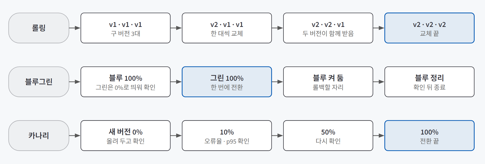
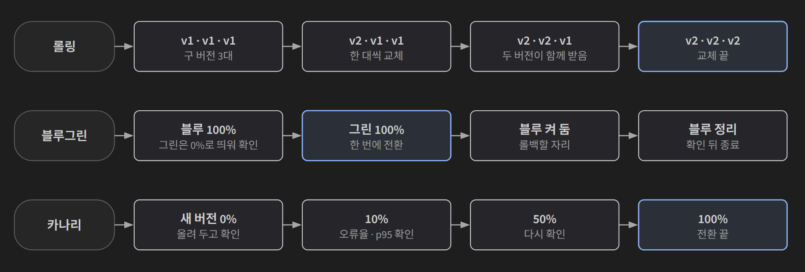
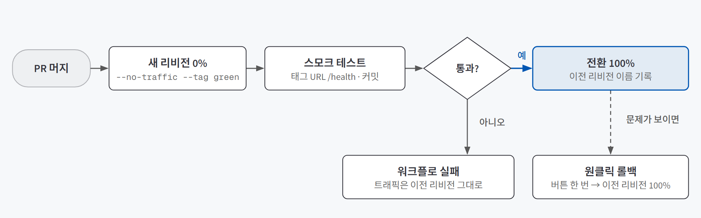
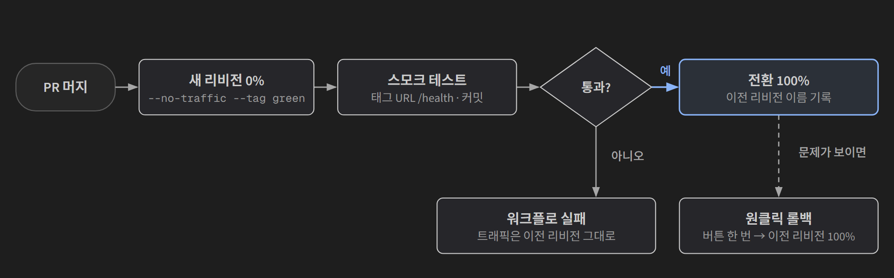

## 한 줄 요약

**이전 버전을 끄지 않은 채 새 버전을 띄우고, 요청을 새 버전으로 옮긴 다음에야 이전 버전을 끄는 배포 방식이다.** 사용자는 주소 하나만 알고, 그 앞에 선 로드밸런서가 요청을 어느 쪽으로 보낼지 정한다. 그래서 무중단 배포는 결국 **로드밸런서가 요청을 보내는 곳을 바꾸는 일**이고, 설계의 핵심은 바꾸는 방법보다 **"언제 바꿔도 되는가"와 "언제 되돌리는가"를 미리 정하는 것**이다.

다리 보수 공사와 같다. 다리를 막고 고치면 그동안 아무도 못 건넌다. 옆에 새 차선을 먼저 깔고 점검을 마친 뒤 차를 돌리고, 옛 차선은 한동안 남겨 둔다. 문제가 보이면 표지판 하나로 차를 다시 옛 차선으로 보낸다.

## 필요한 이유

**사용자에게는 업데이트로 멈추는 것도 고장으로 멈추는 것과 똑같다.** 배포가 하루 한 번이면 새벽에 잠깐 멈추는 걸로 버틸 수 있지만, PR을 머지할 때마다 자동 배포가 나가면 배포는 하루에도 여러 번 일어나는 평범한 사건이 된다.

서비스가 쓸 수 있던 시간의 비율(가용성)은 9의 개수로 말한다. 9가 하나 늘 때마다 멈춰도 되는 시간은 10분의 1로 줄어든다.

| 가용성 | 1년에 멈춰도 되는 시간 |
|---|---|
| 99% | 약 3.65일 |
| 99.9% | 약 8.8시간 |
| 99.99% | 약 53분 |
| 99.999% | 약 5분 |

배포 한 번에 몇십 초씩 멈추면 배포가 잦을수록 이 예산을 배포만으로 써 버린다.

더 까다로운 문제는 **"배포가 성공했다"와 "사용자가 오류를 보지 않았다"가 다른 말**이라는 점이다. 포트는 바로 열지만 준비에 30초가 걸리는 앱을 기본 설정으로 배포하면, 배포 명령은 성공으로 끝나는데 사용자는 30초 가까이 오류를 본다. 배포 도구가 정한 "준비됐다"의 기준이 사용자의 기준과 다르기 때문이다. 무중단 배포는 이 간격을 메우는 설계다.

## 개념과 동작

### 전제 두 가지: 이중화와 무상태

그것 하나만 고장 나도 전체가 멈추는 부분을 **단일 장애점**이라고 한다. 서버가 한 대뿐이면 그 서버가 단일 장애점이고, 배포는 그 서버를 일부러 바꾸는 일이라 반드시 멈춘다. 그래서 무중단 배포의 첫 전제는 **서버를 둘 이상 두는 이중화**다.

두 번째 전제는 **무상태 서버**다. 서버가 둘이 되면 같은 사용자의 요청이 매번 다른 서버로 갈 수 있다. 대화 기록을 서버 메모리에만 두면, 새 버전으로 전환하는 순간 방금 나눈 대화가 사라진 것처럼 보인다. 요청은 한 건도 실패하지 않았지만 **사용자 입장에서는 친구가 대화를 잊어버린 것**이다. 상태는 서버 밖 공용 저장소(DB)에 둔다.

| 상태를 두는 곳 | 전환하면 | 맞는 때 |
|---|---|---|
| 서버 메모리 | 대화가 사라진 것처럼 보인다 | 로컬 연습, 데모 |
| 세션 고정 (같은 사용자를 늘 같은 서버로) | 그 서버가 바뀌면 상태도 사라진다 | 급한 임시방편 |
| **서버 밖 DB** | 그대로 이어진다 | 서버가 둘 이상인 모든 서비스 |

### 로드밸런서: 어디로 보낼지, 고장을 어떻게 알아챌지

로드밸런서는 요청마다 뒤의 서버 하나를 고른다.

| 분배 규칙 | 보내는 방식 | 쓰는 때 |
|---|---|---|
| 라운드 로빈 | 순서대로 돌아가며 | 서버 성능이 비슷할 때 |
| 최소 연결 | 지금 처리 중인 요청이 가장 적은 서버로 | 요청마다 처리 시간이 크게 다를 때. 몇 초에서 수십 초 걸리는 LLM 응답이 그렇다 |
| 가중치 | 정해 둔 비율대로 (예: 90 대 10) | 카나리 배포 |
| IP 해시 | 같은 사용자는 늘 같은 서버로 | 서버가 상태를 가질 때. 무상태로 만들면 필요 없다 |

고장 난 서버를 빼는 방식은 두 가지다. **능동 헬스체크**는 로드밸런서가 `/health` 같은 주소로 주기적으로 먼저 물어보고, 답이 없으면 뺀다. **수동 헬스체크**는 실제 요청이 실패한 것을 보고서야 안다. 수동 방식에서는 **고장을 알아채는 비용을 실제 사용자 요청이 낸다.** 무료 Nginx가 수동 방식이고, 기본 연결 대기 시간이 60초라 뒤의 서버가 응답하지 않으면 그 차례가 된 요청들이 수십 초씩 멈춘다.

### 세 방식: 롤링·블루그린·카나리

{: .light }
{: .dark }

| 방식 | 하는 일 | 특징 |
|---|---|---|
| **롤링** | 서버를 한 대씩 돌아가며 새 버전으로 바꾼다 | 서버를 더 두지 않아도 된다. 바꾸는 동안 두 버전이 함께 요청을 받는다 |
| **블루그린** | 새 묶음(그린)을 다 올려 확인한 뒤 한 번에 방향을 바꾼다 | 가장 깔끔하고 롤백이 쉽다. 두 버전이 함께 도는 시간이 짧다. 서버가 두 배 필요하다 |
| **카나리** | 새 버전에 요청의 일부(10% 등)만 먼저 보내고, 지표가 괜찮으면 비율을 올린다 | 문제의 영향 범위가 작다. 리비전별로 볼 지표가 있어야 의미가 있다 |

블루그린의 핵심은 **전환한 뒤에도 블루를 끄지 않는다**는 점이다. 블루가 켜져 있는 동안 롤백은 방향을 되돌리는 설정 한 줄이라 몇 초면 끝난다. 전환 직후 블루를 바로 끄면 처리 중이던 요청이 끊기고 돌아갈 곳도 사라진다.

### 바꾸는 순간 지킬 세 가지

어느 방식이든 전환하는 순간에 세 가지를 지켜야 "배포 성공"이 "사용자가 오류를 보지 않음"과 가까워진다.

| 조건 | 하는 일 | 지키지 않으면 |
|---|---|---|
| **준비 확인** | 새 서버가 요청을 받을 준비가 됐다고 답할 때만 요청을 보낸다 | 켜지는 중인 서버로 요청이 가서 오류가 난다 |
| **그레이스풀 셧다운** | 이전 서버를 끌 때 처리 중이던 요청을 끝까지 마친 뒤 끈다 | 답을 보내던 도중에 연결이 끊긴다 |
| **DB 호환성** | 이전 버전과 새 버전이 같은 DB를 함께 써도 둘 다 동작하게 한다 | 새 버전이 테이블 구조를 바꾸면 전환 중에도, 롤백 뒤에도 이전 버전이 깨진다 |

가장 까다로운 건 DB 호환성이다. 서버는 여러 벌이어도 DB는 보통 하나라서, 새 버전이 열 이름을 바꾸면 롤백한 이전 버전이 그 열을 찾지 못한다. 롤백 버튼을 눌렀는데 오히려 목록이 안 열리는 일이 여기서 생긴다.

### 관리형 서비스에서는: 리비전과 트래픽 설정

Cloud Run 같은 관리형 서비스는 로드밸런서를 대신 운영한다. 배포할 때마다 이미지와 설정 한 벌인 **리비전**이 생기고, 어느 리비전에 요청의 몇 퍼센트를 보낼지가 **트래픽 설정**이다. Nginx에서 설정 줄을 바꾸고 다시 읽히던 일이, 여기서는 트래픽 설정을 바꾸는 명령 하나가 된다.

옵션 없이 배포하면 새 리비전이 준비되는 대로 100%를 받고, 이전 리비전에는 종료 신호를 보낸 뒤 10초 동안 처리 중이던 요청을 마치게 한다. 블루그린으로 가려면 새 리비전을 **트래픽 0%로 올리고 태그를 붙인다.** 태그가 붙은 리비전은 전용 주소(태그 URL)로만 열려서, 사용자에게 보내기 전에 나만 먼저 확인할 수 있다.

{: .light }
{: .dark }

이 흐름을 자동화하면 그림처럼 된다. 머지하면 새 리비전이 0%로 올라오고, 태그 URL에서 **스모크 테스트**(배포 직후 핵심 기능만 빠르게 확인하는 검사)를 통과해야 100%로 넘어간다. 통과하지 못하면 워크플로가 실패로 끝나고, 사용자는 아무 일 없었다는 듯 이전 리비전을 계속 쓴다.

## 적합한 경우와 피할 경우

| 쓰는 게 좋은 경우 | 굳이 안 해도 되는 경우 |
|---|---|
| 하루에 여러 번 자동 배포가 나가는 서비스 | 배포가 드물고, 정해 둔 점검 시간에 잠깐 멈춰도 되는 내부 도구 |
| 응답 하나가 수십 초 걸려서 중간에 끊기면 손해가 큰 서비스 (LLM 응답 등) | 요청이 몇 초 실패해도 사용자가 다시 누르면 그만인 실험용 서비스 |
| 상태를 이미 DB에 두고 있거나, 옮길 수 있는 서비스 | 상태를 서버 메모리에 둔 채로 옮길 계획이 없는 서비스. 요청은 안 끊겨도 데이터가 사라진다 |

방식은 서비스의 조건에 따라 고른다.

| 기준 | 이럴 때 | 맞는 방식 |
|---|---|---|
| 요청 수 | 하루 수십 건 정도라 일부만 보내면 숫자가 안 쌓인다 | 블루그린 |
| 문제가 드러나는 방식 | 특정 입력이나 일부 사용자에게서만 문제가 보인다 | 카나리 |
| 두 버전 동시 실행 | 새·이전 버전이 같은 테이블을 다르게 쓴다 | 블루그린 (함께 도는 시간이 짧다) |
| 허용되는 영향 | 결제처럼 일부 사용자라도 실패하면 안 된다 | 카나리 + 엄격한 롤백 기준 |
| 관측 도구 | 리비전별 오류율·지연 시간을 볼 도구가 없다 | 블루그린이나 기본 배포 |

사용자가 적을 때는 블루그린으로 시작하고, 요청이 늘어 일부만으로도 숫자가 쌓이면 카나리로 넘어가는 흐름이 흔하다.

## 장점과 한계

| 장점 | 한계 |
|---|---|
| 사용자가 업데이트를 알아채지 못한다 | 서버가 여러 대 필요하다. 블루그린은 두 배 |
| 롤백이 이미지를 다시 만드는 일이 아니라 방향을 바꾸는 일이라 몇 초면 끝난다 | DB는 보통 하나를 함께 쓰므로, 테이블 구조를 바꾸는 배포는 따로 설계해야 한다 |
| 문제 있는 버전은 전환 전에 멈춘다 | 스모크 테스트와 헬스체크는 "살아 있다"만 본다. 답변 품질이 나빠진 건 모른다 |
| 카나리는 문제가 생겨도 일부 사용자에게만 닿는다 | 카나리는 리비전별 지표와 미리 정한 기준이 없으면 그냥 느린 배포다 |

## 적용 방법

### 1단계. 상태를 서버 밖으로 먼저 뺀다

무중단 배포보다 먼저 할 일이다. 대화·로그인·작업 기록처럼 사용자가 다음 요청에서 다시 볼 것을 모두 DB로 옮긴다. 여러 버전이 같은 DB를 보게 되므로, 비밀 키(DB 전체를 읽는 키)는 서버에만 두고 브라우저에는 행 단위 접근 제한이 걸린 공개 키만 준다.

### 2단계. "준비됐다"의 기준을 앱이 정하게 한다

기본 준비 확인은 "포트가 열렸는가"만 본다. 모델 설정이나 문서 색인을 불러오느라 늦게 준비되는 AI 서비스라면, 앱이 준비를 마친 뒤에야 정상으로 답하는 `/health`를 준비 확인 주소로 바꾼다. 몇 초 간격으로 몇 번까지 기다릴지도 정한다. 배포는 그만큼 늦어지지만, 오류를 보여 주는 것보다 배포가 늦는 편이 낫다.

### 3단계. 롤백 기준을 배포 전에 숫자로 정한다

숫자가 나쁘게 나온 뒤에 기준을 정하면 "조금만 더 지켜보자"로 기울어, 새 버전을 겪는 사용자만 늘어난다.

| 신호 | 무엇을 보나 | 기준의 예 |
|---|---|---|
| 오류율 | 새 리비전 요청 중 5xx 비율 | 1%를 넘거나 이전의 두 배 이상 |
| 지연 시간 | p95 (요청 100개 중 95번째로 빠른 값) | 이전보다 1초 이상 늘어남 |
| 핵심 기능 | 로그인, 메시지 전송, 스모크 테스트 | 한 번이라도 실패 |
| 인스턴스 상태 | 시작 실패, 메모리 초과 재시작 | 이전에 없던 일이 생김 |
| 비용 | LLM 호출 수, 토큰 비용 | 새 버전 이후 갑자기 늘어남 |

신호가 애매하면 먼저 롤백하고 원인을 찾는다. 롤백도 재전환도 명령 하나라 되돌리는 비용이 작다.

### 4단계. 손으로 한 번 해 본 뒤 자동화한다

자동화는 손으로 하던 절차를 옮겨 적는 일이다. 0% 배포 → 태그 URL 확인 → 전환 → 롤백을 한 번 손으로 해 본 다음 워크플로로 옮긴다.

| 단계 | 워크플로가 할 일 |
|---|---|
| 0% 배포 | 새 리비전을 트래픽 없이 올리고 태그를 붙인다 |
| 스모크 테스트 | 원래 주소가 아니라 **태그 URL**로 `/health`와 배포된 커밋을 확인한다. 막 올라온 직후는 첫 요청이 늦을 수 있어 재시도 횟수와 간격을 정한다 |
| 전환 | 통과하면 100%. 전환 전에 지금 요청을 받던 리비전 이름을 로그에 남긴다 |
| 원클릭 롤백 | 버튼 하나로 이전 리비전에 100%를 돌려주는 워크플로를 따로 둔다 |

### 5단계. 숫자로 증명하고, 망가진 버전으로 시험한다

전환하는 동안 짧은 간격으로 요청을 보내는 스크립트를 켜 두고, 요약에 이전·새 리비전 응답이 모두 찍히면서 **실패가 0건**인지 본다. 이게 트래픽이 끊기지 않고 옮겨 간 증거다. 그다음 `/health`가 늘 실패하도록 고친 버전을 일부러 머지해서, 워크플로가 전환 전에 멈추고 서비스 주소가 계속 이전 버전으로 답하는지 확인한다. 막아야 할 상황을 한 번 일으켜 봐야 장치가 정말 막는지 안다.

## 다른 방법과 비교

| 방법 | 속도 | 사용자가 겪는 일 | 한 줄 평가 |
|---|---|---|---|
| 서버를 끄고 "점검 중" 화면 | 빠름 | 정해진 시간 동안 못 쓴다 | 가장 단순하다. 하루 여러 번 배포하는 서비스에는 못 쓴다 |
| DNS 주소 바꾸기 | 느림 | 한동안 옛 주소로 간다 | 사용자 컴퓨터가 옛 주소를 기억해서 바로 바뀌지 않는다 |
| 기본 배포 (준비되면 100%) | 빠름 | 준비 기준이 맞으면 거의 없다 | 작은 변경에는 충분하다. 준비 기준이 포트뿐이면 오류가 샌다 |
| Nginx로 직접 블루그린 | 보통 | 설계대로면 없다 | 설정·헬스체크·이전 서버 종료를 모두 내가 챙긴다. 원리를 익히기 좋다 |
| **관리형 서비스의 트래픽 설정** | 보통 | 설계대로면 없다 | 로드밸런서와 종료 신호는 맡기고, 준비 조건·비율·롤백 기준에 집중한다 |

## 주의할 점

- **롤백이나 카나리를 한 번 하면 트래픽이 특정 리비전에 고정된다.** 트래픽 설정에는 "가장 최근 리비전에 100%"와 "리비전 3에 100%" 두 모양이 있다. 롤백하면 뒤의 모양이 되어, 그다음 배포는 새 리비전을 만들기만 하고 트래픽은 옮기지 않는다. 워크플로는 초록색으로 끝나는데 사용자는 새 버전을 받지 못한다. 고정을 풀어 최신 리비전을 따라가게 하는 단계를 흐름 안에 넣는다.
- **롤백할 때는 준비 확인이 다시 돌지 않는다.** 되돌아갈 리비전이 지금도 정상인지, 바깥 의존성(DB 등)과 맞는지는 사람이 확인한다.
- **테이블 구조를 한 번에 바꾸지 않는다.** 새 열을 먼저 추가하고, 두 열을 함께 쓰는 버전을 배포하고, 이전 버전이 다 내려간 뒤에 옛 열을 지운다(확장-축소 패턴).
- **새 리비전이 받은 요청이 몇 건뿐이면 "실패 0건"은 증거가 못 된다.** 요청이 적은 환경에서는 카나리 비율을 나눠도 판단할 숫자가 안 쌓인다.

## 용어 정리

| 용어 | 뜻 |
|---|---|
| 단일 장애점 (SPOF) | 그것 하나만 고장 나도 전체가 멈추는 부분 |
| 무상태 서버 | 상태를 서버 밖에 두어, 어떤 요청이 와도 똑같이 처리하는 서버 |
| 능동 / 수동 헬스체크 | 로드밸런서가 먼저 물어보는 방식 / 실제 요청이 실패한 걸 보고 아는 방식 |
| 그레이스풀 셧다운 | 처리 중이던 요청을 끝까지 마친 뒤 서버를 끄는 것 |
| 태그 URL | 태그가 붙은 리비전 하나로만 요청을 보내는 전용 주소. 공개 서비스라면 누구나 열 수 있다 |
| 스모크 테스트 | 배포 직후 핵심 기능이 동작하는지 빠르게 확인하는 검사 |
| 트래픽 고정 | 트래픽이 특정 리비전에 묶여 새 배포가 요청을 받지 못하는 상태 |
| 확장-축소 패턴 | 테이블 구조 변경을 추가 → 병행 → 삭제의 여러 배포로 나누는 방법 |

---

→ 이 개념을 검증한 프로젝트: [AI 친구 에이전트 배포 검증 — 테스트·이미지 승격·무중단 배포로 확인한 세 가지](/posts/friend-agent/)
