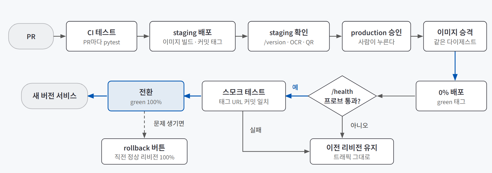
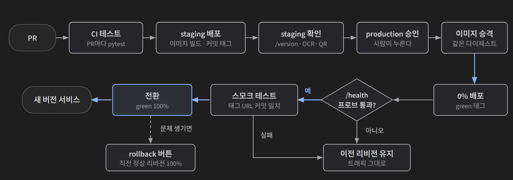

## 한 줄 소개

**배포 경로에 안전장치를 하나씩 붙이면 잘못된 변경이 사용자에게 닿기 전에 정말 멈추는지 확인하려고, AI 친구 에이전트를 Cloud Run에 올리고 8일 동안 PR 35개로 배포 경로를 쌓아 가며 검증했다.** AI 친구 에이전트는 사용자가 정한 캐릭터가 지난 대화를 기억하고, 필요하면 날씨·미세먼지·공휴일을 찾거나 약속을 저장해 두었다가 때가 되면 먼저 말을 거는 서비스다. 앱 본체는 과정에서 제공한 템플릿이고, 이 글에서 검증한 것은 그 앱을 **어떤 경로로 내보내는가**다.

저장소: [beginner-driver/friend-agent](https://github.com/beginner-driver/friend-agent)

> **검증한 것:** 테스트와 staging이 자동 배포의 구멍을 막는가 ✅ · 한 번 만든 이미지가 그대로 production에 나가는가 ✅ · 배포 중 끊김과 잘못된 버전을 막고 되돌릴 수 있는가 ✅(롤백 중 사용자 쪽 실패 수는 재지 않음)
>
> **발견한 것:** 시작조차 못 하는 변경보다 시작은 되는 틀린 변경이 더 위험했다 · 교안의 프로브 대기 시간으로는 느린 버전이 실패했다 · 테스트도 버그를 넣어 실패하는지 확인해야 믿을 수 있었다 · 파이썬 패키지만으로는 돌지 않는 기능이 있었다
{: .prompt-tip }

## 만든 이유

[내 컴퓨터 밖에서 계속 돌게 하기 — Cloud Run 배포와 운영 설정](/posts/cloud-run-deploy/), [머지하면 같은 순서로 나간다 — CI/CD와 Docker로 배포 경로 고정하기](/posts/cicd-docker/), [바꾸는 몇 초도 멈추지 않게 — 무중단 배포와 블루그린·카나리](/posts/zero-downtime-deploy/)를 배우고 나서 세 가지가 궁금했다.

1. main에 머지하면 바로 배포되는 자동 배포만으로는 무엇이 새어 나가고, **테스트와 staging**이 그 구멍을 실제로 막을까?
2. staging에서 확인한 **바로 그 이미지**가 production에 나가게 만들 수 있을까?
3. 새 버전으로 바꾸는 순간의 끊김과, 아예 뜨지 못하는 버전을 **배포 단계에서 걸러 내고**, 문제가 생기면 버튼 하나로 되돌릴 수 있을까?

실험 대상으로 AI 친구 에이전트가 맞았던 이유는 세 가지다.

| 배포 검증에 필요한 조건 | 이 서비스에서는 |
|---|---|
| 틀려도 시작은 되는 변경이 있을 수 있다 | 약속 시각처럼 시간대가 섞이면 서버에서만 틀리는 기능이 있다 |
| 실행 환경에 따라 기능이 달라진다 | 사진 글자 읽기(OCR)는 서버에 tesseract 프로그램이 있어야 돈다 |
| 시작이 느리다 | 부팅에 약 27초가 걸려, 준비가 덜 된 버전이 요청을 받으면 실패가 난다 |

## 실험 설계

### 배포 경로

{: .light }
{: .dark }

마지막 모습을 기준으로 한 흐름이다. 처음부터 이렇게 만든 게 아니라, 아래 순서로 한 단계씩 붙였다.

| 날짜 | 붙인 것 | PR |
|---|---|---|
| 10-22 | main 머지 시 Cloud Run 자동 배포, 화면에 배포된 커밋 번호 표시 | #3, #8 |
| 10-23 | 약속 시각 테스트(E07), PR마다 테스트를 돌리는 CI, staging·production 분리(production은 사람이 승인), 평범한 대화 테스트(E06) | #9, #10, #12, #19 |
| 10-26 | Dockerfile로 실행 환경 고정(tesseract·한국어 데이터), QR 코드 읽기 | #21, #23 |
| 10-27 | Actions에서 이미지를 만들어 저장, production은 staging 이미지를 승격 | #24, #26 |
| 10-29 | `/health` 스타트업 프로브, 0% 배포·스모크 테스트·전환, rollback 워크플로 | #30, #31, #32 |

### 사용 기술

| 기술 | 어디에 썼나 |
|---|---|
| **Cloud Run** | 컨테이너를 올리면 주소를 주고 요청량에 맞춰 늘고 주는 Google Cloud 실행 서비스. 배포할 때마다 **리비전**(그 시점 버전의 스냅숏)이 쌓이고, 리비전마다 트래픽 비율을 정할 수 있다 |
| **GitHub Actions** | PR과 머지에 맞춰 테스트·빌드·배포를 자동으로 돌리는 도구. 키 파일 대신 WIF(GitHub이 "이 저장소의 이 워크플로"임을 Google Cloud에 증명하는 방식)로 인증했다 |
| **pytest** | 파이썬 테스트 도구. 테스트에서는 실제 AI 대신 정해진 답을 내는 가짜 모델을 썼다 |
| **Docker** | 운영체제 패키지까지 포함한 실행 환경을 파일 한 장(Dockerfile)으로 고정했다 |
| **Artifact Registry** | 만든 이미지를 보관하는 저장소. 이미지마다 내용에서 계산한 고유 값(**다이제스트**)이 붙는다 |
| **FastAPI** | 앱의 화면과 API. `/health`(살아 있나)와 `/version`(어느 커밋·리비전인가) 주소를 배포 확인에 썼다 |

### 판단 기준

이번 검증은 실제 사고가 아니라 **일부러 넣은 고장**으로 안전장치를 시험했다. 과정에서 준 고장 난 변경 패치와, 직접 만든 시험용 변경을 썼다. 근거는 PR 본문, GitHub Actions 실행 기록, 커밋 메시지다.

| 질문 | 넣은 고장 | 막혔다고 보는 기준 |
|---|---|---|
| 1 | 시작하지 않는 변경 / 시작은 되지만 틀린 변경 / 화면이 깨지는 변경 | 사용자가 쓰는 production에 닿기 전에 멈춘다 |
| 2 | (고장 대신) 운영체제 패키지가 필요한 기능 | staging에서 확인한 이미지의 다이제스트가 production 배포에 그대로 쓰인다 |
| 3 | 시작이 30초 늦는 버전 / `/health`가 항상 실패하는 버전 | 배포 중 요청 실패 0건, 실패한 버전은 트래픽을 받지 않는다 |

배포 중 끊김은 `/version`에 0.2초마다 요청을 보내 2초 안에 답이 없으면 실패로 세는 스크립트로 쟀다.

## 검증 결과

| 질문 | 결과 | 근거 |
|---|---|---|
| 1. 테스트와 staging이 자동 배포의 구멍을 막는가 | ✅ 막음 | 자동 배포만 있을 때 틀린 변경이 production까지 갔다. CI를 붙인 뒤 고장 변경 PR 4건이 모두 머지 전에 실패했고, 테스트가 못 보는 화면 문제는 staging에서 걸렀다 |
| 2. 한 번 만든 이미지가 그대로 production에 나가는가 | ✅ 확인 | production 배포 기록의 이미지 다이제스트가 staging에서 확인한 리비전의 다이제스트와 같았다 |
| 3. 배포 중 끊김과 잘못된 버전을 막고 되돌릴 수 있는가 | ✅ 막음 | 배포 중 실패 70/293 → 0/369, 0% 배포 뒤 0/742·0/749. 뜨지 못하는 버전은 프로브에서 멈춰 전환되지 않았다. 롤백 버튼은 두 방향 모두 성공했다 |

### 질문 1. 테스트와 staging이 자동 배포의 구멍을 막는가

10-22에 main 머지 시 자동 배포를 붙이고, 고장 변경 두 개를 차례로 머지해 봤다.

| 변경 | 자동 배포 결과 | 사용자에게 |
|---|---|---|
| LLM 키 환경변수 이름 바꾸기 (#4) | 배포 단계 실패 | 새 리비전이 시작하지 못해 이전 리비전이 계속 응답했다 |
| 약속 시각에서 시간대 정보 떼기 (#6) | **배포 성공** | 새 리비전이 트래픽을 받았다. 틀린 변경이 그대로 나갔다 |

두 번째가 자동 배포의 구멍이다. 앱이 정상으로 뜨니 배포는 초록색으로 끝났고, 둘 다 되돌리는 PR(#5, #7)로 수습했다.

다음 날 테스트를 먼저 넣었다. "내일 아침 8시에 알려 줘"라고 하면 약속이 **한국 시간 08:00**으로 저장되는지 보는 E07 테스트(#9)를 넣고, PR마다 이 테스트를 돌리는 CI(#10)를 붙였다. 그다음 고장 변경을 다시 PR로 올렸다.

| 고장 변경 | 올린 PR | CI |
|---|---|---|
| 약속 시각에서 시간대 정보 떼기 | 2건 | 2건 모두 실패 |
| 위기 표현 판정을 "포함"에서 "정확히 같음"으로 | 1건 | 실패 |
| 날씨 키워드를 "날씨"에서 "날씨 알려"로 | 1건 | 실패 |

세 종류, PR 네 건이 모두 머지 전에 빨간색이 됐다. 시간대 변경은 내 컴퓨터(한국 시간)에서는 통과하고, 서버와 같은 UTC에서 도는 CI에서만 실패한다는 점이 중요했다.

테스트로 못 잡는 문제도 하나 넣어 봤다. 보내기 버튼에 `display:none`을 넣은 변경(#17)은 테스트가 화면 모양을 보지 않아 **CI를 통과**했다. staging(production과 같은 구성의 시험용 서비스)에 올라가자 버튼이 사라진 게 바로 보였고, production으로 보내지 않고 staging에서 되돌렸다(#18). production 배포는 GitHub 화면에서 사람이 승인해야 넘어가게 해 두었다.

정리하면 **테스트는 테스트가 확인하는 것만 막고, 화면처럼 테스트가 안 보는 것은 staging에서 사람이 봐야 걸린다.** 두 겹이 각자 다른 구멍을 막았다.

### 질문 2. 한 번 만든 이미지가 그대로 production에 나가는가

처음 구조에서는 staging 브랜치와 main 브랜치에서 **각각 빌드**했다. 그러면 staging에서 써 본 것과 production에 나간 것이 같은 결과물이라고 보장할 수 없다. 그래서 두 단계로 바꿨다.

먼저 실행 환경을 Dockerfile로 고정했다(#21). 사진 글자 읽기는 파이썬 패키지만으로는 안 되고 운영체제에 tesseract와 한국어 데이터가 있어야 한다. 로컬 컨테이너와 staging에서 글자 읽기 API가 200으로 답하는 것을 확인했고, Cloud Build 로그에서 베이스 이미지와 한국어 데이터 설치 줄도 확인했다(#22).

다음으로 이미지를 Actions에서 한 번만 만들게 했다(#24). staging 브랜치에서 이미지를 만들어 커밋 번호를 붙여 저장하고, main에 머지하면 **새로 빌드하지 않고** staging에서 트래픽을 받는 리비전의 이미지를 다이제스트로 찾아 그대로 production에 배포한다(#26).

```yaml
# main 에서는 이미지를 만들지 않고, staging 리비전의 다이제스트와 커밋을 찾아 쓴다
REV=$(gcloud run services describe "$STAGING_SERVICE" ... | jq -r '.status.traffic | max_by(.percent) | .revisionName')
echo "IMAGE=$(jq -r '.status.imageDigest' rev.json)" >> "$GITHUB_ENV"
```

10-27 승격 배포(#27)의 실행 기록을 보면 "staging 리비전 friend-agent-staging-00011-dqb 의 이미지를 승격한다"는 줄 다음에 production 배포가 `sha256:d0d2bb2c7393…` 이미지로 실행됐다. PR 본문에 적어 둔 staging 확인 대상 `00011-dqb(d0d2bb2c7393)`와 같은 다이제스트다. staging에서 `/version`, 글자 읽기, QR, 대화를 확인한 그 결과물이 production에 나간 것이다.

마지막으로 이 원칙을 코딩 에이전트 작업 규칙(AGENTS.md)에도 적었다(#28). "배포용 이미지는 Actions에서만 만든다. 로컬 환경에서 만든 이미지를 Artifact Registry에 올리거나 배포하지 않는다." 사람이든 에이전트든 다른 경로로 만든 이미지를 끼워 넣지 못하게 하려는 것이다.

### 질문 3. 배포 중 끊김과 잘못된 버전을 막고 되돌릴 수 있는가

Cloud Run의 기본 스타트업 프로브(새 리비전이 요청 받을 준비가 됐는지 보는 검사)는 **포트가 열렸는지만** 본다. 그래서 준비가 늦은 버전을 staging에 배포하면, 포트는 열렸지만 준비가 안 된 리비전이 트래픽을 받아 배포 직후 503을 냈다. 프로브를 `/health` 주소로 바꾸자 결과가 갈렸다(#30).

| 프로브 | 배포 중 요청 실패 |
|---|---|
| 기본(포트만 확인) | 70 / 293 |
| `/health` | 0 / 369 |

다음으로 새 버전을 **트래픽 0%로 먼저 올리고**, 그 리비전에만 닿는 태그 주소로 확인한 뒤 옮기게 했다(#31). 태그 주소의 `/version` 커밋이 이번 커밋과 같고 `/health`가 정상인지 5초 간격으로 최대 12번 보고, 끝까지 실패하면 워크플로가 멈춰 전환 단계가 실행되지 않는다. staging에서 두 번 배포하는 동안 실패는 0/742, 0/749였다.

이 장치가 실제로 멈추는지 보려고 `/health`가 항상 503을 돌려주는 시험 버전을 일부러 staging에 머지했다(#34). 실행 기록은 이렇다.

| 단계 | 결과 |
|---|---|
| 이미지 만들기 | 성공 |
| 배포 (0%) | **실패**: "설정된 스타트업 프로브 검사를 통과하지 못했다" (약 3분 기다린 뒤) |
| 스모크 테스트 | 건너뜀 |
| 전환 | 건너뜀 |

전환 단계가 돌지 않았으니 트래픽을 옮기는 명령도 실행되지 않았다. 바로 되돌리는 PR(#35)을 머지해 정상 배포로 돌아왔다.

마지막으로 production용 rollback 워크플로(#32)를 만들었다. Actions 화면의 버튼으로만 실행하고, 이미지를 만들지 않고 트래픽만 옮긴다. 리비전 입력을 비우면 지금 리비전보다 먼저 만들어진 정상 리비전 중 가장 최근 것으로 되돌린다. production에 적용한 뒤 두 번 눌러 봤다.

| 실행 | 워크플로 실행 시간 |
|---|---|
| 입력 비움: 직전 정상 리비전으로 되돌리기 | 약 1분 35초 |
| 리비전 지정: 새 버전으로 다시 옮기기 | 약 27초 |

## 직접 만들며 알게 된 것

### 시작조차 못 하는 변경이 오히려 안전했다

처음에는 앱이 아예 안 뜨는 변경이 가장 무서울 줄 알았다. 실제로는 반대였다. 키 이름을 바꿔 시작하지 못한 리비전은 Cloud Run이 트래픽을 주지 않아 이전 버전이 계속 응답했다. 위험했던 건 **정상으로 뜨지만 결과가 틀린 변경**이다. 배포 단계는 초록색으로 끝나고 사용자만 틀린 시각을 받는다. CI 테스트가 필요한 자리가 정확히 여기였다.

### 교안의 값을 그대로 쓰면 느린 버전이 실패했다

교안의 프로브 설정은 5초 간격으로 12번(최대 60초)이었다. 이 앱은 부팅에만 약 27초가 걸려서, 시작이 30초 늦는 시험 버전은 60초 안에 준비를 마치지 못해 배포가 실패했다. 실패 허용 횟수를 24번(최대 120초)으로 올렸다. 기다리는 시간은 **내 서비스의 부팅 시간을 재고** 정해야 했다.

### 테스트도 버그를 넣어서 실패하는지 봐야 믿을 수 있었다

"오늘 회사에서 힘들었어" 같은 평범한 대화에는 도구를 쓰지 않는다는 E06 테스트를 넣고(#19), 날씨 키워드에 "힘들"을 임시로 넣어 봤다. 이 테스트만 실패하는 것을 확인하고 나서야 테스트가 제 역할을 한다고 볼 수 있었다. 통과하는 테스트는 아무것도 확인하지 않는 테스트일 수도 있다.

### 파이썬 패키지만으로는 돌지 않는 기능이 있었다

QR 코드 읽기(#23)에 쓴 파이썬 패키지는 운영체제의 zbar 라이브러리를 부른다. 로컬 컨테이너에서 zbar 없이 돌리면 QR API가 500을 냈고, Dockerfile에 라이브러리 설치 한 줄을 넣자 200이 됐다. 글자 읽기의 tesseract와 같은 종류다. `requirements.txt`가 같아도 실행 환경이 다르면 기능이 달라진다는 게 Dockerfile을 쓰는 이유였다. Dockerfile로 빌드할 때는 Cloud Run의 자동 베이스 이미지 업데이트를 쓸 수 없어 배포 옵션도 하나 바꿔야 했다.

## 검증 범위와 한계

| 구분 | 내용 |
|---|---|
| **내가 만든 범위** | 앱 본체(대화·기억·도구)는 과정 템플릿이다. 직접 만든 것은 배포 경로(CI 연결, 환경 분리, 이미지 승격, 프로브, 0% 배포·스모크·전환, rollback), 테스트 2개(E06, E07), QR 읽기, 화면의 버전 표시다 |
| **고장의 종류** | 실제 사고가 아니라 일부러 넣은 고장 7가지로 시험했다. 이 밖의 실패(외부 API 장애, 데이터베이스 문제)는 다루지 않았다 |
| **측정 규모** | 배포 중 끊김은 staging에서 조건마다 한두 번씩 쟀다(293·369·742·749건) |
| **시험 버전 배포 중 끊김** | `/health`가 항상 실패하는 버전을 올리는 동안 요청 실패 수는 기록하지 않았다. 전환 단계가 건너뛰어진 것만 확인했다 |
| **롤백 시간** | 위 시간은 Actions 워크플로 실행 시간이다. 롤백하는 동안 사용자 쪽 요청이 실패했는지는 재지 않았다 |
| **승인** | production 승인자가 변경을 올린 나 자신이라 다른 사람의 검토는 아니다 |
| **카나리** | 트래픽을 10%·50%로 나눠 보내는 카나리 배포는 단계별 기준표만 두고 실제로 돌리지 않았다 |
| **production 기능 확인** | 글자 읽기·QR은 staging에서 확인했다. production에서는 QR을 꺼 둔 상태이고, 기능별 확인 기록은 따로 남기지 않았다 |

## 결론

세 질문 모두 기록으로 확인했다. 가장 크게 남은 건 1번이다. **배포가 초록색으로 끝났다는 것은 "앱이 떴다"는 뜻이지 "맞게 동작한다"는 뜻이 아니다.** 시작하지 못하는 변경은 Cloud Run이 알아서 막아 주지만, 뜨는데 틀린 변경은 테스트가 그 동작을 확인하고 있어야만 막힌다. 테스트가 보지 않는 화면은 staging에서 사람이 봐야 했다.

2번과 3번은 그 위에 "같은 것을 내보낸다"와 "확인한 뒤에 옮긴다"를 얹은 셈이다. staging에서 확인한 이미지가 다이제스트 그대로 production에 나가고, 새 버전은 트래픽 0%에서 `/health`와 커밋 번호를 통과해야 사용자에게 닿는다. 이 순서는 AI 친구 에이전트에만 해당하지 않는다. 컨테이너로 도는 AI 서비스라면 테스트 내용과 확인할 주소만 바꿔 같은 경로를 쓸 수 있다.
