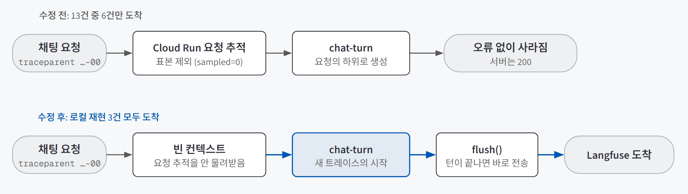
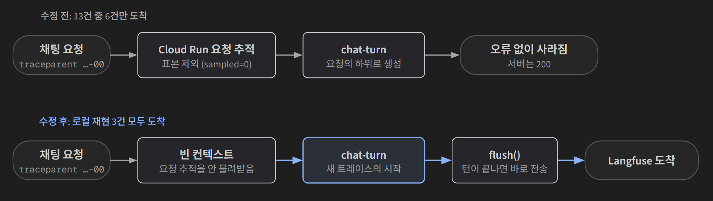

## 한 줄 소개

**"로그로는 안 보이는 문제를 트레이스로 찾는다"는 관측 이론이 서버리스 환경에서도 그대로 통하는지 확인하려고, 이미 Cloud Run에 올려 둔 AI 친구 에이전트에 Langfuse를 하루 동안 PR 5개로 붙여 검증했다.** 한 턴의 단계마다 기록을 남기고, 사용자 반응을 그 답의 기록에 점수로 붙여 staging에서 확인한 뒤 production에 반영했다. 앱 본체와 배포 경로는 [AI 친구 에이전트 배포 검증](/posts/friend-agent/)에서 다룬 그대로이고, 이 글에서 검증한 것은 그 위에 얹은 **관측**이다.

저장소: [beginner-driver/friend-agent](https://github.com/beginner-driver/friend-agent)

> **검증한 것:** 한 턴의 단계를 트레이스로 남기기 ✅ · Cloud Run에서 기록이 빠짐없이 도착하게 하기 ✅(수정 뒤 staging 확인 건수는 기록 없음) · 사용자 반응으로 먼저 읽을 트레이스 고르기 △(점수는 붙지만 실제 반응이 쌓이기 전)
>
> **발견한 것:** 교안의 처방(flush)을 먼저 넣었지만 원인은 다른 곳에 있었다 · 요청 추적과 대화 기록이 같은 표준 위에서 섞였다 · 같은 모델 호출이 두 번 기록돼 비용이 두 배로 보였다 · 관측을 켜면 대화 원문이 외부 서비스로 나간다
{: .prompt-tip }

## 만든 이유

[로그로는 안 보이는 문제 — Langfuse로 에이전트 관측하기](/posts/langfuse-observability/)를 배우고 나서 세 가지가 궁금했다.

1. 메시지 한 턴이 거치는 단계(안전 검사, 도구 선택, 도구 실행, 답 생성, 기억 갱신)를 **트레이스 한 그루**로 남기면, 실제로 어디서 무엇이 일어났는지 읽을 수 있을까?
2. 응답이 끝나면 CPU가 줄어드는 **Cloud Run**에서도 기록이 빠짐없이 도착할까?
3. 좋아요·별로예요·신고를 **그 답의 기록에 점수로** 붙이면, 먼저 읽어야 할 트레이스를 고를 수 있을까?

실험 대상으로 AI 친구 에이전트가 맞았던 이유는 세 가지다.

| 관측 검증에 필요한 조건 | 이 서비스에서는 |
|---|---|
| 요청은 성공(200)인데 답이 이상할 수 있다 | 도구를 잘못 고르거나 기억을 엉뚱하게 갱신해도 서버는 정상 응답한다 |
| 한 턴에 단계가 여럿이다 | 안전 검사 → 도구 선택 → 도구 실행 → 답 생성 → 기억 갱신 |
| 서버리스에서 돈다 | 이미 Cloud Run에 staging·production이 나뉘어 있어, 환경별로 기록을 나눠 볼 수 있다 |

## 실험 설계

### 기록이 사라진 경로와 고친 경로

{: .light }
{: .dark }

작업은 하루 동안 아래 순서로 진행했다. 모두 staging에 먼저 올려 확인한 뒤 마지막에 한 번에 production으로 옮겼다.

| 시각 | 붙인 것 | PR |
|---|---|---|
| 15:03 | 한 턴의 단계를 트레이스로 기록, 사용자·세션·환경·버전 속성, 개인정보 가리기 | #36 |
| 15:33 | 한 턴이 끝날 때 기록을 바로 보내기(`flush`) | #37 |
| 16:10 | 요청 추적 표본과 상관없이 대화 기록을 항상 남기기 | #38 |
| 16:32 | 좋아요·별로예요·신고를 그 답의 트레이스에 점수로 붙이기 | #39 |
| 16:45 | 위 네 건을 production에 반영 (staging → main) | #40 |

### 사용 기술

| 기술 | 어디에 썼나 |
|---|---|
| **Langfuse** | LLM 서비스의 실행 기록(트레이스)을 모아 보는 관측 도구. SDK 버전을 `5.1.0`으로 고정했다 |
| **OpenTelemetry** | 실행 기록을 남기고 보내는 공개 표준. Langfuse SDK가 이 위에서 동작하고, Cloud Run의 요청 추적도 같은 표준을 쓴다. 이 겹침이 질문 2의 원인이 됐다 |
| **Cloud Run** | 앱이 도는 Google Cloud 서비스. 요청마다 추적 헤더(`traceparent`)를 붙이고, 그중 일부만 표본으로 표시한다 |
| **FastAPI** | 채팅·먼저 말 걸기·반응 API를 받는 파이썬 웹 서버. 반응을 받는 `POST /api/feedback`를 새로 만들었다 |
| **pytest** | 파이썬 테스트 도구. 키가 없으면 계측이 꺼지는지, 끊긴 응답에서도 `flush`가 불리는지, 남의 메시지에 반응하면 거절되는지를 테스트로 남겼다 |

단계 이름과 계측할 자리는 교안이 제안한 구조를 따랐다. 서비스에 맞춘 속성 설계, 사라진 기록의 원인 추적, 반응 API의 권한 규칙은 직접 정했다.

### 한 턴을 무엇으로 나눴나

| 단계 | 종류 | 남기는 것 |
|---|---|---|
| `chat-turn` | 트레이스의 뿌리 | 사용자 메시지, 최종 답 |
| `safety` | 일반 단계 | 위기 표현 여부(모델을 부르지 않는 코드 규칙) |
| `choose-tools` | 모델 호출 | 고른 도구, 확신도, 규칙이 골랐는지 모델이 골랐는지 |
| `tool:<이름>` | 일반 단계 | 날씨·공휴일 같은 도구 실행 결과와 성공 여부 |
| `reply` | 모델 호출 | 모델 이름, 토큰, 비용, 첫 글자가 나온 시각 |
| `memory-update` · `memory-summary` | 일반 단계 · 모델 호출 | 기억을 어떻게 고쳤는지 |
| `greeting` | 별도 트레이스의 뿌리 | 약속 시각에 먼저 말을 거는 흐름 |

모든 단계에는 네 가지 속성을 붙였다.

| 속성 | 값 | 쓰는 곳 |
|---|---|---|
| `user_id` | 로그인 ID (이메일은 쓰지 않음) | 특정 사용자의 대화만 모아 보기 |
| `session_id` | 사용자 ID + 한국 날짜 | 하루치 대화를 한 묶음으로 보기 |
| `environment` | staging / production | 두 환경의 기록을 섞지 않기 |
| `version` | Cloud Run 리비전 이름 | 배포 전후를 나눠 비교하기 |

### 판단 기준

| 질문 | 확인 방법 |
|---|---|
| 1. 트레이스로 단계가 읽히는가 | 내 컴퓨터에서 실제 Langfuse로 보내 트리 구조, 모델·토큰·비용, 가리기, 속성이 모두 보이는지 |
| 2. 기록이 빠짐없이 도착하는가 | staging에서 채팅을 보낸 수와 Langfuse에 도착한 수를 비교 |
| 3. 반응으로 트레이스를 고를 수 있는가 | 반응 점수가 질문과 맞는 트레이스에 붙는지, 마음을 바꿔 누르면 점수가 하나만 남는지 |

## 검증 결과

| 질문 | 결과 | 근거 |
|---|---|---|
| 1. 한 턴의 단계를 트레이스로 남기기 | ✅ | 실제 Langfuse에서 트리 구조·모델·토큰·비용·가리기·속성을 모두 확인. 키가 없으면 계측이 꺼지고 앱은 그대로 돈다 |
| 2. Cloud Run에서 빠짐없이 도착하기 | ✅ | 8건 중 4건, 13건 중 7건이 사라지던 원인을 찾아 로컬에서 재현하고 고쳤다. 수정 뒤 staging에서 기록·속성·점수가 모두 도착하는 것을 확인 |
| 3. 반응으로 먼저 읽을 트레이스 고르기 | △ | 점수 4건이 맞는 트레이스에 붙고 덮어쓰기도 동작했다. 실제 사용자 반응이 쌓이기 전이라 "먼저 읽을 트레이스"를 골라 본 기록은 없다 |

### 질문 1. 한 턴의 단계가 트레이스로 읽히는가

로컬에서 실제 Langfuse(미국 리전)로 보내 확인했다. 한 턴이 `chat-turn` 아래 단계별로 나뉘어 트리로 보였고, 답 생성 단계에는 모델 이름·토큰·비용이 붙었다. 이메일·카드 번호·전화번호는 보내기 전에 가려진 채 도착했다.

설계에서 지킨 원칙은 세 가지다.

| 원칙 | 이렇게 했다 |
|---|---|
| 관측이 서비스를 멈추게 하지 않는다 | 키가 없으면 계측을 끄고, 전송에 실패해도 대화는 계속한다 |
| 서버 로그에 원문을 새로 남기지 않는다 | 계측 실패 경고에는 오류 종류만 남긴다 |
| 테스트가 실제 기록을 보내지 않는다 | 테스트에서는 `.env`에 키가 있어도 비워서 가짜 대화가 전송되지 않게 했다 |

테스트는 이 작업 동안 24개에서 30개로 늘었고 모두 통과했다.

### 질문 2. Cloud Run에서 기록이 빠짐없이 도착하는가

처음 답은 "아니다"였다. #36을 staging에 올리고 채팅 8건을 보냈더니 **4건의 기록이 Langfuse에 도착하지 않았다.** 서버는 모두 200을 돌려줬고, 전송 오류 로그도 없었다. 내 컴퓨터에서는 하나도 빠지지 않았다.

**첫 번째 가설: 응답 뒤 CPU가 줄어서 못 보냈다.** Cloud Run은 응답이 끝나면 CPU를 불규칙하게 준다. SDK는 기록을 모아 5초마다 보내므로, 그 사이에 CPU가 끊기면 못 나갈 수 있다. 교안도 서버리스에서는 응답을 마칠 때 `flush()`를 부르라고 했다. PR #37 본문에도 "로그로 직접 증명한 원인은 아니고 증상에서 낸 가설"이라고 적고, 한 턴이 끝날 때(응답이 중간에 끊겨도) 기록을 바로 보내게 했다.

그런데 #37을 올린 뒤에도 **13건 중 6건만 도착했다.** 가설이 틀렸거나, 적어도 원인의 전부가 아니었다.

**두 번째로 한 일: 추측 대신 기록을 봤다.** SDK의 디버그 출력을 켠 시험용 리비전을 올려 로그를 읽었다. 채팅 요청에서 `flush()`는 성공했는데, **보낼 기록 자체가 한 줄도 만들어지지 않았다.** 먼저 말 걸기만 기록됐다.

원인은 Cloud Run의 요청 추적이었다. Cloud Run은 들어오는 요청에 `traceparent` 헤더를 붙이고, 그중 일부만 "표본"(`sampled=1`)으로 표시한다. `chat-turn`이 그 요청의 하위로 만들어지면서 표본 표시까지 물려받았고, 표본이 아닌 요청(`sampled=0`)의 대화 기록은 **오류 없이 버려졌다.**

같은 서버에 헤더만 바꿔 보내 재현했다.

| 보낸 헤더 | 도착 |
|---|---|
| `traceparent: …-01` (표본) | 도착 |
| `traceparent: …-00` (표본 아님) 2건 | 안 옴 |
| 수정 후 `traceparent: …-00` 3건 | **3건 모두 도착** |

수정은 한 곳이었다. 새 트레이스의 뿌리(`chat-turn`, `greeting`)를 **빈 컨텍스트에서** 만들어 요청의 추적 상태를 물려받지 않게 했다. 답을 조금씩 흘려보내는(스트리밍) 구조라, 컨텍스트를 짧게 걸었다가 바로 풀어 다른 단계에 영향이 없게 했다. `sampled=0`인 부모 안에서도 뿌리가 부모 없이 만들어지고, 끝난 뒤 원래 컨텍스트로 돌아오는지를 테스트로 남겼다.

이 수정을 staging에 올린 뒤 기록·속성·점수가 모두 도착하는 것을 확인하고 production에 반영했다. 다만 수정 뒤 staging에서 몇 건을 보내 몇 건이 왔는지는 숫자로 남기지 않았다.

### 질문 3. 사용자 반응으로 먼저 읽을 트레이스를 고를 수 있는가

답 말풍선에 마우스를 올리면 좋아요·별로예요·신고 버튼이 나오게 하고, 누르면 그 답의 트레이스에 점수를 붙였다.

| 설계 | 이렇게 했다 |
|---|---|
| 메시지와 트레이스 잇기 | 답을 저장할 때 메시지 정보에 트레이스 번호를 함께 저장한다. 반응이 오면 그 번호로 점수를 붙인다 |
| 점수 종류 | `user-feedback`(좋아요 참, 별로예요 거짓), `report`(신고, 사유는 설명으로) |
| 마음을 바꿔 누르면 | 같은 트레이스의 같은 이름 점수는 덮어써서 겹치지 않는다 |
| 남의 메시지 | 로그인한 사용자의 **답 메시지**만 허용. 남의 메시지·사용자 메시지·없는 메시지는 404(테스트로 확인) |
| 신고 사유 | 가리기를 거쳐 보내고, 서버 로그에는 글자 수만 남긴다 |

로컬에서 실제 Langfuse로 보내 **점수 4건이 질문과 맞는 트레이스에 붙고**, 좋아요를 별로예요로 바꾸면 점수가 하나만 남는 것을 확인했다.

△로 둔 이유는 질문의 뒷부분이다. 점수를 붙이는 것까지는 됐지만, production에 반영한 날이라 **실제 사용자 반응이 쌓이지 않았다.** "별로예요가 붙은 트레이스부터 읽어서 문제를 찾는" 단계는 아직 해 보지 못했다.

## 직접 만들며 알게 된 것

### 교안의 처방이 원인을 가렸다

기록이 빠졌을 때 처음 떠올린 원인은 교안에 나온 "서버리스에서는 응답 뒤 CPU가 줄어 기록이 빠질 수 있다"였다. 증상이 맞아 보여서 그대로 고쳤는데, 진짜 원인은 교안에 없는 요청 추적 표본이었다. **알려진 처방이 있으면 그걸 넣고 끝내기 쉽다.** 이번에 원인을 찾은 건 처방을 넣은 뒤에도 숫자(13건 중 6건)를 다시 셌고, 디버그 로그로 "기록이 만들어지기는 했는가"를 직접 봤기 때문이다. 고친 뒤 `flush()`는 그대로 뒀다. 응답이 끝나기 전에 전송을 마치는 일은 별개로 필요할 수 있지만, 그 효과를 따로 재지는 않았다.

### 요청 추적과 대화 기록은 목적이 다르다

Cloud Run의 요청 추적은 "요청이 어디서 느렸나"를 보려고 **일부만** 남기는 것이 정상이다. Langfuse의 대화 기록은 "답이 왜 이랬나"를 보려고 **모두** 남겨야 한다. 둘이 같은 표준(OpenTelemetry) 위에 있어서 대화 기록이 요청 추적의 표본 규칙을 물려받았다. 목적이 다른 기록은 시작점부터 분리해야 한다는 걸 알았다.

### 같은 호출이 두 번 기록되면 비용이 두 배로 보인다

첫 계측에서 Anthropic SDK가 스스로 만드는 기록까지 함께 보내지자, 같은 모델 호출이 두 번 잡혀 **비용이 두 배로** 보였다. 직접 만든 `reply` 단계만 남기고 SDK가 만든 기록은 보내지 않게 했다. 관측 도구의 비용 숫자도 무엇이 몇 번 세어졌는지 확인하기 전에는 믿을 수 없었다.

### 관측을 켜면 대화 원문이 밖으로 나간다

production에 반영하면서 PR에 따로 적어 둔 점이다. 전화번호·이메일·카드 번호는 가리지만, 나머지 **대화 원문은 외부 서비스(Langfuse 미국 리전)로 전송된다.** 누가 볼 수 있는지, 얼마나 보관할지, 개인정보처리방침에 어떻게 안내할지는 계측 코드와 별개로 정해야 하는 일로 남았다.

## 검증 범위와 한계

| 구분 | 내용 |
|---|---|
| **수정 뒤 도착률** | 수정 뒤 staging에서 기록이 모두 도착한 것은 확인했지만, 보낸 수와 도착한 수를 숫자로 남기지 않았다. 로컬 재현은 3건이다 |
| **flush의 효과** | 진짜 원인을 고친 뒤 `flush()`가 따로 필요한지는 재지 않았다. 응답 종료가 늦어지는 시간(0.1~0.3초)도 추정치다 |
| **사용자 반응** | production 반영 당일이라 실제 반응 점수로 트레이스를 골라 읽어 본 기록이 없다 |
| **이전 메시지** | 이 작업 전에 저장된 메시지에는 트레이스 번호가 없어, 그 답에 반응을 눌러도 점수가 붙지 않는다 |
| **터치 기기** | 반응 버튼이 마우스를 올릴 때만 보여서 휴대폰에서는 누를 수 없다 |
| **토큰 수** | OpenAI 호환 모델의 스트리밍 답은 호출 옵션을 바꾸지 않으려고 토큰 수를 남기지 않았다(모델 이름만) |
| **개인정보** | 대화 원문의 외부 전송에 대한 접근 권한·보관 기간·안내는 아직 정하지 않았다 |

## 결론

세 질문 중 1번과 2번은 확인했다. 한 턴의 단계를 트레이스로 남기면 서버 로그로는 안 보이던 "무엇을 골랐고 무엇을 썼는지"가 보이고, Cloud Run에서 사라지던 기록도 원인을 찾아 고쳤다. 3번은 점수를 붙이는 데까지만 확인했고, 그 점수로 문제 있는 답을 먼저 찾는 일은 반응이 쌓인 뒤의 과제로 남았다.

가장 크게 남은 건 2번의 과정이다. **"서버는 200, 오류 로그는 없음"인데 기록이 절반 가까이 사라졌다.** 관측 도구도 결국 하나의 시스템이라, 관측이 제대로 되는지부터 관측해야 했다. 보낸 수와 도착한 수를 세는 단순한 확인이 없었다면 사라진 기록을 모른 채 "Langfuse를 붙였다"고 끝냈을 것이다.
