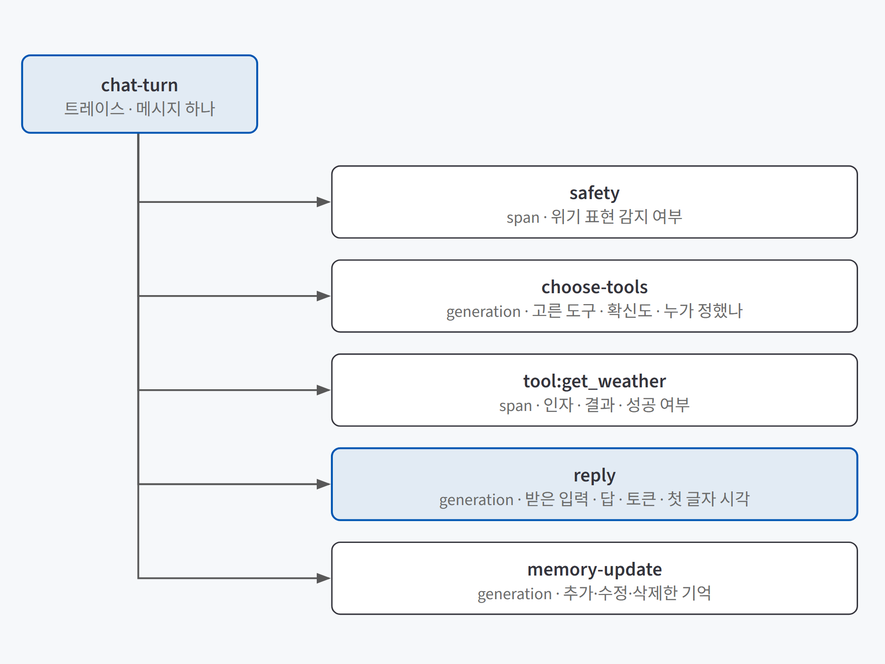
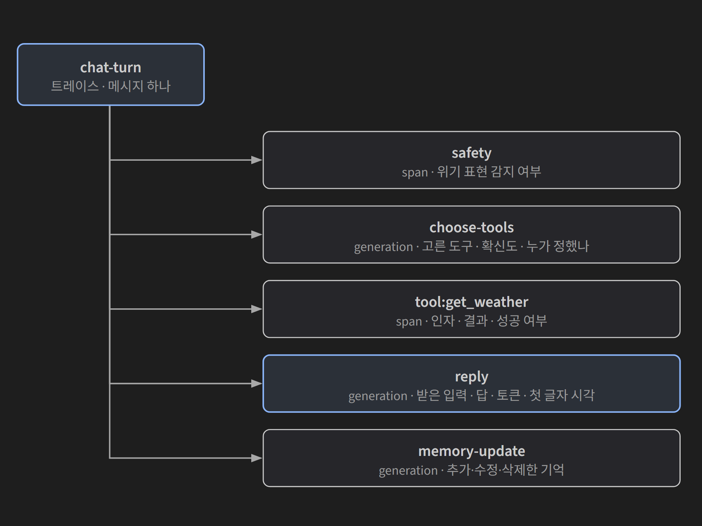
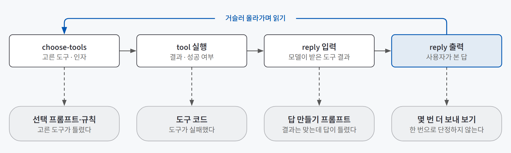
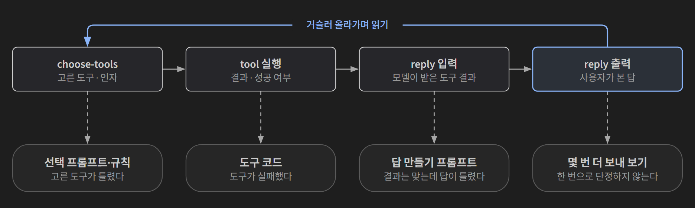

## 한 줄 요약

**메시지 하나가 거치는 단계(안전장치, 도구 선택, 도구 실행, 답 만들기, 기억 정리)를 트레이스로 남겨, 엉뚱한 답·느린 답·늘어난 요금이 처음 생긴 단계를 찾는 방법이다.** LLM 서비스의 문제는 대부분 "요청은 성공(200)했는데 답이 이상하다"는 모양이라 서버 로그에는 흔적이 없다. Langfuse는 이 기록을 남기고 사용자·세션·환경·버전·점수로 나눠 보게 해 주는 오픈소스 관측 도구다.

택배 조회를 떠올리면 쉽다. "배송 완료" 한 줄만 있으면 물건이 왜 엉뚱한 집에 갔는지 알 수 없다. 집하, 간선 상차, 지역 터미널, 배송 기사까지 단계마다 스캔 기록이 있어야 "터미널에서 주소가 바뀌었다"고 짚을 수 있다. 서버 로그가 "배송 완료"라면, 트레이스는 단계별 스캔 기록이다.

## 필요한 이유

LLM 서비스는 일반 프로그램과 네 가지가 달라서 로그만으로는 원인을 찾을 수 없다.

| 다른 점 | 무슨 일이 생기나 | 그래서 필요한 것 |
|---|---|---|
| **답이 실행마다 달라진다** | 지금 다시 보내면 멀쩡하게 답할 수 있다 | 문제가 난 **그때 그 실행의 기록** |
| **이상한 답에 오류가 없다** | 로그에는 `POST /api/chat 200`만 남는다 | 모델이 무엇을 받고 무엇을 냈는지 |
| **요금이 메시지 수로 정해지지 않는다** | 메시지 하나에 모델을 세 번 부르고, 대화가 길수록 입력이 늘어난다 | 단계별 토큰과 비용 |
| **품질이 통과/실패로 갈리지 않는다** | 사실 여부, 기억 반영, 말투, 안전을 함께 봐야 한다 | 사람이 읽을 수 있는 입력·출력 원문 |

예를 들어 일주일에 메시지가 700개라도 메시지마다 모델을 세 번 부르면 호출은 2,100번이다. 청구서가 "메시지 수 × 호출 한 번"과 안 맞는 이유다. 그리고 **기록하지 않은 과거는 볼 수 없으니,** 사용자가 늘기 전에 붙여 두는 편이 낫다.

## 개념과 동작

### 로그와 트레이스는 다른 것을 남긴다

| | 서버 로그 | 트레이스 |
|---|---|---|
| 보는 것 | 요청이 들어왔는지, 몇 초 걸렸는지, 오류가 났는지 | 한 요청 안의 단계, 단계별 입력·출력, 토큰, 비용 |
| 대화 원문 | 개인정보라 남기지 않는다 | 접근 권한이 따로 걸린 관측 도구에만 남긴다 |
| 답할 수 있는 질문 | "서버가 죽었나?" | "모델이 무엇을 보고 이렇게 답했나?" |

둘은 대체 관계가 아니다. 서버 쪽 오류는 로그로, 답 품질과 단계별 지연은 트레이스로 본다.

### 트레이스, 관찰 단위, 세션, 점수

Langfuse가 기록하는 단위는 네 가지다.

- **트레이스(trace):** 요청 하나가 지나가는 처리 전체다. 에이전트에서는 메시지 하나를 보내 답을 받을 때까지가 트레이스 하나다.
- **관찰 단위(observation):** 트레이스 안의 작업 하나다. 안에 다른 관찰 단위가 들어가 나무 모양이 된다.
- **사용자·세션:** 트레이스를 사람별, 대화별로 묶는다.
- **점수(score):** 사람이나 프로그램이 매긴 평가를 트레이스에 붙인다.

관찰 단위는 종류가 정해져 있다. 비용이 계산되는 것은 모델 호출(generation)과 임베딩뿐이다.

| 종류 | 뜻 | 에이전트에서의 예 |
|---|---|---|
| span | 일반 작업. 입력·출력·시간을 남긴다 | 안전장치 검사, 날씨 API 부르기 |
| generation | 모델 호출. 모델 이름·토큰·**비용**까지 남긴다 | 도구 선택, 답 만들기, 기억 정리 |
| event | 시간이 걸리지 않는 한 시점의 기록 | "기억 세 개를 불러옴" |

{: .light }
{: .dark }

트레이스에는 나중에 거를 값을 속성으로 붙인다. **environment**는 staging과 production을 가르고, **version**은 어느 배포가 만든 트레이스인지 가르며, **tags·metadata**에는 고른 도구나 확신도처럼 나중에 걸러 보고 싶은 값을 넣는다. 속성이 있어야 "누가, 어느 배포에서, 별로라고 했나"를 한 번에 거를 수 있다.

### 기록이 서버까지 가는 길

코드에 기록 지점을 넣는 일을 **계측**이라고 한다. Python SDK에서는 함수 위에 `@observe()` 한 줄을 붙이면 실행될 때마다 관찰 단위가 기록되고, 모델을 부르는 함수에는 generation 종류를 지정한다. 가장 바깥 함수가 트레이스가 되고, 그 안에서 부른 함수는 따로 지정하지 않아도 자식으로 붙는다.

기록은 메모리 버퍼에 쌓였다가 백그라운드에서 몇 초마다 한꺼번에 보낸다. 그래서 답이 기록 보내는 시간만큼 늦어지지 않고, Langfuse 서버가 잠시 멈춰도 서비스는 그대로 돈다.

대가로 트레이스가 화면에 뜨기까지 몇 초에서 수십 초가 걸리고, 프로세스가 갑자기 끝나면 버퍼에 남은 기록을 잃는다. Cloud Run 같은 서버리스 환경은 응답을 마친 뒤 CPU를 거의 주지 않아서 트레이스가 늦거나 빠질 수 있다. 이때는 응답을 마칠 때 `flush()`로 버퍼를 즉시 비우고, 응답이 조금 늦어지는 것을 받아들인다.

### 자동 계측과 수동 계측

SDK는 공개 표준인 OpenTelemetry 위에서 만들어져서, 이 표준을 지원하는 라이브러리(LLM API 클라이언트, LangChain 등)는 연동 설정만으로 기록된다. 이것이 **자동 계측**이다.

하지만 자동 계측은 라이브러리가 아는 단위로만 남긴다. 모델 호출이 "도구 선택"인지 "기억 정리"인지는 모르고, 모델을 부르지 않는 도구 실행은 아예 안 남는다. 그래서 단계 이름과 남길 값을 사람이 정해 붙이는 **수동 계측**이 기본이다. 반대로 함수마다 다 붙이면 한 턴에 관찰 단위가 수십 개 생겨 읽을 수 없고, 무료 플랜 한도도 금방 쓴다.

### 거슬러 올라가며 읽기

트레이스가 있어도 답만 보면 원인이 안 보인다. **답을 만들기 전에 모델이 무엇을 받았는지부터** 거슬러 올라간다.

{: .light }
{: .dark }

예를 들어 지원하지 않는 지역의 날씨를 물었는데 그럴듯한 날씨가 돌아왔다고 하자. 날씨 도구는 "지원하지 않는 지역"이라는 실패를 돌려줬고, 그 문장이 답 만들기의 입력에 그대로 들어갔는데도 모델이 날씨를 지어냈다면, 도구 결과를 받고도 무시한 것이다. 도구도 선택도 아니라 **답 만들기 프롬프트**가 고칠 곳이다. 정상 사례(지원하는 지역)의 같은 자리와 나란히 놓고 처음 달라진 단계를 한 문장으로 적으면 고칠 곳이 정해진다.

## 적합한 경우와 피할 경우

| 쓰는 게 좋은 경우 | 쓰지 않아도 되는 경우 |
|---|---|
| 사용자에게 열린 LLM 서비스. 문제를 재현할 수 없어 그때의 기록이 필요하다 | 혼자 돌려 보는 일회성 스크립트. 화면에 찍힌 출력이면 충분하다 |
| 한 메시지에 모델을 여러 번 부르는 에이전트. 단계별 비용·지연을 나눠 봐야 한다 | 모델을 한 번 부르고 끝나는 단순 호출. 제공사 사용량 화면으로 충분하다 |
| staging과 production, 배포 리비전별로 숫자를 비교해야 한다 | 대화 원문을 회사 밖으로 보낼 수 없는데 셀프 호스팅을 운영할 여력도 없다 |
| "답이 이상해요", "느려요", "요금이 많아요"라는 말을 받기 시작했다 | 관측할 질문이 없다. 무엇을 확인할지 모르면 무엇을 남길지도 못 정한다 |

## 장점과 한계

| 장점 | 한계 |
|---|---|
| 짐작이 아니라 그 순간의 입력·출력으로 원인을 말할 수 있다 | 기록하지 않은 과거는 볼 수 없다 |
| 단계마다 입력·출력·시간·비용이 붙어 어느 단계가 문제인지 좁혀진다 | 무엇을 어떤 단위로 남길지는 도구가 정해 주지 않는다. 사람이 먼저 설계해야 한다 |
| 비동기 전송이라 서비스 응답이 늦어지지 않는다 | 서버리스에서는 트레이스가 늦거나 빠질 수 있다 |
| 사용자 반응을 점수로 붙여 먼저 읽을 트레이스를 고를 수 있다 | 관측은 무슨 일이 있었는지만 보여 준다. 좋았는지 나빴는지는 사람이 읽어야 한다 |
| 특정 LLM 제공사나 프레임워크에 묶이지 않는다 | 대화 원문이 관측 도구로 올라간다. 마스킹과 보관 기간을 따로 챙겨야 한다 |

## 적용 방법

### 1단계. 확인할 질문부터 적는다

"Langfuse 붙여 줘"가 아니라 "답이 이상해요", "가끔 한참 있다가 와요", "이사 간다고 했는데 기억을 못 해요"처럼 동료나 사용자가 한 말을 먼저 적는다. 무엇을 남길지는 이 질문에서 거꾸로 정해진다.

### 2단계. 고치는 단위로 단계를 나누고 이름을 고정한다

단계는 **고칠 곳이 다른 단위**로 나눈다. 원인이 도구 선택이면 선택 프롬프트를, 도구 실행이면 도구 코드를, 답 만들기면 답 프롬프트를 고치므로 셋은 따로 보여야 한다. 도구 실행은 도구마다 실패 이유가 다르니 도구별로 하나씩 둔다.

| 정할 것 | 기준 |
|---|---|
| 종류 | 모델을 부르면 generation(비용 계산), 안 부르면 span |
| 남길 것 | "이 단계가 틀렸다는 걸 무엇을 보고 알 수 있나". generation에는 모델 이름과 입력·출력 토큰 수를 꼭 남긴다. 없으면 비용이 계산되지 않는다 |
| 도구 선택 | 고른 도구, 인자, 확신도, 규칙이 정했는지 모델이 정했는지 |
| 답 만들기 | 받은 입력, 답, 그리고 **첫 글자가 나온 시각**. 스트리밍이라 사용자가 기다린 시간은 첫 글자까지다 |
| 이름 | 어느 트레이스에서나 같은 단계는 같은 이름. 함수 이름은 바뀔 수 있으니 화면용 이름을 따로 정한다 |

자주 일어나지 않는 호출(대화 요약, 먼저 말 걸기)도 이름을 붙여 둔다. 그래야 비용을 합칠 때 빠지지 않는다.

### 3단계. 속성과 원문 정책을 정한다

| 속성 | 값을 어디서 가져오나 |
|---|---|
| user_id | 서버가 로그인으로 확인한 사용자 ID. 이메일은 넣지 않는다 |
| session_id | Langfuse가 정해 주지 않는다. 대화방이 없는 서비스라면 "사용자 ID + 날짜"로 하루치 대화를 한 세션으로 본다 |
| environment | 실행 환경 변수(local, staging, production). 프로젝트를 나누지 않고 이것으로 나눈다 |
| version | 배포 리비전 이름(Cloud Run은 `K_REVISION`을 넣어 준다) |

원문은 정책을 먼저 정한다. 원문이 없으면 답이 왜 이상했는지 읽을 수 없고, 그대로 보내면 개인정보가 나간다. **접근할 사람이 정해진 관측 도구에는 원문을 남기되**, 전화번호·이메일·카드 번호 같은 패턴은 보내기 전에 가리고(마스킹), 보관 기간을 정하고, 개인정보처리방침에 적는다. 이 결정 없이 코딩 에이전트에게 계측을 맡기면 원문을 아예 빼거나 아무것도 가리지 않고 보내기 쉽다.

### 4단계. 증상별로 읽는 순서를 정해 둔다

| 증상 | 어디서부터 보나 |
|---|---|
| 엉뚱한 답 | 답의 입력 → 도구 결과 → 도구 선택 순으로 거슬러 올라가 처음 어긋난 단계 |
| 느린 답 | 지연 순으로 정렬해 가장 느린 트레이스를 열고, 단계별 막대와 **첫 글자까지 시간**. 답이 다 나온 뒤 도는 기억 정리는 사용자가 기다리지 않는 시간이다 |
| 늘어난 요금 | 비용 순으로 정렬해 가장 비싼 트레이스와 싼 트레이스의 단계별 토큰 비교. 차이는 답 만들기의 입력 토큰(지시문, 기억, 요약, 최근 대화)인 경우가 많다 |
| 기억을 못 함 | 기억 정리 출력에 저장됐나 → 저장된 기억이 답의 입력에 들어갔나 → 들어갔는데 무시했나 |
| 배포 뒤 느려짐 | staging만 골라 version별로 지연과 첫 글자까지 시간 비교 |

비용 칸이 비어 있으면 두 가지 중 하나다. 가짜 모델이라 토큰이 0이거나, 실제 모델인데 Langfuse 가격표에 그 모델 이름이 없는 경우다. 후자는 모델 이름과 토큰당 가격을 직접 추가하고, 추가한 뒤 들어오는 기록부터 계산된다.

### 5단계. 사용자 반응을 점수로 붙여 읽을 순서를 만든다

답 옆의 좋아요·별로예요·신고 버튼을 트레이스 점수로 보내면, 수십 개 쌓인 트레이스 중 별로예요가 붙은 것만 걸러 먼저 읽을 수 있다.

| 정할 것 | 기준 |
|---|---|
| 메시지와 트레이스 잇기 | 화면은 메시지 ID만, 점수는 트레이스 ID를 안다. 메시지 저장 시 트레이스 ID를 같이 저장하거나, 응답 끝에 트레이스 ID를 실어 보낸다 |
| 점수 형태 | 좋아요 1·별로예요 0, 신고 1 같은 참/거짓 점수. 신고 사유는 설명으로 붙인다 |
| 권한 | 남의 메시지에 점수를 매기지 못하게 서버에서 본인 메시지인지 확인한다 |

다만 대부분의 사용자는 버튼을 누르지 않고, 화가 났을 때 더 자주 누른다. 피드백 점수는 **읽을 순서를 정하는 데** 쓰고, 품질 판단은 사람이 읽고 나눈 결과와 자동 채점을 함께 본다. 평가셋과 채점기를 세우는 방법은 [에이전트 품질 평가](/posts/agent-evaluation/)에서 다뤘다.

## 다른 방법과 비교

| 방법 | 보이는 것 | 한 줄 평가 |
|---|---|---|
| 서버 로그 | 요청 성공 여부, 전체 시간, 오류 | 서버가 살아 있는지는 알지만 답이 왜 이상한지는 모른다 |
| LLM 제공사 청구 화면 | 날짜별 금액과 토큰 합계 | 어느 기능(도구 선택, 답, 기억 정리)이 썼는지는 모른다 |
| Cloud Run 요청 지연 그래프 | 요청이 열려 있던 전체 시간 | 스트리밍이면 사용자가 첫 글자를 기다린 시간과 다르다 |
| 자동 계측만 | 모델 호출 | 빨리 붙지만 단계 이름이 없고, 모델을 안 부르는 도구 실행은 빠진다 |
| **수동 계측(단계 설계 + 이름 고정)** | 단계별 입력·출력·시간·비용 | 손이 가지만 "어느 단계를 고칠지"까지 답한다 |
| 셀프 호스팅 | 같은 기능 | 대화 데이터를 밖으로 보낼 수 없거나 트래픽이 아주 클 때만. 데이터베이스와 저장소까지 직접 운영한다 |

## 주의할 점

**같은 날의 대화는 기억하는 척할 수 있다.** 최근 대화 원문이 답의 입력에 함께 들어가면, 기억 메모가 없어도 몇 마디 전의 말을 기억하는 것처럼 답한다. 며칠 뒤에도 기억하는지는 답이 아니라 **기억 정리 단계의 출력**으로 확인한다.

**SDK 버전이 자주 바뀐다.** 웹 예제와 코딩 에이전트가 쓰는 문법은 옛 버전인 경우가 많다. 공식 문서 최신 버전을 근거로 쓰게 하고, 버전을 고정한다.

**키가 없으면 계측을 끄고 앱은 그대로 돌게** 한다. 관측 도구 장애가 서비스 장애가 되면 안 된다.

**규칙이 도구를 고르면 토큰이 0으로 남는다.** 누가 정했는지를 같이 남기지 않으면 계측이 빠진 것으로 오해한다.

## 용어 정리

| 용어 | 뜻 |
|---|---|
| 트레이스 (trace) | 요청 하나가 지나가는 처리 전체의 기록. 에이전트에서는 메시지 하나 |
| 관찰 단위 (observation) | 트레이스 안의 작업 하나. span, generation, event 등으로 나뉜다 |
| generation | 모델 호출을 기록하는 관찰 단위. 모델 이름과 토큰이 있어야 비용이 계산된다 |
| 계측 (instrumentation) | 코드에 기록 지점을 넣는 일. 자동 계측과 수동 계측이 있다 |
| OpenTelemetry (OTel) | 실행 기록을 남기고 보내는 공개 표준. Langfuse SDK가 이 위에서 만들어졌다 |
| 첫 글자까지 시간 (TTFT) | 요청 후 답의 첫 토큰이 나오기까지 걸린 시간. 스트리밍에서 사용자가 실제로 기다린 시간 |
| environment / version | 트레이스가 어느 환경(staging, production)과 어느 배포 리비전에서 나왔는지 표시하는 속성 |
| 마스킹 | 관측 도구로 보내기 전에 전화번호·이메일 같은 개인정보 패턴을 가리는 것 |

---

→ 이 개념을 검증한 프로젝트: [Langfuse 관측 검증 — AI 친구 에이전트에 붙여 확인한 세 가지](/posts/langfuse-friend-agent/)
