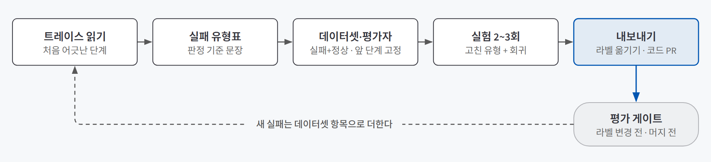
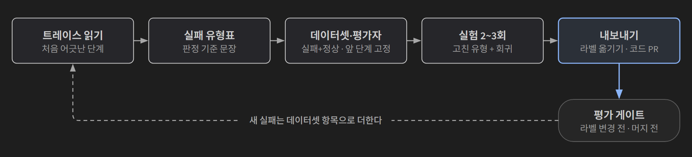
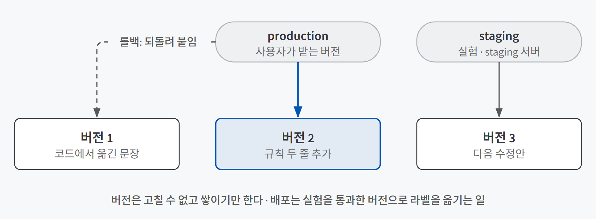
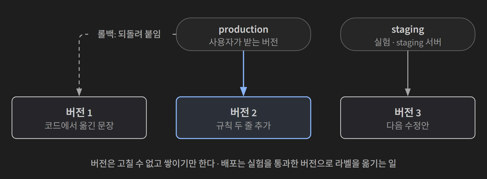

## 한 줄 요약

**트레이스로 찾은 실패를 데이터셋과 평가자로 재고, 고친 지시문을 같은 기준으로 두세 번 실험해 통과한 버전만 내보내는 방법이다.** 앞 글([Langfuse로 에이전트 관측하기](/posts/langfuse-observability/))이 문제를 **찾는** 쪽이었다면, 이 글은 찾은 문제를 **재고, 고치고, 다시 생기지 않게 지키는** 쪽이다.

약 처방에 비유할 수 있다. 증상 하나 듣고 바로 약을 바꾸지 않는다. 검사 수치를 먼저 재고, 약을 바꾼 뒤 같은 검사를 다시 하고, 다른 수치가 나빠지지 않았는지도 본다. 지시문 한 줄을 고치는 일도 같다.

## 필요한 이유

지시문을 고친 뒤 대화창에서 두세 번 물어 맞게 답하면 고쳐졌다고 믿기 쉽다. 하지만 LLM은 같은 메시지에도 실행마다 답이 달라서 두세 번 맞은 것으로는 고쳐졌다고 말할 수 없다. 고친 규칙이 다른 메시지에서 엉뚱하게 읽혀 원래 잘 되던 답이 나빠졌는지도 대화 몇 개로는 보이지 않는다.

또 하나는 **확인을 빠뜨리는 것**이다. 평가를 한 번 만들어 둬도 급하게 지시문을 고칠 때 돌리지 않으면 소용이 없다. 확인할 방법이 없어서가 아니라 확인하지 않고 내보낼 수 있어서 품질이 무너진다.

## 개념과 동작

{: .light }
{: .dark }

### 실패를 먼저 읽고, 유형은 나중에 묶는다

지표를 먼저 정하지 않는다. 실제로 틀린 트레이스를 30개쯤 읽고 트레이스마다 **처음 어긋난 단계** 하나를 한 줄 댓글로 남긴 뒤, 비슷한 메모끼리 묶어 실패 유형표를 만든다. 미리 정한 지표가 있으면 그 지표에 맞는 실패만 눈에 들어오기 때문이다. 별로예요가 붙은 트레이스만 읽으면 사용자가 표시하지 않은 조용한 실패를 놓치므로 무작위로 고른 트레이스도 섞는다.

답만 보면 "날짜를 틀렸다"로 같아 보이는 실패도 처음 어긋난 자리가 다르다. AI 친구 에이전트의 공휴일 질문을 예로 들면 다음과 같다.

| 증상 | 처음 어긋난 단계 | 고칠 곳 |
|---|---|---|
| 다음 공휴일을 못 찾음 | 도구 선택: 기간을 이번 주로 좁혀 12월 25일이 빠짐 | 도구 선택 지시문 |
| 없는 공휴일을 말함 | 답 만들기: 도구는 "공휴일 없음"이라는데 날짜를 지어냄 | 답 지시문, 도구 결과 |
| 금요일 크리스마스를 연휴가 아니라고 함 | 답 만들기: 요일을 따져 연휴를 판단해야 해서 실행마다 갈림 | 공휴일 도구 |

유형표에는 **판정 기준 문장**을 같이 적는다. "날짜를 정확히 말한다"가 아니라 "답에 나온 공휴일 날짜는 모두 도구 결과에 있다"처럼, 다른 사람이 읽어도 같은 트레이스에 같은 판정을 내릴 수 있어야 한다. 개수가 많은 유형부터 고치되, 위기 표현이나 개인정보처럼 한 번만 일어나도 피해가 큰 유형은 순서를 올린다.

### 데이터셋은 앞 단계 결과를 고정한다

데이터셋은 평가할 때마다 똑같이 쓰는 **입력과 기대 결과의 모음**이고, 고치기 **전에** 만든다. 만들 때 세 가지를 챙긴다.

- **기대 결과는 정답이 아니라 확인하고 싶은 것으로 적는다.** "다음 공휴일" 질문에 정답 기간을 적으면, 인자를 비워 1년을 찾게 하는 맞는 답도 틀린 것으로 센다. 다음 공휴일 날짜(12-25)를 적고 모델이 고른 기간이 그 날짜를 **포함하는지** 코드로 본다.
- **답에서 생기는 실패는 앞 단계 결과를 고정해 넣는다.** 처음부터 실행하면 도구 선택에 따라 도구 결과가 매번 달라져, 답이 틀렸을 때 답 지시문 탓인지 도구 결과 탓인지 가릴 수 없다. 도구 결과 문장을 입력에 고정하고 답만 만들게 한다.
- **정상 사례를 같이 넣는다.** "이번 주에 쉬는 날 있어?"처럼 원래 잘 되던 항목이 없으면, "공휴일이 없다고 말하라"는 규칙이 정상 질문까지 "없어"로 만드는 부작용을 못 본다.

평가자는 실패마다 고른다. 날짜를 비교하면 아는 것은 **코드 채점**, "사흘 쉴 수 있어", "주말까지 쭉 쉬네"처럼 표현이 여러 가지라 읽어야 아는 것은 **LLM 심사**로 판정한다. LLM 심사는 점수 대신 통과·실패로 받는다. 심사를 사람 라벨과 맞춰 보고 믿는 방법은 [에이전트 품질 평가](/posts/agent-evaluation/)에서 다뤘다.

### 실험은 두세 번, 고친 항목 밖까지

**실험**은 데이터셋의 항목마다 같은 작업을 실행하고 평가자로 판정해 한 번의 실행 기록(run)으로 남기는 일이다. Langfuse는 두 실행을 골라 항목별 답과 판정을 나란히 보여 준다.

같은 지시문도 맞힌 수가 한두 개씩 흔들리므로 **버전마다 두세 번** 돌린다. 어떤 회귀가 두 실행 모두에서 나오면 규칙의 영향이고, 한 번만 나오면 흔들림일 가능성이 크다. 그리고 고친 항목만 보지 않고 도구 선택 데이터셋 전체를 돌려 날씨나 약속처럼 상관없는 항목이 나빠지지 않았는지 본다. 이것이 **회귀 확인**이다.

### 프롬프트를 코드 밖에 두고 라벨로 내보낸다

**프롬프트 관리**는 지시문을 코드 밖 저장소에 두고 서비스가 실행 중에 가져다 쓰게 하는 기능이다. 같은 이름으로 저장할 때마다 버전이 하나씩 늘고, 한 번 만든 버전은 고칠 수 없다. 서비스는 버전 번호 대신 **라벨**로 가져온다.

{: .light }
{: .dark }

새 버전에는 staging 라벨만 붙여 실험하고, 통과하면 production 라벨을 옮긴다. 문제가 생기면 production을 이전 버전으로 되돌린다. 코드를 다시 배포하지 않으니 몇 초면 끝난다.

대신 Langfuse에 닿지 못하는 순간이 생긴다. SDK가 가져온 프롬프트를 잠시 저장해 두지만 서버가 처음 뜰 때 가져오지 못하면 답을 만들 수 없다. 그래서 **코드에 기본 문장을 남겨 두고** 그것으로 답하게 한다. AI 친구 에이전트의 도구 선택 지시문도 이렇게 옮겼다.

### 해석은 프롬프트로, 계산은 코드로

실험해 보면 지시문으로 고쳐지는 실패와 안 고쳐지는 실패가 갈린다. 말의 뜻을 **해석**하는 일은 모델이 잘하고, 날짜를 더하고 빼는 **계산**은 코드가 하면 매번 같은 답이 나온다.

| 실패 | 성격 | 고칠 곳 |
|---|---|---|
| 다음 공휴일을 못 찾음 | 해석: "다음 공휴일"에는 기간이 없다 | 지시문에 "기간을 말하지 않으면 인자를 비운다" |
| 시험 전날이 아닌 날로 저장 | 계산: 금요일의 하루 전 | 모델은 "금요일·하루 전·밤"으로 표현만 나누고 날짜는 코드가 계산 |
| 금요일 크리스마스를 연휴가 아니라고 함 | 계산: 주말과 이어지는가 | 공휴일 도구가 "25일(금)~27일(일) 사흘 연휴"까지 돌려줌 |

"전날" 계산 방법을 지시문에 적어 돌려 보면, 같은 항목이 같은 틀린 날짜로 계속 나오는 경우가 있다. 판단이 서지 않으면 지시문 버전을 먼저 두 번 실험하고, 같은 항목이 같은 답으로 계속 틀리면 코드로 옮긴다. 코드로 고친 뒤에는 고정해 둔 도구 결과도 **새 도구가 내는 문장**으로 바꿔 다시 잰다.

### A/B 테스트는 사용자가 많아야 결론이 난다

데이터셋 실험은 "정한 기준을 지키는가"를 잰다. 두 버전이 모두 기준을 통과했는데 "짧은 답이 낫다", "지금이 낫다"로 의견이 갈리면, 실제 사용자를 반씩 나눠 서로 다른 버전을 보여 주고 반응을 비교한다. 이것이 A/B 테스트다. Langfuse에서는 두 버전에 `prod-a`, `prod-b` 라벨을 붙이고 서비스가 사용자마다 둘 중 하나를 가져다 쓰게 한다.

그룹은 요청마다가 아니라 **사용자마다** 정한다. 요청마다 무작위로 고르면 한 사람의 대화 안에서 말투가 오락가락하고, 그 사람의 반응이 두 버전에 섞인다. 사용자 ID를 숫자로 바꿔(해시) 반으로 나누면 같은 사람은 늘 같은 그룹에 들어간다.

어려운 점은 결론이 날 만큼 반응을 모으는 일이다. 동전을 열 번 던져 앞면이 여섯 번 나왔다고 앞면이 잘 나오는 동전이라고 할 수 없듯이, 별로예요가 몇 건 적다고 B가 낫다고 할 수 없다. 차이가 작을수록 우연과 구분하려면 반응이 훨씬 많아야 한다.

| 예 | 값 |
|---|---|
| 확인하고 싶은 차이 | 별로예요 비율 20% → 15% |
| 그룹마다 필요한 피드백 | 약 900건 |
| 하루 메시지 50건, 그중 10%만 버튼을 누르면 | 한 그룹에 하루 2~3건 |
| 다 모으는 데 걸리는 시간 | 1년 가까이 |

그래서 사용자가 적은 서비스에서는 데이터셋 실험으로 판단하고, A/B는 "새 버전이 크게 나빠지지 않았나"를 보는 정도로만 쓴다. 하루 메시지가 수천 건이면 몇 주로 줄어든다.

A/B는 일부 사용자에게 먼저 보낸다는 점에서 카나리 배포와 비슷하지만, 카나리는 **서버 버전(리비전)**으로 나누고 프롬프트 A/B는 같은 서버 안에서 **프롬프트 라벨**로 나눈다.

## 적합한 경우와 피할 경우

| 쓰는 게 좋은 경우 | 쓰지 않아도 되는 경우 |
|---|---|
| 트레이스가 쌓였고 "답이 이상해요"를 받기 시작했다 | 계측이 안 돼 실패한 단계의 입력·출력이 없다. 계측부터 고친다 |
| 지시문을 자주 고치고 버전끼리 비교해야 한다 | 위기 표현 규칙처럼 바꿀 일이 드문 고정 규칙. 코드에 두는 편이 안전하다 |
| 답의 표현이 다양해 코드로 못 재는 실패가 있다 | 정답이 정해진 출력. 코드 채점으로 충분하고 LLM 심사 비용을 쓸 이유가 없다 |

## 장점과 한계

| 장점 | 한계 |
|---|---|
| "괜찮아 보인다"가 아니라 "고친 유형 통과가 늘었고 정상 사례는 그대로"라고 말할 수 있다 | 실험마다 답 모델과 심사 모델을 항목 수만큼 부른다. 돈이 든다 |
| 코드 배포 없이 몇 초 만에 지시문을 내보내고 되돌린다 | 10개 남짓한 데이터셋은 드문 실패를 담지 못하고, 한두 개 차이는 흔들림과 구분되지 않는다 |
| 트레이스마다 프롬프트 버전이 보여 버전별 지연·비용·점수를 비교할 수 있다 | 앞 단계 결과를 고정한 항목은 원인을 가르기 쉽지만 실제 대화가 아니라 만든 입력이다 |

## 적용 방법

### 1단계. 실패 유형은 하나만 고른다

여러 유형을 한꺼번에 고치면 무엇 때문에 나아졌는지 분리할 수 없다. 유형표에서 하나를 골라 판정 기준 문장과 함께 다음 단계로 넘긴다.

### 2단계. 데이터셋과 평가자를 만든다

실패·정상 사례를 합쳐 10개 이상으로 시작하고, 새 실패가 보이면 항목을 더한다. 심사 모델은 구조화 출력을 지원하고 가능하면 답 모델보다 한 단계 큰 모델을 고른다. 같은 모델은 자기 답과 비슷한 실수를 넘기기 쉽다.

기존 평가가 이 유형을 이미 잡는지 먼저 본다. 도구 선택까지만 채점하는 평가는 답에서 생기는 실패를 하나도 잡지 못한다.

### 3단계. 지금 상태를 재고, 버전을 하나만 바꿔 실험한다

고치기 전 버전을 두세 번 돌려 기준선을 남긴다. 새 버전은 규칙 몇 줄만 더하고 다른 줄은 그대로 둔다. 다른 줄까지 바꾸면 차이가 규칙 때문이라고 말할 수 없다. 새 버전도 두세 번 돌리고, 고친 유형 데이터셋과 회귀 확인 데이터셋을 함께 본다.

### 4단계. 내보낼 기준을 실험 전에 숫자로 적는다

결과를 본 뒤 기준을 정하면 조금이라도 오른 결과를 내보내는 쪽으로 기운다. "실패 5개 중 3개 이상 통과, 정상 7개 모두 통과"처럼 미리 적는다.

### 5단계. 평가를 배포 흐름에 건다

| 지점 | 돌리는 평가 | 멈추는 조건 |
|---|---|---|
| 프롬프트 라벨을 옮기기 전 | 고친 유형 + 회귀 확인 실험 | 고친 유형 통과가 늘지 않거나 다른 데이터셋이 떨어짐 |
| 코드를 머지하기 전 (CI) | 코드 채점 평가 | 정답 비율이 기준 아래 (예: 41개 중 37개) |
| 새 리비전에 일부 트래픽을 보낸 동안 | 피드백 점수, 표본 LLM 심사 | 새 리비전의 별로예요 비율이 눈에 띄게 높음 |

CI 게이트는 실제 LLM을 부르므로 PR마다 자동으로 돌리면 비용이 쌓인다. GitHub Actions에서 PR에 `eval` 라벨을 붙였을 때나 수동 실행 버튼을 눌렀을 때만 돌게 하고, 기준은 지금 결과보다 조금 낮게 잡아 흔들림에 걸리지 않게 한다.

## 다른 방법과 비교

| 방법 | 보는 것 | 한 줄 평가 |
|---|---|---|
| 대화창에서 몇 번 시험 | 고친 메시지 몇 개 | 비용은 없지만 흔들림과 회귀를 못 본다 |
| **데이터셋 실험 (오프라인)** | 정한 기준을 지키는가 | 고친 유형과 회귀를 같은 기준으로 비교한다. 이 글의 중심 |
| A/B 테스트 (온라인) | 사용자가 어느 쪽을 더 좋아하는가 | 실제 반응을 보지만 트래픽이 적으면 결론까지 너무 오래 걸린다 |
| 프롬프트를 코드에 두기 | 코드 리뷰를 거친 문장 | 단순하지만 버전 비교와 즉시 롤백이 어렵다 |

## 주의할 점

**심사 지시문에 판정하지 않을 것을 적는다.** LLM 심사는 길고 자신 있게 쓴 답을 후하게 판정한다. 말투·길이·친절함은 판정하지 않는다고 적고, 12월 25일은 실제 공휴일이지만 도구 결과에 없으면 "지어낸 날짜"라는 경계 사례도 넣어야 "사실이니 통과"가 되지 않는다.

**A/B 결과를 매일 들여다보다 앞선 날 멈추지 않는다.** 자주 볼수록 우연히 앞선 쪽을 승자로 고르기 쉽다. 모을 수를 미리 정하고, 다 모은 뒤 한 번 판정한다.

**평가 데이터의 "지금"을 맞춘다.** "이번 주", "다음 공휴일"은 기준 시각에 따라 답이 바뀐다. 데이터셋마다 기준 시각을 정해 두고, 지시문의 현재 시각과 고정한 도구 결과가 같은 날을 가리키게 한다.

## 용어 정리

| 용어 | 뜻 |
|---|---|
| 오류 분석 (error analysis) | 실패한 트레이스를 읽어 처음 어긋난 단계를 적고, 비슷한 것끼리 묶어 실패 유형을 정하는 일 |
| 데이터셋 (dataset) | 평가할 때마다 똑같이 쓰는 입력과 기대 결과의 모음 |
| LLM 심사 (LLM-as-a-Judge) | LLM에게 판정 기준을 주고 다른 모델의 출력을 통과·실패로 판정하게 하는 평가 방법 |
| 실험 (experiment) | 데이터셋의 항목마다 같은 작업을 실행하고 평가자로 판정해 한 번의 실행 기록으로 남기는 일 |
| 회귀 확인 (regression check) | 고친 곳이 나아지는 동안 원래 잘 되던 곳이 나빠지지 않았는지 보는 일 |
| 프롬프트 라벨 (label) | 프롬프트 버전 하나를 가리키는 이름표. production 라벨을 옮기는 것이 배포다 |
| A/B 테스트 | 사용자를 두 그룹으로 나눠 서로 다른 버전을 주고 반응을 비교하는 방법 |
| 평가 게이트 (eval gate) | 배포 흐름의 정해진 지점에서 평가를 돌려 기준에 못 미치면 내보내지 못하게 하는 장치 |
