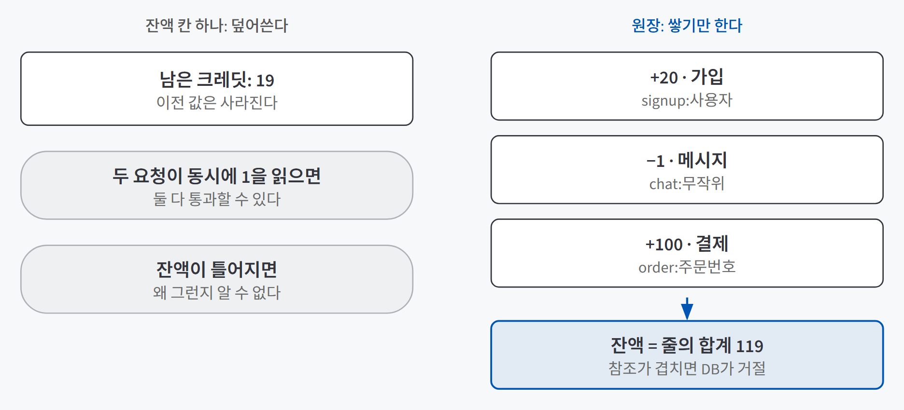
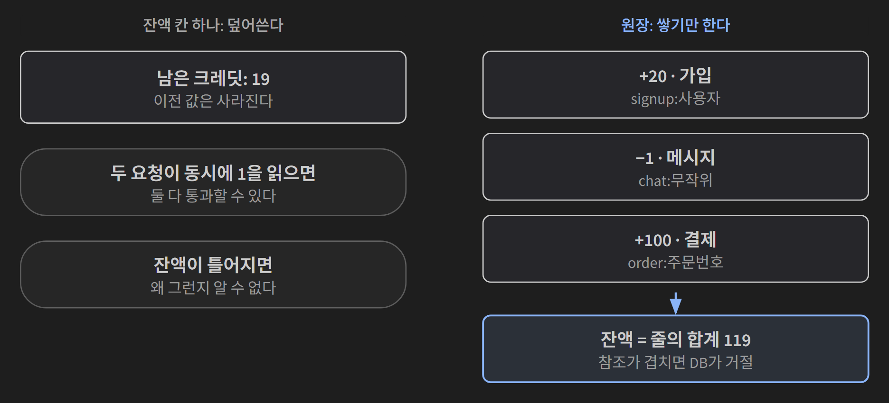
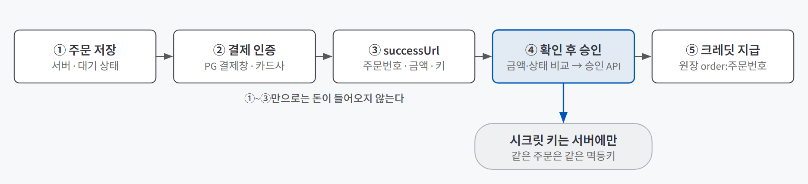
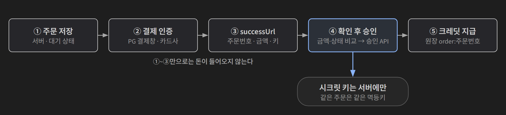

## 한 줄 요약

**메시지 한 건의 원가를 재고, 그 위에 가격과 무료 한도를 정하고, 크레딧을 거래 기록(원장)으로 쌓고, 결제는 서버가 확인해 한 번만 지급하는 순서로 "돈을 받는 서비스"의 뼈대를 만드는 방법이다.** 사용자가 메시지를 보낼 때마다 LLM 비용이 나가는데, 이 단계 전까지는 그 돈을 운영자가 전부 낸다.

은행 통장에 비유할 수 있다. 통장은 잔액 칸 하나만 고쳐 쓰지 않고 입금·출금 내역을 한 줄씩 쌓는다. 잔액은 내역의 합이라 숫자가 이상하면 내역을 읽어 원인을 찾는다. 그리고 입금은 은행이 돈이 들어온 것을 확인한 뒤에야 찍힌다. 크레딧도 같은 원칙으로 만든다.

## 필요한 이유

LLM 서비스의 원가는 사용량에 비례한다. 에이전트는 메시지 한 건에 모델을 여러 번 부르고(도구 고르기, 답 만들기, 기억 정리), 대화가 길어질수록 입력에 들어가는 지난 대화가 늘어 한 건이 더 비싸진다. 한 건이 몇십 원이라도 하루 3,000개를 자동으로 보내는 계정 하나면 한 달 원가가 몇백만 원이 된다.

그래서 순서가 중요하다. 원가를 모르고 가격을 정하면 팔수록 손해일 수 있고, 잔액과 결제를 서버가 확인하지 않으면 화면만 건너뛰어도 크레딧이 생긴다.

## 개념과 동작

### 원가는 호출을 모두 더해 잰다

메시지 한 건의 원가는 그 메시지가 부른 모든 모델 호출의 `입력 토큰 × 단가 + 출력 토큰 × 단가` 합계다. 관측 도구(Langfuse)에 트레이스별 비용이 남아 있으면 그대로 모아 읽는다.

| 읽을 값 | 이유 |
|---|---|
| 평균 | 보통 사용자의 한 달 원가 |
| 비싼 쪽 상위 10% | 가격의 바닥은 평균이 아니라 비싼 쪽으로 잡아야 많이 쓰는 사용자에게서 손해가 안 난다 |
| 가장 비싼 단계 | 줄일 곳 후보 |
| 첫 메시지 vs 열 번째 이후 | 지난 대화가 쌓이면 얼마나 비싸지나 |

어느 모델로 잰 값인지 반드시 같이 적는다. 모델에 따라 단가가 몇십 배까지 다르다. 관측 기록이 없다면 혼자 쓰는 키로 조용한 시간에 메시지를 정확히 20개 보내고 제공사 사용량 화면의 금액을 20으로 나눈다. 평균 하나만 나오지만 시작하기엔 충분하다.

원가를 줄이는 방법(단계마다 작은 모델 쓰기, 프롬프트 캐싱, 출력 길이 상한, 지난 대화 줄이기)은 모두 품질과 맞바꾸는 것이라 비용 숫자만 보고 바꾸지 않는다. 같은 메시지 10개를 두 모델로 보내 비용과 답을 나란히 읽어 보고, 실제로 바꾸기 전에는 평가 데이터셋으로 확인한다.

### 원가는 가격의 바닥만 정한다

가격을 정할 때 보는 것은 네 가지다. **메시지 원가**, **결제 수수료**(카드 결제면 부가세 포함 3~4%대), **고정비**(DB·관측 도구·PG 가입비처럼 사용량과 상관없이 나가는 돈), **마진**이다.

여기서 한 달 손익을 가장 크게 흔드는 것은 크레딧 가격이 아니라 **무료 한도와 유료 전환율**이다. 사용자 1,000명 중 50명만 산다고 놓고 계산하면, 크레딧 하나를 팔 때마다 이익이 남아도 무료 사용자 950명의 원가와 고정비를 메우지 못한다. 가격을 두 배로 올리는 것보다 무료 한도를 줄이는 쪽이 손익을 더 크게 바꾼다. 다만 무료 한도를 줄이면 써 보기도 전에 떠나는 사람이 늘 수 있고, 전환율은 운영자가 정할 수 없어 실제로 재 봐야 안다.

차감 단위는 세 가지 중에서 고른다.

| 방식 | 사용자 입장 | 운영자 입장 |
|---|---|---|
| 메시지당 고정 (1건 = 1개) | 얼마인지 바로 안다 | 메시지마다 원가가 달라도 평균으로 감수한다 |
| 쓴 토큰만큼 | 보내기 전엔 얼마 빠질지 모른다 | 원가와 정확히 맞는다 |
| 기본은 고정, 비싼 기능만 더 | 대부분 1개, 예외만 알면 된다 | 이미지처럼 원가가 큰 기능만 따로 받는다 |

대화형 서비스에서 토큰만큼 받으면 사용자가 짧게 말하게 되므로 메시지당 고정으로 시작하는 편이 낫다. 몇 원짜리를 한 번씩 결제하게 할 수는 없으니(카드 인증, 건당 최저 수수료) 100개, 300개처럼 묶어서 판다.

### 크레딧은 원장으로 쌓는다

{: .light }
{: .dark }

**원장(ledger)**은 잔액을 덮어쓰지 않고 늘고 준 기록을 한 줄씩 쌓기만 하는 표다. 각 줄에는 누구, 변화량(+/−), 이유, **참조**, 시각을 남긴다. 참조를 유일하게 두면(`signup:사용자`, `order:주문번호`) 같은 결제로 두 번 충전되거나 같은 가입으로 무료 크레딧을 두 번 받는 일을 DB가 막는다. 잘못 차감했으면 줄을 지우지 않고 되돌리는 줄(+1)을 새로 쌓는다.

규칙은 세 가지다.

- **차감은 서버에서만 한다.** 화면이 잔액을 확인하고 막으면 개발자 도구로 API를 바로 불러 건너뛸 수 있다. 화면은 서버가 준 잔액을 보여 주기만 한다.
- **잔액 확인과 차감을 DB 함수 하나로 묶는다.** 따로 하면 잔액 1인 사용자의 요청 두 개가 동시에 "1 있음"을 읽고 둘 다 통과한다.
- **크레딧 부족은 402(Payment Required)로 거절한다.** 401로 보내면 화면이 로그인을 다시 시키고, 500이면 모니터링이 장애로 잡고, 200에 오류 문구를 넣으면 화면이 거절된 줄 모른다.

### 결제는 인증과 승인 두 단계다

카드 정보는 우리 서버가 다루지 않는다. 결제 대행사(**PG**)의 결제위젯이 결제 수단 선택과 카드사 인증 화면을 대신 띄운다. 그리고 결제는 두 단계로 나뉜다. 사용자가 카드사 인증을 마치는 **결제 인증**, 우리 서버가 PG에 "이 결제를 확정해 달라"고 요청하는 **결제 승인**이다. 승인이 성공해야 돈이 빠져나가고, 인증만 하고 승인하지 않은 결제는 일정 시간 뒤 사라진다.

{: .light }
{: .dark }

| 지킬 것 | 이유 |
|---|---|
| 주문을 먼저 서버에 대기 상태로 저장한다 | 승인할 때 비교할 기준 금액이 있어야 한다 |
| 주문은 상품 ID만 받고 금액은 서버 상품표에서 찾는다 | 화면이 보낸 금액은 바꿀 수 있다 |
| successUrl의 금액을 저장한 금액과 비교한다 | 주소창에서 `amount=4000`을 `100`으로 고칠 수 있다 |
| 승인은 서버가 시크릿 키로 한다 | 화면 코드에 있으면 누구나 승인·취소할 수 있다 |
| 크레딧은 승인이 성공한 뒤, 승인 처리 한 곳에서만 쌓는다 | successUrl로 돌아왔다는 것은 인증이 끝났다는 뜻일 뿐이다. 성공 페이지에서 늘리면 누구나 그 API를 불러 충전할 수 있다 |

키도 두 종류다. **클라이언트 키**는 결제위젯을 띄우는 용도라 화면에 넣어도 되고, **시크릿 키**는 승인처럼 돈이 움직이는 API용이라 서버의 비밀 저장소에만 둔다.

### 같은 승인이 두 번 와도 한 번만 지급한다

**멱등성(idempotency)**은 같은 요청을 여러 번 받아도 결과가 한 번 받은 것과 같은 성질이다. 결제에서는 성공 페이지 새로고침, 버튼 두 번 클릭, 느린 네트워크의 재전송, 서버와 PG 사이 연결이 끊긴 뒤 재시도가 모두 같은 승인 요청을 두 번 만든다. 그래서 장치를 세 겹으로 건다.

| 장치 | 막는 것 |
|---|---|
| 주문 상태 확인 | 이미 완료된 주문이면 승인 API를 다시 부르지 않는다 |
| 원장 참조 유일 | 같은 `order:주문번호` 줄을 두 번 쌓으려 하면 DB가 거절한다 |
| PG의 멱등키(`Idempotency-Key`) | 같은 키로 승인을 다시 부르면 PG가 새로 처리하지 않고 첫 응답을 돌려준다 |

두 요청이 거의 동시에 와서 둘 다 "아직 대기"를 읽으면 첫 겹이 뚫리므로, 한 겹으로 대신하지 않고 함께 건다. 멱등키는 같은 주문이면 몇 번을 보내도 **같은 값**이어야 한다. 요청마다 새로 만들거나 오류가 났다고 바꿔 보내면 아무것도 막지 못한다. 추측할 수 없는 무작위 주문번호라면 그대로 써도 된다.

## 적합한 경우와 피할 경우

| 크레딧(쓴 만큼 결제)이 맞는 경우 | 다른 방식을 볼 경우 |
|---|---|
| 원가가 사용량에 비례하는 LLM 서비스 | 원가가 거의 고정이고 사용량 차이가 작다. 월정액이 단순하다 |
| 많이 쓰는 사용자와 적게 쓰는 사용자의 차이가 크다 | 사용자가 소수다. PG 가입비·연 관리비 같은 고정비가 받을 돈보다 크다 |

## 장점과 한계

| 장점 | 한계 |
|---|---|
| 원가를 숫자로 알아 가격의 바닥과 무료 한도를 근거로 정한다 | 손익을 가장 크게 바꾸는 유료 전환율은 실제로 재 보기 전엔 모른다 |
| 잔액이 이상하면 원장을 시간순으로 읽어 어느 줄에서 틀어졌는지 찾는다 | 기록이 아주 많아지면 합계 계산이 느려질 수 있다 |
| 화면을 건너뛰거나 주소를 고쳐도 크레딧을 얻을 수 없다 | 로그인 없는 게스트를 새로 만들면 무료 크레딧을 반복해서 받는 것은 이 구조만으로 못 막는다 |
| 결제 한 건이 PG 기록·주문 표·원장 세 곳에 남아 서로 맞춰 볼 수 있다 | 세 곳이 어긋나는 경우(승인 뒤 기록 실패)를 매일 맞춰 보는 대사 작업은 따로 필요하다 |

## 적용 방법

### 1단계. 원가표를 만든다

실제 모델로 긴 대화를 하나 이상 보내 둔 뒤 평균, 상위 10%, 단계별, 대화 앞쪽과 뒤쪽 원가를 표로 적는다. 달러를 원으로 바꿀 때 계산한 날의 환율을 같이 적고, 보통·많이 쓰는·악용 사용자의 한 달 원가(원가 × 하루 메시지 × 30)를 계산해 둔다.

### 2단계. 가격·무료 한도·차감 규칙을 먼저 정한다

구현 전에 사람이 정한다. 코딩 에이전트는 이 값을 대신 정해 주지 않는다.

| 정할 것 | 기준 |
|---|---|
| 크레딧 1개 가격 | 비싼 쪽 원가 + 수수료보다 높게. 실제 가격은 지불 의사와 비슷한 서비스로 정한다 |
| 무료 크레딧 | 가입할 때 한 번. 하루마다 다시 주면 게스트를 새로 만드는 악용에 약하다 |
| 차감 시점 | 받자마자 차감하면 동시 요청으로 잔액보다 많이 쓰는 것을 막기 쉽다 |
| 실패하면 | 답을 못 만들면 되돌리는 줄을 쌓는다 |

### 3단계. 원장과 402를 만들고 실제 DB에서 확인한다

원장 테이블은 브라우저용 키로 읽지도 부르지도 못하게 권한을 막는다. 확인은 테스트와 실제 DB 둘 다로 한다. 새 사용자의 무료 크레딧, 메시지 한 건의 차감, 잔액 0일 때 402와 안내 문구를 본다.

### 4단계. 결제는 테스트 키와 공식 문서로 붙인다

PG에 정식 가입하기 전에는 연동 문서에 공개된 테스트 키를 쓴다. 클라이언트 키와 시크릿 키는 같은 문서에서 한 세트로 가져와야 하고, 공개된 시크릿 키라도 실제 비밀처럼 서버 환경변수로만 다룬다. 코딩 에이전트에게 맡길 때는 PG의 공식 문서(MCP나 `llms.txt`)를 근거로 쓰게 해 옛 버전 코드가 섞이지 않게 하고, 상품표 위치나 지급 시점 같은 우리 서비스의 구조는 사람이 정한다.

### 5단계. 중복·위조는 테스트로 고정한다

브라우저로는 금액 조작이나 남의 주문을 만들기 어렵다. 성공 페이지가 열리자마자 승인 요청이 나가기 때문이다. 그래서 승인 API 호출을 가짜로 바꿔 끼운 테스트로 네 가지를 남긴다. 같은 승인 두 번, 금액을 바꾼 요청, 다른 사용자의 주문, 승인 실패다. 금액 조작과 남의 주문은 "승인 API가 한 번도 불리지 않았는지"까지 확인한다.

## 다른 방법과 비교

| 결제 경로 | 맞는 경우 | 대가 |
|---|---|---|
| **PG 직접 연동** | 국내 사용자에게 원화로 판다 | 한 PG에 묶인다 |
| 결제 연동 플랫폼 | PG를 여럿 쓰거나 나중에 바꿀 수 있어야 한다 | 연동 계층이 하나 늘어난다 |
| 판매 대행 (MoR) | 해외에 달러로 팔고 세금 처리까지 맡기고 싶다 | 건당 고정 수수료라 작은 묶음에 불리하다 |
| 스토어 결제 | 휴대폰 앱 안에서 디지털 상품을 판다 (정책상 필수) | 수수료가 PG보다 크다 |

어느 곳이든 "주문 저장 → 금액 확인 → 승인 확인 뒤 한 번만 지급" 구조는 같다.

## 주의할 점

**결제 키와 시크릿 키를 로그에 남기지 않는다.** 결제 성공 주소에는 결제 키가 쿼리로 붙어 오므로, 웹 서버가 기본으로 남기는 접속 기록에 그대로 찍힐 수 있다. 우리 코드의 로그만 보면 놓친다.

**결제창을 닫는 경우도 처리한다.** 사용자가 결제를 취소하면 PG가 실패 주소로 돌려보내지 않을 수 있다. 화면에서 따로 실패를 기록하지 않으면 대기 주문이 계속 쌓인다.

**환불·청약 철회·크레딧 유효기간은 구현보다 먼저 정한다.** 법과 PG 약관을 확인해야 하는 일이라 코드로 나중에 맞추기 어렵다.

## 용어 정리

| 용어 | 뜻 |
|---|---|
| 원가 (메시지 한 건) | 메시지 하나가 부른 모든 모델 호출의 토큰 비용 합계 |
| 원장 (ledger) | 잔액을 덮어쓰지 않고 늘고 준 기록을 한 줄씩 쌓는 표. 잔액은 합계로 계산한다 |
| 402 Payment Required | 결제가 필요해 요청을 거절한다는 HTTP 상태 코드 |
| PG (결제 대행사) | 카드사와 가맹점 사이에서 결제 인증·승인을 대신 처리하는 회사 |
| 결제 인증 / 결제 승인 | 사용자가 카드사 인증을 마치는 단계 / 서버가 PG에 결제 확정을 요청하는 단계. 승인이 성공해야 돈이 빠진다 |
| 멱등성 (idempotency) | 같은 요청을 여러 번 받아도 한 번 받은 것과 결과가 같은 성질 |
| 멱등키 (Idempotency-Key) | 같은 요청임을 알리는 값. 같은 키로 다시 부르면 PG가 첫 응답을 돌려준다 |
| 대사 (reconciliation) | PG 기록과 우리 주문·원장이 서로 맞는지 정기적으로 맞춰 보는 작업 |

---

→ 이 개념을 검증한 프로젝트: [크레딧 결제 검증 — AI 친구 에이전트에 붙여 확인한 세 가지](/posts/friend-agent-credits/)
