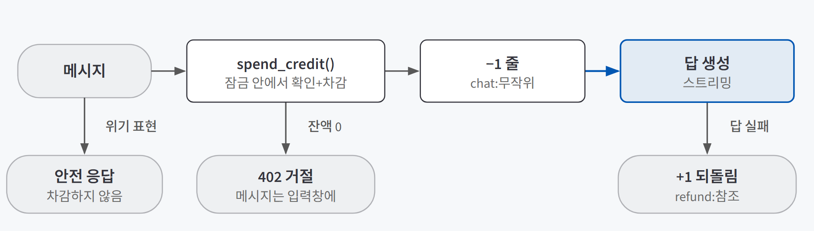
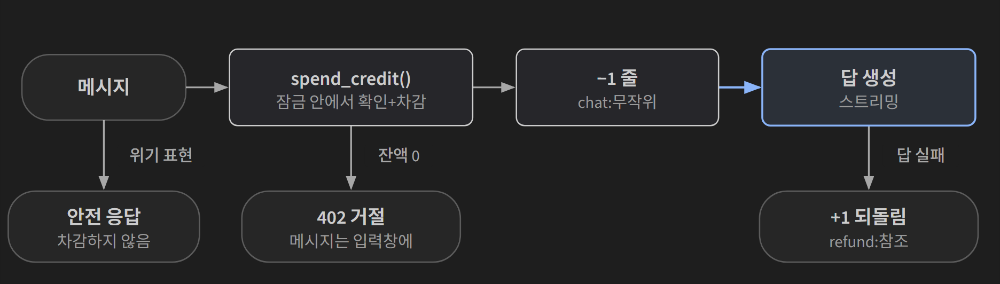

## 한 줄 소개

**"원가를 재고, 크레딧은 원장으로, 결제는 서버가 확인해 한 번만"이라는 설계가 실제 서비스에서도 통하는지 확인하려고, AI 친구 에이전트에 원가 측정·크레딧 원장·토스페이먼츠 테스트 결제를 하루 동안 커밋 3개로 붙여 검증했다.** 내 컴퓨터의 서버를 시험용 Supabase 프로젝트에 연결해 확인했고, 결제는 토스페이먼츠 문서에 공개된 테스트 키로 했다(실제 돈은 빠지지 않는다).

저장소: [beginner-driver/friend-agent](https://github.com/beginner-driver/friend-agent)

> **검증한 것:** 메시지 원가를 재서 가격 정하기 ✅ · 크레딧이 서버에서만 잔액만큼 빠지기 ✅ · 결제가 승인된 만큼 한 번만 충전되기 ✅
>
> **발견한 것:** 결제 키가 웹 서버 접속 기록에 남았다 · 결제창을 닫으면 주문이 대기로 남았다 · 게스트를 새로 만들면 무료 크레딧을 다시 받는다
{: .prompt-tip }

## 만든 이유

[메시지 한 건이 얼마인지부터 — 원가 계산과 크레딧 결제 설계](/posts/cost-credits-payment/)를 배우고 나서 세 가지가 궁금했다.

1. 이 서비스의 메시지 한 건은 **실제로 얼마**이고, 그 숫자로 가격을 정할 수 있을까?
2. 크레딧이 **서버에서만, 잔액만큼만** 빠질까? 동시에 요청을 몰아 보내도?
3. 결제가 **승인된 금액만큼 한 번만** 충전될까? 새로고침하거나 금액을 고쳐도?

AI 친구 에이전트는 이 질문을 시험하기에 맞았다.

| 필요한 조건 | 이 서비스에서는 |
|---|---|
| 메시지마다 실제 LLM 비용이 나간다 | 한 턴에 모델을 세 번 부른다(도구 선택, 답 만들기, 기억 정리) |
| 원가를 잴 기록이 있다 | 이틀 전 붙인 Langfuse에 production 트레이스가 쌓여 있었다 |
| 로그인 없이 쓸 수 있다 | 게스트(익명 로그인)로 바로 대화할 수 있어, 무료 크레딧 악용을 시험할 수 있다 |

## 실험 설계

### 메시지 한 건의 크레딧 흐름

{: .light }
{: .dark }

결제는 이론 글의 순서(주문 저장 → 결제 인증 → 서버의 금액·상태 확인 → 승인 → 원장 +크레딧)를 그대로 따랐다.

### 사용 기술

| 기술 | 어디에 썼나 |
|---|---|
| **Langfuse** | 메시지별 비용이 남은 트레이스를 읽기만 해서 원가를 냈다 |
| **Supabase (PostgreSQL)** | 크레딧 원장 `credit_ledger`와 주문 표 `orders`. 잔액 확인과 차감을 묶은 DB 함수 `spend_credit()` |
| **Toss Payments** | 결제위젯 v2와 결제 승인 API. 승인 요청에 주문번호를 멱등키로 보냈다 |
| **FastAPI** | `/api/credits`, `/api/products`, `/api/orders`, `/api/payments/confirm`, `/api/payments/fail` |
| **pytest** | 승인 API를 가짜로 바꿔 끼워 중복·위조 상황을 테스트로 남겼다 |

토스페이먼츠 코드는 공식 문서(`llms.txt`)를 근거로 만들었고, 상품 가격·무료 크레딧·차감 시점·위기 표현 예외는 직접 정했다.

### 판단 기준

| 질문 | 확인 방법 |
|---|---|
| 1. 원가와 가격 | Langfuse 트레이스 비용으로 평균·상위 10%·단계별·대화 앞뒤 원가를 내고, 같은 메시지 10개를 두 모델로 보내 비교 |
| 2. 서버에서만 잔액만큼 | 실제 Supabase에서 가입 +20, 메시지 −1, 잔액 0이면 402를 확인하고, 잔액 1인 게스트로 메시지 10개를 동시에 보냄 |
| 3. 승인된 만큼 한 번만 | 테스트 결제 뒤 주문 표·원장·서버 로그를 맞춰 보고, 새로고침·결제 취소를 직접 해 보고, 금액 변조·남의 주문은 테스트로 |

## 검증 결과

| 질문 | 결과 | 근거 |
|---|---|---|
| 1. 원가를 재서 가격 정하기 | ✅ | 평균 약 19원, 상위 10% 약 27원. 큰 모델은 2.4배 비싸고 나은 답은 10개 중 2개 → 모델 유지, 크레딧 1개 30~40원 |
| 2. 서버에서만 잔액만큼 빠지기 | ✅ | 실제 DB에서 +20 → −1 → 0이면 402. 동시 요청 10개 중 1개만 통과하고 원장에 −1은 한 줄 |
| 3. 승인된 만큼 한 번만 충전 | ✅ | 테스트 결제 2건이 주문 표·원장·로그 세 곳에서 일치. 새로고침에도 +100은 주문당 한 줄. 금액 변조·남의 주문은 승인 호출 0번 |

### 질문 1. 메시지 한 건은 얼마인가

production 환경의 최근 14일 트레이스 104건(모델 `claude-sonnet-5-5`)을 읽기만 해서 계산했다. 환율은 1,440원/$로 가정했다.

| 항목 | 달러 | 원 (≈) |
|---|---|---|
| 메시지 한 건 평균 | $0.0130 | 19원 |
| 비싼 쪽 상위 10% | $0.0185 | 27원 |
| 대화 첫 메시지 | $0.007~0.009 | 10~14원 |
| 열 번째 이후 메시지 | $0.015~0.018 | 21~26원 |

단계별 평균은 답 만들기 $0.0065, 도구 선택 $0.0046, 기억 정리 $0.0022였다. 도구 선택이 답 만들기와 비슷하게 비쌌다. 대화 뒤쪽이 두 배 가까이 비싼 것은 입력 토큰이 2.4~3.4천에서 5.6~6.0천으로 늘었기 때문이다. 하루 300개를 보내는 사용자는 한 달 원가가 약 20만 원이다.

큰 모델로 바꿀 가치가 있는지도 봤다. 인사·날씨·고민 상담·약속·앞 메시지 잇기를 섞은 같은 메시지 10개를 내 컴퓨터의 서버 두 대로 보냈다.

| 항목 | 지금 모델 (Sonnet) | 큰 모델 (Opus) |
|---|---|---|
| 메시지 한 건 평균 | 약 16원 | 약 38원 (2.4배) |
| 출력 토큰 평균 | 312 | 494 |
| 답이 눈에 띄게 나은 메시지 | 0~1개 | 2개 (고민 상담 맥락) |

단가 차이는 2배인데 큰 모델이 더 길게 답해서 비용은 2.4배가 됐다. 10개 중 2개가 나아진 것으로는 2.4배를 낼 근거가 약해서 모델은 유지했다.

이 원가로 가격을 정했다. 결제 수수료 3.74%를 더하면 크레딧 1개는 최소 28원은 받아야 비싼 쪽 메시지에서도 손해가 없다. 상품은 100개 4,000원(개당 40원), 300개 10,000원(33원), 600개 18,000원(30원)으로 두고, 무료 크레딧은 가입할 때 20개 한 번만 주기로 했다(사용자당 원가 약 400원). 하루마다 다시 주는 무료 한도는 두지 않았다.

### 질문 2. 크레딧이 서버에서만, 잔액만큼만 빠지는가

원장에는 참조를 유일하게 두고(`signup:사용자`, `chat:무작위`, `refund:…`, `order:주문번호`), 잔액 확인과 차감은 DB 함수 하나에서 사용자별 잠금을 걸고 처리했다. 메시지를 받자마자 차감하고, 답을 한 글자도 못 만들면 되돌리는 +1 줄을 쌓는다.

시험용 Supabase 프로젝트에서 직접 확인했다.

| 확인 | 결과 |
|---|---|
| 새 게스트 | 원장에 `signup +20`, 화면 "남은 크레딧 20개" |
| 메시지 1건 | `chat −1`, 잔액 19 |
| 잔액을 0으로 만든 뒤 전송 | 402로 거절, 정한 문구 표시, 보내려던 메시지는 입력창에 남음 |
| 거절된 요청 | 원장과 대화 기록에 아무것도 안 남음 |
| 브라우저용 키로 원장 조회 | 기록이 있어도 빈 목록. 함수도 부를 수 없음 |

동시 요청은 따로 시험했다. 가짜 LLM 서버(비용 0원)를 시험 프로젝트에 붙이고, 잔액을 1로 맞춘 게스트로 메시지 10개를 동시에 보냈다.

| 보낸 요청 | 통과 (200) | 거절 (402) | 원장의 −1 줄 | 최종 잔액 |
|---|---|---|---|---|
| 10개 동시 | 1 | 9 | 1 | 0 |

잠금 안에서 확인과 차감을 한 번에 하니 그 사이에 끼어들 틈이 없었다.

### 질문 3. 결제가 승인된 만큼 한 번만 충전되는가

팝업에서 100개(4,000원)를 골라 테스트 결제를 했다. 같은 사실이 세 곳에 맞게 남았다.

| 남은 곳 | 내용 |
|---|---|
| `orders` | 상태 `done`, 4,000원, 크레딧 100, 승인 시각 기록. 주문번호는 `ord_` + 무작위 32자 |
| `credit_ledger` | `+100 purchase`, 참조 `order:주문번호`. 잔액 19 → 119 |
| 서버 로그 | "결제 승인과 크레딧 지급" 한 번. 시크릿 키 없음 |

결제가 끝난 주소에서 새로고침을 두 번 더 했다. 성공 주소 요청은 두 번 더 왔지만 승인과 지급 로그는 새로 찍히지 않았고 `+100` 줄도 늘지 않았다. 이어서 한 번 더 결제한 주문까지 합쳐 원장의 `purchase` 줄은 주문당 하나씩 2줄, 잔액은 219였다.

브라우저로 만들기 어려운 상황은 승인 API를 가짜로 바꿔 끼운 테스트로 남겼다.

| 상황 | 결과 |
|---|---|
| 같은 승인 요청 두 번 | 둘 다 성공 응답, 크레딧 +100 한 번, 승인 호출도 한 번 |
| 주소의 금액을 바꾼 요청 | 400, 승인 호출 0번, 주문은 대기 그대로 |
| 다른 사용자의 주문번호 | 404, 승인 호출 0번 |
| 카드사 거절 | 크레딧 없이 주문 `failed` |
| 네트워크 일시 오류 | 502, 주문은 대기 유지, 다시 보내면 한 번만 지급 |
| 화면이 금액·크레딧을 보냄 | 무시하고 서버 상품표 값 사용 |

테스트가 정말 잡는지 보려고 금액 비교와 "이미 완료된 주문은 그대로 돌려주기"를 하나씩 일부러 끄고 돌렸다. 각각 해당 테스트가 실패했고, 코드는 원래대로 되돌렸다. 테스트는 기존 41개에서 크레딧 7개, 결제 10개를 더해 58개가 모두 통과했다.

## 직접 만들며 알게 된 것

### 결제 키가 우리 코드가 아닌 곳에서 새고 있었다

첫 테스트 결제 뒤 서버 로그를 검사하니 `paymentKey`가 한 줄 남아 있었다. 우리 코드의 로그가 아니라 웹 서버(uvicorn)가 기본으로 남기는 **접속 기록**이었다. 토스가 결제 뒤 `/?pay=success&…&paymentKey=…` 주소로 돌려보내면, 그 주소 전체가 그대로 찍혔다. 시크릿 키 없이는 이 값만으로 승인·취소를 할 수 없어 위험도는 낮았지만, 접속 기록의 주소에서 `paymentKey` 값만 가리는 필터를 넣고 테스트로 남겼다.

### 결제창을 닫으면 실패 주소로 돌아오지 않았다

결제를 취소하면 실패 주소(`/?pay=fail`)로 돌아온다고 생각했는데, 결제창을 닫으니 토스는 아무 데로도 보내지 않았고 화면의 결제 요청만 오류로 끝났다. 크레딧은 늘지 않았지만 주문이 **대기 상태로 남았다.** 화면이 이때 `/api/payments/fail`을 불러 내 대기 주문만 실패로 바꾸게 고쳤고, 다시 닫아 보니 주문이 `failed`(`USER_CANCEL`)로 기록됐다. 남의 주문이나 완료된 주문은 바꾸지 못하는 것도 테스트로 남겼다.

## 검증 범위와 한계

| 구분 | 내용 |
|---|---|
| **게스트 반복 수령** | 게스트를 새로 5명 만들자 5명 모두 무료 20개를 받았다. 로그인 없이 만들 수 있어 이 구조로는 못 막는다. 구글 계정 연결 뒤 지급 같은 대책은 정하지 않았다 |
| **결제 환경** | 문서용 테스트 키라 가상 승인이다. 내 상점 키, 실제 결제, staging·production 배포는 하지 않았다 |
| **원가 숫자** | 환율 1,440원/$ 가정. 모델 비교는 메시지 10개를 눈으로 읽은 것이라 평가 데이터셋으로 잰 것은 아니다 |
| **차감 범위** | `/api/chat`만 차감한다. 먼저 말 걸기(`/api/greeting`)는 모델을 부르지만 차감하지 않는다 |
| **아직 정하지 않은 것** | 환불 기준, 크레딧 유효기간, 오래된 대기 주문 정리, PG 기록과 주문 표를 맞춰 보는 대사 작업 |

## 결론

세 질문 모두 확인했다. 원가를 재서 가격의 바닥을 정했고, 크레딧은 동시 요청 10개 중 1개만 통과할 만큼 서버에서 잔액만큼만 빠졌고, 결제는 새로고침과 금액 변조에도 승인된 만큼 한 번만 들어갔다.

가장 크게 남은 것은 **"돈이 새는 곳은 설계도 밖에 있다"**는 점이다. 원장과 세 겹의 중복 방지는 설계대로 동작했지만, 결제 키는 웹 서버의 접속 기록에서, 대기 주문은 결제창을 닫는 동작에서, 무료 크레딧은 게스트를 새로 만드는 동작에서 샜다. 셋 다 테스트 결제를 직접 해 보고 로그와 DB를 맞춰 본 뒤에야 보였다.
