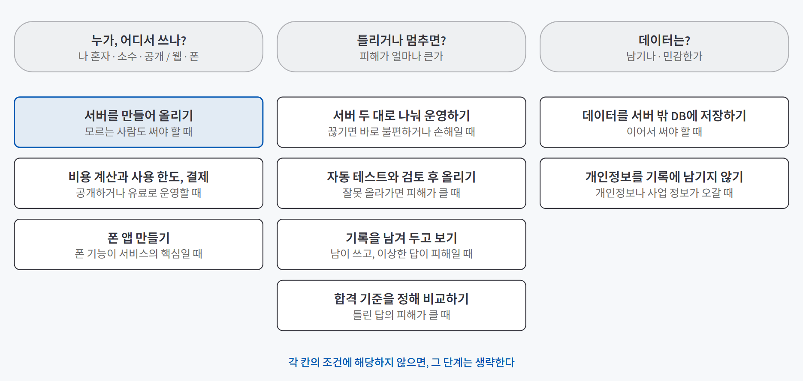
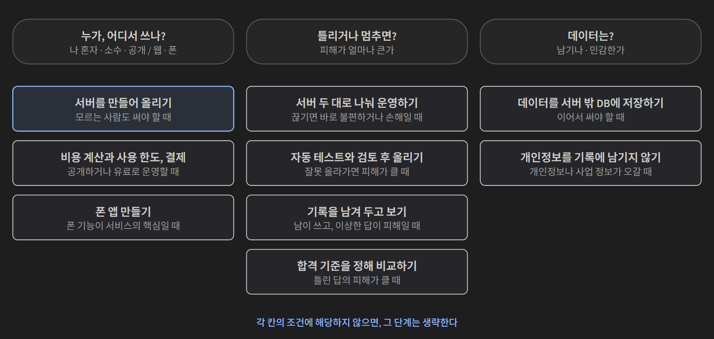
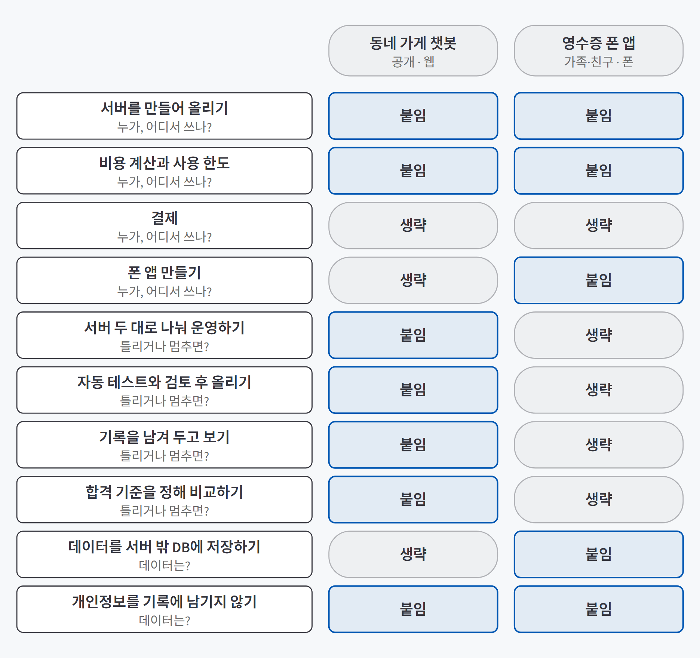
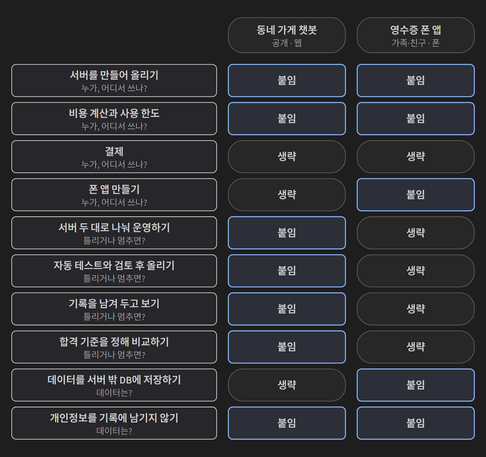

## 한 줄 요약

**AI 서비스 운영 단계는 모두 붙일 수 있지만, 모두 필요하지는 않다.** 어디까지 붙일지는 서비스 특성 세 가지가 정한다. **누가·어디서 쓰는가, 틀리거나 멈추면 피해가 얼마나 큰가, 데이터를 남기는가**다. 세 질문에 답하면 붙일 단계와 생략할 단계가 이유와 함께 나온다.

## 필요한 이유

AI 친구 에이전트를 새 버전으로 바꾸자 방금 저장한 약속이 사라졌다. 약속을 서버 메모리에만 저장했기 때문이고, DB로 옮기자 서버를 바꿔도 약속이 남았다([무중단 배포](/posts/zero-downtime-deploy/)에서 다룬 무상태 서버다). 이런 일을 겪고 나면 서비스 올리기, 자동 테스트, 무중단 배포, 기록 확인, 품질 평가, 결제, 앱 만들기까지 전부 붙이고 싶어진다.

**단계를 붙일 때마다 운영 부담이 같이 붙는다.** 반대로 하나도 안 붙이면 사고가 사용자에게 먼저 간다.

| 전부 붙이면 | 하나도 안 붙이면 |
|---|---|
| 혼자 쓰는 도구에 CI와 무중단 배포를 운영하느라 정작 기능을 못 고친다 | 공개한 서비스가 멈추거나, 틀린 답과 개인정보가 그대로 나간다 |

무엇을 만들지, 어떤 채널로 내놓을지는 [AI 기능을 서비스로 설계하기](/posts/ai-feature-to-service/)에서 PRD 한 장으로 정리했다. 이 글은 그다음 질문, **만든 서비스에 어떤 운영 단계를 붙일지**를 다룬다.

## 개념과 동작

### 서비스 특성 세 가지

| 질문 | 선택지 | 왜 중요한가 |
|---|---|---|
| **누가, 어디서 쓰나?** | 나 혼자 / 아는 소수 / 모르는 사람까지 공개, 웹 / 폰 | 공개할수록 로그인·사용 한도·안정적인 운영이 필요하고, 폰에서 쓰면 앱이 필요하다 |
| **틀리거나 멈추면 피해가 얼마나 큰가?** | 다시 하면 됨 / 불편함 / 손해나 신뢰 문제 | 피해가 클수록 점검과 대비가 필요하다 |
| **데이터를 남겨야 하나, 민감한가?** | 한 번 쓰고 끝 / 이어서 써야 함 / 개인정보나 사업 정보가 들어감 | 남길수록 서버 밖 저장소와 보관 규칙이 필요하다 |

세 질문에 답하고, 질문별 묶음에서 해당하는 단계를 찾아 붙일 것과 생략할 것을 정한다. 서비스가 커지면 같은 질문에 다시 답한다.

### 질문별로 붙일 것 고르기

단계마다 "없으면 생기는 일", "꼭 필요한 때", "생략해도 되는 때"를 적었다. **"겪은 일"로 시작하는 칸은 AI 친구 에이전트에서 직접 겪은 것**이고, 나머지는 일반적으로 생기는 일이다.

{: .light }
{: .dark }

#### 누가, 어디서 쓰나

| 단계 | 없으면 생기는 일 | 꼭 필요한 때 | 생략해도 되는 때 |
|---|---|---|---|
| [서버를 만들어 인터넷에 올리기](/posts/cloud-run-deploy/) | 내 컴퓨터를 켜 둘 때만 쓸 수 있다 | 모르는 사람이나 계정 없는 사람도 써야 할 때, 기능이 서버를 필요로 할 때(예: 사진 속 글자 읽기) | 나 혼자나 아는 소수가 이미 있는 도구(GPTs, Claude 프로젝트, 슬랙 봇)로 쓸 때 |
| [비용 계산과 사용 한도, 결제](/posts/cost-credits-payment/) | **겪은 일:** 메시지 한 건에 약 19원이 들었다([검증 글](/posts/friend-agent-credits/)). 한도가 없으면 쓸수록 늘어나기만 한다 | 모르는 사람에게 공개하거나 유료로 운영할 때 | 나 혼자나 아는 소수가 쓸 때(월 한도만 확인) |
| 폰 앱 만들기 | 폰 카메라 같은 기능을 쓸 수 없다 | 카메라나 알림 같은 폰 기능이 서비스의 핵심일 때 | 웹으로 충분할 때 |

**첫 행을 가장 먼저 따진다.** 여기서 생략하면 다른 묶음의 단계 대부분이 사라진다.

#### 틀리거나 멈추면 피해가 얼마나 큰가

| 단계 | 없으면 생기는 일 | 꼭 필요한 때 | 생략해도 되는 때 |
|---|---|---|---|
| [서버 두 대로 나눠 운영하기](/posts/zero-downtime-deploy/) | **겪은 일:** 서버 한 대가 꺼지자 요청 127건 중 17건이 실패했다 | 끊기면 사용자가 바로 불편하거나 손해를 볼 때 | 잠깐 멈춰도 괜찮고 다시 하면 되는 서비스 |
| [자동 테스트와 검토 후 올리기](/posts/cicd-docker/) | **겪은 일:** 일부러 넣은 시간대 버그가 자동 테스트에서 걸렸다. 테스트가 없으면 이런 버그는 사용자가 먼저 발견한다 | 잘못 올라가면 피해가 클 때, 여러 명이 자주 고칠 때 | 나 혼자 가끔 고치고 피해가 작을 때 |
| [기록을 남겨 두고 보기](/posts/langfuse-observability/) | **겪은 일:** 서버에 올렸더니 채팅 8건 중 4건이 Langfuse에 도착하지 않았고 오류는 없었다 | 남이 쓰는 서비스, 이상한 답이 피해가 될 때 | 만들면서 내가 직접 보는 시험 단계 |
| [합격 기준을 정해 비교하기](/posts/langfuse-quality/) | **겪은 일:** AI가 확인한 것을 스스로 뒤집는 문제가 대화 253개 중 49건 있었다. 고친 뒤 나아졌는지 기준으로 확인했다 | 틀린 답의 피해가 클 때 | 가벼운 잡담, 틀려도 바로 알아채는 서비스 |

표에서 설명이 더 필요한 세 곳이다.

**서버 두 대로 나눠 운영하기.** 서버 두 대에 요청을 나눠 보내다 한 대를 껐다. 꺼진 서버에 연결하려고 기다리는 시간(연결 대기 시간, `proxy_connect_timeout`)의 기본값이 60초라서, 그동안 그 서버 차례였던 요청이 같이 막혔다. 기본값에서는 127건 중 17건이 실패했고, 1초로 줄이자 270건 중 0건이 실패했다. **서버를 두 대 두는 것만으로는 부족하고, 고장을 알아채는 시간도 정해야 한다.**

**기록을 남겨 두고 보기.** 첫 계측을 staging에 올리고 채팅 8건을 보냈더니 4건이 도착하지 않았다. 서버는 모두 200이었고 오류 로그도 없었다. 원인은 Cloud Run이 요청에 붙이는 `traceparent` 헤더가 "표본 아님"(`sampled=0`)이면 그 하위 기록이 오류 없이 버려지는 것이었다. 내 컴퓨터에는 이 헤더가 없어 하나도 빠지지 않았다. 자세한 과정은 [검증 글](/posts/langfuse-friend-agent/)에 있다. **올린 뒤에는 보낸 요청 수와 기록된 수를 비교한다.**

**합격 기준을 정해 비교하기.** AI에게 안내 한 줄("앞에서 말한 날씨·날짜·약속은 도구로 확인한 것이니 정정하지 않는다")을 추가하자, 질문 12개를 3번씩 시험한 36번 중 말을 뒤집은 횟수가 13번에서 0번으로 줄었다. 다만 합격 기준 하나는 끝내 못 맞췄다. "입력 토큰이 3% 넘게 늘면 안 된다"의 3%를 시험용 입력(755토큰)으로 계산했는데, 실제 서비스 입력은 평균 2,048토큰이었다. 기준을 실제에 맞게 바꾸고 문구를 줄여도 13토큰이 넘었고, 못 맞췄다고 보고서에 적었다. **기준은 정하기 전에 그 대상이 실제로 얼마인지부터 잰다.**

#### 데이터를 남겨야 하나, 민감한가

| 단계 | 없으면 생기는 일 | 꼭 필요한 때 | 생략해도 되는 때 |
|---|---|---|---|
| 데이터를 서버 밖 DB에 저장하기 | **겪은 일:** 새 버전으로 바꾸자 방금 저장한 약속이 사라졌다 | 대화나 기록을 이어서 써야 할 때 | 한 번 쓰고 끝나는 대화 |
| 개인정보를 기록에 남기지 않기 | 대화에 든 개인정보가 기록에 그대로 남고, 기록 도구로 전달된다 | 개인정보나 사업 정보가 오갈 때 | 공개된 정보만 다룰 때 |

### 적용 예시 두 개

세 질문에 답하고, 묶음에서 붙일 것과 뺄 것을 골랐다.

| 항목 | 동네 가게 손님이 쓰는 문의 챗봇 | 영수증을 찍어 정리하는 폰 앱 |
|---|---|---|
| 누가, 어디서 쓰나 | 모르는 손님까지 공개, 웹 | 가족과 친구 몇 명, 폰 |
| 틀리거나 멈추면 | 멈추면 손님이 바로 불편하고, 틀린 가격이나 메뉴는 불만으로 이어짐 | 글자를 잘못 읽어도 다시 찍으면 됨 |
| 데이터 | 한 번 문의하고 끝나지만 연락처 같은 개인정보가 들어올 수 있음 | 정리한 결과를 이어서 봐야 하고, 영수증은 개인정보 |
| **붙일 것** | 서버 올리기(Cloud Run), 비용 계산과 사용 한도, 서버 두 대 운영, 자동 테스트, 기록 남기기, 합격 기준 비교(지어낸 가격·메뉴 점검), 개인정보를 기록에 남기지 않기 | 폰 앱(Expo), 서버 올리기(사진 속 글자 읽기용), DB 저장, 개인정보를 기록에 남기지 않기, 비용 계산, 출시 전 점검(개인정보 처리방침, 데이터 삭제 기능) |
| **생략할 것** | DB 저장, 폰 앱, 결제 | 서버 두 대 운영, 자동 테스트, 기록 남기기, 합격 기준 비교, 결제 |

같은 질문으로 물어도 결과가 다르다. **영수증 앱은 쓰는 사람이 적은데도 서버가 필요하다.** 사진 속 글자를 읽는 기능(OCR)이 서버에서 돌아가기 때문이다. 이 표는 서비스의 성격을 보고 내린 판단이고, 실제로 만들어서 확인한 결과는 아니다. 같은 단계를 두 서비스에 나란히 놓으면 아래 그림과 같다.

{: .light }
{: .dark }

## 적합한 경우와 피할 경우

| 이 기준이 맞는 경우 | 맞지 않는 경우 |
|---|---|
| 만들 서비스를 어디까지 운영할지 정해야 할 때 | 이미 운영 중이라 사고가 난 단계를 고치는 중일 때 (해당 단계 글로 간다) |
| 혼자·소수가 쓰던 서비스를 공개로 넘길 때 | 규정이 운영 단계를 이미 정해 둔 조직 |
| 코딩 에이전트에게 어디까지 만들지 근거와 함께 알려 줘야 할 때 | 한 번 쓰고 버릴 스크립트 |

## 장점과 한계

| 장점 | 한계 |
|---|---|
| 필요 없는 단계에 시간을 쓰지 않는다 | 판단표는 한 서비스에서 겪은 일과 학습 내용으로 만들었다. 서비스마다 맞는지는 만들어 봐야 안다 |
| 생략한 이유가 적혀 있어 서비스가 커질 때 다시 판단할 수 있다 | 세 질문으로 안 잡히는 기능 요구가 있다(OCR이 서버를 요구하는 경우) |
| 코딩 에이전트에게 붙일 것과 뺄 것을 이유와 함께 줄 수 있다 | 적용 예시 두 개는 설계 판단이고 만들어 확인하지 않았다 |

## 적용 방법

1. **세 문장을 채운다.**

   | 문장 | 채울 말 |
   |---|---|
   | 이 서비스는 ( )이 ( )에서 쓴다. | 나 혼자 / 아는 소수 / 모르는 사람까지, 웹 / 폰 |
   | 틀리거나 멈추면 ( ) 피해가 있다. | 없음 / 불편함 / 손해나 신뢰 문제 |
   | 데이터는 ( ). | 남기지 않는다 / 이어서 쓴다 / 개인정보가 들어간다 |

2. **해당 묶음에서 "꼭 필요한 때"에 걸리는 단계를 붙일 것으로 적는다.**
3. **"생략해도 되는 때"에 걸리는 단계는 생략하고, 이유를 한 줄 적는다.**
4. **기능이 요구하는 것을 따로 점검한다.** 사진 속 글자 읽기가 서버를 요구하는 것처럼, 질문 답과 무관하게 붙여야 하는 단계가 있다.
5. **쓰는 사람이 늘거나 데이터가 바뀌면 1번부터 다시 한다.**

## 다른 방법과 비교

| 방법 | 드는 비용 | 한 줄 평가 |
|---|---|---|
| 단계를 전부 붙이기 | 큼 | 혼자 쓰는 도구에도 운영 부담이 생긴다 |
| 사고가 나면 그때 붙이기 | 작음 | 공개 서비스는 사고가 사용자에게 먼저 드러난다. 약속이 사라진 일도, 기록이 빠진 일도 쓰고 나서야 알았다 |
| **세 질문으로 고르기** | 보통 | 이유와 함께 고르고, 서비스가 커질 때 같은 질문으로 다시 판단한다 |

## 주의할 점

- **생략은 영원하지 않다.** 쓰는 사람이 늘거나 다루는 데이터가 바뀌면 같은 세 질문에 다시 답한다.
- **기능이 서버를 요구하면 질문 답과 상관없이 붙인다.**
- **"겪은 일"이 없는 칸은 일반적인 설명이다.** 내 서비스에서 같은 일이 생긴다고 단정하지 않는다.
